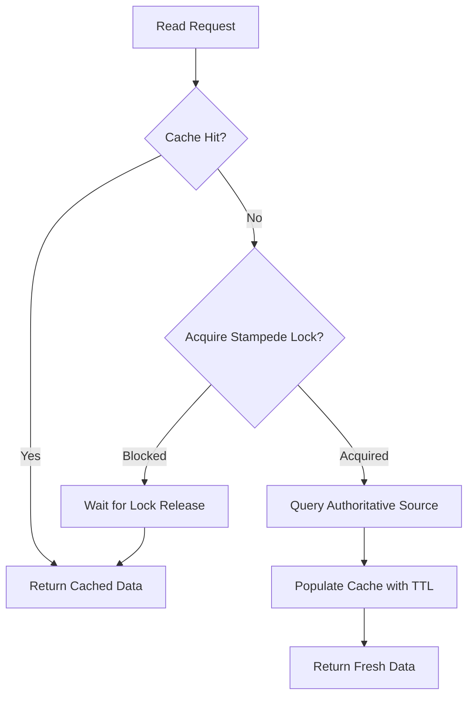
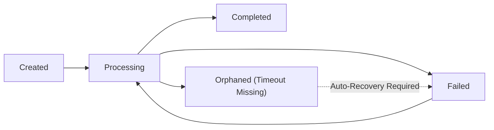
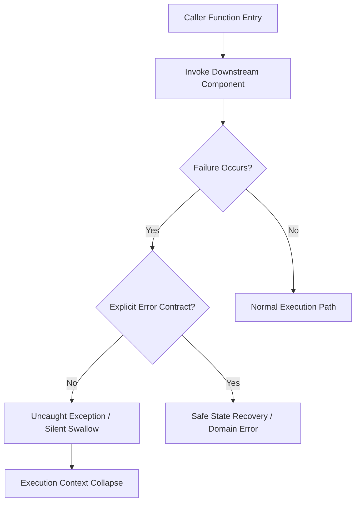
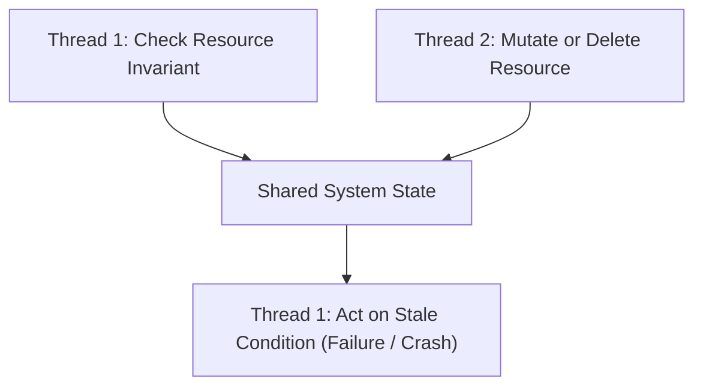
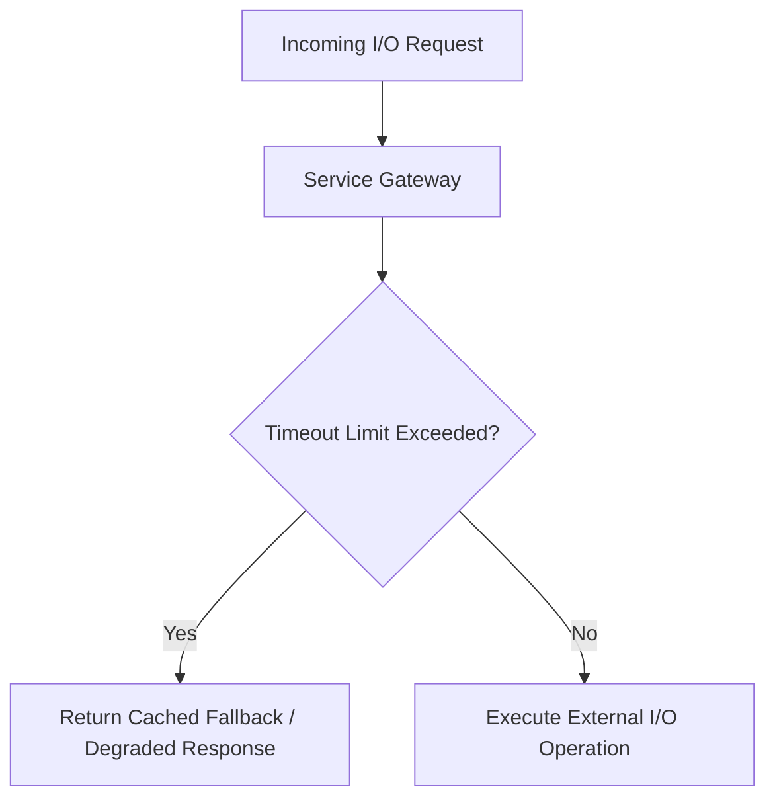
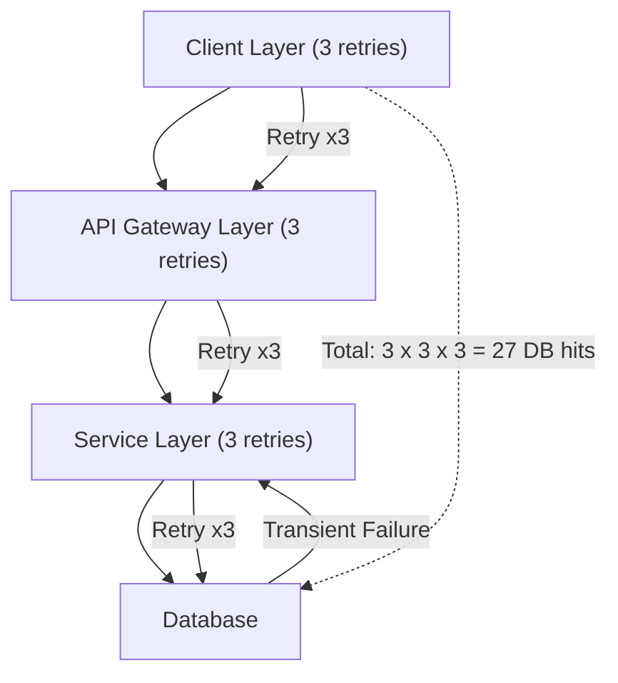

# Language-Agnostic Points of Failure Identification

In software engineering, identifying failure points independently of programming languages requires analyzing the structural, logical, and environmental mechanics of how software executes. Because language paradigms map to common abstract models such as the Control Flow Graph, memory state machine, or execution call stack, we establish deterministic language-agnostic principles. This document defines actionable inspection rules for failure point identification, bug detection, static code auditing, and system resilience validation across all software layers including frontend web and mobile applications, backend microservices, data pipelines, and embedded systems.

## Purpose

The primary purpose of this topic standard is to equip engineers and automated review agents with a language-agnostic diagnostic framework. Applying these principles reveals latent bugs, runtime instabilities, resource leaks, race conditions, edge case failures, and scalability bottlenecks across any software codebase or execution layer.

## Activation Triggers

**Auditing for Bug Detection and Static Analysis**
Activate this document when scanning a codebase for latent defects, conducting resilience reviews, or performing language-agnostic static code analysis across frontend, backend, or full-stack architectures.

**Post-Mortem Analysis and System Incident Reviews**
Activate this document during post-mortems following unexpected production failures or performance degradation incidents to discover root causes.

**Designing and Refactoring Critical Components**
Activate this document when authoring or refactoring core algorithms, interactive UI views, data processing pipelines, concurrency managers, resource handlers, or service boundaries.

## Core Failure Point Principles and Actionable Inspection Rules

**Boundary and Domain Validation: Equivalence Partitioning and Boundary Value Analysis**
Software tends to fail at the boundaries of its input and state ranges rather than inside the middle of those ranges. Inspect every conditional threshold such as `<`, `>`, `<=`, or `>=` and evaluate behavior at $N-1$, $N$, and $N+1$ to eliminate off-by-one errors. Inspect arithmetic operations for potential overflow, underflow, or precision loss, ensuring floating-point comparisons use an epsilon threshold $\epsilon$ rather than strict equality. Trace all parameters, collections, and return values across four fundamental states: null or undefined, empty zero-length, single element, and maximum capacity.

$$\text{Floating Point Comparison Error} = |x - y| < \epsilon$$

```text
FUNCTION CompareWithEpsilon(a, b, epsilon):
    RETURN AbsoluteValue(a - b) < epsilon
END FUNCTION
```

**Boundary and Domain Validation: Input Sanity and Invariant Preservation**
Programs fail when internal invariants assume properties about inputs that external actors did not guarantee. Functions must enforce preconditions such as valid ranges, correct types, non-null values, and domain rules at the entry boundary before mutating state. Never leak internal invariants directly to external API callers or UI components; normalize and sanitize inputs immediately upon ingestion.

**Dynamic Execution and State: Non-Local Control Flow and Failure Propagation**
Unhandled exceptions or improperly handled error codes propagate up the call stack, collapsing execution contexts when intermediate layers lack failure handling. Audit every function call for failure modes, enforcing that functions either handle downstream errors completely or translate them into explicit domain-specific error contracts. Eliminate catch-all blocks that silently swallow exceptions without logging or recovering state. Audit conditional fallbacks to guarantee the program defaults to a fail-safe state, such as read-only mode or safe termination, rather than an indeterminate state.

**Dynamic Execution and State: State Determinism, Mutation Scope, and Closure Safety**
A failure point occurs whenever system state depends on non-deterministic factors, global shared state, or stale scope closures. Locate global variables, singletons, or shared mutable pointers and encapsulate them in local scopes or immutable data structures. In interactive user interfaces and reactive state stores, desynchronization occurs when derived state is manually duplicated rather than recomputed dynamically, or when asynchronous callbacks capture stale variable closures. Inspect reactive state dependencies to ensure derived values recompute automatically, and verify that asynchronous event handlers reference current state wrappers rather than stale captured scope variables. Eliminate temporal coupling by refactoring sequence-dependent methods so that dependencies are explicitly required during object creation or factory initialization, rendering invalid uninitialized states physically impossible.

**Resource and Environmental Lifecycle: Deterministic Resource Lifecycle**
Any operation acquiring a finite external resource such as file descriptors, sockets, database connections, memory blocks, hardware handles, or UI event listeners introduces a point of failure if cleanup relies on manual release paths. Inspect resource allocations to ensure symmetric cleanup logic is bound directly to the scope lifecycle using constructs such as destructors, try-with-resources blocks, or explicit component unmount handlers. Verify that early returns, thrown exceptions, or branch short-circuits do not bypass resource release steps.

**Resource and Environmental Lifecycle: Timeouts, Fallbacks, Degradation, and Platform Permissions**
Operations interacting with networks, disk I/O, external processes, or platform capabilities will eventually stall, fail, or be rejected. Unbounded waiting starves execution threads and drains system memory. Inspect every external I/O call to enforce explicit timeout durations for connect, read, and write operations. Ensure applications handle I/O timeouts via cached fallbacks or degraded responses rather than cascading failures up the architecture. Platform capability requests such as Geolocation, Storage quotas, Camera access, Notifications, Clipboard, or hardware sensors can be denied, revoked, or unsupported by the host environment. Inspect platform capability access to ensure permission queries check authorization states before invocation, and verify that permission rejections degrade gracefully to non-privileged fallback paths without crashing execution.

```text
FUNCTION ExecuteWithTimeout(ioOperation, timeoutDuration):
    timer = StartTimer(timeoutDuration)
    TRY:
        result = ioOperation.Execute(cancelSignal = timer.Signal)
        RETURN result
    FINALLY:
        timer.Cancel()
END FUNCTION
```

**Algorithmic Efficiency and Scalability: Complexity Bounds Analysis**
Algorithms optimized for small datasets frequently degrade exponentially under real-world volumes. Scan nested iterations and collection operations for hidden linear lookup calls inside loops, such as evaluating collection containment within an outer iteration.

$$\text{Nested Iteration Complexity} = \sum_{i=1}^{N} \sum_{j=1}^{M} O(1) = O(N \times M)$$

Identify unbounded growth vectors where in-memory collections grow continuously inside long-running processes without pagination or eviction.

**Algorithmic Efficiency and Scalability: Memory Allocation and Cache Locality**
Allocation overhead and memory fragmentation degrade operational throughput. Locate objects, strings, or buffers created repeatedly inside high-frequency loops and relocate allocations outside the loop or reuse pre-allocated pools. Defer expensive computations or network and disk reads using lazy evaluation until results are explicitly required by execution flow.

**Algorithmic Efficiency and Scalability: Recursive and Deep Call Stack Exhaustion**
Every runtime has a finite call stack. Unbounded recursion or deeply nested callback chains crash the process with a stack overflow error that is often unrecoverable and produces no meaningful diagnostic output. Inspect recursive functions for guaranteed base-case convergence and enforce maximum recursion depth bounds. Audit mutual recursion cycles where function A calls function B and function B calls function A to verify termination guarantees under all input domains. Refactor deeply nested callback or promise chains to iterative patterns or explicit stack management when nesting depth is determined by data volume rather than by fixed program structure.

**Concurrency and Synchronization: Atomicity and Mutex Granularity**
Multi-threaded or asynchronous contexts fail when compound read-modify-write actions are not executed atomically. Scan for check-then-act flaws where code checks a condition and acts upon it without locking state across both operations. To prevent deadlocks when locking multiple resources, verify that locks are always acquired in a fixed, globally defined order across all execution paths.

**Concurrency and Synchronization: Re-Entrancy, UI Rendering Races, and Hydration Alignment**
Execution interrupted by asynchronous callbacks, interrupts, UI re-renders, or parallel threads must leave shared state in a consistent condition. Ensure internal state invariants are fully updated before yielding control to external function calls, promises, or asynchronous invocations. In UI frameworks and server-rendered client applications, asynchronous rendering, DOM mutation races, and server-side rendering hydration desynchronization occur when server-rendered markup diverges from client state during initial mounting. Inspect rendering lifecycle hooks to ensure initial render state matches server-generated markup, and verify that concurrent asynchronous UI updates do not mutate shared DOM trees out of order.

**Serialization and Data Transformation: Schema Drift and Type Coercion**
Boundary transitions between data layers fail when assumptions about type precision or field existence drift over time. Inspect parsing logic for integer truncation or lossy coercion, ensuring strings are parsed with explicit radix enforcement. Ensure parsers handle extra or unknown fields gracefully without crashing or dropping critical state.

**Serialization and Data Transformation: Unvalidated Deserialization and Reference Mutability**
Ingesting serialized JSON, XML, or binary payloads directly into executable domain objects without schema validation creates execution vulnerabilities and class-cast errors. Validate payloads against strict structural schemas before instantiation. Passing object references without deep copying allows external scopes to mutate internal state unexpectedly; verify that methods returning or accepting mutable structures return defensive deep copies.

**Security and Trust Boundaries: Untrusted Input Execution, Access Control, and Client Security Policies**
Dynamic evaluation or construction of commands, queries, paths, or HTML markup using raw user input allows malicious control flow hijacking or cross-site script injection. Eliminate string concatenation in database queries, system command calls, file path resolutions, or dynamic HTML rendering by mandating parameterized APIs, strict sanitization, and context-aware escaping. Verify that authorization checks occur at every public service boundary, independent of UI state. Enforce idempotency keys on retryable operations to prevent duplicate state mutations under network retries. Host security policies such as Content Security Policy, Cross-Origin Resource Sharing, or sandboxed iframe restrictions block unauthorized script execution, network requests, or frame embedding. Inspect application resource declarations to ensure external scripts, stylesheets, workers, and network origins are explicitly permitted by security headers, preventing silent execution blocking at runtime.

**Security and Trust Boundaries: Information Disclosure in Diagnostic Paths**
Exposing raw stack traces, database schemas, or internal secrets in user-facing error outputs aids adversarial analysis. Ensure error responses returned to external consumers map to generic sanitized messages while full diagnostic context is routed strictly to secure telemetry logs.

**Security and Trust Boundaries: Privilege Escalation and Least-Privilege Violations**
A compromised or misbehaving service with excessive permissions converts a minor vulnerability into a full system compromise. Verify that service processes run with the minimum operating-system-level permissions required for their function. Inspect database connection credentials for overly broad privilege grants; routine application queries should never use administrative or DDL-capable credentials. Audit API token and OAuth scope assignments for least-privilege adherence, ensuring tokens carry only the scopes required by the specific integration rather than broad administrative access.

**Distributed Systems and Event-Driven Reliability: Out-of-Order Messages and Queue Saturation**
In asynchronous event streams, messages may arrive out of order, delayed, or duplicated. Verify that event handlers store idempotency markers or compare sequence timestamps before applying state mutations. Unbounded in-memory queues saturate process memory when producers outpace consumers; enforce maximum queue capacities with explicit backpressure policies when limits are reached.

$$\text{Buffer Backpressure Policy} = \text{IF } Q_{\text{current}} \ge Q_{\text{max}} \text{ THEN Block Producer}$$

**Distributed Systems and Event-Driven Reliability: Retry Storms and Exponential Backoff**
Unbounded retries without backoff amplify downstream load during partial outages, converting a single service degradation into a full system collapse. Fixed-interval retries without jitter synchronize all clients into periodic bursts that overwhelm recovering services. Verify that every retry loop enforces a maximum retry count and exponential backoff with random jitter. Confirm that retries are only triggered for transient failure codes; non-retryable errors such as validation failures or authorization denials must short-circuit immediately. Inspect for retry amplification in layered architectures where each layer independently retries, compounding total attempts exponentially across the call chain.

$$\text{Backoff Delay}_k = \min\left(\text{Base} \times 2^k + \text{Jitter}(0, \delta), \text{MaxDelay}\right)$$

```text
FUNCTION RetryWithBackoff(operation, maxAttempts, baseDelay):
    FOR attempt FROM 0 TO maxAttempts - 1:
        TRY:
            RETURN operation.Execute()
        CATCH error:
            IF NOT IsTransient(error) OR attempt == maxAttempts - 1:
                RAISE error
            jitter = RandomFloat(0.0, baseDelay)
            delay = Minimum(baseDelay * Power(2, attempt) + jitter, MaxDelay)
            Sleep(delay)
    END FOR
END FUNCTION
```

**System Lifecycle and Multi-Resource Atomicity: Partial Execution and Startup Validation**
Operations modifying multiple independent data stores leave the system in an inconsistent state if an intermediate step fails without rollback. Operations spanning multiple resources must implement transactional rollback or explicit compensating actions to restore consistency upon partial failure. Failure to validate required environment variables or configuration properties at startup leads to latent runtime crashes; enforce strict startup schema validation for all mandatory configuration settings.

**System Lifecycle and Multi-Resource Atomicity: Graceful Shutdown and Process Lifecycle**
Modern deployments in containerized environments or interactive application runtimes regularly terminate processes through signals or lifecycle events. A process that does not intercept shutdown signals loses in-flight work, corrupts partially-written state, or leaves downstream consumers with abandoned connections. Verify that the application registers signal handlers for graceful termination and drains active connections or work queues before exiting. Inspect background job processors for incomplete work persistence to ensure partially-processed items are returned to the queue or checkpointed before shutdown. Audit health-check and readiness-probe endpoints to confirm they reflect actual application state rather than static success responses that mask an unhealthy process.

```text
FUNCTION RegisterShutdownHandler(serviceProcess, activeRequests):
    ON_SIGNAL("TERMINATE"):
        serviceProcess.StopAcceptingNewWork()
        AwaitCompletion(activeRequests)
        FlushPendingState()
        ExitProcess(0)
END FUNCTION
```

**Logging, Observability, and Diagnostic Telemetry Failures**
Logging is a cross-cutting runtime concern that touches every execution path. Absent, malformed, or excessive logging causes cascading operational failures: silent production incidents with no trace, disk saturation from unbounded log volume, sensitive data leaking into log aggregators, or structured-logging schema violations that break downstream monitoring pipelines. Verify every error-handling branch emits at least one structured log event with correlation identifiers such as request IDs or trace spans. Enforce log-level granularity so that errors are never logged at informational level and debug-only payloads do not appear in production configurations. Inspect log serialization paths for PII or secret leakage where sensitive fields are inadvertently included in structured log output. Validate that log sinks enforce rotation, size caps, or external drain policies to prevent disk exhaustion on the host.

**Caching Coherence and Stale Data Failures**
Every caching layer is a point of failure because it decouples read recency from write authority. A missing time-to-live policy, absent invalidation hook, or lack of stampede protection converts a performance optimization into a correctness and availability defect. Verify every cache entry has an explicit TTL or invalidation trigger tied to the authoritative data source. Inspect for cache stampede vectors where concurrent cache misses trigger duplicate expensive recomputations or database queries simultaneously. Audit write paths for consistency model alignment: confirm whether the system uses write-through, write-behind, or write-around caching, and verify that stale reads are acceptable for the specific business domain consuming the cached data.



**Configuration Drift and Feature Flag State Explosion**
Feature flags and runtime configuration introduce combinatorial state explosion. Every unmanaged flag doubles the effective number of execution paths the system can traverse, creating untested branch combinations that harbor latent defects. Verify that every feature flag has an explicit owner, expiration date, and removal plan documented alongside its definition. Inspect for configuration values consumed at runtime without schema validation or type enforcement, ensuring that a misconfigured string or missing numeric value cannot silently alter execution behavior. Audit for environment parity violations where configuration diverges between development, staging, and production in ways that mask failures until deployment.

$$\text{Combinatorial Path Explosion} = 2^{F} \text{ where } F = \text{number of active boolean flags}$$

**Data Integrity, Encoding, and Character Set Failures**
Encoding mismatches are among the most insidious production failures because they corrupt data silently and manifest far downstream from the point of origin. UTF-8 versus Latin-1 mismatches cause mojibake, byte-order mark corruption breaks parser initialization, and surrogate pair truncation silently destroys Unicode characters outside the Basic Multilingual Plane. Verify that all I/O boundaries including file reads, HTTP responses, and database queries specify explicit character encoding rather than relying on platform defaults. Inspect string operations such as comparison, sorting, and case conversion for locale-sensitivity hazards, especially in systems operating across multiple geographic regions where locale-dependent collation produces inconsistent ordering. Audit data transfer pipelines for integrity verification through checksums or cryptographic hashes at ingestion boundaries to detect corruption introduced during transit.

**Date, Time, Timezone, and Calendar Arithmetic Failures**
Date and time operations are a universal failure surface across every programming language and platform. Daylight saving time transitions cause duplicate or skipped hours. Leap-year bugs crash systems on February 29. Timezone-naive datetime storage misaligns events across geographic regions. Verify that all timestamps are stored and transmitted in UTC with explicit timezone metadata attached when local time context is required for display. Inspect calendar arithmetic for edge cases including month-end rollover where adding one month to January 31 produces an invalid date, leap-year handling for February 29, and DST transition boundaries where local clock values are ambiguous or nonexistent. Audit scheduled job and cron execution for DST-awareness to verify that jobs do not fire twice or skip entirely during clock transitions.

```text
FUNCTION FormatUtcTimestamp(utcTimestamp, targetTimeZone):
    utcDateTime = ParseIso8601Utc(utcTimestamp)
    RETURN FormatDateTime(utcDateTime, timeZone = targetTimeZone)
END FUNCTION
```

**API Contract Evolution and Backward Compatibility Failures**
APIs are the primary integration surface between independently deployable components. A breaking change in one service's response contract cascades into runtime failures across all consumers, often with no compile-time safety net to detect the incompatibility. Verify that public APIs implement explicit versioning through URL path segments, request headers, or content negotiation to isolate breaking changes from existing consumers. Inspect for field removals or type changes in API responses that could break clients still depending on the prior contract shape. Audit deprecation paths to ensure deprecated fields emit consumer-visible warnings for a defined migration window before permanent removal.

**State Machine and Workflow Transition Integrity Failures**
Business workflows such as order processing, payment authorization, and deployment pipelines are modeled as finite state machines. A missing transition guard allows entities to move into illegal states. A missing timeout on intermediate states causes entities to become permanently orphaned in limbo. Verify that every state machine defines an exhaustive transition matrix where every state-event pair maps to either a valid next state or an explicit rejection. Inspect for orphan states where intermediate workflow positions lack timeout-based auto-recovery or alerting mechanisms. Audit terminal states to ensure they are truly terminal and cannot be re-entered through race conditions or duplicate event delivery.



**Logical Memory Leaks: Event Listeners, Closures, and Subscription Accumulation**
Logical memory leaks are the most common memory failure in garbage-collected languages where the runtime allocator never reclaims objects because live references still exist even though the objects are semantically dead. Event listener accumulation where handlers are registered but never deregistered pins growing handler chains in memory. Closure captures that reference large parent scopes or DOM trees inadvertently retain entire object graphs. Growing lookup maps used as implicit caches without eviction consume memory proportional to the lifetime of the process. Inspect event emitter and subscription registrations for symmetric unsubscription on component or scope teardown. Audit closure captures for inadvertent retention of large parent scopes, DOM node trees, or data buffers that should have been released. Verify that in-memory lookup maps enforce maximum size limits, LRU eviction policies, or weak reference semantics to prevent unbounded growth.

**Build, Compilation, and Deployment Pipeline Failures**
A system that cannot be reliably built, tested, and deployed carries latent failure risk independent of its code quality. Non-deterministic builds produce artifacts that behave differently from what was tested in continuous integration. Missing rollback mechanisms convert a bad deployment into an extended production outage. Verify that builds are reproducible by confirming that the same source commit combined with locked dependency manifests produces a byte-identical artifact. Inspect deployment pipelines for rollback capabilities to ensure every deployment can revert to the prior known-good artifact within a defined time window. Audit CI/CD configuration for environment parity to verify that test environments match production in dependency versions, runtime versions, and configuration schemas.

**Floating-Point and Numeric Determinism in Business Logic**
Financial, scientific, and metrological systems require exact numeric determinism. Using IEEE 754 floating-point types for currency or precise measurement introduces rounding drift that compounds across operations, producing silently incorrect totals. Verify that monetary and exact-value calculations use integer-based representations such as cents or basis points, or arbitrary-precision decimal types, never binary floating-point. Inspect compound arithmetic chains for associativity and commutativity assumptions that IEEE 754 does not guarantee, since $(a + b) + c$ may not equal $a + (b + c)$ in floating-point arithmetic. Audit cross-platform numeric operations for determinism when results must be identical across different CPU architectures or runtime versions.

$$(a + b) + c \neq a + (b + c) \text{ in IEEE 754 floating-point arithmetic}$$

**Testing and Verification Coverage Failures**
Code without verification coverage carries unknown failure risk. An untested error handler is functionally equivalent to no error handler because its correctness has never been proven under controlled conditions. Verify that every error branch and exception handler has at least one corresponding negative test case that forces the error path and asserts the expected recovery behavior. Inspect for test suites that achieve high line coverage but miss branch and path coverage on conditional logic, leaving entire decision branches unexercised. Audit service boundaries for contract tests or consumer-driven contract verification to ensure that API schema changes are detected before reaching production consumers.

**Dependency and Third-Party Versioning Failures**
Software does not execute in isolation and its dependencies form a critical failure surface. Breaking API contract changes in upstream libraries, incompatible transitive dependency versions, and runtime behavior modifications introduced by minor version bumps produce failures that are invisible at compile time. Verify that dependency manifests pin exact versions or use lock files to eliminate non-deterministic resolution across build environments. Audit transitive dependency trees for version conflicts where two libraries require incompatible versions of a shared dependency. Inspect for runtime behavioral coupling to third-party internals such as undocumented APIs or reflection into private members that break silently when the upstream library publishes an update.

## Flow Visualizations for Critical Failure Modes

**Failure Propagation Stack Collapse**
The diagram below illustrates how unhandled downstream failures propagate up the execution call stack when intermediate layers lack explicit error contracts.



**Check-Then-Act Concurrency Race Condition**
The diagram below depicts time-of-check to time-of-use race conditions where non-atomic operations yield invalid shared state across execution threads.



**Distributed Circuit Breaking and Timeout Flow**
The diagram below illustrates proper timeout enforcement and graceful degradation when interacting with external I/O resources.



**Retry Storm Amplification in Layered Architectures**
The diagram below illustrates how independent retry loops at each architectural layer compound total downstream request volume exponentially during a partial outage.



## Systemic Application Strategy and Inspection Procedures

**Boundary and Control Flow Inspection Procedure**
Begin codebase audits by examining input ingestion boundaries and conditional branching. Identify all conditional operators and verify that edge states including $N-1$, $N$, and $N+1$ are handled explicitly. Inspect exception handling blocks to ensure no catch statement swallows exceptions silently, and verify that every downstream failure translates into a documented error contract.

**State Management and Concurrency Inspection Procedure**
Inspect global variable declarations, singleton instantiations, sequence-dependent method patterns, and reactive state stores. Encapsulate mutable state within local module boundaries and convert sequence-dependent initializers into factory functions. Audit reactive state dependencies to prevent stale closures or derived state desynchronization, and audit asynchronous function bodies to verify that internal state invariants are fully committed before yielding control via async calls.

**Resource and Lifecycle Inspection Procedure**
Audit every allocation of system resources including files, database connections, sockets, and hardware handles. Verify that every resource acquisition is paired symmetrically with deterministic scope cleanup or explicit unmount handlers, ensuring that early exit paths do not bypass resource release steps. Verify that every external network, disk I/O, or platform capability operation specifies an explicit timeout or permission check. Confirm that process-level shutdown handlers drain active connections and checkpoint in-flight work before exit.

**Algorithmic and Data Transformation Inspection Procedure**
Scan nested loops for hidden linear lookups and replace nested collections with hash-indexed lookup structures. Validate that deserialization logic enforces structural schema checks prior to object mapping, and ensure that methods handling mutable objects employ defensive deep copying at boundary entry points. Inspect recursive functions for guaranteed base-case convergence and bounded maximum depth.

**Observability and Diagnostic Inspection Procedure**
Verify that every error-handling branch emits structured log events with correlation identifiers. Inspect log serialization for PII and secret leakage. Validate that log sinks enforce rotation and size caps. Confirm that health-check endpoints reflect actual application readiness state.

**Caching, Retry, and Resilience Inspection Procedure**
Audit all cache implementations for explicit TTL policies, invalidation triggers, and stampede protection. Verify that retry loops enforce maximum attempts, exponential backoff with jitter, and transient-only error classification. Inspect for retry amplification across architectural layers.

**Configuration, Dependency, and Environment Inspection Procedure**
Verify that all feature flags carry ownership, expiration, and removal metadata. Inspect runtime configuration consumption for schema validation. Audit dependency manifests for pinned versions and lock file presence. Verify environment parity between test and production configurations.

**Date, Encoding, and Numeric Precision Inspection Procedure**
Confirm that all timestamps are stored in UTC with explicit timezone metadata. Inspect calendar arithmetic for month-end, leap-year, and DST edge cases. Verify that all I/O boundaries specify explicit character encoding. Audit monetary and exact-value calculations for integer-based or arbitrary-precision decimal representation.

**API Contract and State Machine Inspection Procedure**
Verify that public APIs implement explicit versioning. Inspect for breaking field removals or type changes without consumer migration. Audit state machine transition matrices for exhaustive coverage and verify that intermediate workflow states enforce timeout-based auto-recovery.

**Testing Coverage and Build Pipeline Inspection Procedure**
Verify that every error branch has at least one negative test case. Inspect test suites for branch and path coverage beyond line coverage. Audit service boundaries for contract tests. Confirm build reproducibility through locked dependencies and verify deployment rollback capabilities.

**Verification and Completion Criteria**
Audit completion requires that all boundary inputs are validated at system entry, all external I/O calls enforce explicit timeouts, all resource allocations feature deterministic cleanup, all error conditions produce safe failover states or explicit error contracts, all retry loops enforce bounded backoff with jitter, all caches define TTL and invalidation policies, all feature flags carry expiration metadata, all timestamps use UTC storage, all monetary calculations avoid floating-point types, all state machines define exhaustive transition matrices, all shutdown handlers drain in-flight work, and all critical error paths have corresponding negative test coverage.
