## Monolithic Architecture and Modular Decomposition

A monolithic architecture is a software design where all user interface handling, business logic rules, and database queries are packaged together as a single executable program sharing one centralized database (a single storage system that holds all company data). Teams initially benefit from fast local development, simple testing, and instant function calls without any network latency (the delay caused by sending data over physical cables between servers).

As engineering teams and codebases grow larger, tightly coupled code boundaries create severe deployment bottlenecks (slowdowns where work piles up) and eliminate fault isolation (preventing a crash in one small feature from bringing down the entire website). A single memory leak (a software bug where unused memory is never freed) or slow database query inside an auxiliary module can exhaust server capacity and crash the entire application process.

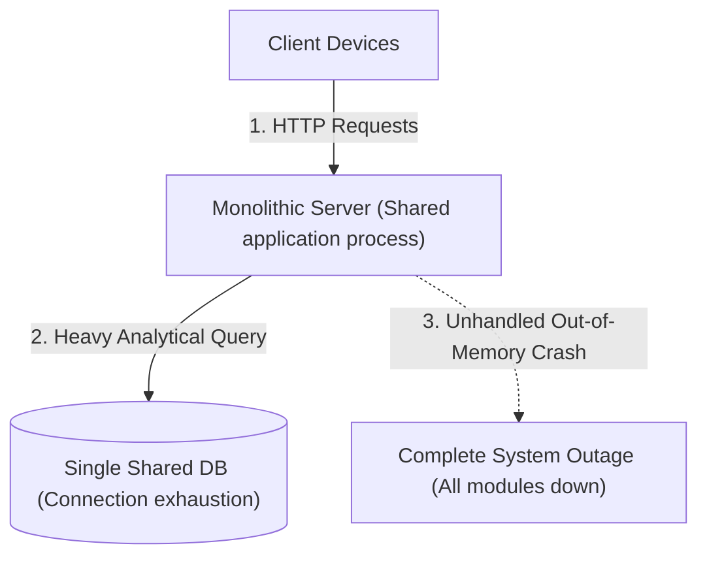

Refactoring into a modular monolith enforces strict code boundaries with explicit module interfaces and isolated database tables before introducing physical network complexity. Compute-heavy operations and long-running background tasks are pushed onto dedicated asynchronous workers (background processes that execute tasks independently without blocking the user interface) while core application code remains unified.

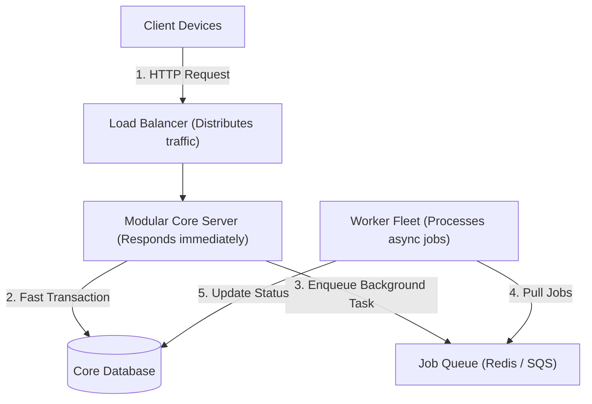

This architecture provides fast in-process execution speed while eliminating chaotic dependencies between teams and features. Teams maintain high delivery velocity without needing distributed tracing (monitoring tools that track requests across dozens of servers) or eventual consistency (a model where data syncs across nodes after a short delay).

## Client-Server Architecture and Gateway Scaling

A client-server architecture separates user-facing applications (clients like web browsers and mobile apps) from central backend servers that process data and manage security rules. Clients send structured network requests over standard communication protocols (established rules for transferring data like HTTP and WebSockets) to fetch account balances, create orders, and synchronize state.

Connecting mobile and web clients directly to internal database servers or legacy backend instances causes rapid connection exhaustion (running out of available communication sockets) during sudden traffic spikes. Heterogeneous client applications (devices running different hardware, operating systems, or outdated application versions) flood backend servers with chatty requests and struggle when server data schemas (the organizational format of database records) change.

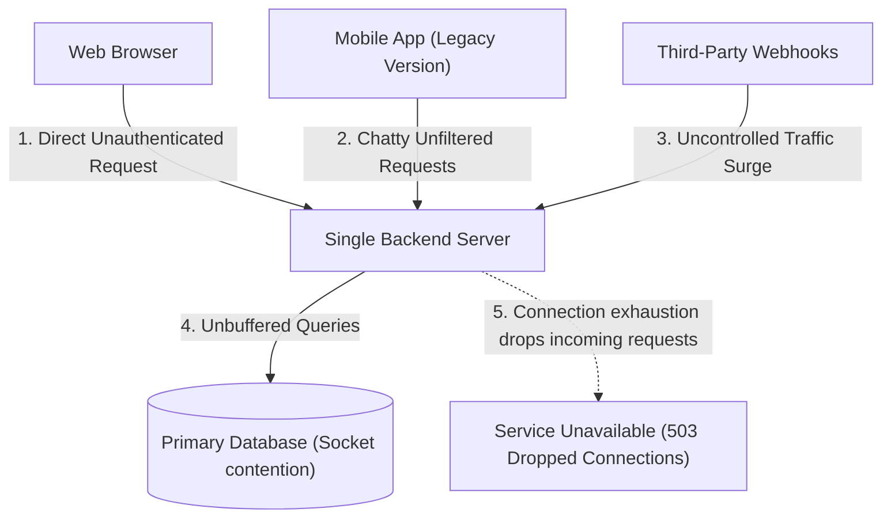

Deploying an edge API gateway (a front-door reverse proxy that manages incoming traffic before it hits internal servers) centralizes transport termination (handling encryption handshakes at the edge so internal servers do not expend compute on security overhead), rate limiting (restricting the number of requests a user can make in a given timeframe), request authentication, and response caching (storing frequently requested data in fast memory for instant retrieval). Downstream backend services sit safely inside private networks behind load balancers, shielded from client variances and malicious network attacks.

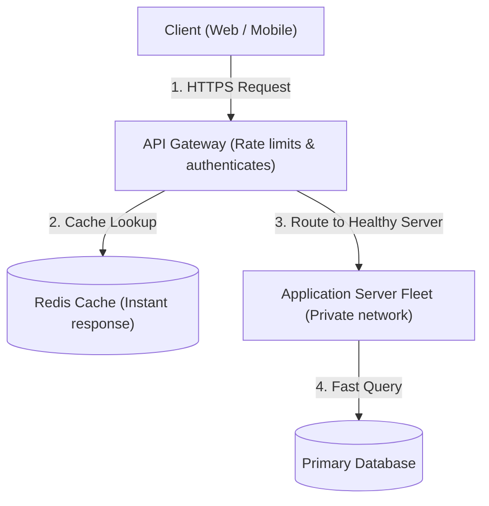

The gateway pattern simplifies backend code by handling cross-cutting concerns (tasks like security checks, logging, and metrics that apply to every service) in one central place. It introduces a small additional network hop (the physical route taken by data between two connected machines) and requires careful gateway redundancy to prevent the gateway itself from becoming a single point of failure (a solitary component whose shutdown halts the entire system).

## Microservices and Domain Boundaries

Microservices architecture divides a large software system into a collection of small, independently deployable services organized around distinct business capabilities (such as authentication, billing, product catalog, and shipping). Each microservice owns its private database and exposes clean programming interfaces (contracts defining how software modules communicate with each other) to communicate with other services.

When microservices communicate primarily through long chains of synchronous HTTP calls (requests where each server must wait idle for the next server to respond), the system becomes a distributed monolith (a fragile system that suffers the complexity of microservices without the benefits of independence). If a deep downstream dependency suffers high latency or crashes, thread pools across all upstream callers exhaust rapidly, causing cascading failures (a domino effect where one broken server brings down all connected servers).

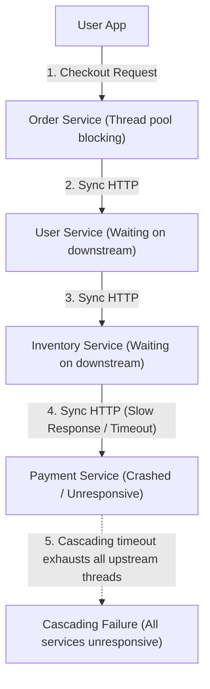

Applying event-driven patterns and localized read caches (fast temporary memory stores that hold frequently accessed data to avoid querying slower remote services) eliminates synchronous blocking chains between independent microservices. When synchronous communication is unavoidable, developers wrap remote calls inside circuit breakers (software switches that immediately fail fast and return fallback data instead of waiting endlessly for an unresponsive service).

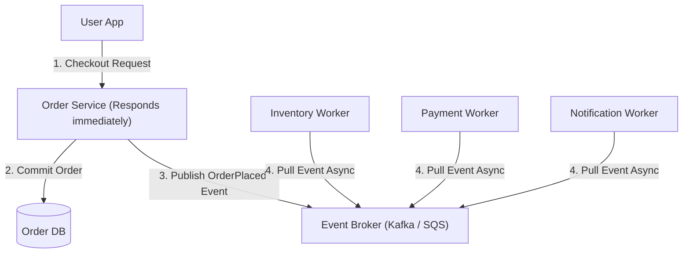

Microservices maximize organizational scaling and allow teams to deploy updates independently without coordinating release schedules across the entire engineering department. In return, systems require higher operational maturity to manage distributed tracing (monitoring tools that record the entire path of a request across dozens of network services), container deployment pipelines (automated systems that package code into standardized units and release them to servers), and eventual consistency across isolated databases.

## Event-Driven Architecture and Distributed Consistency

Event-driven architecture connects decoupled applications through the asynchronous generation and consumption of events (records describing an action that occurred in the system, like a payment receipt or user signup). Services publish events to a central message broker (an intermediary messaging software that receives, stores, and routes messages between applications) without waiting for downstream consumers to process them.

Dual writing occurs when an application service updates its local database and immediately attempts to send an event to a remote message broker inside the same request handler. If a network interruption or server crash happens between the database write and the message dispatch, downstream subscribers never receive the event, causing permanent data inconsistency (a broken state where different databases hold conflicting data).

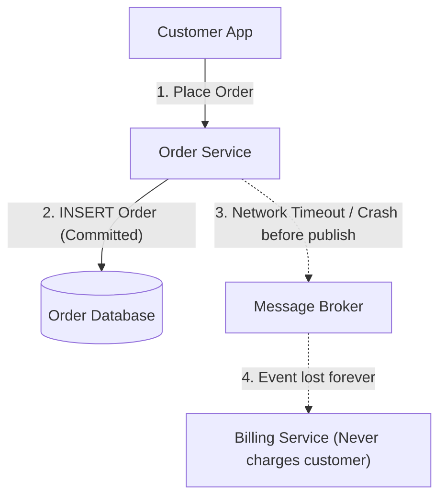

The transactional outbox pattern prevents lost events by recording the business mutation and an event record together within a single ACID transaction (a database guarantee that all grouped writes succeed together or safely cancel without partial corruption). A separate change data capture process (a background worker that reads database commit logs) reliably delivers outbox records to the message broker.

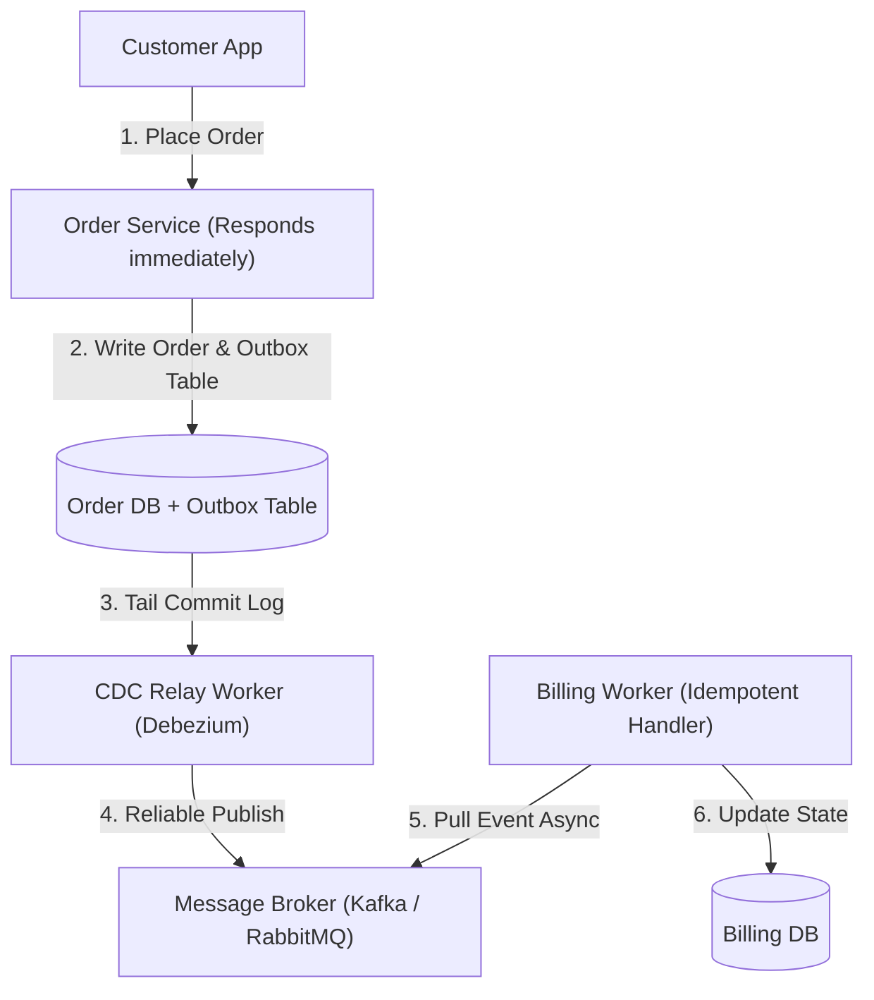

This pattern ensures that every committed business state change is published reliably without risking message loss during unexpected hardware failures. Downstream consumer services must be built to be idempotent (able to process duplicate message deliveries safely without creating repeated billing charges or redundant records).

## Serverless Architecture and Event Execution

Serverless architecture runs software logic inside stateless compute containers (short-lived computing environments that spin up on demand and shut down immediately after execution). Cloud providers automatically allocate server capacity to run functions when events arrive, charging exclusively for exact execution time.

Sudden traffic bursts create thousands of simultaneous serverless function instances, leading to severe cold starts (the startup delay incurred when a cloud provider prepares a fresh container runtime). Uncontrolled concurrency (many functions executing at the exact same moment) can instantly overwhelm downstream relational databases (structured databases that organize data into tables with predefined relationships) by exhausting available database connections and saturating CPU cores with connection handshakes (the initial cryptographic and network verification exchanges required to establish a communication channel).

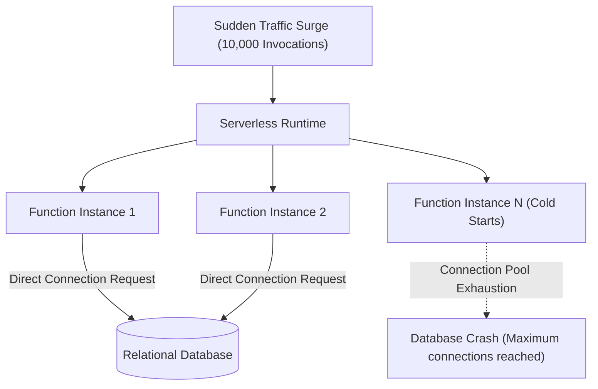

Placing managed connection proxies and intermediate task queues between serverless functions and relational databases regulates concurrency and stabilizes database throughput (the total volume of read and write queries processed per second). Managed database proxies pool persistent sockets (reusable open network connections) so thousands of short-lived functions share a small, controlled number of physical database connections.

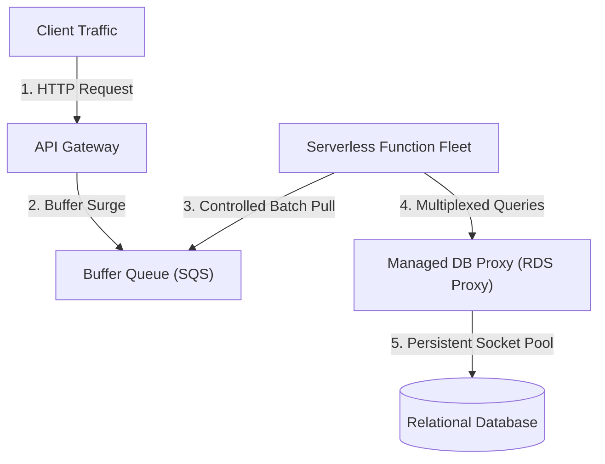

Serverless compute eliminates idle infrastructure bills and automates horizontal scaling (adding more machines automatically to handle heavier traffic loads). Developers must manage cold start latency considerations, maximum execution time limits, and vendor ecosystem constraints (technical limitations or specific proprietary tools enforced by a cloud hosting provider) when building serverless systems.

## Peer-to-Peer Architecture and Decentralized Coordination

Peer-to-peer architecture distributes computational workloads and file storage across a network of equal participant machines called peers. Each peer node functions simultaneously as a client requesting data and a server fulfilling requests for other network participants without requiring a central authority.

Unstructured peer networks that rely on broadcast flooding (sending search queries blindly to every neighboring machine) suffer catastrophic network congestion (network slowdowns caused by too much data traffic). When nodes join and leave the network frequently (rapid node turnover where participants connect and disconnect unpredictably), query messages repeat redundantly across nodes, saturating user bandwidth and creating long lookup delays.

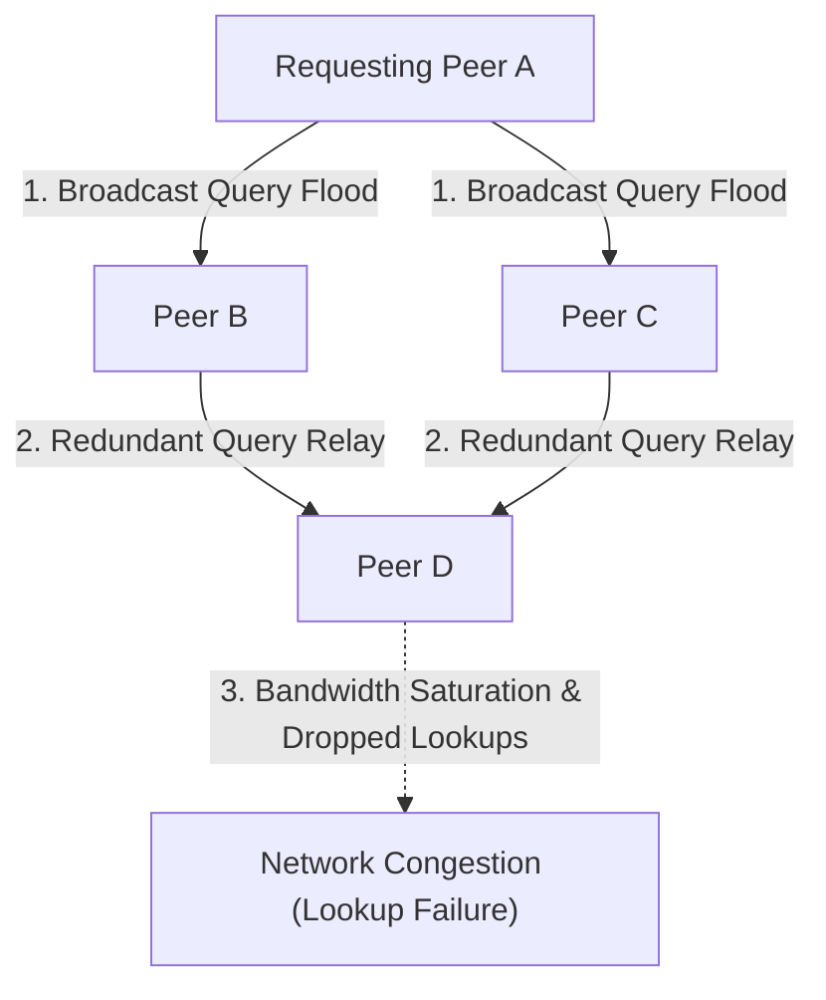

Structured peer-to-peer networks organize nodes into distributed hash tables (decentralized key-value indexes distributed across participating machines) with deterministic routing algorithms (mathematically predictable rules used to find the exact node storing a specific piece of data) like Kademlia. A small set of bootstrap servers (initial contact servers used only to discover active peers) facilitates network entry, after which nodes route search queries in logarithmic network hops (a fast lookup mechanism where query time grows very slowly even as the network reaches millions of nodes) and download file pieces simultaneously from multiple peers.

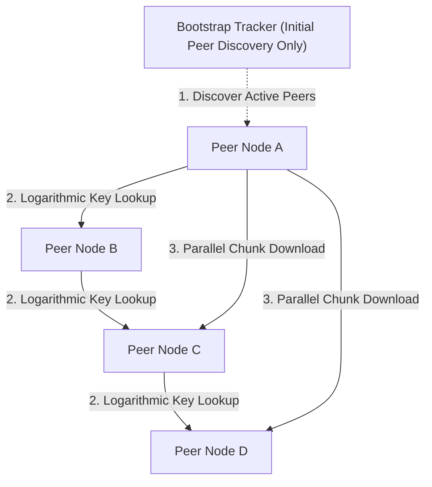

Peer-to-peer systems offer high fault tolerance against censorship and scale aggregate download bandwidth automatically as new participants join the network. Applications must incorporate cryptographic validation (verifying data chunks against cryptographic hash signatures to confirm authenticity) to prevent malicious nodes from distributing corrupted file content.
