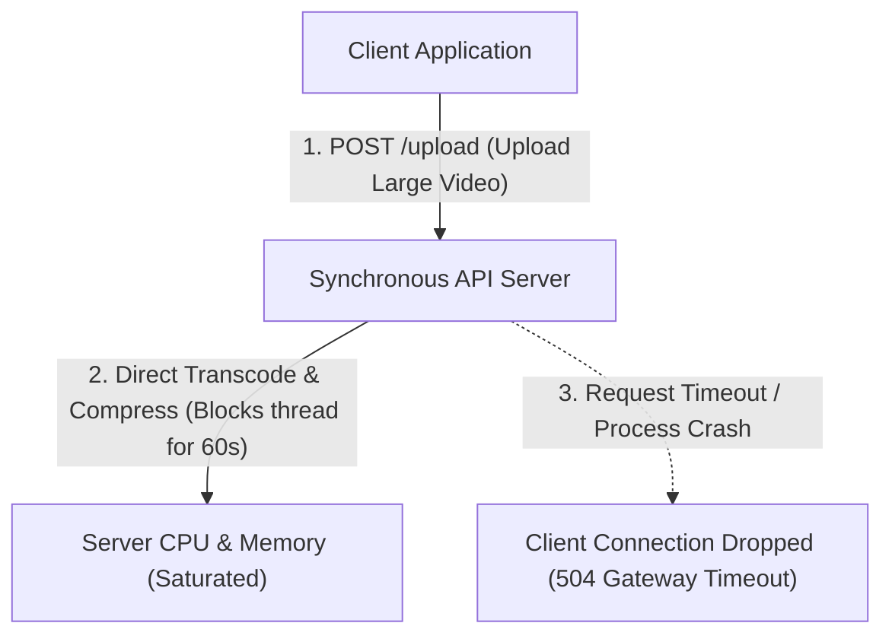
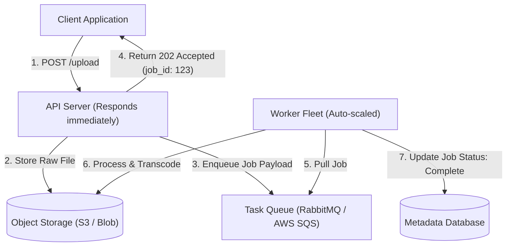
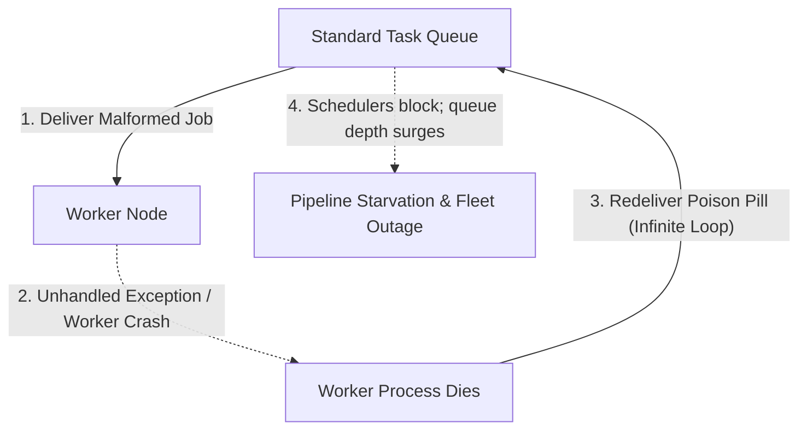
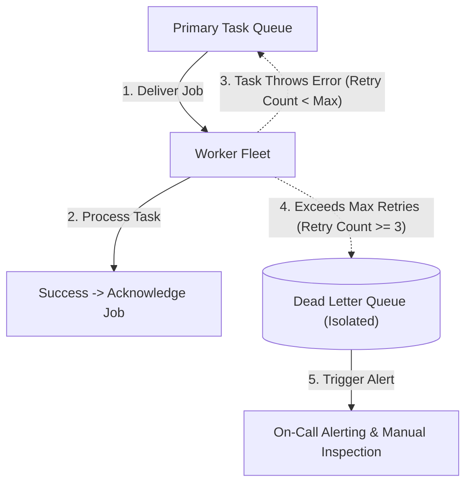
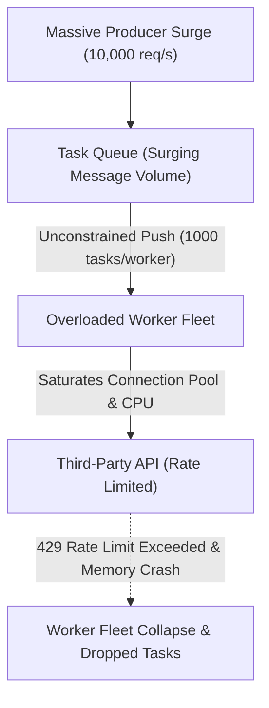
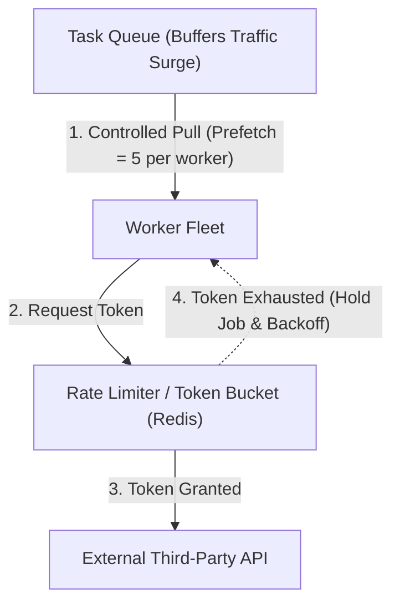
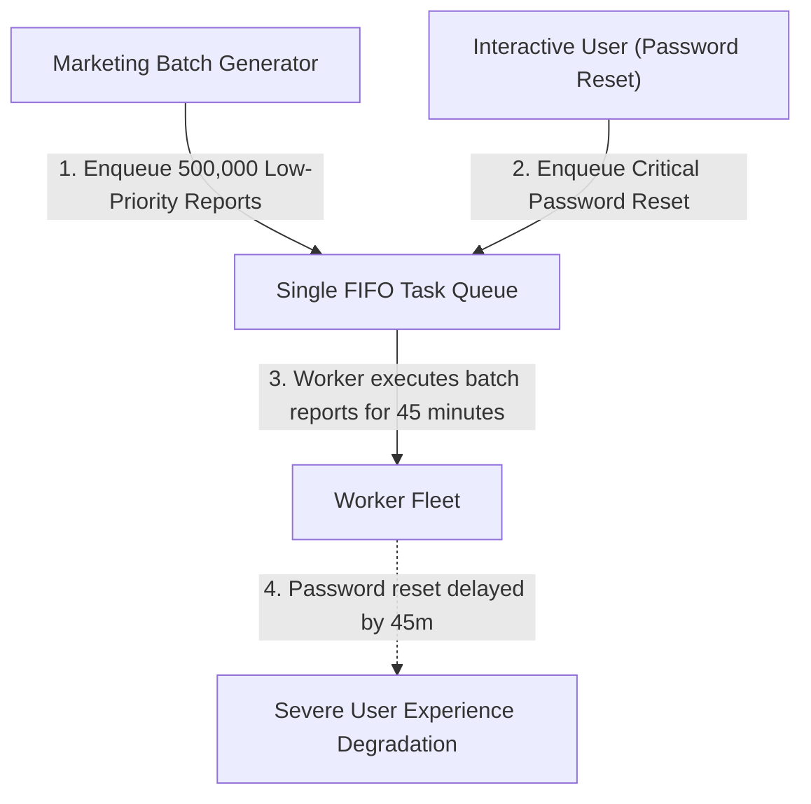
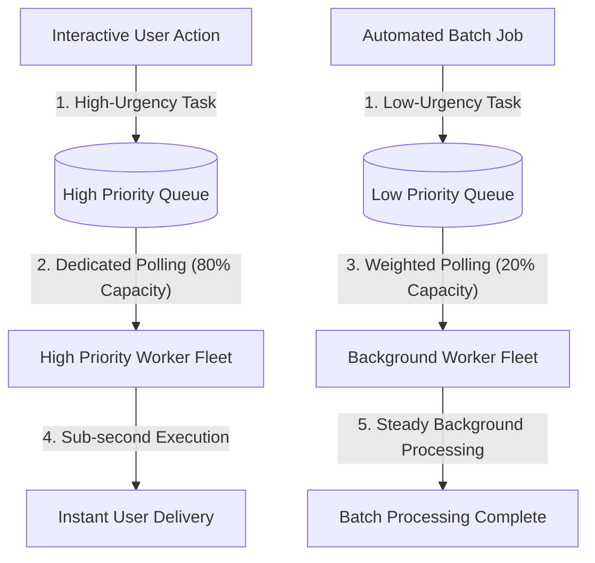

## Asynchronous Task Offloading and Worker Fleets

Synchronous request processing forces the client to wait while the server executes long-running operations like video transcoding (converting a video file from one format or resolution into another), generating complex analytical reports, or sending batch notification emails. When incoming traffic surges or heavy background tasks consume significant CPU processing time, application server worker threads become completely blocked, causing connection pool exhaustion (running out of available communication sockets to handle new requests) and cascading request timeouts (failures where users experience dropped connections).

Executing resource-intensive computations directly inside the web request lifecycle also destroys fault isolation (a design principle where a failure in one component is contained without crashing the rest of the application). If an image compression algorithm encounters an unhandled out-of-memory error (a condition where the server runs out of physical RAM and crashes), the entire web process terminates, abruptly dropping unrelated user sessions and corrupting in-flight transactions.

Asynchronous task offloading decouples the immediate user response from background execution by introducing an intermediate message broker (a specialized messaging system that reliably buffers and routes task messages between independent software applications). The API server validates the incoming request payload, stores any raw media files directly into object storage (a scalable storage system that manages data as unstructured files), writes a small job descriptor message to the queue, and immediately returns a fast acceptance response with a unique job tracking identifier.

Independent worker pools pull task messages off the queue at their own sustainable pace, execute the compute-intensive transformations in dedicated containers, and update the final processing status in the central database.

This pattern ensures predictable, sub-second API latency (the round-trip duration required to respond to client actions) regardless of task complexity while enabling independent horizontal scaling (adding more worker machines dynamically when the queue size increases). The client application retrieves the final result by polling a status endpoint (periodically checking a web address for job updates) or receiving a webhook callback (an automated HTTP request sent to a client server when a background task finishes).

## Dead Letter Queues and Poison Pill Isolation

A poison pill message is a malformed task payload, corrupted data record, or unexpected edge case that causes a background worker to crash repeatedly whenever it attempts processing. In standard message queues with basic retry policies, a crashed worker immediately releases the unacknowledged message back to the front of the queue, creating an infinite crash loop that continuously takes down healthy worker nodes.

When thousands of background workers become trapped in continuous crash-and-retry cycles on the same malformed message, entire processing pipelines grind to a halt. Valid user tasks trapped behind the poison pill experience unbounded delivery delays, driving up queue depth (the total count of unread messages waiting in a broker) and triggering false positive operational alarms.

A dead letter queue is an auxiliary message queue designed to permanently isolate problematic messages after they exceed a strictly defined maximum retry threshold. When a worker fails to process a task, the message broker increments an internal delivery counter and applies a brief exponential backoff delay (an increasing pause duration between successive retry attempts) before re-attempting execution.

If the message fails consistently across all permitted attempts, the broker automatically transfers the offending payload to the dead letter queue and acknowledges the original message, allowing workers to immediately proceed with healthy downstream tasks.

This isolation mechanism preserves overall pipeline throughput (the total volume of successfully processed jobs per second) and prevents single malformed requests from causing widespread systemic downtime. Engineering teams monitor dead letter queue depth to inspect corrupted payloads, apply bug fixes to worker software, and replay resolved messages back to the primary queue without data loss.

## Backpressure and Consumer Rate Limiting

Backpressure occurs when an upstream producer generates task messages at a rate significantly faster than downstream workers can consume and process them. In unconstrained message queues without consumer flow controls, workers pull too many simultaneous tasks into local memory, triggering thread starvation (running out of execution threads to process work) and out-of-memory crashes.

When background tasks interact with downstream rate-limited dependencies like external payment processors or third-party email providers, uncontrolled worker concurrency causes mass HTTP status 429 errors (rejection responses indicating that the rate limit has been exceeded). These repeated failures trigger cascading retry storms (synchronized waves of retried requests that amplify traffic load and prolong outages) that worsen upstream bottlenecks.

Implementing explicit prefetch limits (restricting the number of unacknowledged messages a worker can hold in memory simultaneously) and token bucket rate limiters (algorithms that regulate outgoing request velocity using replenishing capacity tokens) enforces strict consumer flow control. Workers pull only as many tasks as their local CPU cores can concurrently process, while outgoing calls to external systems pass through centralized rate limiting coordinators.

When downstream services experience latency spikes or transient degradation, worker consumption automatically slows down, allowing the intermediate message queue to buffer excess volume safely on disk.

This architecture protects both internal compute resources and external service relationships from being overwhelmed during extreme demand spikes. The system trades real-time processing speed for complete operational stability, letting queue backlog drain smoothly as downstream processing capacity becomes available.

## Priority Queuing and Starvation Prevention

In standard first-in first-out task queues, all incoming jobs share a single delivery channel regardless of customer urgency or business criticality. When large batches of low-priority tasks like non-urgent marketing analytics or background database cleanups flood the queue, time-sensitive operations like password reset emails or checkout payment verifications get stuck behind millions of non-urgent jobs.

This lack of prioritization causes severe customer experience degradation, as interactive users must wait tens of minutes for basic transactional notifications simply because an automated batch process was scheduled at the same time.

Priority queuing resolves starvation by separating workloads into distinct dedicated queues based on business urgency (such as high priority, default priority, and bulk background priority). Dedicated worker fleets are partitioned across queues, ensuring that high-priority queues always have dedicated compute capacity to process urgent tasks immediately with zero queuing delay.

To prevent low-priority queues from experiencing complete starvation (a state where low-priority jobs never execute because higher-priority jobs continuously arrive), workers allocate weighted polling ratios (for example, pulling eight jobs from the high-priority queue and two jobs from the low-priority queue for every ten execution cycles).

This dual-queue model guarantees strict service level agreements (formal operational targets defining maximum acceptable processing delays) for customer-facing workflows while maintaining steady background throughput for bulk jobs. The platform maintains predictable delivery boundaries across distinct user tiers and workloads without risking compute resource waste.
