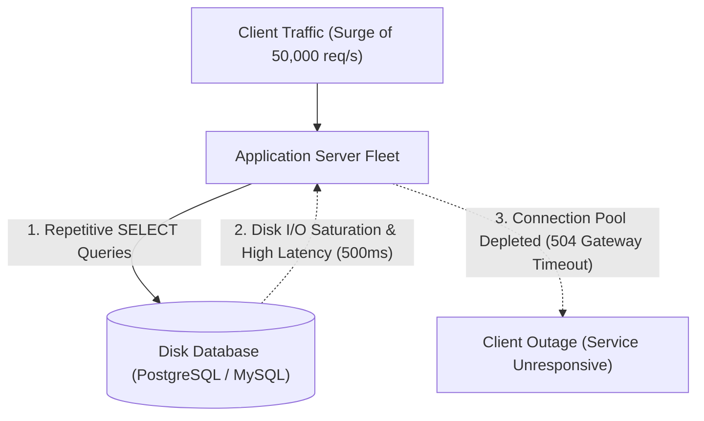
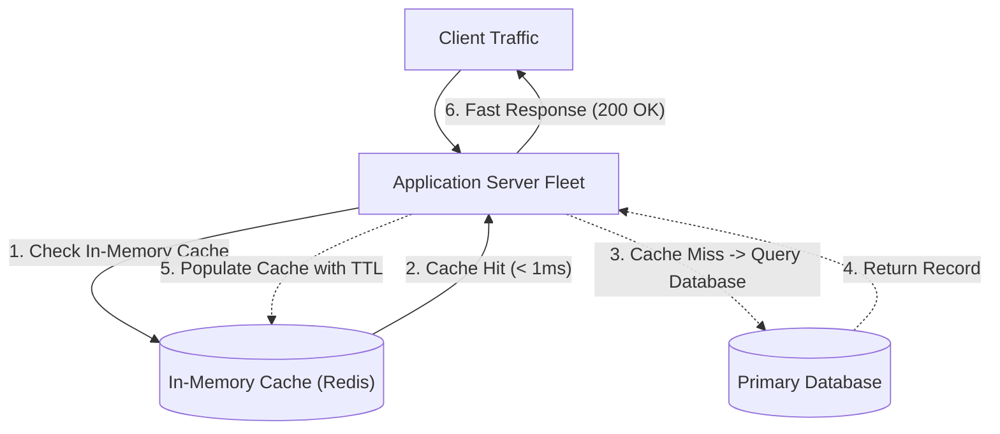
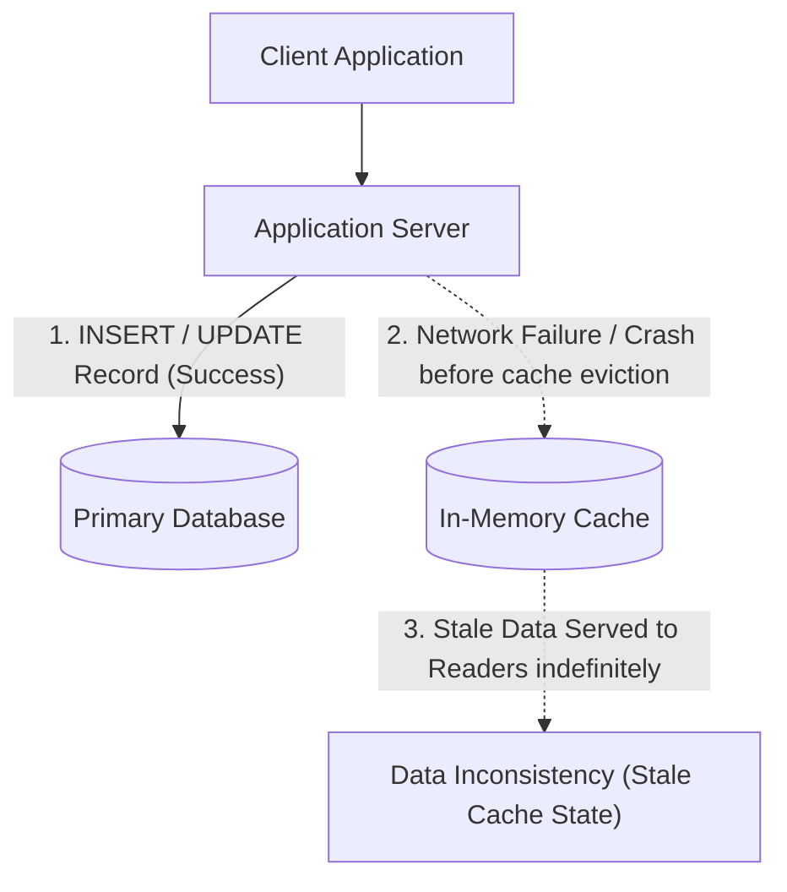
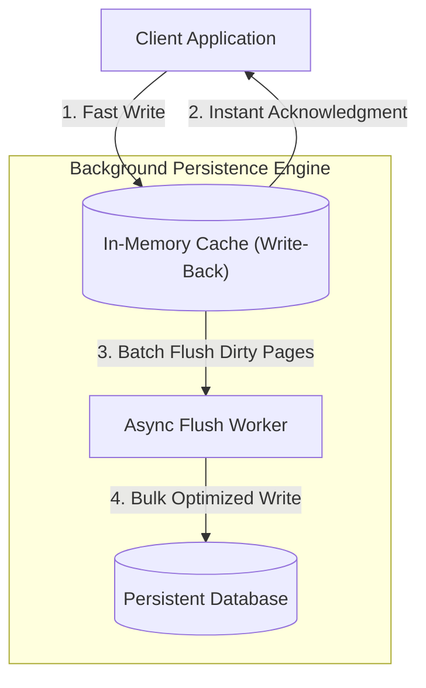
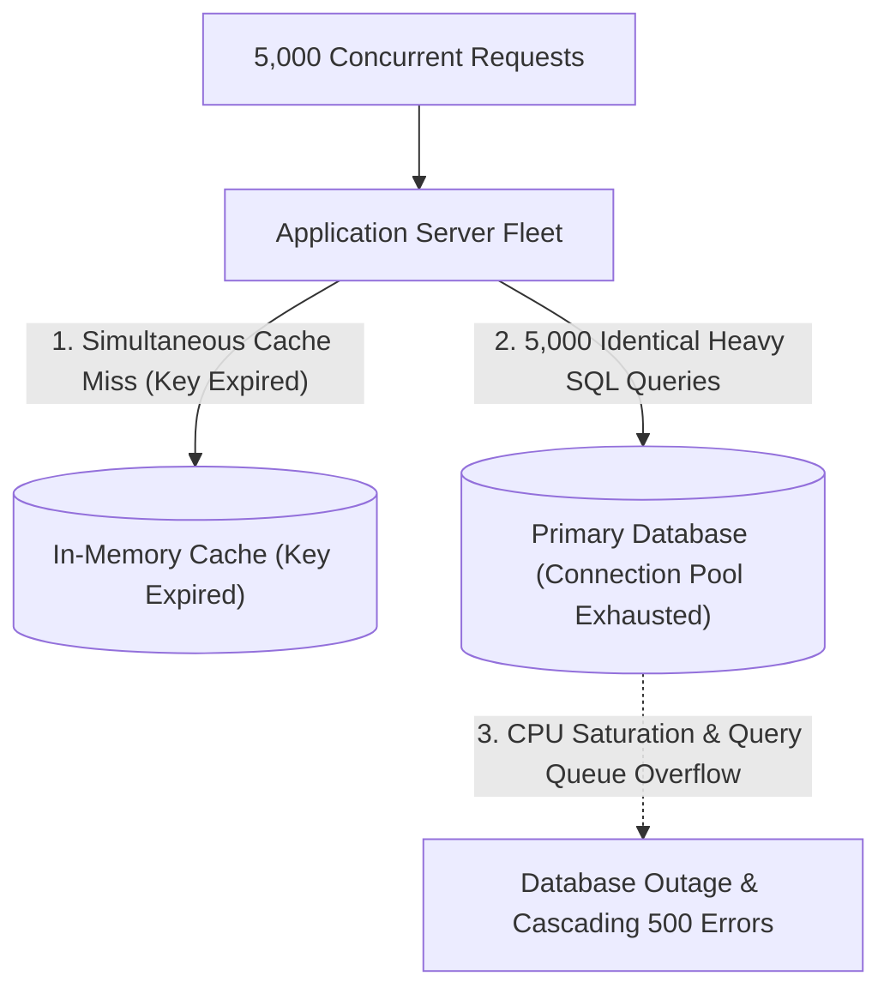
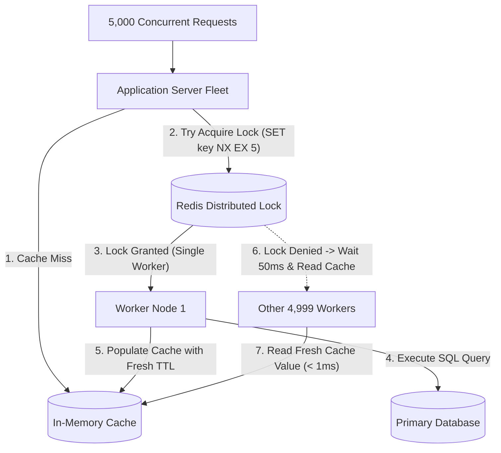
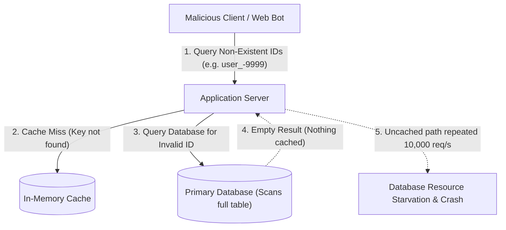
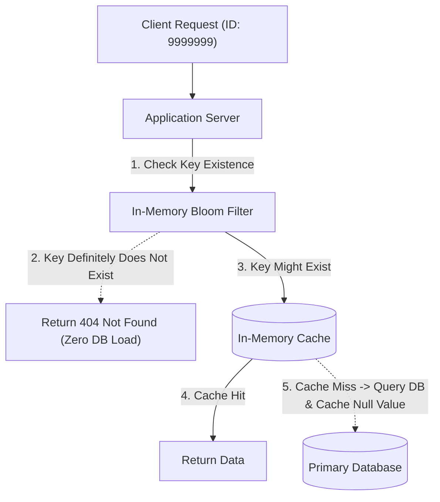
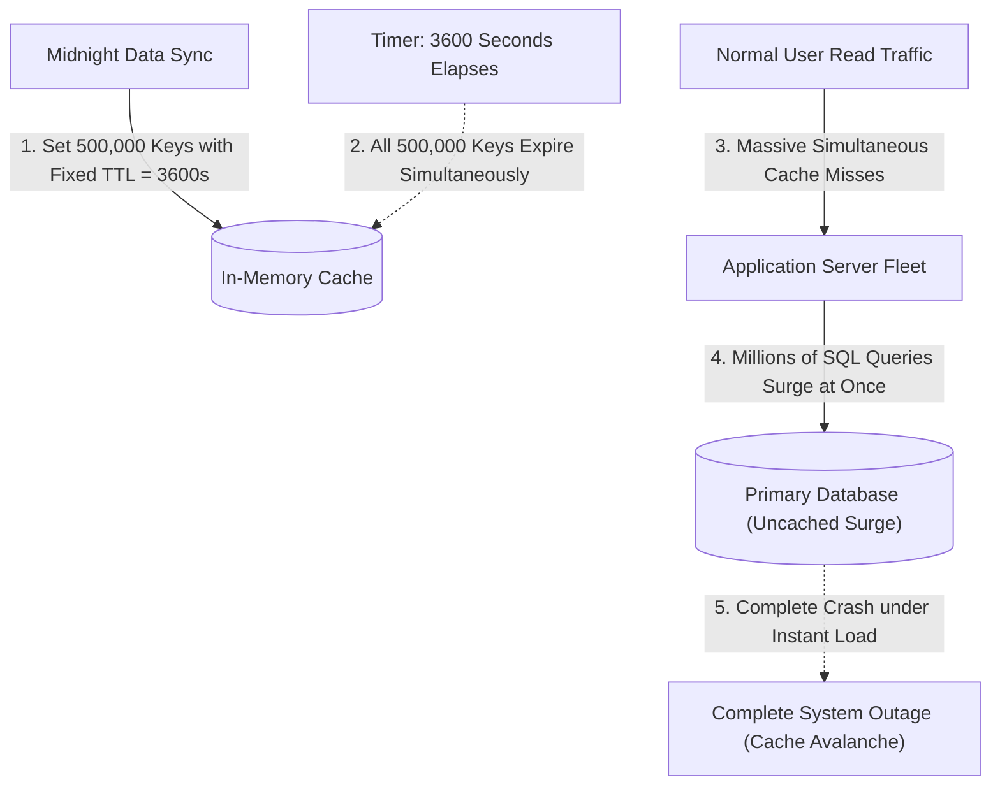
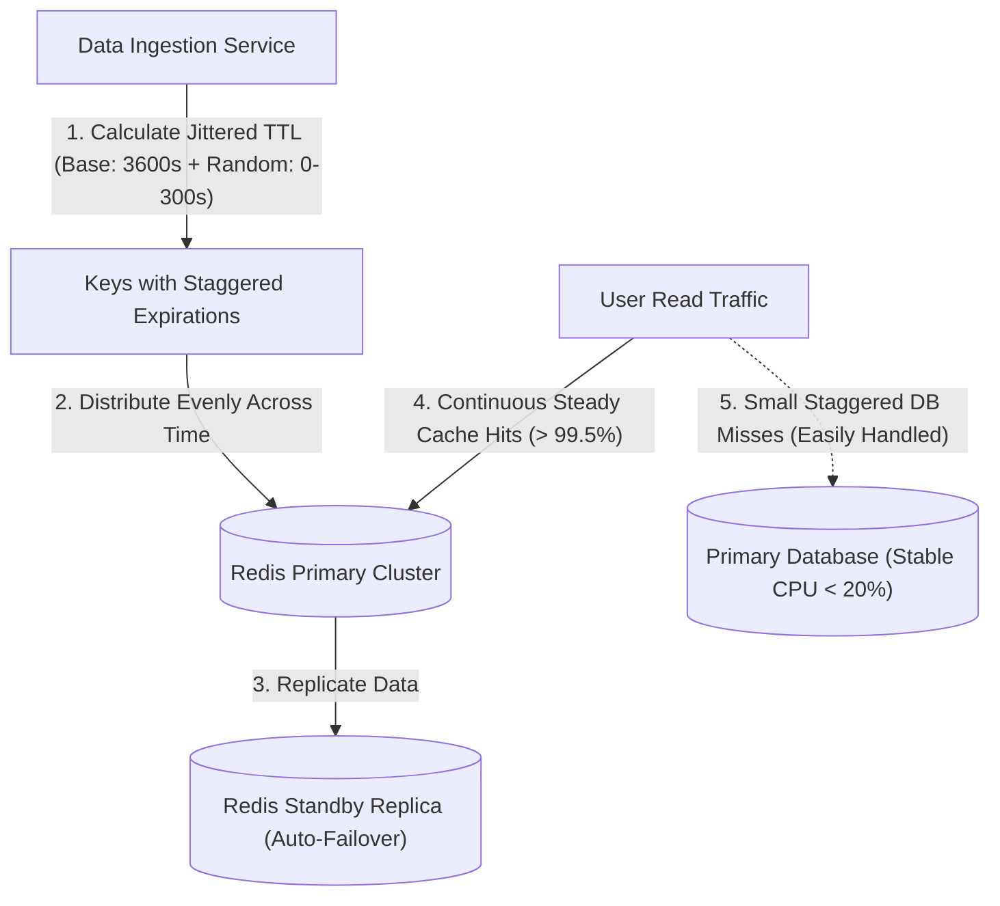

## Cache-Aside Pattern and Latency Reduction

Relational and document databases store data persistently on physical disks, requiring rotational or solid-state input-output operations (reading data from disk blocks into memory) and query parsing for every read request. When application servers execute repetitive queries for identical, static records like user profile headers or product descriptions directly against disk storage, database CPU utilization and connection pools quickly become saturated, leading to severe latency degradation (slow response times).

If database query latency spikes under high traffic loads, web worker threads remain blocked waiting on network sockets, causing upstream request queues to overflow and triggering gateway timeouts (errors returned when an intermediary proxy gives up waiting for a response).

The cache-aside pattern places a high-speed in-memory data store (a fast temporary storage system like Redis or Memcached that holds data directly in RAM) alongside the application server. The application code first queries the in-memory cache; if a cache hit occurs (the requested record exists in fast RAM), the server returns the cached payload immediately with sub-millisecond response latency.

When a cache miss occurs (the record is not found in memory), the application queries the persistent database, writes the retrieved record into the cache with a time-to-live expiration (a scheduled timestamp after which cached data is automatically deleted), and returns the payload to the client.

This pattern isolates persistent database disks from repetitive read traffic, allowing systems to serve hundreds of thousands of read requests per second cost-effectively. Because the cache operates independently from the database, a temporary cache restart degrades system performance by falling back to the database without causing complete system failure.

## Write-Through and Write-Back Caching Strategies

Direct database writes followed by manual cache eviction can introduce race conditions (unpredictable timing bugs where concurrent operations overwrite data in the wrong sequence), causing stale data (outdated information that does not match the actual database state) to remain in memory indefinitely. If an application updates the database but crashes before updating or evicting the corresponding cache key, subsequent read queries will continue serving outdated data to users.

Conversely, in high-frequency write environments like live multiplayer game leaderboards or high-volume sensor telemetry, writing every single update synchronously to disk creates severe database write contention (multiple write queries competing for disk locks).

Write-through caching treats the cache as the primary data interface, where the cache layer synchronously writes data to both in-memory storage and the persistent database within a single unified operation before returning a success confirmation. This guarantees that cached data is never stale and eliminates complex cache synchronization logic from application code.

Write-back caching (also called write-behind caching) accepts write updates into high-speed memory immediately, acknowledges the write to the client with microsecond latency, and asynchronously flushes accumulated batches of dirty pages (modified in-memory records that have not yet been written to persistent disk storage) to the database in the background.

Write-through caching prioritizes absolute data freshness at the expense of slightly higher write latency, making it ideal for financial accounts and order management. Write-back caching delivers extreme write throughput by absorbing write bursts in RAM, trading the risk of transient data loss during ungraceful server power outages for massive performance gains.

## Cache Stampede and Distributed Mutex Locking

A cache stampede (also known as a thundering herd problem) occurs when a heavily accessed, hot cache key expires while thousands of concurrent client requests are reading it simultaneously. Because the key is suddenly missing from memory, all incoming application threads experience a simultaneous cache miss and execute identical expensive database queries at the exact same millisecond.

This sudden surge of identical complex database queries instantly overwhelms database CPU cores, exhausts available connection pools, and drives database response latency into complete operational collapse.

Distributed mutex locking (a synchronization mechanism that restricts access to a shared resource across multiple servers to one worker at a time) eliminates cache stampedes by ensuring that only a single worker queries the database on a cache miss. When a cache miss occurs, the first application thread acquires a short-lived distributed lock in Redis using atomic operations (commands that execute completely in a single step without interruption).

The winning thread queries the persistent database and repopulates the cache, while all other concurrent threads wait briefly and retry the cache lookup, reading the freshly populated value without touching the database.

This single-flight execution pattern guarantees that the database experiences only one single query during key regeneration regardless of incoming concurrency volume. The database remains completely protected from traffic spikes, maintaining stable sub-second response times across the entire cluster.

## Cache Penetration and Bloom Filters

Cache penetration occurs when external clients repeatedly send queries for non-existent records, such as malicious attackers requesting random, non-existent user identification numbers. Because the requested keys do not exist in the database, the cache never stores a value for them, causing every single request to bypass the cache entirely and hit the database directly.

An attacker sending high-velocity requests for invalid keys can easily bypass the caching layer entirely, driving database CPU utilization to maximum capacity and causing denial of service (an outage where legitimate users cannot access the system).

To eliminate cache penetration, systems deploy Bloom filters (space-efficient probabilistic data structures used to test whether an element is definitely not in a set or might be in a set) at the edge of the data layer. Before querying the cache or database, the application checks the in-memory Bloom filter; if the filter indicates the key does not exist, the request is rejected immediately with an HTTP 404 response without executing any storage queries.

Additionally, for legitimate cache misses that return empty results, the application writes a null placeholder value into the cache with a very short expiration time (for example, sixty seconds), ensuring subsequent queries for that missing key return an instant cache hit for the null value.

This dual-defense mechanism protects backend databases from malicious scraping and random key enumeration attacks while consuming minimal RAM. The Bloom filter processes lookups in constant time (execution speed that remains instantaneous regardless of dataset size), shielding the core infrastructure from artificial traffic surges.

## Cache Avalanche and Jittered Expirations

A cache avalanche happens when a massive portion of cached keys expire at the exact same moment, or when the entire caching cluster suddenly restarts or becomes unreachable. When thousands of distinct keys expire simultaneously, all subsequent user traffic cascades directly onto the backend database at once, causing sudden hardware saturation and site-wide outages.

Systems that populate large batches of cache keys with identical fixed time-to-live durations (for example, setting every product cache key to expire in exactly twenty-four hours during a midnight data sync) inherently create predictable avalanche conditions.

Preventing cache avalanches requires introducing randomized TTL jitter (adding a small random interval of extra seconds to key expiration times) so that cache expirations distribute evenly across time windows instead of occurring in a single synchronized spike.

Furthermore, deploying high-availability cache clusters with multi-replica master-follower topologies (deploying secondary follower cache nodes that automatically take over if the primary node fails) ensures the caching layer remains operational even during physical server failures.

Staggered expirations smooth out database query traffic into a predictable, manageable trickle that persistent storage easily absorbs without latency degradation. Multi-node cache replication guarantees fault resilience, preventing hardware outages from triggering devastating cascade effects across the broader application architecture.
