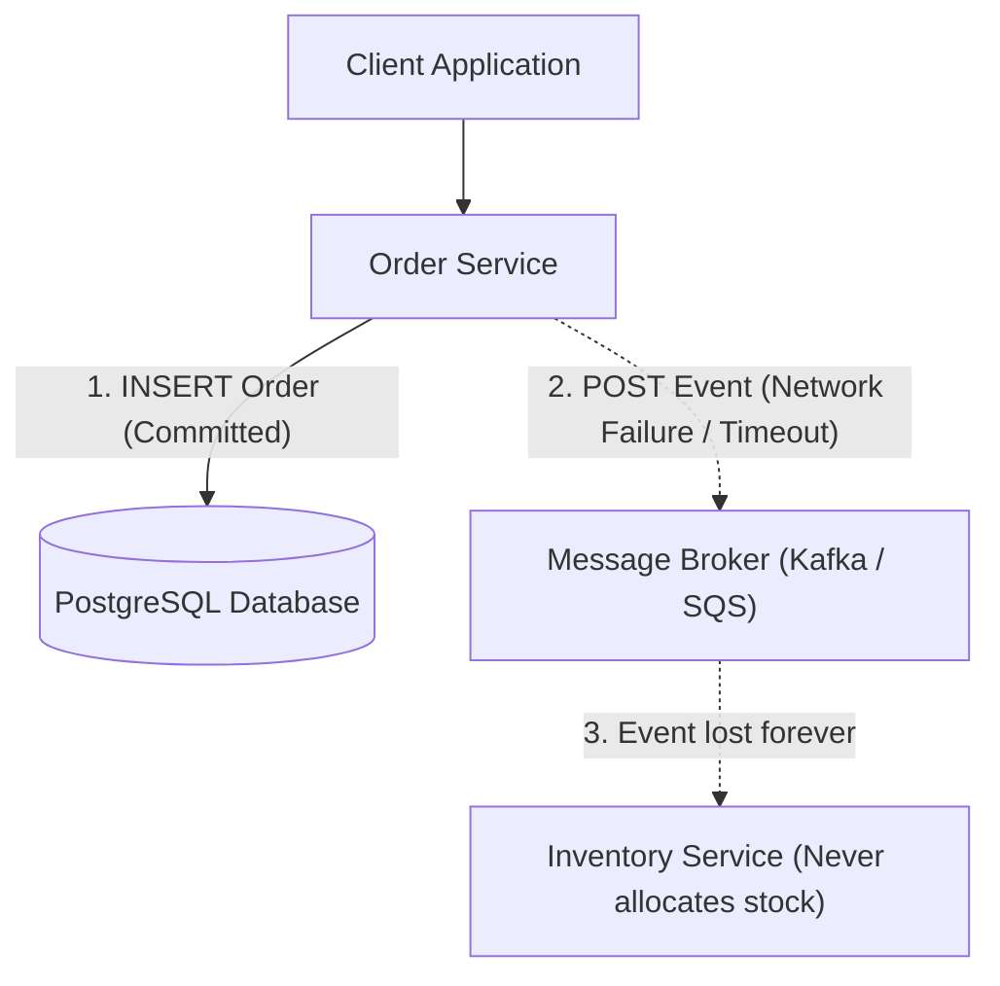
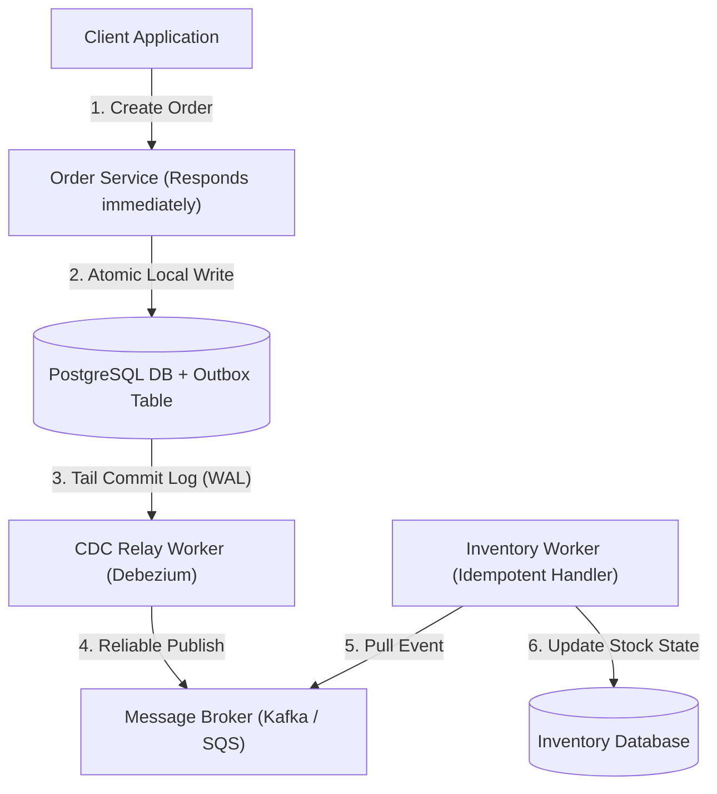
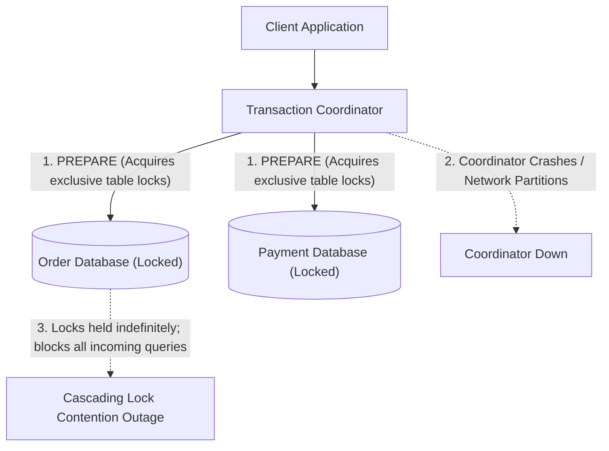
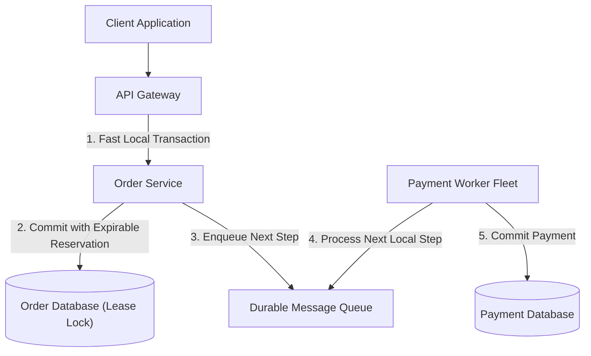
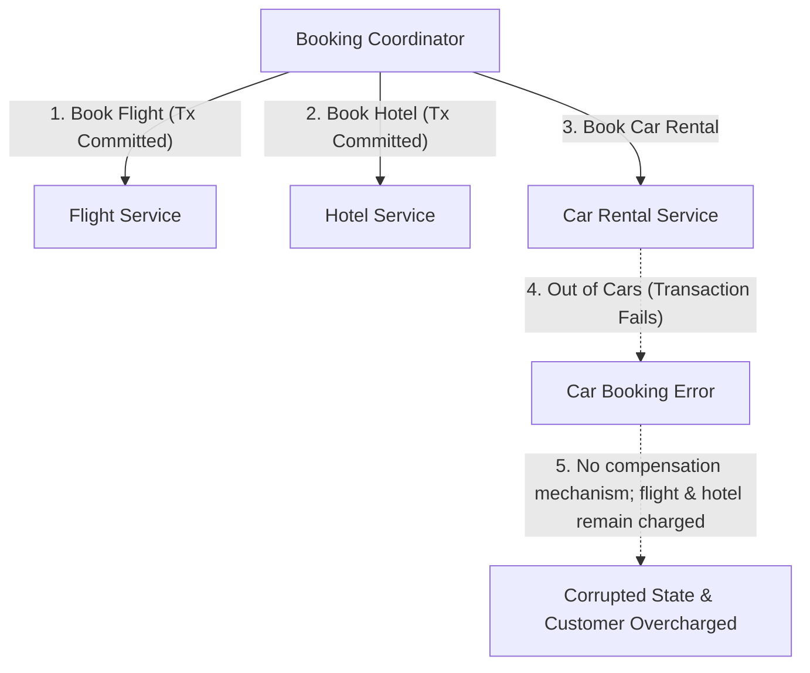
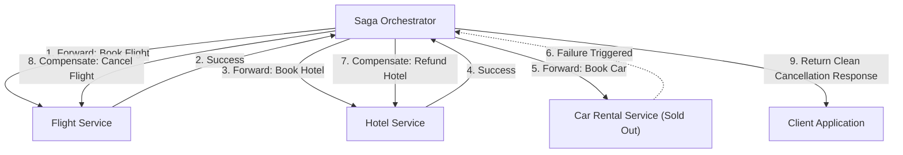
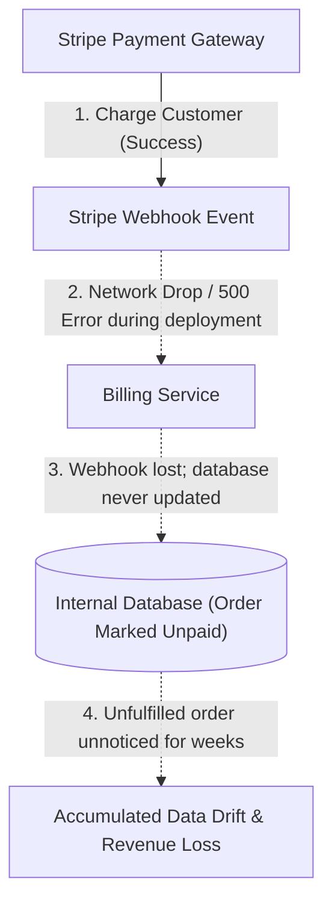
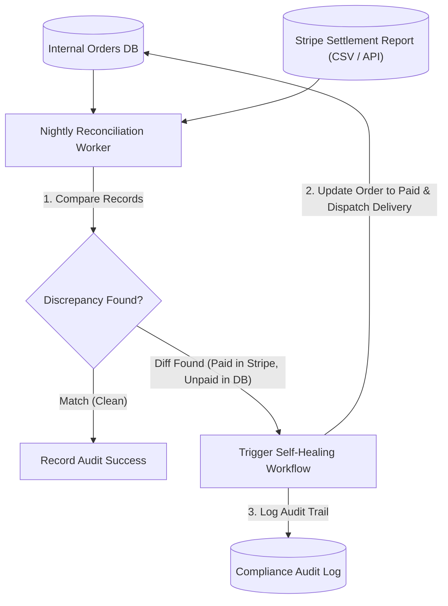
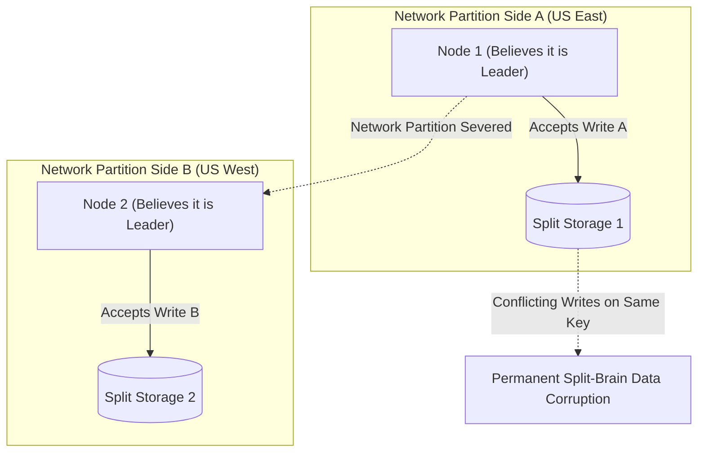
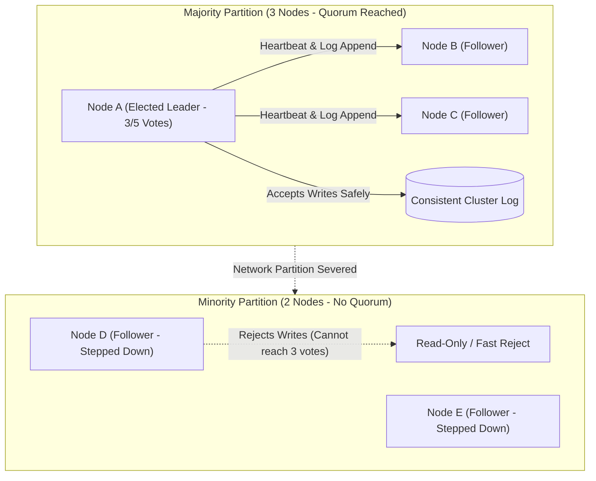

## Dual Writes and Transactional Outbox

Dual writing occurs when an application service attempts to update a primary database and publish an event to a message broker sequentially within a single request cycle. Because distributed transactions across disparate datastores are fragile and expensive, network failures or process crashes between the first write and the second write inevitably leave the system in an inconsistent state (a broken condition where one database has updated data but the second database still holds outdated information).

When the database write succeeds but the message broker publish fails, downstream subscriber services never receive the event notification, causing permanent state discrepancies across microservices. Retrying the message publish synchronously blocks the client request while waiting for the network, increasing response latency and risking thread exhaustion during downstream broker outages.

The transactional outbox pattern eliminates dual writing by recording the domain entity mutation and an outgoing event record together inside a single ACID transaction (a database guarantee that all grouped write operations either completely succeed together or safely roll back without partial data corruption). A separate asynchronous relay process monitors the outbox table via change data capture (a technology that listens directly to database transaction logs to detect new records in real time) and reliably publishes events to the message broker.

Downstream consumer worker services pull events from the message broker and update secondary datastores asynchronously, guaranteeing that no state updates are lost even if downstream components experience temporary downtime.

This pattern trades immediate consistency for eventual consistency (a model where data replicas become synchronized across all systems after a slight delay) while achieving complete fault isolation and zero data loss. The application must design downstream consumer services to be idempotent (capable of receiving the exact same message multiple times without creating duplicate records or incorrect side effects).

## Two-Phase Commit and Blocking Coordinator Risks

Two-phase commit coordinates transactions across multiple independent databases by locking resources across all participating nodes during a prepare phase and committing them in a second phase. A centralized transaction coordinator node queries all participant nodes to ensure they are ready to commit before sending the final commit directive.

In high-throughput distributed systems, holding physical locks across network boundaries creates extreme latency spikes and severe cascading bottlenecks. If the coordinator node crashes or loses network connectivity after participants have voted and acquired locks, participant nodes remain blocked indefinitely holding database locks, causing connection pool exhaustion (running out of available database sockets) across the entire cluster.

Modern architectures replace blocking two-phase commits with non-blocking coordination patterns and asynchronous consensus protocols. By avoiding synchronous inter-database locks, individual microservices execute atomic local transactions within their private databases and coordinate subsequent steps using durable messaging queues and change streams.

When cross-service consistency is strictly required, distributed systems employ non-blocking state machines with explicit lease timeouts (automatic lock expirations that safely release reserved resources if a coordinator process fails to respond within a short time limit).

This non-blocking approach eliminates single points of failure and prevents transient network partitions from freezing independent databases. Services preserve maximum local write throughput while ensuring that unconfirmed transactions expire safely without human intervention.

## Saga Pattern and Compensating Transactions

Managing long-running business workflows across multiple microservices (such as booking a vacation package involving flights, hotels, and car rentals) cannot rely on traditional database transactions because locking resources across third-party APIs for several minutes is impossible. If the third step of a multi-step booking workflow fails after the first two steps have already committed locally, the system is left in a corrupted state with stranded, paid reservations.

Attempting to undo committed database rows with simple delete queries fails because subsequent operations may have already modified adjacent records, producing phantom data corruption.

The saga pattern manages distributed business transactions as a sequence of independent local transactions across participating services. For every local transaction that commits a state change, the system defines an explicit compensating transaction (a semantic undo operation like issuing a refund or releasing a seat reservation) designed to reverse the business effects if a downstream step fails.

When a failure occurs midway through the saga, the orchestrator triggers the compensating transactions in reverse chronological order, cleanly restoring overall business consistency across all participating microservices.

Sagas provide reliable business consistency across loosely coupled services without requiring distributed resource locking. Because compensating transactions execute after initial commits, intermediate uncommitted states may be briefly visible to external readers before compensation completes.

## Batch Data Reconciliation and Self-Healing Audits

In high-volume distributed systems relying on asynchronous messaging and webhooks (automated HTTP notifications sent between platforms when events occur), transient network drops, partition hiccups, or expired retry timers occasionally cause individual event notifications to be lost silently. Over months of operation, these small unhandled anomalies accumulate into severe data drift (unnoticed discrepancies between two independent records representing the same financial or business reality).

Relying solely on real-time event streaming without scheduled verification guarantees that undetected discrepancies will persist until customers complain about missing refunds or mismatched accounting ledgers.

Batch data reconciliation operates as an automated background audit loop that periodically compares two independent sources of truth (such as internal transactional database records and external payment settlement files) to detect anomalies. A scheduled worker process pulls end-of-day settlement reports, executes high-speed cryptographic diffs (comparisons that identify mismatched or missing rows), and flags discrepancies.

When data drift is detected, the reconciliation engine automatically triggers a self-healing workflow (an automated script that safely inserts missing records or syncs status flags) to re-align internal state with external reality.

This dual-layer architecture pairs fast real-time event streaming with reliable scheduled audit safety nets. Automated reconciliation guarantees long-term ledger accuracy and ensures that unavoidable transient network anomalies are systematically resolved within twenty-four hours.

## Distributed Consensus and Leader Election

Distributed data clusters require multiple participant nodes to agree on a single shared state, such as electing a single primary leader to coordinate write operations. When network connections between nodes fail, naive clustering algorithms risk split-brain scenarios (a catastrophic condition where a cluster fractures into two isolated factions, each independently electing a leader and accepting conflicting writes).

Split-brain conditions permanently corrupt data because two distinct leaders accept incompatible write mutations on the same records simultaneously, making automated reconciliation mathematically impossible.

Modern distributed systems enforce consensus algorithms like Raft or Paxos that require a strict quorum (a mathematical majority consisting of more than half of all total cluster nodes) before any leader election or write operation can be confirmed. In a five-node cluster, a leader candidate must successfully obtain affirmative votes from at least three nodes to assume the leadership role.

If a network partition divides the cluster into a minority partition with two nodes and a majority partition with three nodes, the minority nodes recognize they cannot reach a quorum, automatically step down, and reject write operations until connectivity is restored.

Quorum-based consensus guarantees that only one valid leader can ever exist across the entire network at any given time. This eliminates split-brain data corruption and ensures continuous safe operation across unreliable physical networks.
