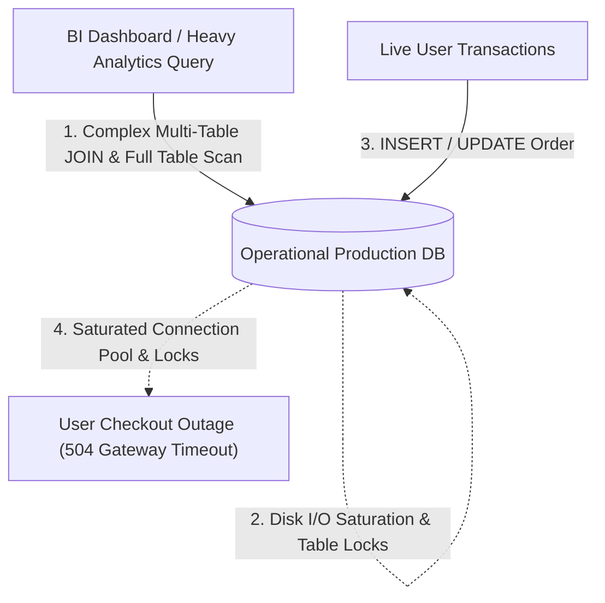
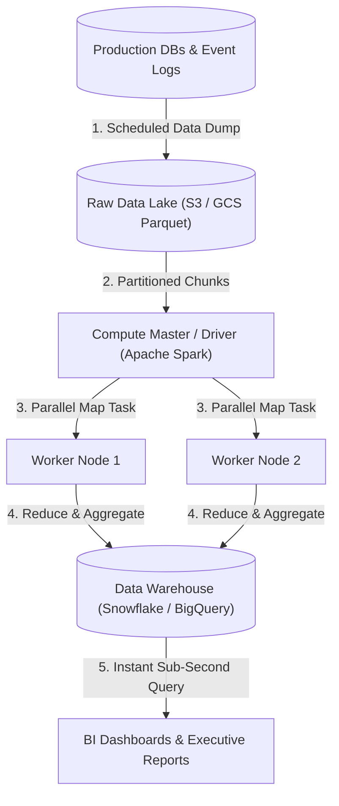
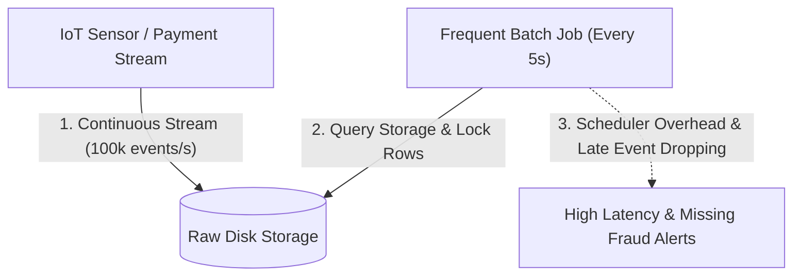
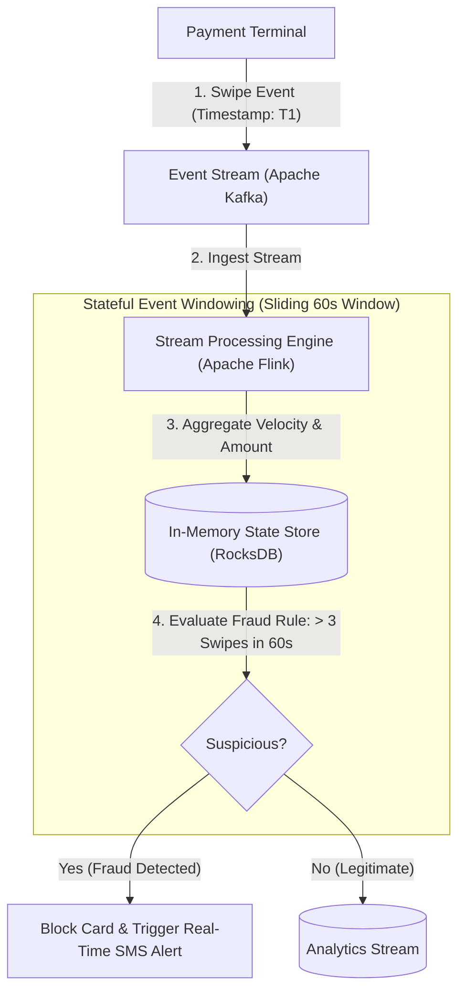
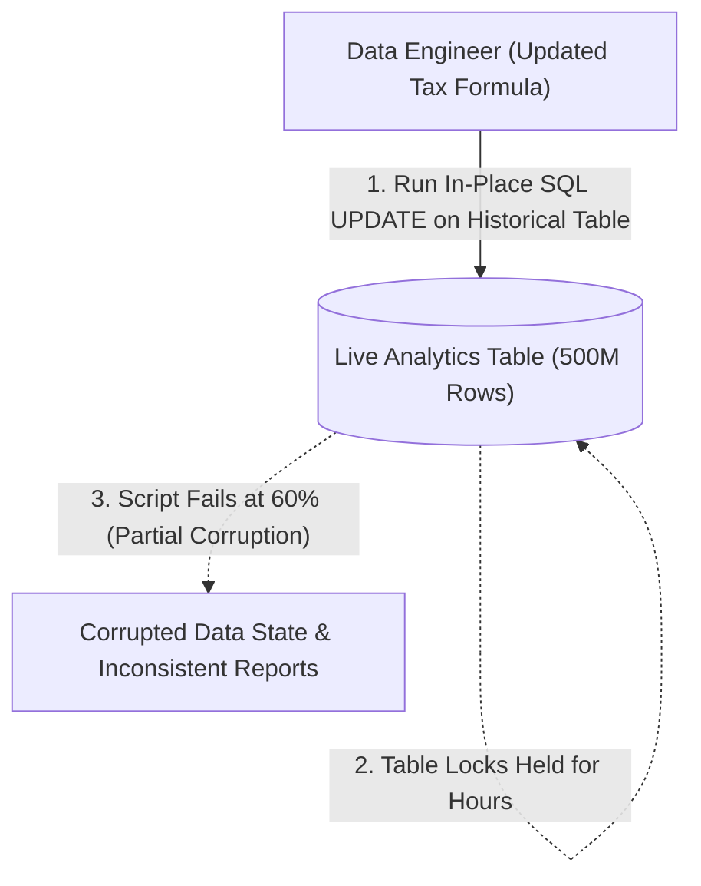
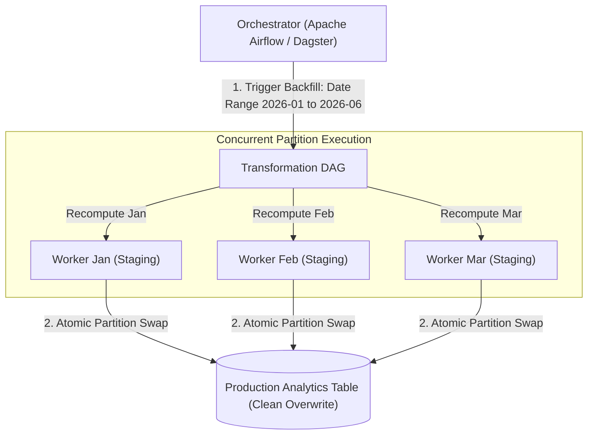
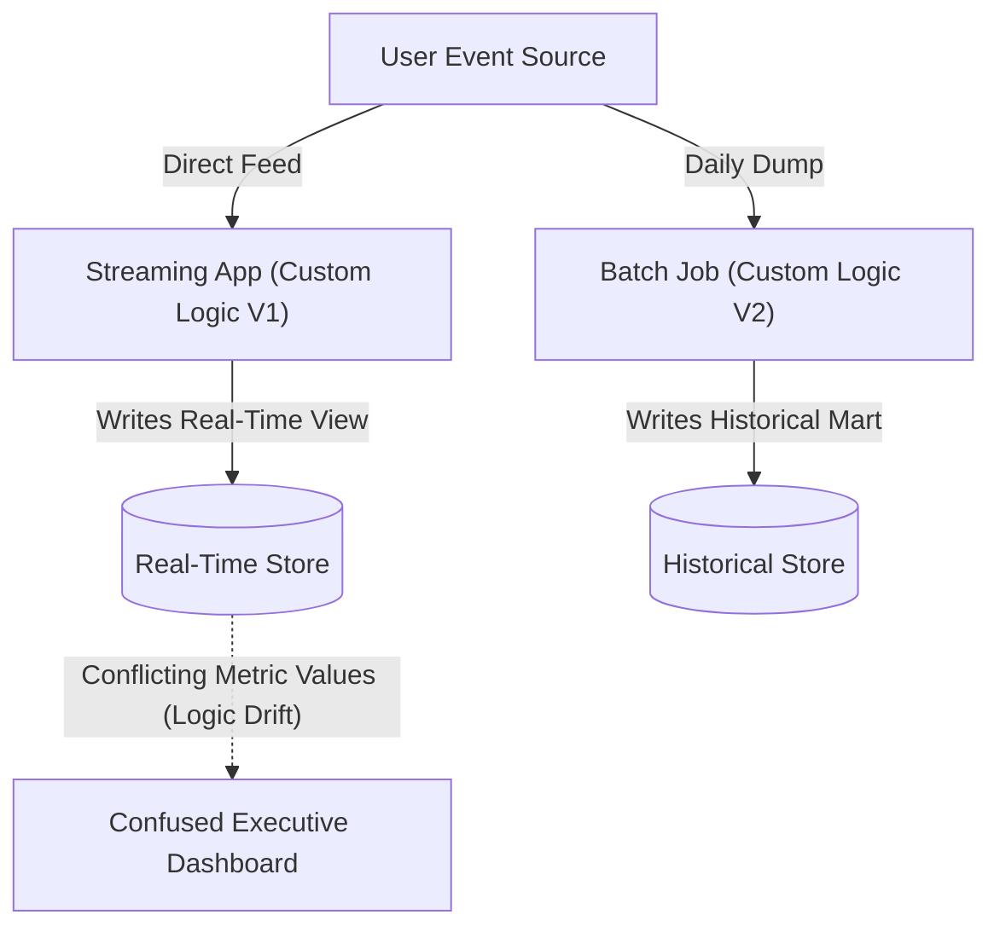
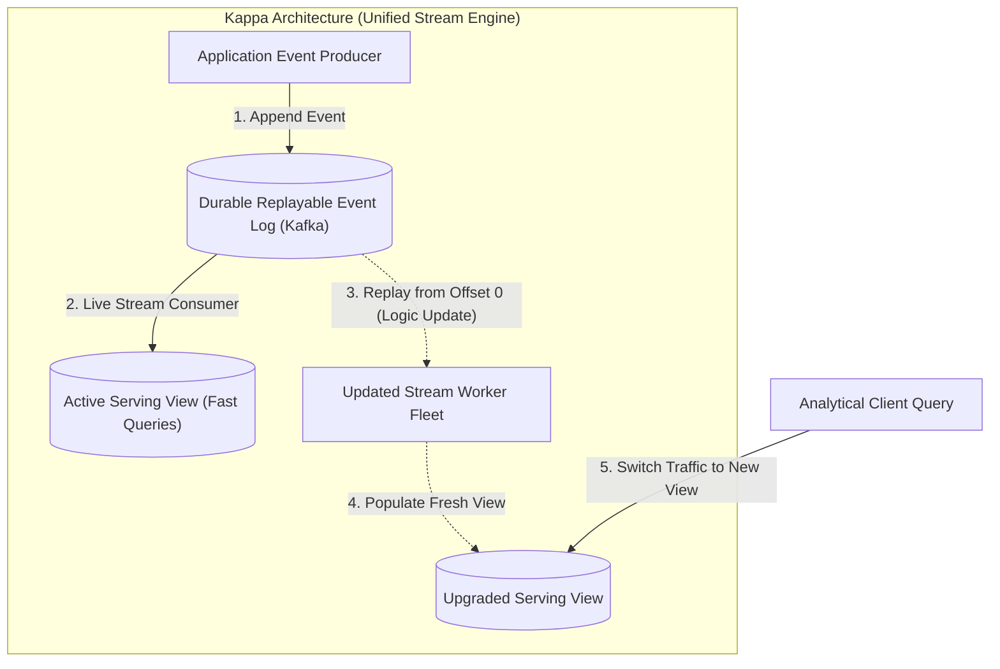

## Batch Processing and MapReduce Distributed Compute

Executing large-scale analytical queries, monthly financial reconciliations, or machine learning feature aggregations directly against operational online transaction processing databases (databases optimized for fast, individual row reads and writes like PostgreSQL or MySQL) creates severe resource contention. Heavy multi-table scan operations lock relational tables, exhaust disk input-output capacity, and slow down user-facing checkout transactions to the point of complete system failure.

When raw uncompressed transaction logs and change streams are queried without preprocessing, single server nodes run out of memory and execution times stretch from minutes into days.

Batch processing moves analytical workloads into a dedicated distributed computing pipeline that operates over scheduled intervals (such as nightly or hourly data runs). Operational databases export incremental change dumps directly into a scalable data lake (a centralized storage repository that holds raw structured and unstructured data files in cost-effective object storage).

Distributed compute clusters (such as Apache Spark or Apache Hadoop) partition the raw files across worker nodes using the MapReduce paradigm (a programming model that filters and transforms data chunks in parallel before combining them into consolidated aggregates), writing the final optimized records into a columnar data warehouse (a database organized by columns rather than rows to accelerate analytical filtering and aggregations).

This pattern isolates operational transactional systems completely from heavy analytical queries while allowing data teams to process petabytes of information in parallel. Systems trade real-time reporting latency for massive aggregate data throughput and predictable compute costs.

## Stream Processing and Real-Time Event Windowing

Traditional batch pipelines introduce substantial data latency because reports and metrics only update when scheduled batch jobs execute hours or days later. In fraud detection, live cybersecurity intrusion monitoring, or dynamic ride-sharing pricing, waiting for a nightly batch job allows fraudulent transactions or system breaches to execute undetected.

Attempting to achieve real-time analytics by running short-interval micro-batch jobs every few seconds creates massive scheduler overhead and struggles to handle out-of-order events (messages that arrive late due to network delays or mobile disconnection).

Stream processing processes incoming data records individually or in micro-windows as soon as they are produced, eliminating batch scheduling delays. Stream engines (such as Apache Flink or Apache Kafka Streams) ingest events continuously from message topics and maintain stateful in-memory accumulators across defined time windows.

The engine handles out-of-order records through watermark tracking (a mechanism that tracks event timestamps rather than arrival time to wait a designated duration for late-arriving messages), emitting updated calculations immediately when time thresholds expire.

Stream processing provides sub-second detection and action boundaries for critical operational events. In exchange, the architecture requires managing state checkpointing (periodically saving in-memory stream state to durable storage) to ensure exact once-processing guarantees during sudden worker node crashes.

## Historical Data Backfilling and Partition Overwriting

When data engineering teams update transformation logic (such as fixing a bug in customer lifetime value formulas or adding a new regulatory tax breakdown), analytical reporting tables immediately contain inconsistent metrics. Historical records calculated under legacy business logic clash with newly generated records, corrupting long-term financial reports and predictive machine learning models.

Attempting to update millions of historical rows with live SQL update queries creates massive database lock contention, risks partially corrupted tables if the script fails midway, and exhausts transaction log capacity.

Data backfilling solves metric updates by re-running deterministic transformation directed acyclic graphs (workflow DAGs where processing steps follow a defined topological order without loops) retroactively across partitioned historical time ranges. An orchestrator (such as Apache Airflow or Dagster) coordinates the parallel execution of compute jobs across individual historical partitions (for example, monthly or daily data folders).

Each backfill worker computes the updated partition in an isolated staging location and performs an atomic partition swap (a fast metadata pointer switch that replaces an entire old data partition with a new one instantaneously), ensuring zero read downtime and preventing partial table corruption.

Atomic partition overwriting guarantees that readers always observe complete, consistent historical datasets even while massive re-computations occur concurrently. If any individual backfill task fails, the staging output is discarded without altering the active production reporting tables.

## Lambda versus Kappa Architecture Tradeoffs

Organizations that require both real-time dashboards and comprehensive historical reporting frequently struggle to balance the low latency of stream processing with the heavy re-computation power of batch systems. Attempting to force a single batch system to handle real-time streaming causes intolerable reporting delays, while forcing a stream system to process years of historical data can overwhelm in-memory state stores.

Deploying separate, uncoordinated systems for streaming and batch processing causes code duplication and logic drift, where the real-time stream engine and the nightly batch engine produce conflicting metric calculations for the exact same business events.

The Lambda architecture unifies these needs by maintaining three distinct layers: a speed layer (stream processing that computes real-time views with low latency), a batch layer (an immutable master data lake that computes perfectly accurate comprehensive views over time), and a serving layer that merges results from both layers when queried.

The Kappa architecture simplifies this model by eliminating the batch layer entirely, treating all data as a single continuous append-only event stream stored in a durable, replayable log (such as Apache Kafka). When business logic changes or historical re-computations are needed, the team deploys a new streaming consumer instance, replays the event log from the beginning of time into a fresh view, and redirects user queries once processing catches up.

Kappa architectures reduce operational overhead by maintaining a single codebase for both real-time processing and historical recalculations. Lambda architectures remain valuable when batch algorithms are fundamentally different from real-time heuristics, while Kappa excels when stream transformation logic can be replayed deterministically over immutable logs.
