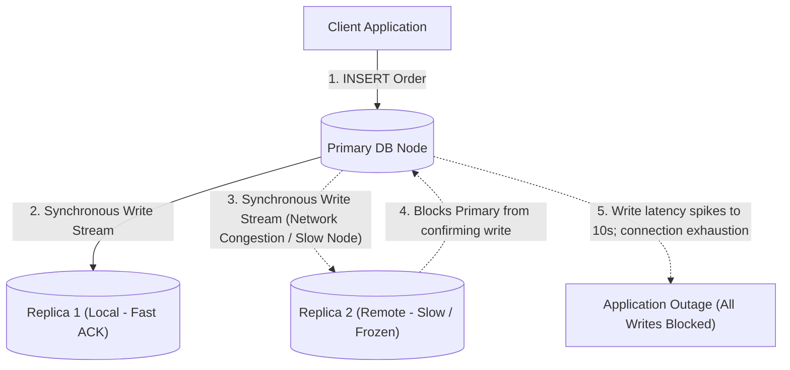
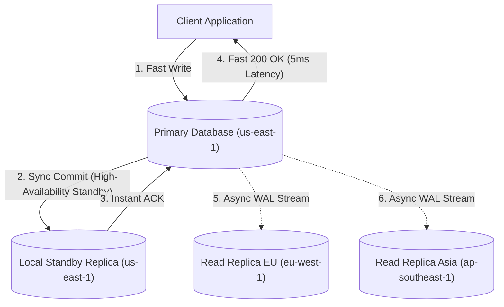
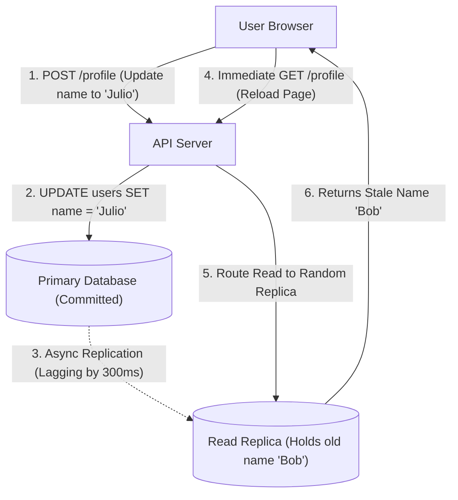
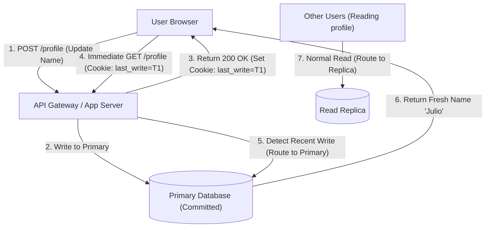
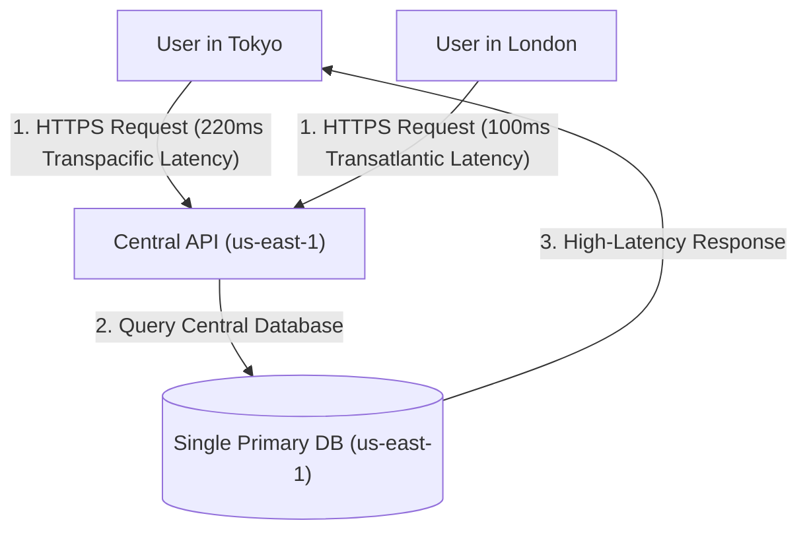
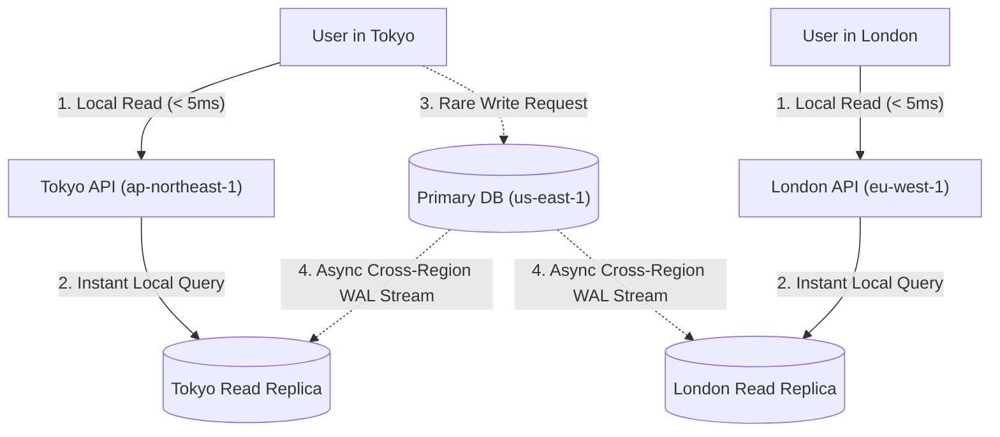
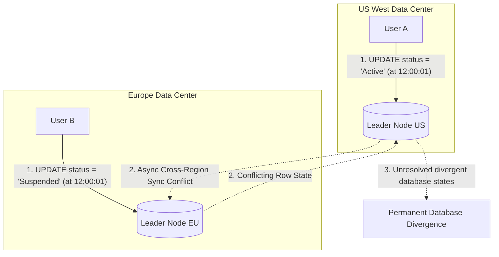
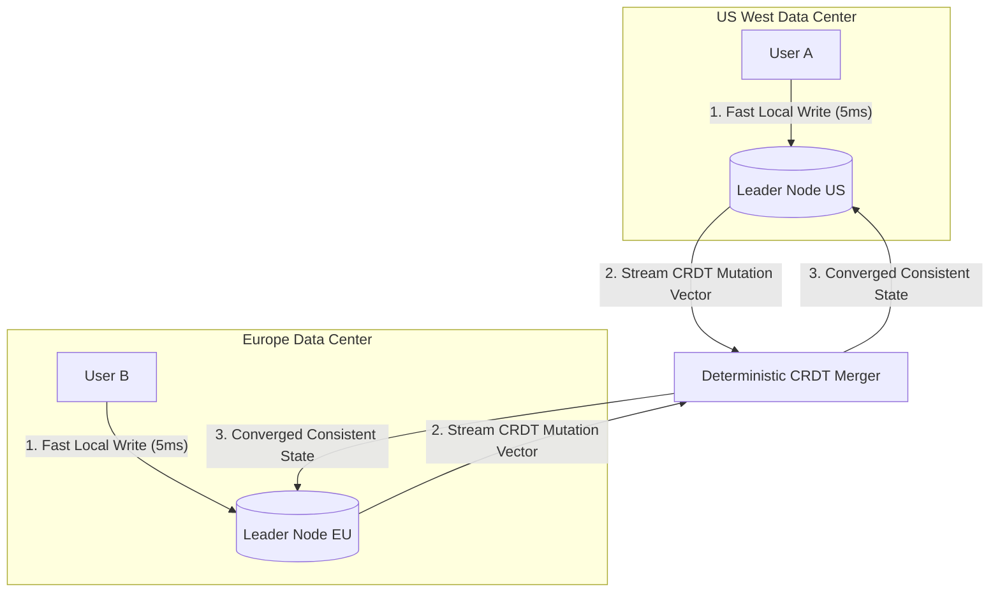

## Synchronous versus Asynchronous Replication Topologies

Single-node database deployments represent a catastrophic single point of failure (a solitary component whose crash halts the entire system) and struggle to serve heavy read traffic from global users. To scale read throughput and provide fault recovery, databases replicate write-ahead transaction logs (sequential log files recording all database mutations before they are applied to storage) from a primary write node to one or more secondary replica instances.

In purely synchronous replication topologies, the primary database must wait for every secondary replica node to acknowledge that the write has been written to disk before confirming success to the client application. If a single replica node suffers a slow network connection, garbage collection pause (a temporary freeze while a server runtime reclaims unused memory), or hardware reboot, the entire system write latency spikes and all incoming write transactions stall.

Semi-synchronous or fully asynchronous replication decouples client write confirmations from secondary node replication progress. The primary database records the mutation, commits locally, replicates synchronously to at least one fast local standby replica for instant high-availability failover, and acknowledges the write immediately to the client with single-digit millisecond latency.

Secondary read replicas across remote availability zones or geographical regions pull updates asynchronously via streaming replication, allowing temporary network hiccups on secondary nodes to occur without impacting primary write throughput.

This semi-synchronous topology provides immediate write availability and protects against regional data loss. System architects accept replication lag (the brief time delay before a committed write is fully applied to asynchronous read replicas) in exchange for resilient global write performance.

## Read-Your-Own-Writes Consistency and Sticky Sessions

Asynchronous replication introduces eventual consistency anomalies, where secondary read replicas temporarily trail the primary database by tens or hundreds of milliseconds. When a user updates their account profile information (such as changing their display name or billing address) and the browser immediately redirects to reload the account overview page, the read query is routed to a lagging replica that has not yet received the update.

The user observes their old, unchanged profile information, leading them to believe the update failed and causing them to submit repeated, duplicate update requests in confusion.

The read-your-own-writes pattern guarantees that an individual user always observes their own latest updates while allowing other users to read from lagging replicas. When an application server executes a write operation, it returns an encrypted cookie or session token to the client containing the timestamp or transaction log sequence number (a monotonically increasing numerical identifier assigned to every database change) of the committed write.

On subsequent read requests, the API gateway or application routing layer inspects the session token; if a write occurred within a designated safety window (for example, the past five seconds), the request is pinned to the primary database, ensuring the user immediately sees their fresh updates.

This hybrid routing pattern provides strong consistency guarantees for the modifying user while preserving horizontal read scalability across the replica fleet for the vast majority of global read traffic. Once the safety window expires, the user session resumes routing to read replicas seamlessly.

## Multi-Region Read Replicas and Latency Optimization

Serving global user traffic from a single centralized data center incurs severe physical network latency (round-trip delays caused by data traveling thousands of miles across undersea fiber optic cables). A customer located in Tokyo or London querying a database located in northern Virginia experiences round-trip network delays exceeding two hundred milliseconds for every database query, making interactive web applications feel sluggish and unresponsive.

Routing millions of global read queries across international boundaries also wastes expensive cross-region bandwidth and increases vulnerability to transoceanic network partition disruptions.

Deploying multi-region read replicas places read-only database nodes directly in regional edge data centers close to end-users (such as Frankfurt, Tokyo, and Sydney). Global edge application servers route incoming read requests directly to the local in-region database replica, serving user reads in single-digit milliseconds without crossing continental boundaries.

All write operations (such as creating orders or updating billing details) are automatically routed across optimized private cloud backbones to the single primary database region, which asynchronously streams write-ahead log updates out to all regional replicas.

This regional topology delivers instantaneous local read performance for international users while centralizing write authority to maintain strong relational data integrity. System administrators tune replication streams with compression and connection pooling to ensure cross-region replication lag remains under a few hundred milliseconds.

## Multi-Leader Replication and Conflict Resolution

In globally distributed applications with high write volumes across multiple continents (such as collaborative document editing or global social networking platforms), routing every single write to a solitary primary database region creates intolerable write latency for overseas users. If the central write region experiences a major power outage or cloud connectivity failure, write operations worldwide halt completely.

However, permitting multiple database nodes in different regions to accept writes independently creates write conflicts (a condition where two users modify the exact same database record concurrently on different nodes with conflicting values).

Multi-leader replication resolves write latency by allowing designated leader nodes in each continent to accept writes locally and propagate them asynchronously to other regional leaders. To resolve conflicting writes deterministically, systems employ conflict resolution algorithms like Last-Write-Wins (using synchronized high-precision wall-clock timestamps to discard older conflicting mutations) or Conflict-Free Replicated Data Types (mathematical data structures like growing sets or counter registers that merge concurrent mutations deterministically without data loss).

For collaborative applications, operational transformation and state-based convergence protocols ensure that all regional nodes eventually arrive at the exact same data representation regardless of the order in which mutations arrived.

Multi-leader topologies deliver ultra-fast write latency worldwide and provide disaster tolerance against entire regional datacenter failures. Engineering teams must accept the increased architectural complexity of conflict detection and design application data models to be naturally commutative (operations whose order of execution does not change the final outcome).
