## Relational Databases and ACID Compliance

Relational databases organize structured data into predefined tables consisting of rigid columns and rows linked together through relational foreign keys (unique identifiers in one table that point to the primary key of another table to maintain referential integrity). In financial systems, e-commerce order processing, and inventory management, modifying multiple related tables simultaneously without atomic transactional boundaries results in partial updates (a broken state where money is deducted from an account but the recipient order is never created).

Unconstrained concurrent writes without strict isolation levels create dirty reads (reading uncommitted data that is subsequently rolled back) and non-repeatable reads (re-reading the same row within a transaction and receiving different data due to concurrent commits).

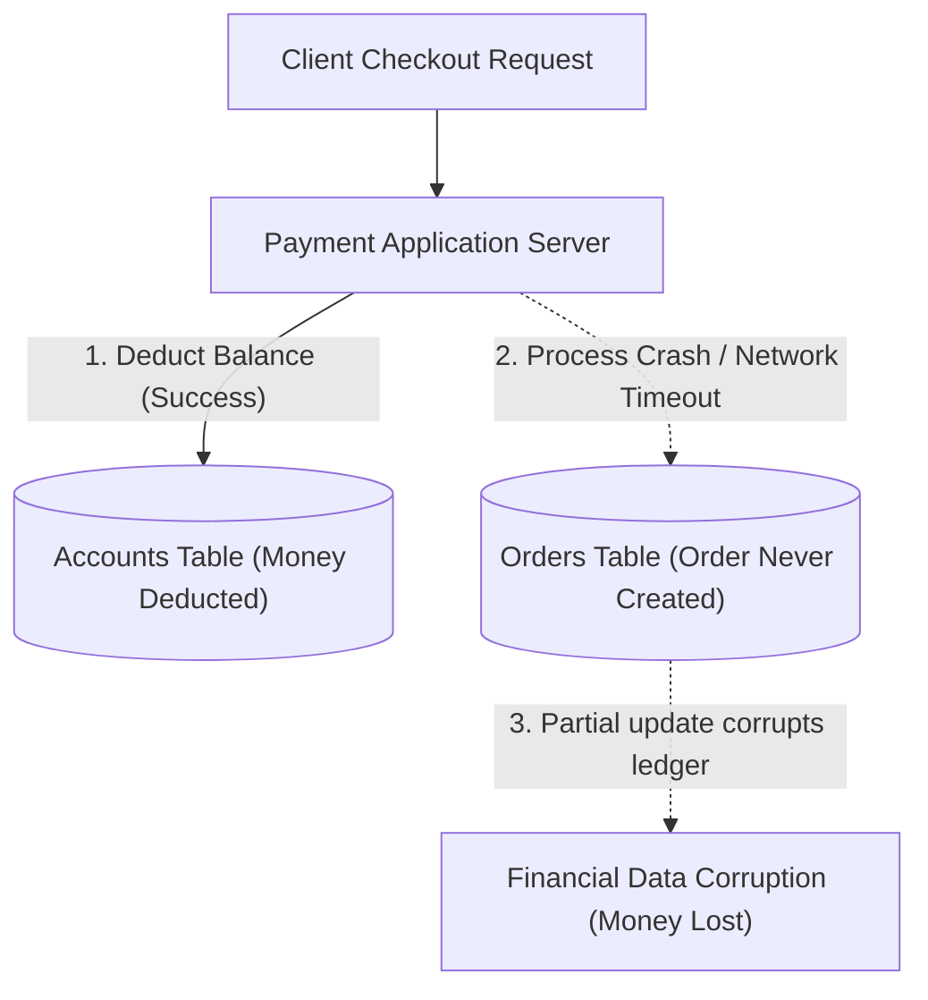

Relational database management systems enforce ACID compliance (a set of four database guarantees ensuring atomicity, consistency, isolation, and durability). The database engine wraps multi-table modifications inside a single atomic transaction, ensuring that either all operations succeed completely or all changes roll back safely to the initial state without leaving partial updates.

Using write-ahead logging (recording all data changes to non-volatile disk logs before modifying table pages), the database guarantees that committed transactions survive hardware crashes and power failures.

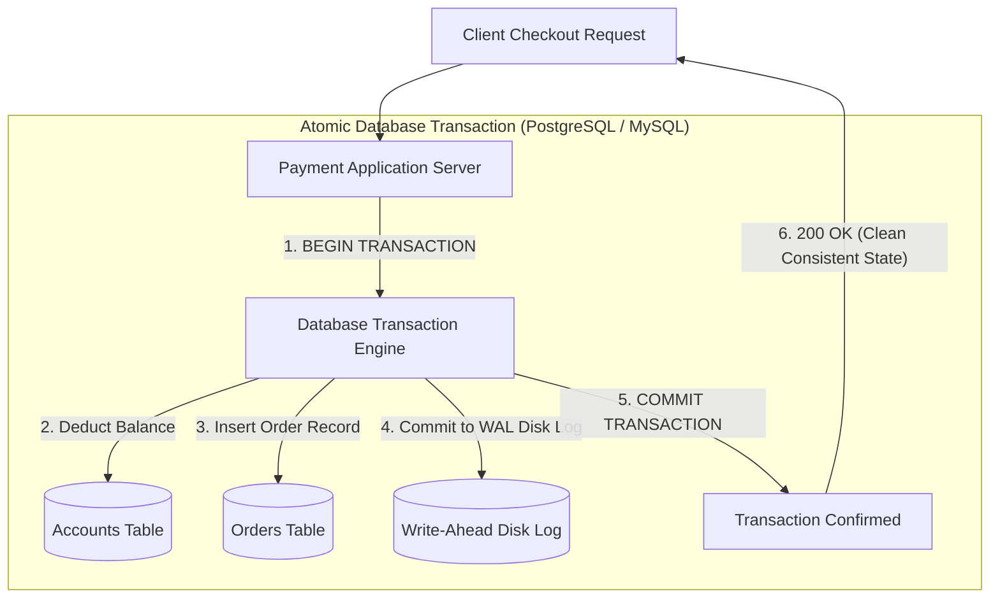

Relational databases provide rock-solid transactional safety, standardized SQL querying, and complex relational joins across multi-entity schemas. In return, systems face scaling ceilings on single-node write throughput and require complex sharding strategies when dataset sizes exceed the storage capacity of individual physical machines.

## Non-Relational Document and Wide-Column Datastores

Enforcing rigid tabular schemas in applications with rapidly evolving, dynamic payloads (such as user profile preferences, catalog product attributes, or telemetry streams) requires frequent, blocking database schema migrations (altering table columns across millions of rows, which locks tables and risks application downtime). When semi-structured JSON documents with unpredictable fields are forced into relational tables, queries require dozens of empty null columns and expensive normalization joins across disparate tables.

Furthermore, traditional relational databases hit write throughput bottlenecks when ingesting hundreds of thousands of continuous time-series events per second across distributed nodes.

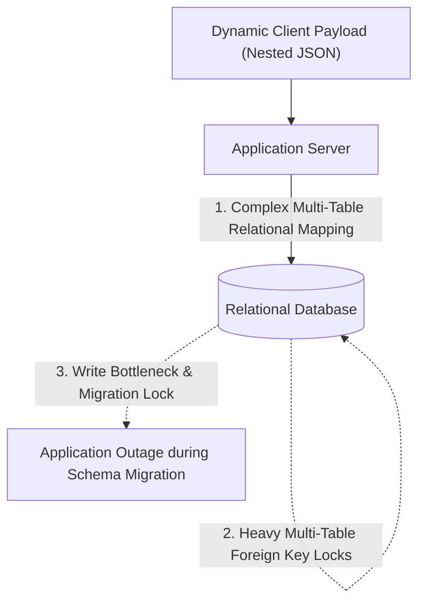

Non-relational document databases (such as MongoDB) store self-contained JSON-like documents within collections, allowing individual records to hold distinct attributes and nested arrays without requiring centralized schema migrations. Applications write flexible data payloads directly, adapting product attributes dynamically as business requirements evolve.

For extreme write throughput, distributed wide-column stores (such as Apache Cassandra) organize data around partition keys, appending writes sequentially to memory and immutable disk commit logs without table locks, scaling write throughput linearly across commodity server nodes.

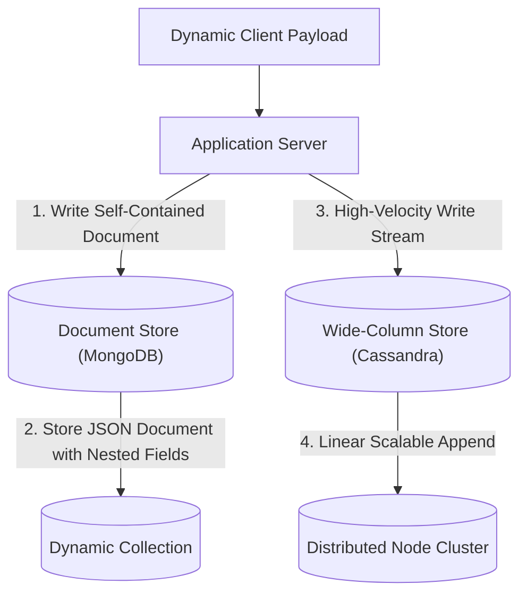

Non-relational databases deliver schema flexibility, horizontal write scalability, and single-digit millisecond read access for self-contained records. These systems trade ACID multi-table join capabilities for raw throughput, requiring application code to handle data validation and cross-entity consistency.

## CAP Theorem and Consistency Tradeoffs

In a distributed database cluster where data is replicated across multiple server nodes, physical network links between machines will inevitably experience packet loss, cable cuts, or routing failures called network partitions. When a network partition occurs, nodes in one data center cannot communicate with nodes in another data center, forcing the system into a fundamental architectural tradeoff.

A distributed database cannot simultaneously provide strong consistency (guaranteeing every read receives the most recent write) and high availability (guaranteeing every non-failing node returns a successful response) in the presence of a network partition.

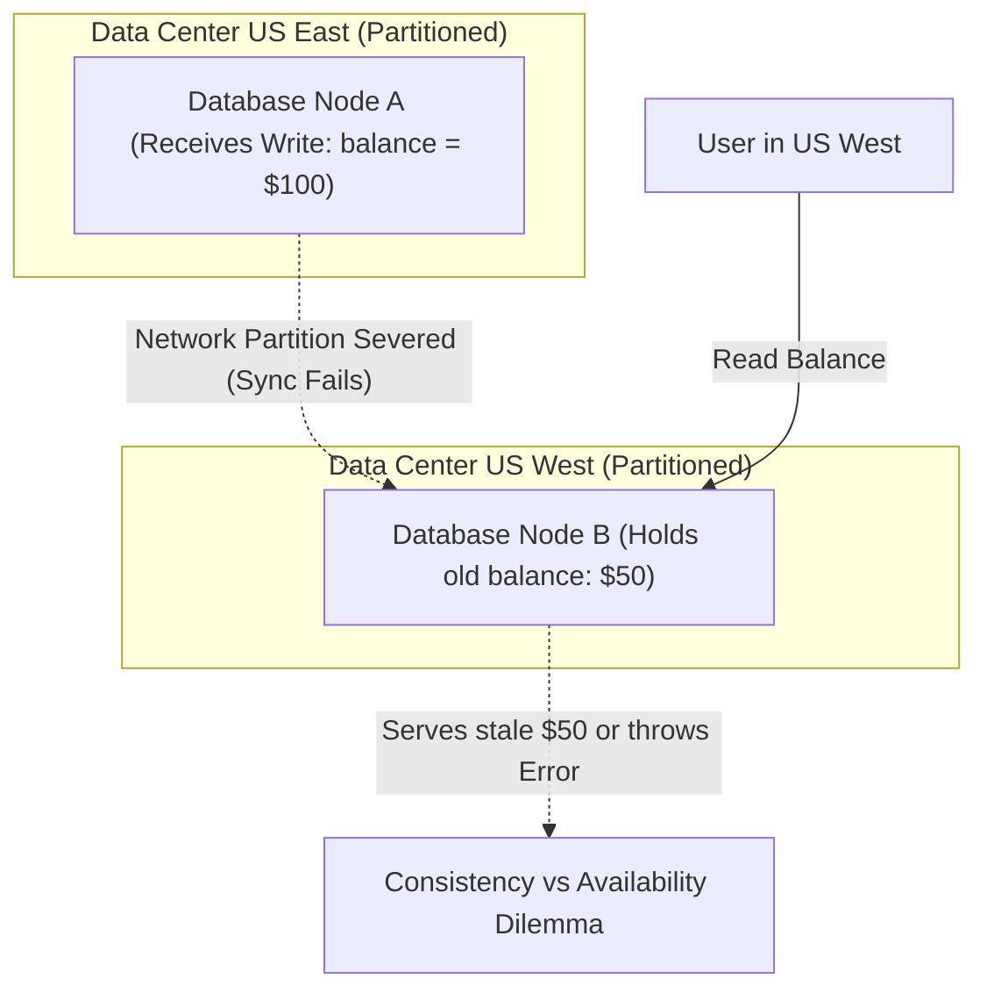

System architects select between CP systems (prioritizing Consistency and Partition Tolerance by rejecting writes when nodes cannot communicate to prevent stale data) and AP systems (prioritizing Availability and Partition Tolerance by accepting writes on both sides of the partition and reconciling data later). Financial and inventory applications choose CP databases (such as Google Cloud Spanner or Apache HBase) to guarantee balance accuracy, accepting temporary request errors during severe network partitions.

Social media feeds, messaging apps, and analytics platforms choose AP databases (such as Apache Cassandra or DynamoDB) using the BASE model (guaranteeing basic availability, soft state, and eventual consistency), ensuring users can always interact with the application even during major telecommunication outages.

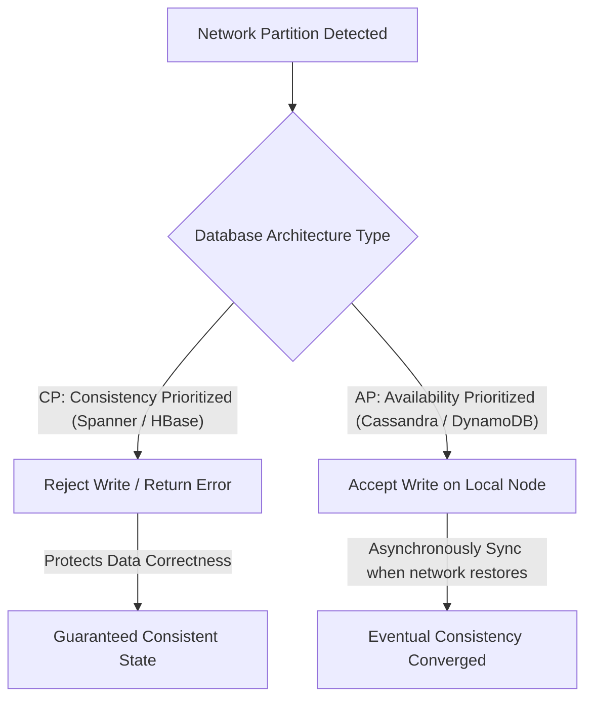

Aligning database selection with specific business domains ensures systems fail safely according to application requirements. Critical financial operations maintain strict consistency at the cost of transient downtime, while social platforms preserve uninterrupted user uptime by accepting temporary data staleness.

## Primary Key and Indexing Strategies

Primary key selection dictates how physical data pages are arranged on disk and how foreign systems reference records. Using sequential auto-incrementing integers for public-facing identifiers exposes systems to enumeration scraping attacks (malicious bots guessing sequential numbers like user identification numbers 1001, 1002, 1003 to scrape customer databases) and causes distributed write bottlenecks when multiple independent shards attempt to generate numbers from a single central counter.

Conversely, generating completely random UUID version 4 strings in relational databases causes severe B-Tree index fragmentation (a condition where random insertion keys force constant disk page splitting, ballooning memory usage and destroying write performance).

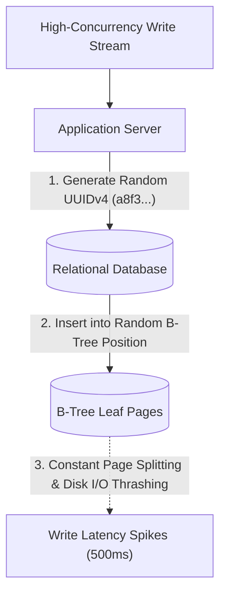

Modern architectures combine compact internal primary keys with time-ordered distributed identifiers for external interfaces. Relational databases optimize internal indexing using auto-incrementing 64-bit integers or time-ordered UUID version 7 identifiers (unique identifiers that embed a millisecond timestamp prefix ahead of random entropy bits).

UUID version 7 identifiers append sequentially to B-Tree index leaf pages without causing page splitting while remaining globally unique and secure against enumeration scraping, allowing distributed microservices and mobile clients to generate collision-free keys locally without central database coordination.

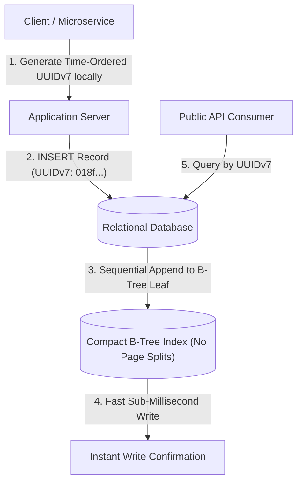

Time-ordered unique identifiers combine the high-performance disk storage characteristics of sequential numbers with the distributed security and non-coordination benefits of global UUIDs. Databases maintain compact, high-speed indexes while application security teams prevent unauthorized scraping.

## In-Memory Datastores and Sub-Millisecond Access

Disk-based databases require complex disk input-output pipelines, buffer cache management, and lock contention handling, capping query response times in the single-digit millisecond range. In latency-sensitive workflows like real-time gaming leaderboards, session authentication validation, and distributed rate limiting, querying disk databases for every user action saturates database connections and introduces noticeable user-facing lag.

Furthermore, executing atomic counter increments or set intersection operations on disk tables under high concurrency causes intense row locking that throttles throughput.

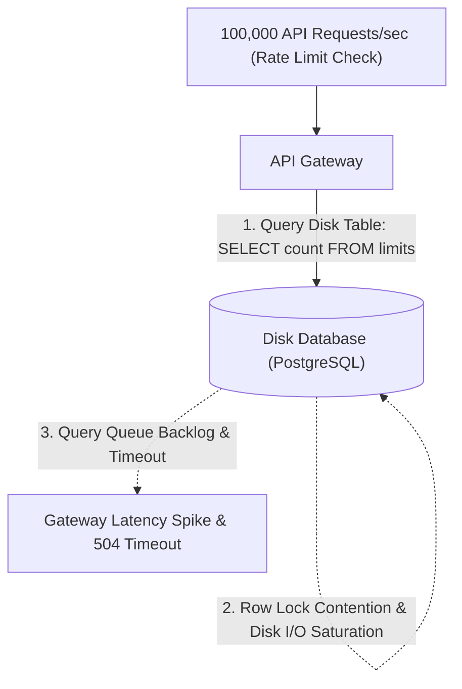

In-memory datastores (such as Redis or Memcached) store entire datasets directly in physical random access memory (RAM), eliminating disk seek operations and delivering sub-millisecond read and write latencies. Redis provides rich in-memory data structures (such as sorted sets, hash maps, bitmaps, and hyperloglogs) that execute atomic operations in microsecond timeframes.

For persistence, in-memory engines utilize background snapshotting (saving full memory dumps to disk periodically) and append-only log files, ensuring that fast in-memory operations are preserved across hardware restarts.

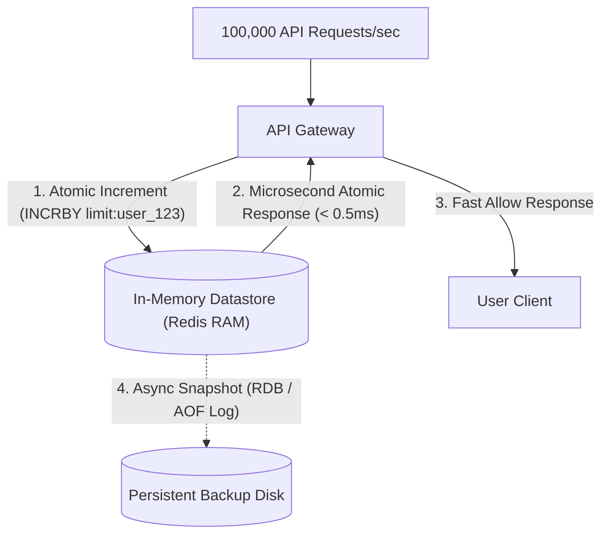

In-memory datastores provide lightning-fast query speeds and high concurrency for transient and high-frequency data. Because RAM costs significantly more per gigabyte than disk storage, systems reserve in-memory storage for hot working datasets and session states while archiving cold data in persistent databases.

## Vector Databases and Semantic Similarity Retrieval

Traditional relational and full-text search databases index data based on exact string matching or keyword stems (such as searching for exact product names like cordless drill). In modern generative artificial intelligence and recommendation systems, users query systems using conversational natural language or images where exact keywords may not appear in the source documents.

Attempting to compute mathematical vector distance calculations (calculating cosine similarity across high-dimensional floating-point arrays) using relational database queries requires exhaustive full-table scans that take minutes per query, making real-time search impossible.

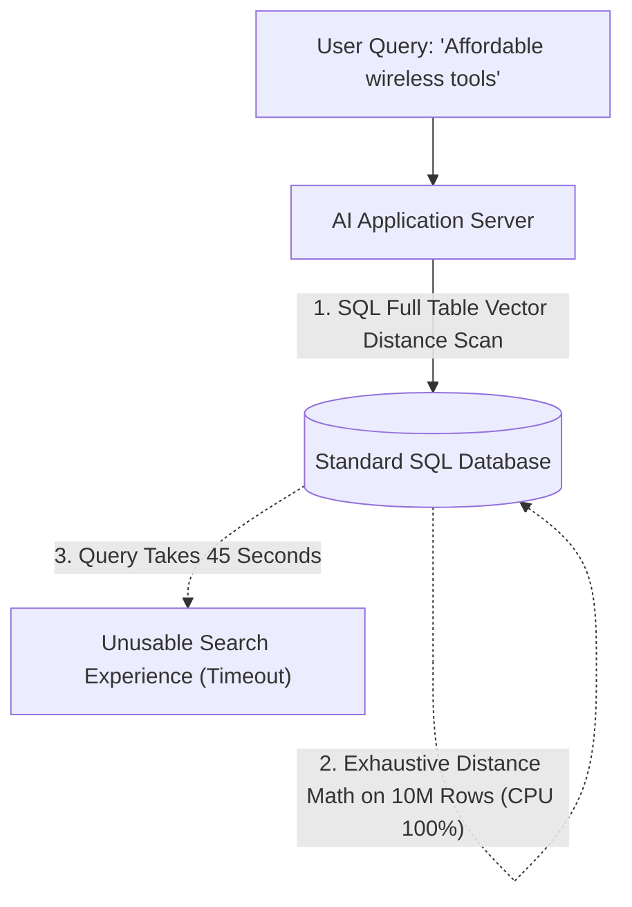

Vector databases (such as Qdrant, Milvus, or Pinecone) store high-dimensional mathematical vector embeddings (arrays of numbers generated by machine learning models that represent the semantic meaning of text or images). The vector database indexes embeddings using approximate nearest neighbor algorithms like Hierarchical Navigable Small World graphs (multi-layer graph structures that navigate high-dimensional space in logarithmic time).

During Retrieval-Augmented Generation workflows, the vector database retrieves the top most semantically relevant document chunks in milliseconds and injects them into the context window of a large language model to produce accurate, context-grounded answers.

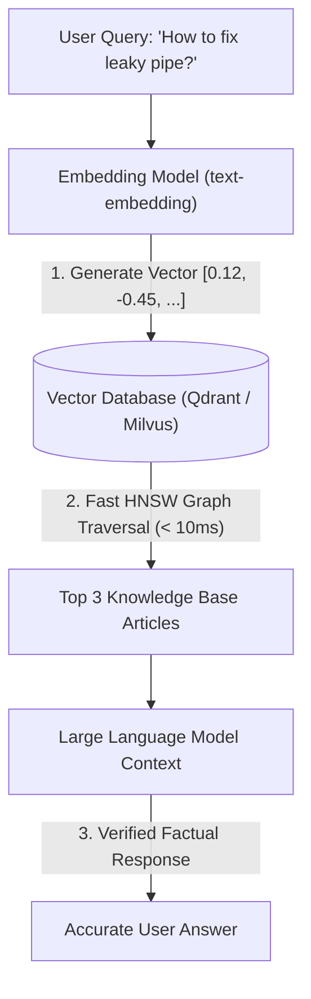

Vector databases enable lightning-fast semantic search, personalization engines, and intelligent AI chatbots across massive unstructured datasets. Systems trade minor mathematical approximation error for orders-of-magnitude faster vector retrieval speeds.

## Search Engine Databases and Inverted Indexes

Relational databases evaluate text search queries using wildcard pattern matches (such as scanning for substring matches inside text columns), requiring full table scans that inspect every single row in the database. When users search across millions of blog posts, e-commerce product catalogs, or application log files with typo tolerance and multi-attribute filtering, relational queries grind to a complete halt.

Relational indexes are structured to find exact keys rather than tokenized word fragments, making fuzzy matching and relevancy scoring computationally prohibitive.

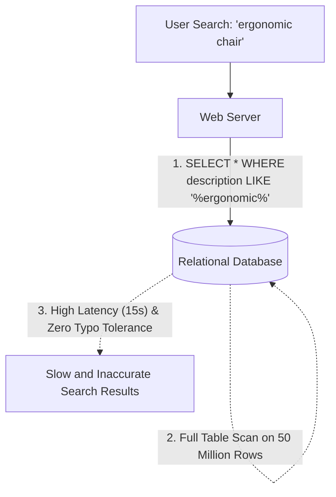

Search engine databases (such as Elasticsearch, OpenSearch, or Meilisearch) process text using an inverted index (a data structure that maps every unique word or token to the exact list of documents that contain it, similar to the index at the back of a textbook). When documents are ingested, an analyzer splits text into lowercase tokens, removes stop words, and applies stemming algorithms.

When a user submits a search query, the search engine intersects the inverted index entries in milliseconds, calculating relevance scores (such as BM25 ranking algorithms that measure term frequency and document rarity) and providing instant typo tolerance.

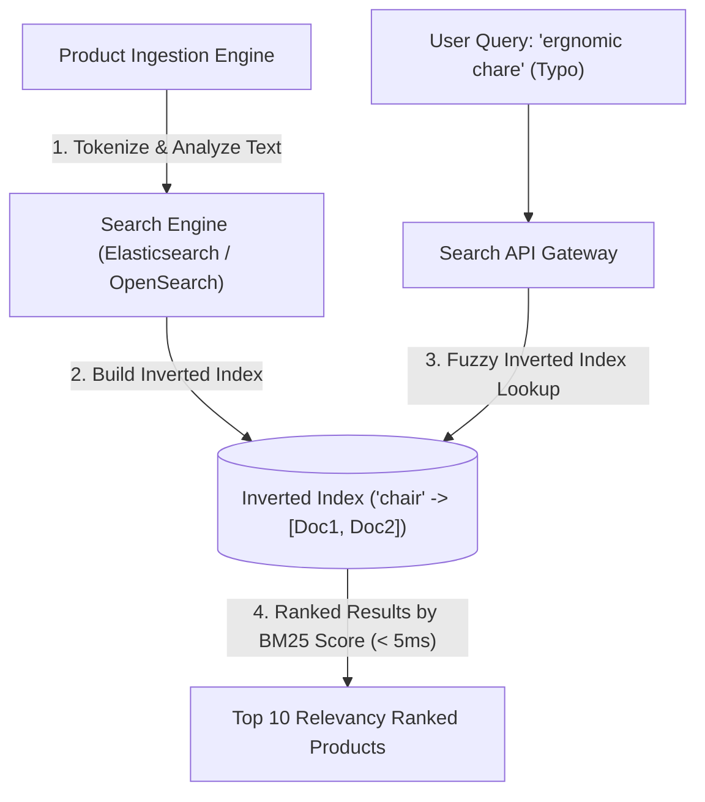

Search engines deliver sub-second full-text searching, autocomplete suggestions, and complex faceted filtering across massive unstructured document stores and log pipelines. Systems maintain a search engine alongside their primary transactional database, synchronizing updates via change data capture pipelines.

## Graph Databases and Complex Relationship Traversal

Relational databases model connections between entities using join tables containing foreign keys. In applications with deeply nested or multi-degree relationships (such as social networks finding friends of friends, financial fraud rings laundering funds across shell companies, or recommendation engines traversing user interest graphs), querying connections requires recursive, multi-table SQL joins.

As the depth of the relationship traversal increases beyond two or three degrees of separation, relational query execution time explodes exponentially, leading to severe memory exhaustion and database lockouts.

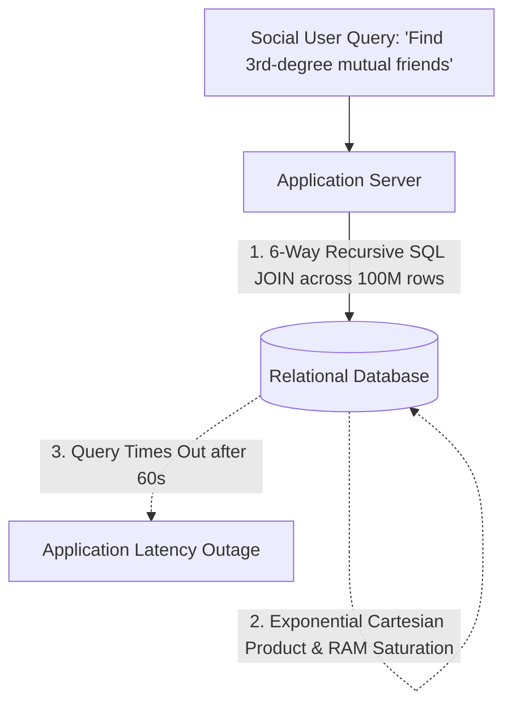

Graph databases (such as Neo4j or Amazon Neptune) store data natively as nodes (entities like people, bank accounts, or locations) connected by directed edges (relationships like friends with, transferred money to, or works at), with properties attached to both nodes and edges. The database engine uses index-free adjacency (a storage model where each node holds direct physical memory pointers to its neighboring nodes), allowing traversals to navigate relationships in constant time.

Traversing millions of complex relationship hops executes in milliseconds regardless of overall database size because the engine follows direct memory pointers rather than computing expensive multi-table join matches.

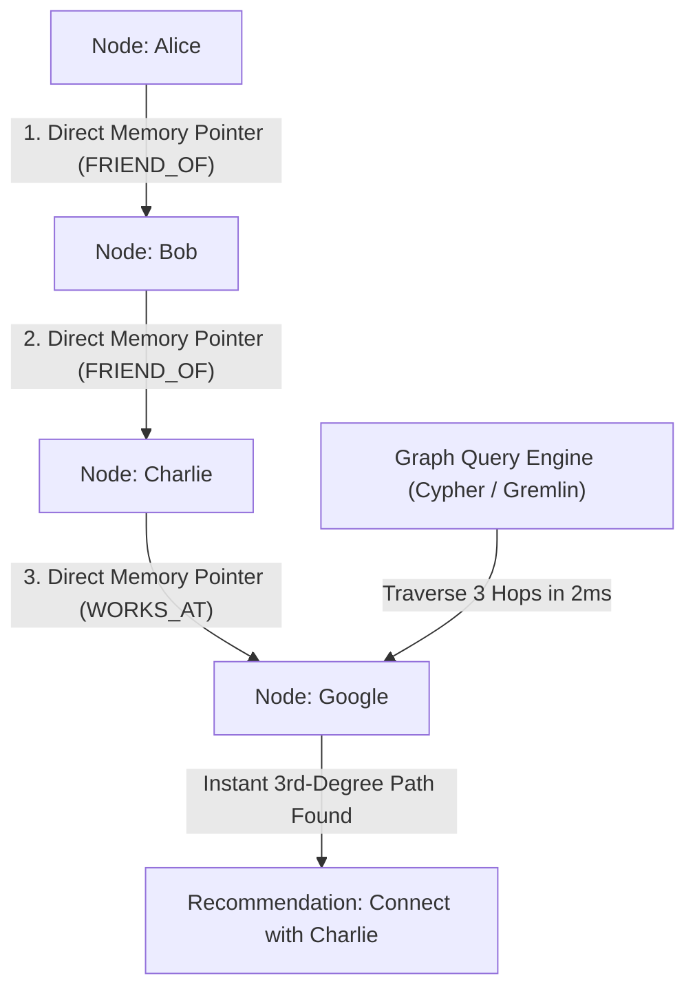

Graph databases eliminate exponential join penalties and provide intuitive query languages for heavily connected datasets. Systems utilize graph databases for specialized relationship-heavy domains like fraud detection, knowledge graphs, and social networks while leaving tabular accounting records in relational storage.
