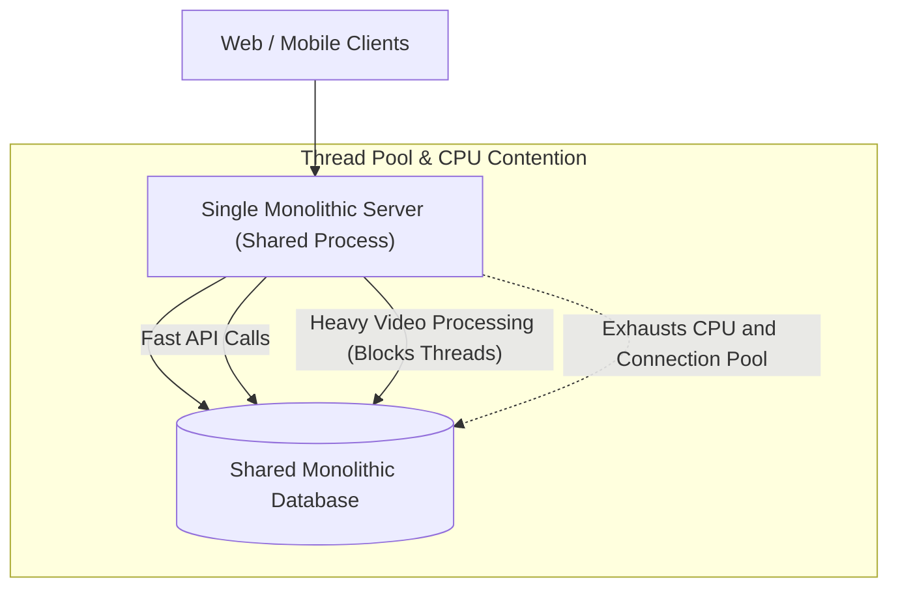
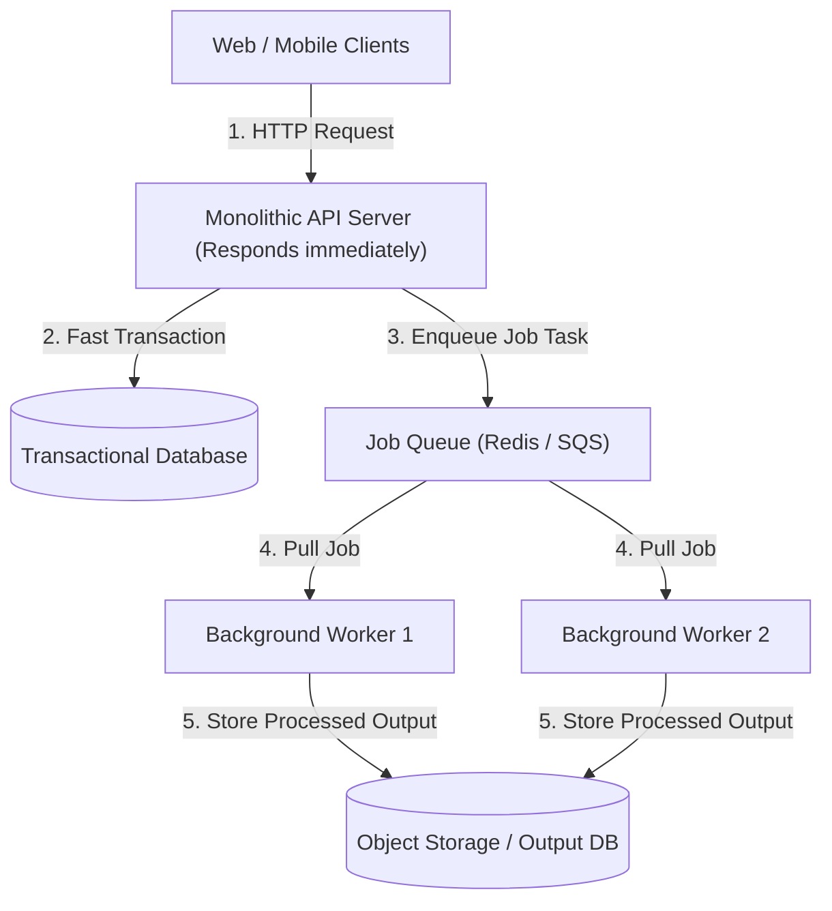
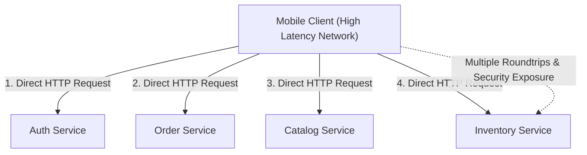
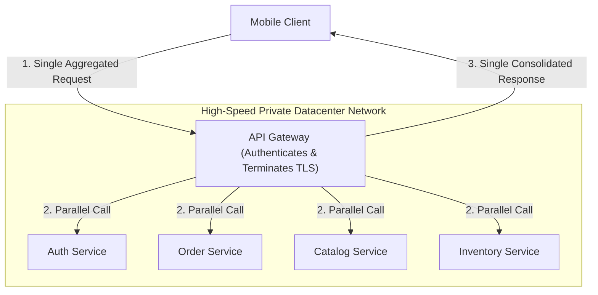

## Monolithic Architecture and Asynchronous Decoupling

A monolithic architecture packages all business logic, background tasks, and database queries into a single executable service program connected to a shared central database (a single persistent data store that holds all company records). In initial development stages, this model delivers fast local developer iteration, straightforward testing, and direct in-memory function calls without any network latency (the delay incurred when transmitting data packets across physical network cables).

As application traffic expands, compute-intensive operations like video transcoding or large analytical report generation run on the same server worker threads that handle latency-sensitive user HTTP requests. When heavy background calculations monopolize server CPU processing cores or exhaust available database connection pools (reusable sets of database connections held open to handle queries), incoming client requests queue up indefinitely and eventually time out, causing platform-wide service degradation.

Offloading resource-intensive workloads to asynchronous worker queues separates fast synchronous user requests from long-running compute jobs. The monolithic API server receives the incoming client request, writes a small job descriptor message to an in-memory or disk-backed message queue (an intermediary buffer system that holds task messages until workers are ready to process them), and immediately returns an acceptance response (such as an HTTP status 202 Accepted) to the client with a unique tracking identifier.

Independent worker nodes pull task messages from the queue and execute the heavy transformations in dedicated, isolated compute environments, protecting the primary API server and operational database from resource starvation.

This decoupling guarantees consistent, sub-second API response times and allows independent horizontal scaling (adding more worker machines dynamically based on queue depth). The client application retrieves the final processing output by polling a dedicated status endpoint or receiving an automated webhook notification (an HTTP callback sent to the client once background execution finishes).

## Client Server Bottlenecks and API Gateways

In direct client-to-service architectures, client applications (such as mobile apps and web browsers) establish separate network connections to dozens of independent backend microservices. Mobile wireless networks with high latency and packet loss suffer severe performance degradation when rendering a single screen requires dozens of sequential round trips to assemble view data from disparate services.

Exposing internal microservices directly to public client networks also leaks internal network topologies, duplicates authentication checks across every individual service, and prevents backend teams from refactoring service boundaries without breaking legacy mobile application versions.

An API gateway sits as a reverse proxy entry point (a front-door server that intercepts all incoming internet traffic and manages routing before requests reach internal services) between external clients and internal backend fleets. The gateway terminates client connections over optimized transport protocols, validates security credentials once at the perimeter, and handles SSL termination (decrypting incoming encrypted traffic at the edge so internal servers avoid cryptographic compute overhead).

The gateway fans out requests to internal microservices concurrently across the fast internal datacenter network, aggregates the individual responses into a single consolidated payload, and returns it to the client device in a single round trip.

This architecture minimizes mobile latency, enforces centralized rate limiting and security filtering, and allows backend microservices to evolve without impacting client applications. The API gateway is deployed across multiple availability zones with automated failover to ensure the gateway itself never becomes a single point of failure (a solitary component whose shutdown halts the entire system).
