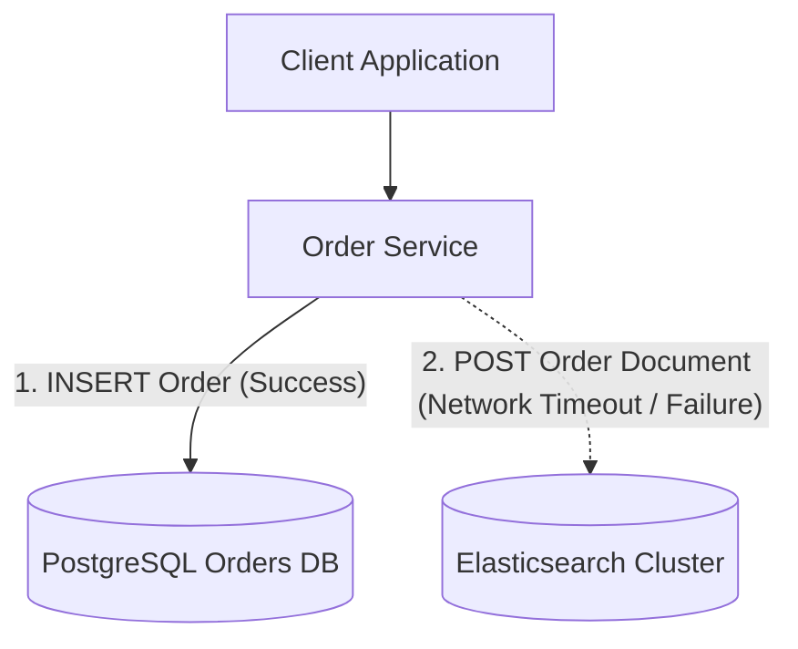
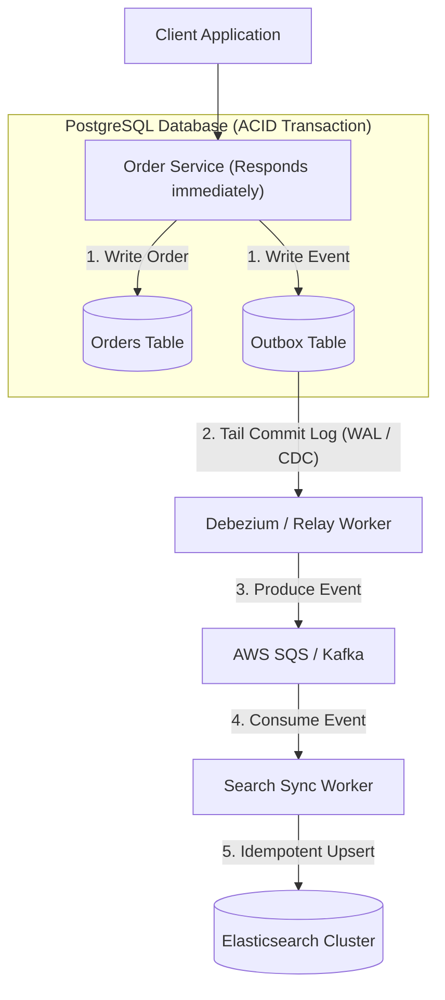
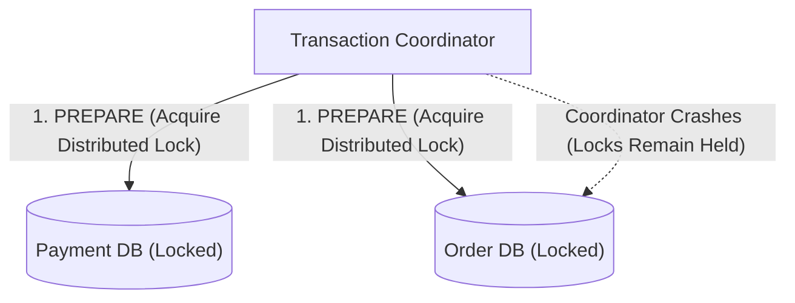
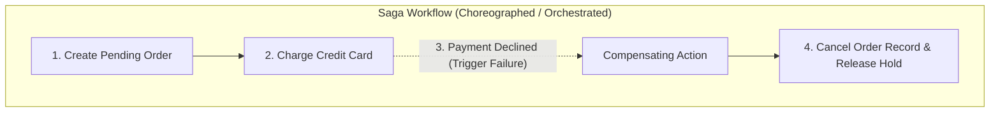

## Dual Writing and Transactional Outbox

Dual writing occurs when an application service attempts to update two separate data stores sequentially within a single request cycle. Because distributed transactions across disparate datastores are fragile and expensive, network failures or process crashes between the first write and the second write inevitably leave the system in an inconsistent state (a broken condition where one database has updated data but the second database still holds outdated information).

When the primary database write succeeds but the secondary search index write fails, the application cannot reliably roll back the database change without introducing complex distributed compensation logic. Retrying the secondary write synchronously (blocking the user request while waiting for the network) increases request latency (response delay) and risks unbounded thread exhaustion (running out of server worker capacity) during downstream outages.

The transactional outbox pattern eliminates dual writing by recording the domain entity and an outgoing event record together inside a single ACID database transaction (a database guarantee ensuring all grouped operations either completely succeed together or safely roll back without partial data corruption). A separate asynchronous relay process monitors the outbox table via change data capture (a technology that listens to database transaction logs to detect new records in real time) and reliably publishes the events to a distributed message queue.

Downstream consumers read events from the message queue and update secondary data stores independently, guaranteeing that no state updates are lost even if downstream components experience downtime.

This pattern trades immediate consistency for eventual consistency (a model where data replicas become synchronized across all systems after a slight delay) while achieving fault isolation and zero data loss. The application must design downstream consumers to be idempotent (capable of receiving the exact same message multiple times without creating duplicate records or incorrect side effects).

## Two Phase Commit and Saga Pattern

Two-phase commit coordinates transactions across multiple distributed databases by locking resources across all participants during a prepare phase and committing them in a second phase. This protocol enforces strict atomicity (guaranteeing that all distributed write steps either commit together or none commit at all) across distributed nodes under a centralized coordinator.

In high-throughput distributed systems, holding locks across network boundaries creates extreme latency spikes and severe cascading bottlenecks. If the coordinator crashes while participants hold locks, participant nodes remain blocked indefinitely, exhausting connection pools (running out of available database communication channels) and taking down upstream services.

The saga pattern manages distributed business transactions as a sequence of local transactions across independent services. Each service executes its local database transaction, updates its state, and publishes a domain event or triggers the next step in the saga.

If a local transaction fails along the execution path, the saga executes a series of compensating transactions (semantic undo operations designed to reverse the business effects of previous commits) in reverse order to undo the previously committed changes and restore business consistency.

Sagas eliminate distributed blocking locks and allow services to scale horizontally with high availability (the percentage of time a system remains operational and accessible). Compensating actions are semantic rollbacks rather than physical database rollbacks, meaning intermediate dirty reads (reading temporary state that may later be reversed) may be briefly visible to other processes during execution.
