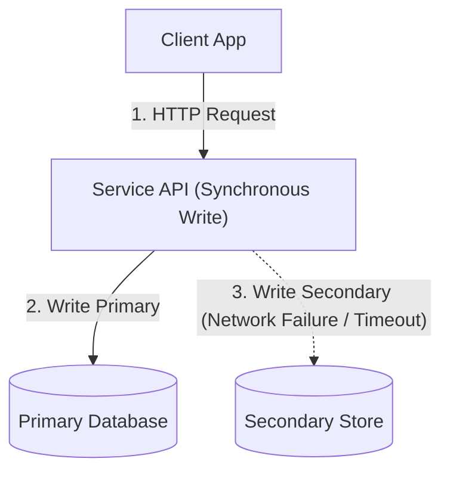
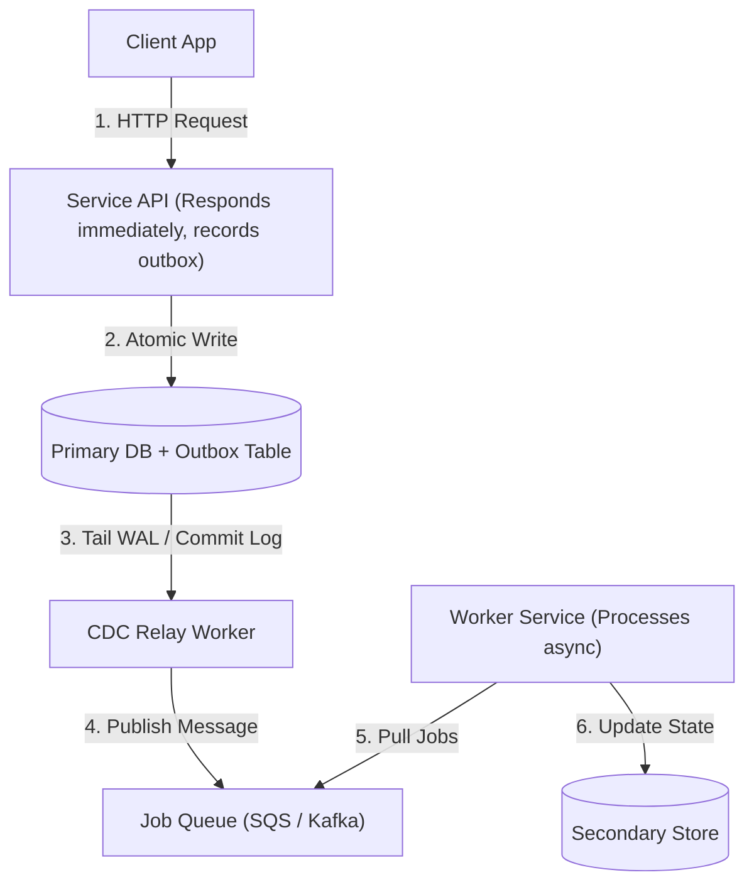
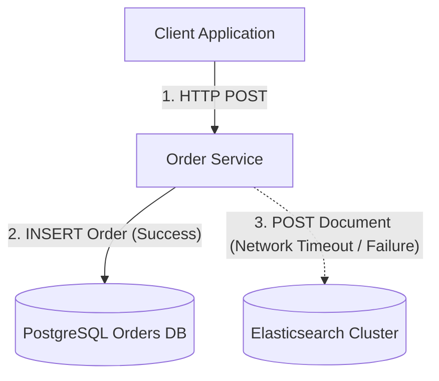
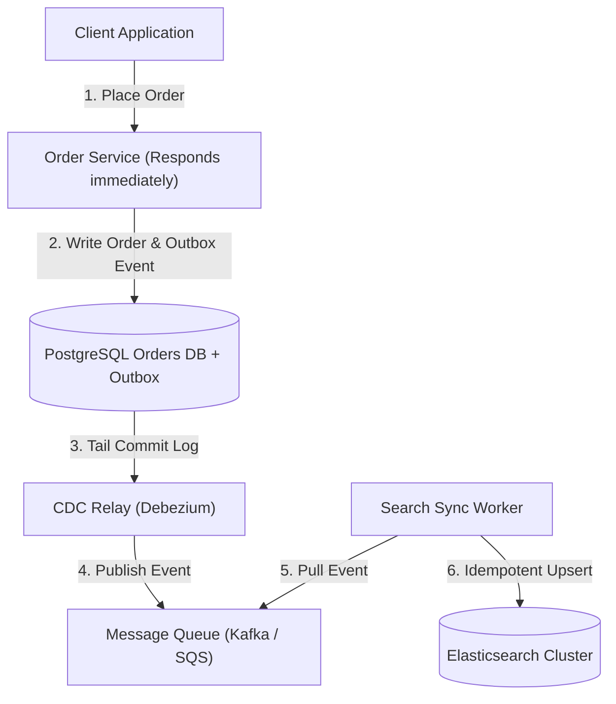

# System Design Handbook Skill

This skill defines the operational standards and constraints for writing handbook-style system design documentation. The core objective is high-density, fast-absorption knowledge transfer where architecture is communicated through clean, flat Mermaid diagrams and unadorned, atomic plain-text paragraphs using accessible English with parenthetical explanations for technical terms.

---

## 1. Core Principles & Delivery Framework Philosophy

Traditional documentation often suffers from excessive prose, scattered code snippets, and confusing lists. This handbook format prioritizes rapid comprehension and delivers working, production-grade systems based on the System Design in a Hurry Delivery Framework:

1. Focus on delivering a working system: Prioritize the primary data paths, core components, and failure modes that prove the system actually works end-to-end before optimizing edge cases.
2. Flat and clean visuals do the heavy lifting: Diagrams illustrate the mechanism, failure mode, and resolution clearly without visual clutter or unnecessary graph complexity.
3. Accessible precision: Plain-English sentences explain complex engineering principles, pairing every technical term with an immediate plain-language explanation in parentheses.
4. Zero formatting distraction: Prose contains no bolding, no italics, no bullet points, and no inline markdown decorations.

---

## 2. Strict Formatting & Structural Rules

When generating or editing system design documentation under this skill, you must enforce the following rules:

### Rule 1: Accessible English with Parenthetical Jargon Explanations
Use simple, clear English vocabulary while preserving technical accuracy.
- Whenever a technical term, engineering concept, or architecture acronym is introduced (such as ACID, CDC, idempotent, eventual consistency, backpressure, or circuit breaker), immediately explain what it means in simple terms inside parentheses `()`.
- Example: "The service uses an idempotent handler (a mechanism where processing the same message multiple times produces the exact same outcome without duplicate charges)."
- Example: "The database enforces ACID transactions (guarantees that database operations either completely succeed together or leave data untouched without partial corruption)."
- Maintain conversational clarity so that any engineer can absorb the mechanism instantly without guessing terminology.

### Rule 2: Zero Markdown Styling in Prose
Prose must be strictly plain text.
- Do not use bullet points or numbered lists (`-`, `*`, `+`, `1.`, `2.`).
- Do not use inline styling such as bold (`**text**`), italics (`*text*` or `_text_`), strikethrough, or underline.
- Do not use code blocks or inline code formatting for language syntax (` ```python `, ` `const x = 1` `).
- All explanations must flow naturally in standard grammatical sentences and standalone paragraphs.

### Rule 3: Flat and Clean Mermaid Diagrams (Delivery Framework Style)
Mermaid diagrams are the primary visual medium and must remain clean, flat, legible, and syntactically valid:
- Use `flowchart TD` or `flowchart LR` with direct, descriptive node and edge labels.
- Follow the clean whiteboard style of the System Design in a Hurry framework: keep node labels action-oriented (for example: `Server["API Server (Responds immediately, queues background job)"]` and `Workers["Worker Fleet (Pulls jobs off queue, processes reports)"]`).
- Keep edge labels clear and descriptive (for example: `-->|"HTTP Request"|`, `-->|"Add job to DB"|`, `-->|"Async Pull"|`, `-.->|"Fails midway (Inconsistent State)"|`).
- **Strict Mermaid Syntax Rules**:
  - Always write labeled arrows in the forward direction: `NodeA -->|"Action label"| NodeB` or `NodeA -.->|"Dotted label"| NodeB`.
  - NEVER use reverse labeled arrows like `NodeA <--|"label"| NodeB` (Mermaid parser does not support pipe labels on left arrows and will throw a parse error). If a consumer pulls from a queue, write `Consumer -->|"Pull Jobs"| Queue` or `Queue -->|"Deliver Jobs"| Consumer`.
  - Always enclose all node labels and edge labels in explicit double quotes: `Node["Text"]` and `-->|"Edge Text"|`.
  - Avoid special characters (`<`, `>`, `&`) inside labels unless properly escaped or quoted.
- Avoid deeply nested subgraphs or visual clutter; organize nodes so the flow reads naturally from client input to background execution and data persistence.

### Rule 4: Heading Hierarchy & File Scope
- Each markdown file is dedicated to one macro topic (for example: `architectures.md`, `data_consistency.md`, `caching_strategies.md`).
- Subtopics within a file must be demarcated exclusively by level 2 headings: `## Subtopic Name`.
- Do not use level 1 (`#`), level 3 (`###`), or level 4 (`####`) headings inside topic files.

### Rule 5: Atomic Paragraph per Idea
- Exactly one idea per paragraph.
- If an architectural concept involves three key takeaways, present them as exactly three separate plain-text paragraphs.
- Never bundle multiple distinct concepts or unrelated trade-offs into a single paragraph.

### Rule 6: Short, Direct, High-Signal Text
- Paragraphs must be concise (typically 2 to 4 sentences).
- Eliminate all conversational fluff, introductory filler, and generic transitions.
- Maintain technical accuracy without sacrificing brevity.

### Rule 7: Mandatory Problem and Solution Diagram Pairing
Every subtopic must contain two Mermaid diagrams:
1. **Problem Diagram**: Illustrates the anti-pattern, bottleneck, race condition, or point of failure.
2. **Solution Diagram**: Illustrates the production-grade, resilient, flat and clean working architectural fix.

Both diagrams must be clearly placed within the subtopic flow alongside their corresponding explanatory paragraphs.

---

## 3. Topic Schema Template

When generating a topic file or subtopic entry, use the following layout:

````markdown
## Subtopic Title

Plain text paragraph stating the core operational context or the fundamental challenge in accessible English with parenthetical explanations (simple definitions) for any technical terms. This paragraph introduces the first key idea without any bold text, italic styling, or bullet lists.

Plain text paragraph detailing the specific failure mode, performance bottleneck, or data integrity issue that occurs under scale or concurrent load.



Plain text paragraph explaining the architectural resolution and the mechanism used to guarantee correctness, availability (the percentage of time a system remains operational and accessible), or throughput (the number of actions processed per second).



Plain text paragraph summarizing the operational tradeoffs, latency characteristics (the round-trip time delay before completing an operation), or eventual consistency guarantees (data will become synchronized across all nodes after a short delay) of the solution.
````

---

## 4. Reference Exemplar: Dual Writes vs. Transactional Outbox

Below is an exact reference example demonstrating complete compliance with all skill constraints:

````markdown
## Dual Writes and Eventual Consistency

Dual writing occurs when an application service attempts to update two separate data stores sequentially within a single request cycle. Because distributed transactions across disparate datastores are fragile and expensive, network failures or process crashes between the first write and the second write inevitably leave the system in an inconsistent state (a broken condition where one database has updated data but the second database still holds outdated information).

When the primary database write succeeds but the secondary search index write fails, the application cannot reliably roll back the database change without introducing complex distributed compensation logic. Retrying the secondary write synchronously (blocking the user request while waiting for the network) increases request latency (response delay) and risks unbounded thread exhaustion (running out of server worker capacity) during downstream outages.



The transactional outbox pattern eliminates dual writing by recording the domain entity and an outgoing event record together inside a single ACID transaction (a database guarantee ensuring all grouped operations either completely succeed together or safely roll back without partial data corruption). A separate asynchronous relay process monitors the outbox table via change data capture (a technology that listens to database transaction logs to detect new records in real time) and reliably publishes events to a message queue.

Downstream worker services pull events from the message queue and update secondary data stores asynchronously (in the background without making the user wait), guaranteeing that no state updates are lost even if downstream components experience downtime.



This pattern trades immediate consistency for eventual consistency (a model where data replicas become synchronized across all systems after a slight delay) while achieving complete fault isolation and zero data loss. The application must design downstream consumers to be idempotent (capable of receiving the exact same message multiple times without creating duplicate records or incorrect side effects).
````

---

## 5. Handbook Topic Taxonomy

When building chapters for the handbook, organize files according to this taxonomy:

1. **01_architectural_patterns.md**
   - Monolith and Modular Monolith
   - Microservices and Domain Boundaries
   - Event-Driven Architecture
   - Command Query Responsibility Segregation (CQRS)

2. **02_data_consistency_and_transactions.md**
   - Dual Writes and Transactional Outbox
   - Two-Phase Commit and Distributed Locking
   - Saga Pattern (Choreography vs. Orchestration)
   - Idempotency and Deduplication Keys

3. **03_caching_and_read_performance.md**
   - Cache-Aside and Eviction Policies
   - Write-Through and Write-Behind Caching
   - Cache Stampede and Mutex Locking
   - Read Replicas and Replication Lag

4. **04_messaging_and_async_processing.md**
   - Point-to-Point Queues vs. Publish-Subscribe
   - Dead Letter Queues and Poison Pill Handling
   - Backpressure and Consumer Rate Limiting
   - Message Ordering and Partition Keys

5. **05_partitioning_and_storage_scaling.md**
   - Horizontal Sharding and Shard Key Selection
   - Consistent Hashing and Ring Rebalancing
   - Leader-Follower Failover and Split-Brain Prevention

6. **06_resilience_and_fault_tolerance.md**
   - Circuit Breaker Pattern
   - Rate Limiting (Token Bucket and Leaky Bucket)
   - Retry Strategies with Exponential Backoff and Jitter
   - Bulkhead Isolation

---

## 6. Pre-Generation Checklist

Before delivering any system design documentation, verify:
- [ ] Technical jargon and concepts are paired with immediate plain-English parenthetical explanations `()`.
- [ ] Visuals follow the flat, clean delivery framework style with clear action labels.
- [ ] Mermaid syntax is strictly valid: all labeled arrows use forward syntax (`NodeA -->|"Label"| NodeB`), NEVER reverse pipe labels (`<--|...|`).
- [ ] All node labels and edge labels are wrapped in double quotes.
- [ ] No bolding (`**`) or italics (`*`, `_`) in text body.
- [ ] No bullet points or numbered lists anywhere in text body.
- [ ] No backtick code blocks (only ````mermaid` blocks are permitted).
- [ ] Subtopics are strictly titled with `##`.
- [ ] Each paragraph contains exactly one cohesive idea (2 to 4 sentences).
- [ ] Every subtopic contains both a Problem Diagram and a Solution Diagram.
- [ ] Mermaid syntax is valid, clean, and immediately readable.
