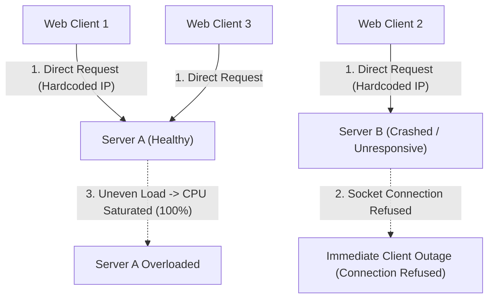
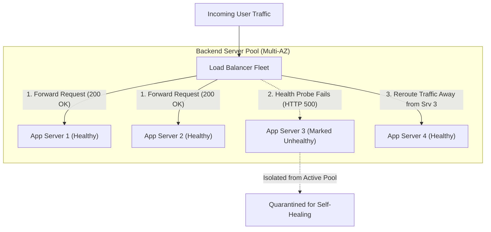
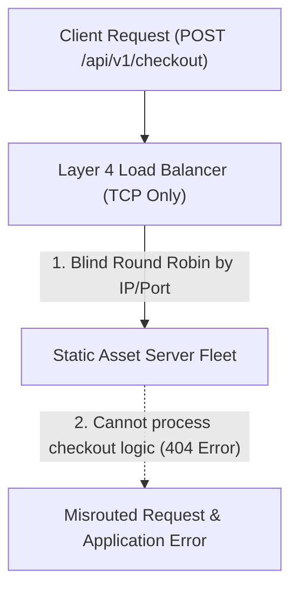
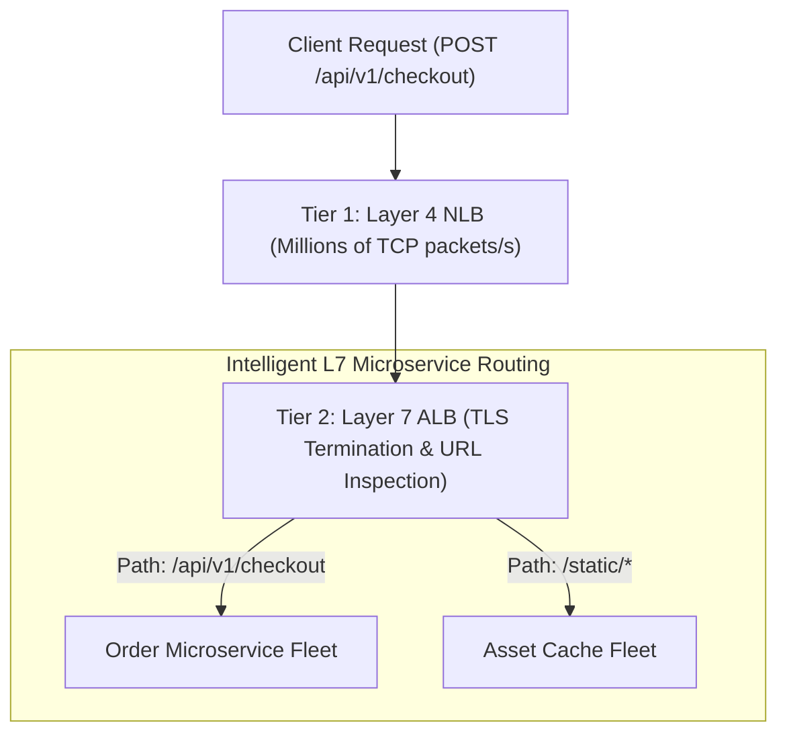
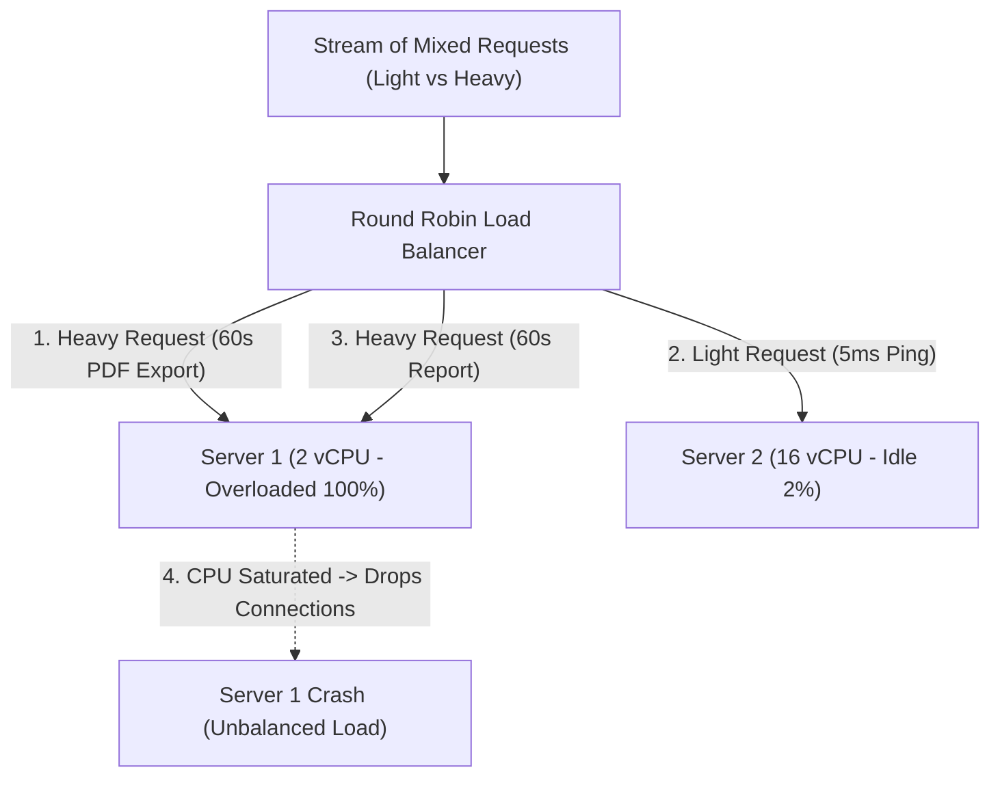
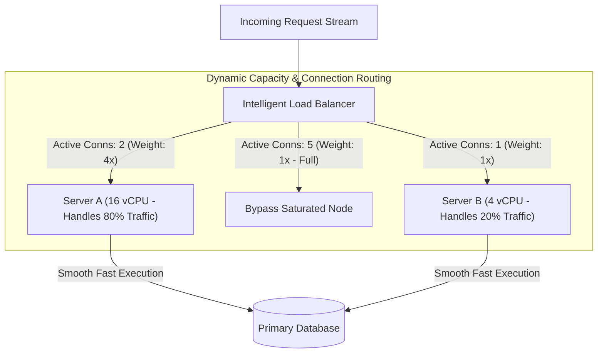
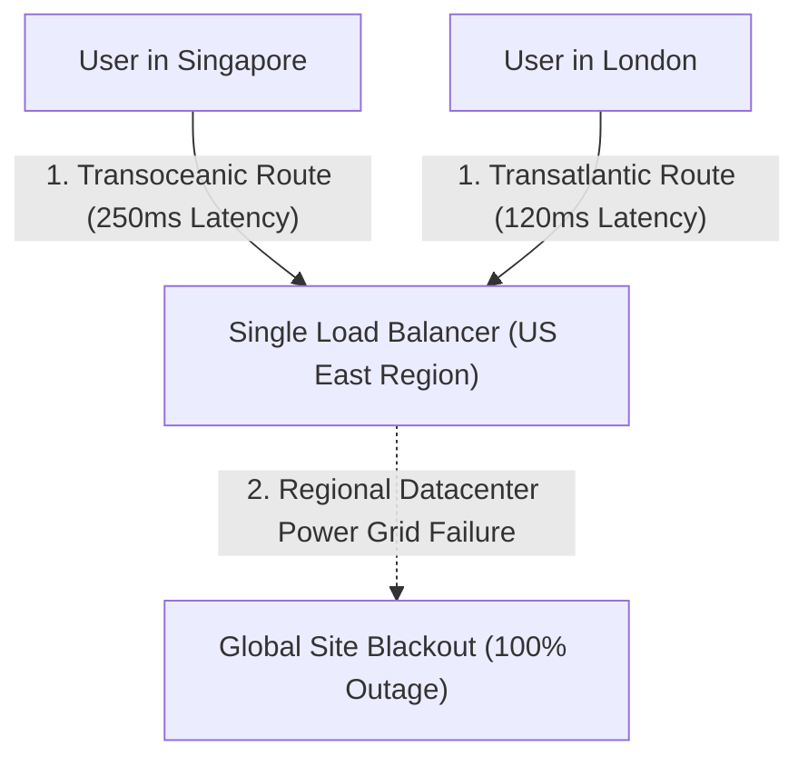
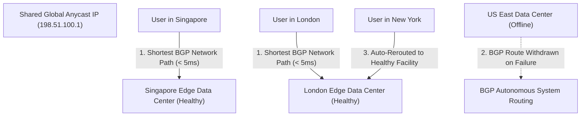

## Traffic Distribution and Server Fleet Health Checks

Deploying application servers without an intermediate traffic distributor forces client applications to hardcode direct server IP addresses. When a physical host crashes, experiences a kernel panic, or undergoes an operating system update, client applications continue directing traffic to the dead host, resulting in immediate connection dropouts and service outages.

Furthermore, direct client-to-server connections create uneven traffic distribution, where one server runs at maximum CPU capacity while adjacent servers sit completely idle.

Load balancers sit as reverse proxy entry points that accept all incoming traffic and distribute connections evenly across a pool of healthy backend server instances. The load balancer runs continuous automated health checks (sending periodic HTTP probe requests like checking a health status endpoint every ten seconds) to verify backend responsiveness.

If a backend instance fails consecutive health checks or returns HTTP error codes, the load balancer automatically marks the node unhealthy and isolates it from the active rotation, seamlessly redirecting subsequent client requests to remaining healthy instances with zero user downtime.

Automated health checking eliminates single points of failure and provides high availability across server fleets. Engineering teams execute rolling deployments (replacing old software versions with new versions one server at a time) with zero customer downtime by draining traffic from target instances before updates occur.

## Layer 4 Transport versus Layer 7 Application Load Balancing

Network architects must balance raw packet routing speed against intelligent, application-aware routing capabilities. Layer 4 load balancers operate strictly at the transport layer (TCP and UDP), making routing decisions based purely on source IP, destination IP, and port numbers without inspecting or decrypting packet payloads.

Because Layer 4 load balancers do not terminate TLS encryption or inspect HTTP headers, they cannot route traffic based on URL paths (such as separating shopping cart requests from static image requests) or inspect user cookies for authentication routing.

Layer 7 load balancers operate at the application layer, fully terminating TLS encryption handshakes and parsing incoming HTTP headers, cookies, and URL paths. This allows the load balancer to execute content-based routing (directing requests matching specific URL paths like api/orders to dedicated microservice clusters and static paths to cache servers), enforce Web Application Firewall security rules, and manage gRPC request multiplexing.

For extreme scale, architectures deploy a two-tier load balancing topology: ultra-high-throughput Layer 4 load balancers at the network edge distribute packets across a fleet of Layer 7 application load balancers, which in turn perform intelligent path-based routing to internal microservices.

Layer 4 load balancers provide raw packet performance with microsecond latencies for gaming, database connections, and DNS services. Layer 7 load balancers provide rich application routing, security inspection, and path multiplexing for modern microservices architectures.

## Load Balancing Algorithms and Capacity Weighting

Using simple round-robin algorithms (distributing requests sequentially to servers one by one in a fixed circular order) assumes that all incoming requests consume identical processing time and that all backend servers have identical hardware specifications. In real-world environments with mixed instance sizes or long-running WebSocket connections, round-robin routing inevitably overloads weaker instances while underutilizing high-capacity machines.

When an application server receives several compute-heavy analytical requests simultaneously under round robin, its CPU saturates and incoming requests queue up, leading to request timeouts.

Modern load balancers employ dynamic routing algorithms tailored to workload characteristics. The Least Connections algorithm routes incoming requests to the server currently maintaining the fewest active concurrent connections, making it ideal for long-running transactions and WebSocket streams.

Weighted Round Robin assigns capacity weights to backend servers based on hardware specifications (routing four times as many requests to a 16-vCPU instance compared to a 4-vCPU instance), while IP Hash (sticky sessions) computes a mathematical hash of the client IP address to consistently direct a user to the same backend node for stateful applications.

Selecting the appropriate load balancing algorithm maximizes hardware utilization and prevents localized server hotspots. Systems dynamically update server weights during autoscaling events to maintain smooth traffic distribution across heterogeneous fleets.

## Global Server Load Balancing and Anycast Routing

Directing all global users to a single regional load balancer forces international clients to cross continental fiber optic links for every request, adding hundreds of milliseconds of round-trip network latency. Furthermore, if a physical natural disaster or regional power grid failure disables that single cloud data center, global service goes dark completely.

Relying purely on DNS-based geo-routing can result in delayed traffic failovers because internet service providers frequently cache DNS responses past their designated expiration times.

Global Server Load Balancing (GSLB) pairs Anycast Border Gateway Protocol routing (a network addressing technique where multiple edge data centers across the globe advertise the exact same public IP address) with regional GeoDNS controllers. Internet routers automatically direct client network packets to the physically nearest edge data center point-of-presence along the shortest geographical BGP network path.

If an entire regional data center fails, BGP routing withdraws the IP route advertisement from that region within seconds, and global internet routers automatically reroute user packets to the nearest healthy regional data center without waiting for DNS cache expiration.

Anycast routing delivers sub-ten-millisecond edge response times for global users and provides automated, resilient failover during catastrophic regional disasters. Systems terminate TCP and TLS handshakes at the Anycast edge, forwarding requests to backend data centers over optimized private fiber backbones.
