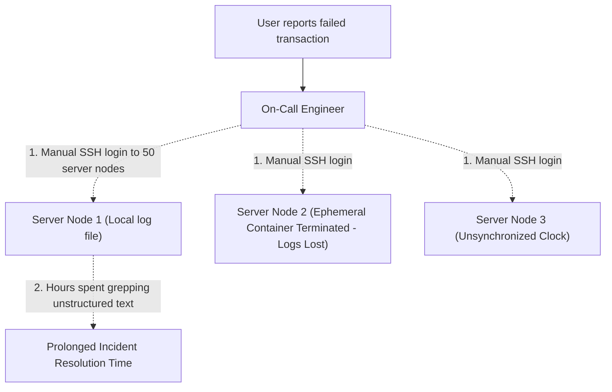
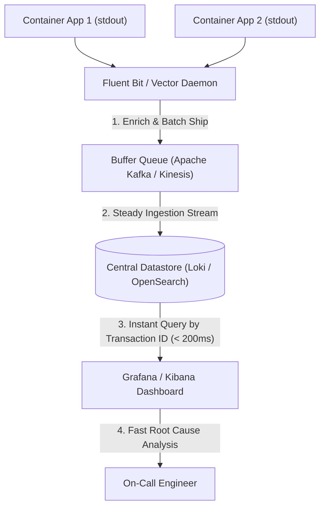
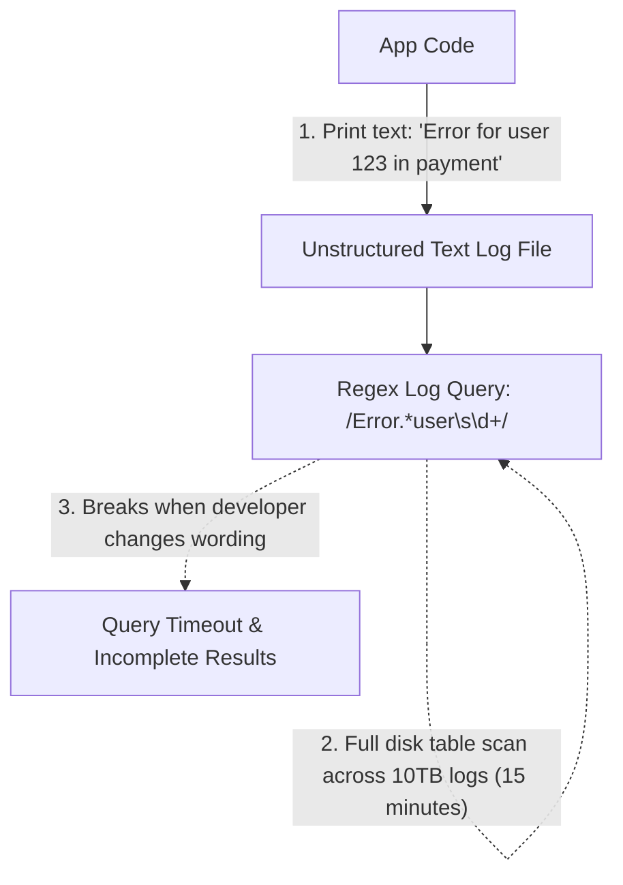
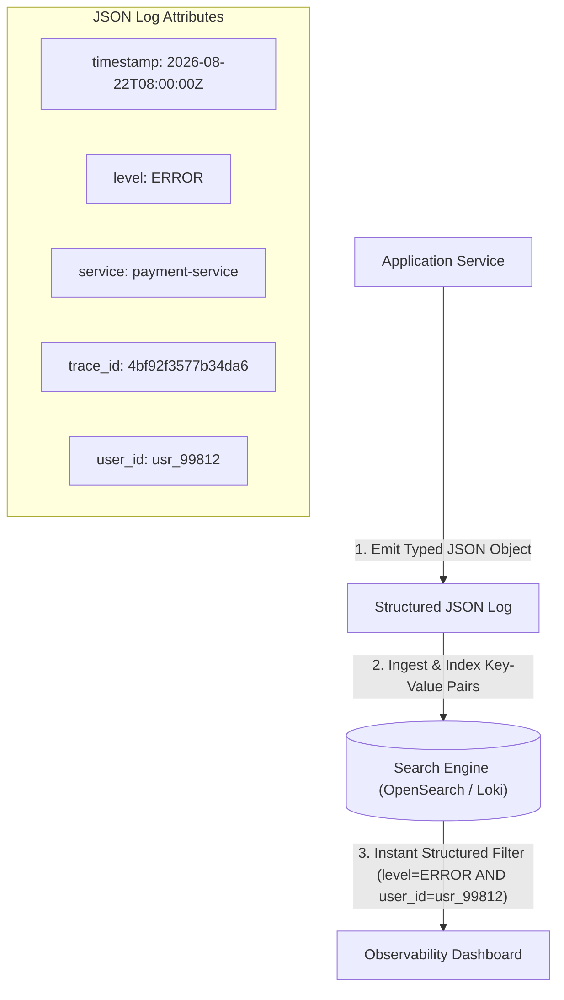
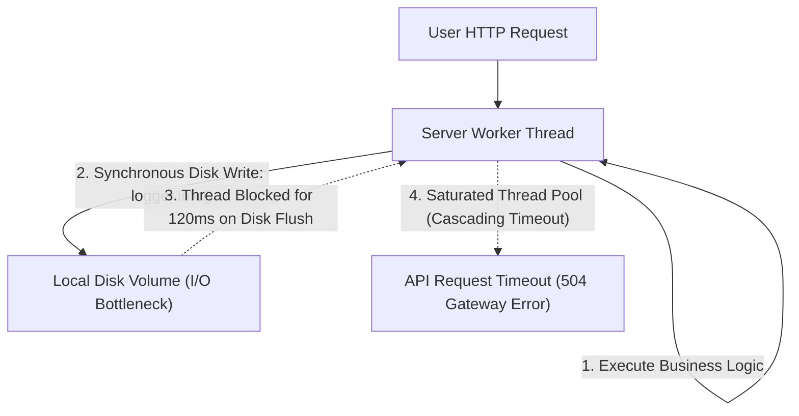
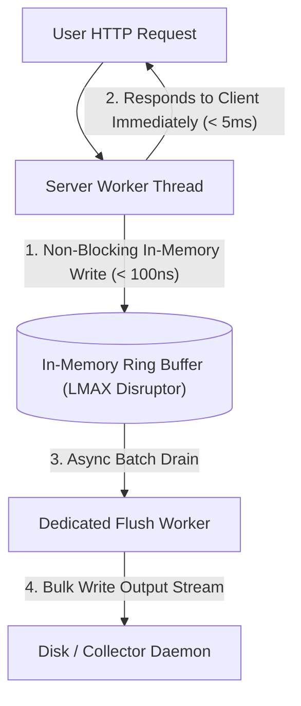
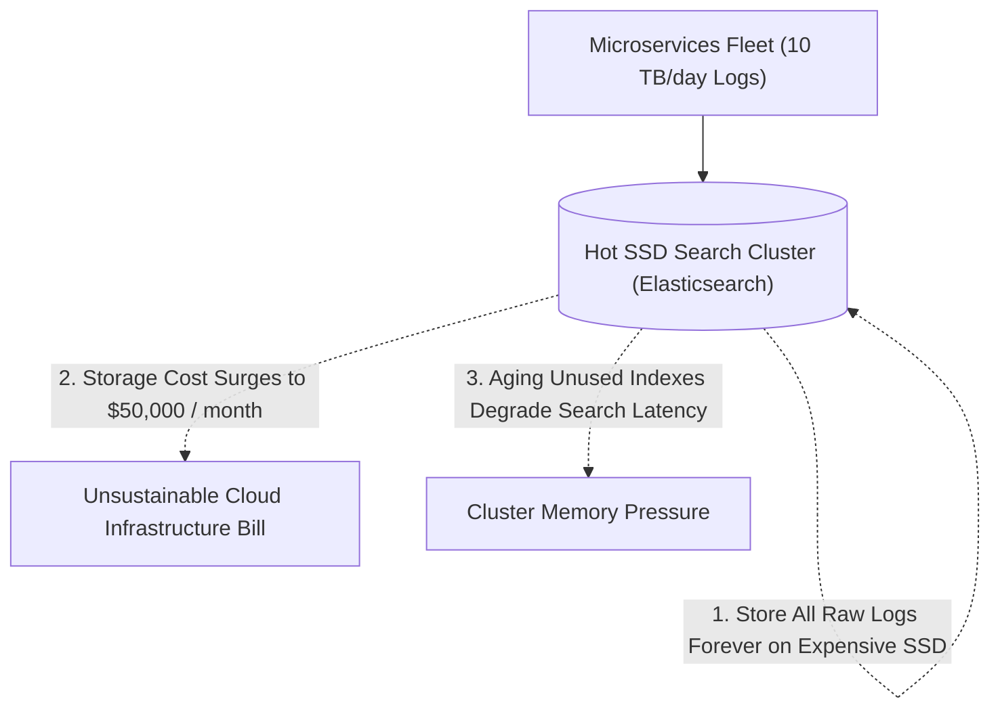
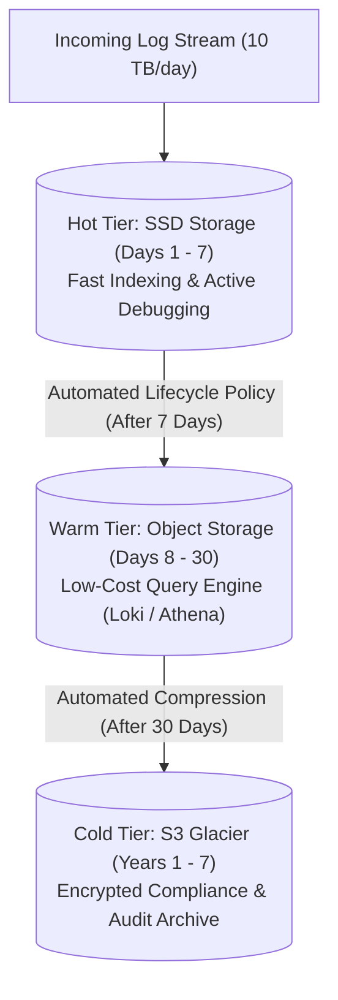

## Centralized Log Aggregation and Transport Buffers

In distributed microservice architectures running hundreds of container instances, storing log files locally on individual server disks makes operational debugging nearly impossible. When a user transaction fails, on-call engineers must manually connect to dozens of separate servers via SSH, search through disjointed flat files, and correlate timestamps across machines with unsynchronized clocks.

Furthermore, when container orchestration platforms terminate ephemeral containers during autoscaling events, all uncollected local log files are deleted permanently, destroying critical audit trails and security forensics.

Centralized log aggregation streams log events continuously from every application container into a centralized, indexed datastore (such as Grafana Loki, Elasticsearch, or OpenSearch) using lightweight node daemon collectors (such as Fluent Bit or Vector). Container processes write log events directly to standard output, where the local node collector intercepts the stream, enriches records with Kubernetes pod metadata, and batches events into memory buffers.

To protect backend storage clusters from write saturation during sudden traffic spikes, log shippers stream batches into intermediate message buffers (such as Apache Kafka or AWS Kinesis), allowing indexing workers to consume and persist logs at a sustainable pace.

Centralized log pipelines provide unified visibility across thousands of ephemeral containers and eliminate data loss during container terminations. Decoupling ingestion with message buffers prevents high log volume from impacting database search performance.

## Structured JSON Logging and Diagnostic Contexts

Legacy applications frequently write logs as free-form, unstructured human-readable text strings (for example, printing a custom string concatenation containing user names, error messages, and variables). Searching across millions of unstructured text logs requires computationally expensive regular expression scans that take minutes to execute and fail whenever developers slightly alter punctuation or capitalization.

Without standardized contextual attributes, automated log parsers cannot filter events by specific HTTP response codes, tenant identifiers, or customer tiers.

Structured logging formats all log output as machine-readable JSON objects adhering to a strict organizational schema. Every log entry includes standardized root attributes, including the precise ISO 8601 UTC timestamp, standardized severity level (such as INFO, WARN, or ERROR), service name, environment identifier, user ID, and distributed tracing correlation IDs.

Observability backends ingest structured JSON logs and build indexed inverted attribute indexes, allowing engineers and automated alerting systems to execute sub-second boolean filters across petabytes of telemetry.

Structured JSON logging turns raw text into structured operational data that can be aggregated into real-time operational metrics and anomaly detection alerts. Standardized trace identifiers allow engineers to link a single log line directly to end-to-end distributed transaction traces.

## Asynchronous Non-Blocking Log Appenders

When application code executes synchronous disk write operations on every logging statement, disk input-output latency directly blocks the active request-handling worker thread. During periods of heavy traffic or when operating on shared cloud disk volumes with throttling limits, physical disk write delays can spike from microseconds to hundreds of milliseconds.

A sudden surge of debug or error log statements creates severe thread contention, causing API response latencies to spike and exhausting server connection pools.

Asynchronous logging decouples business execution from physical disk I/O using high-performance, non-blocking in-memory ring buffers (such as the LMAX Disruptor queue used in Log4j2 and Logback). When an application thread calls a logging function, the thread writes the log event into an in-memory ring buffer in nanoseconds and immediately resumes processing customer business logic.

A dedicated background worker thread pulls batches of log events from the ring buffer and writes them to standard output or network streams in optimized bulk blocks.

Asynchronous appenders eliminate disk I/O bottlenecks from latency-critical request paths and ensure high application throughput during logging spikes. Systems configure ring buffers with bounded capacities and explicit overflow policies (such as dropping debug statements or switching to temporary sampling during memory pressure) to protect process memory.

## Log Retention Tiers and Cost Optimization

Storing every raw debug log entry in high-performance, solid-state disk-backed search clusters forever results in massive cloud infrastructure expenses. As daily log ingestion scales into terabytes, disk storage and index memory requirements grow exponentially, consuming a large portion of the total engineering operational budget.

Furthermore, over ninety percent of historical logs are never queried after the first seven days following their initial creation.

Log lifecycle management organizes storage into automated hot, warm, and cold tiers based on age and access patterns. The hot tier keeps recent logs (such as the last seven days) on fast, indexed solid-state drives for rapid querying during active incident response.

After seven days, automated lifecycle policies transition logs to a warm tier on cost-effective object storage (such as Amazon S3) with index pruning, and after thirty days, logs are compressed and archived into cold storage (such as Amazon Glacier) for long-term compliance and regulatory auditing at minimal expense.

Tiered log retention reduces long-term observability storage expenses by up to eighty percent while preserving full compliance with regulatory audit standards. High-volume systems implement dynamic sampling at the edge collector, discarding verbose debug logs during normal operations while retaining all error and transaction logs.
