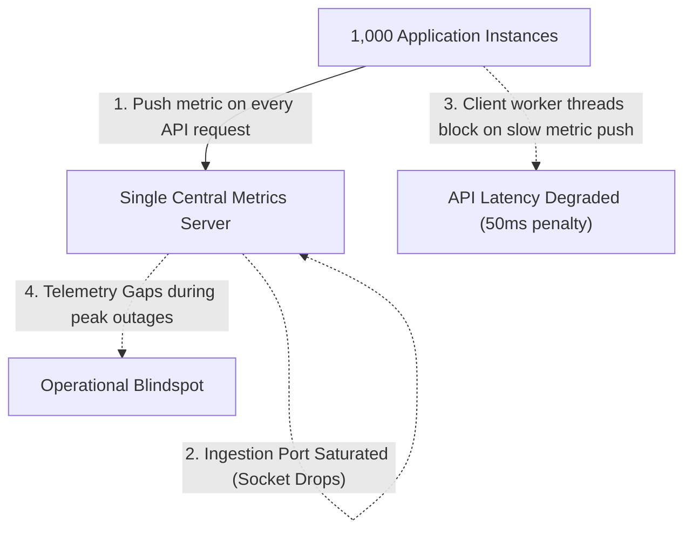
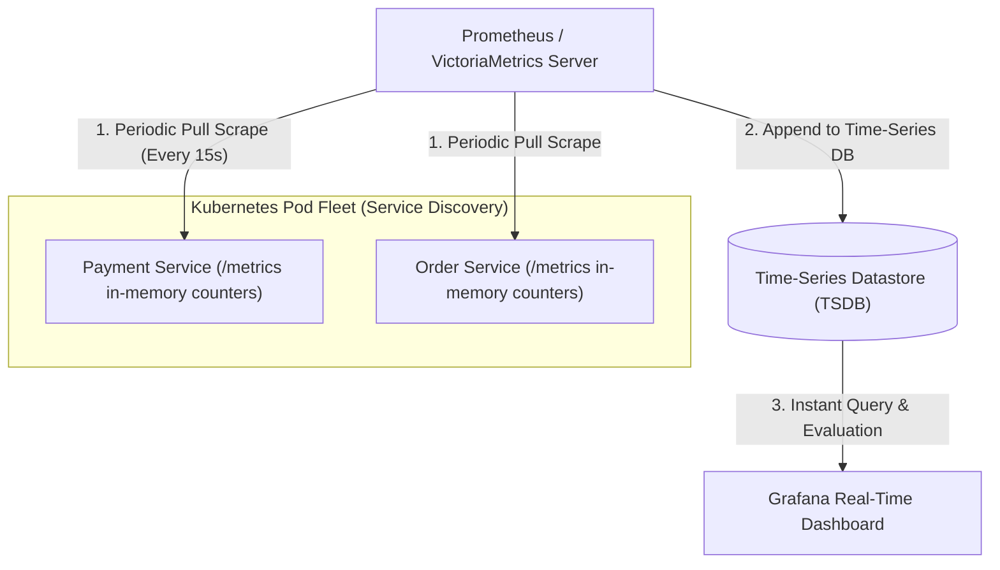
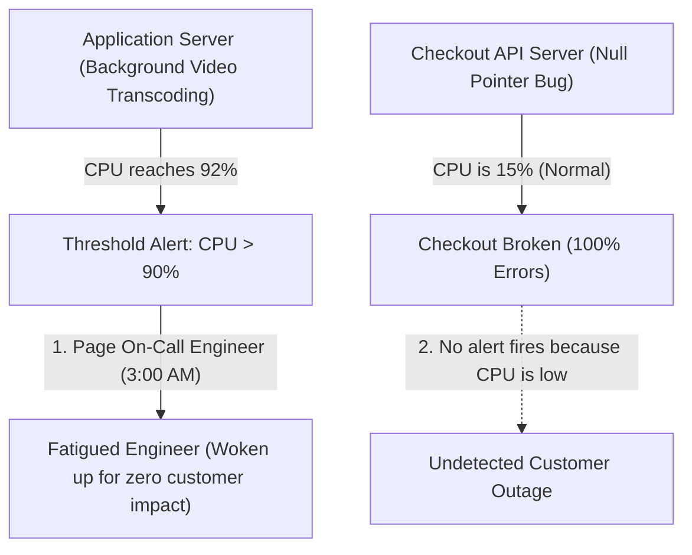
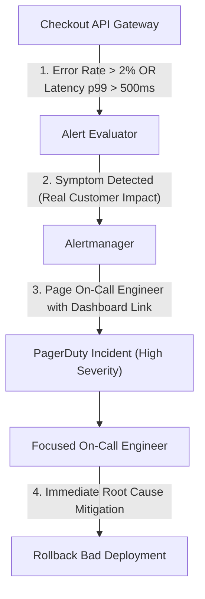
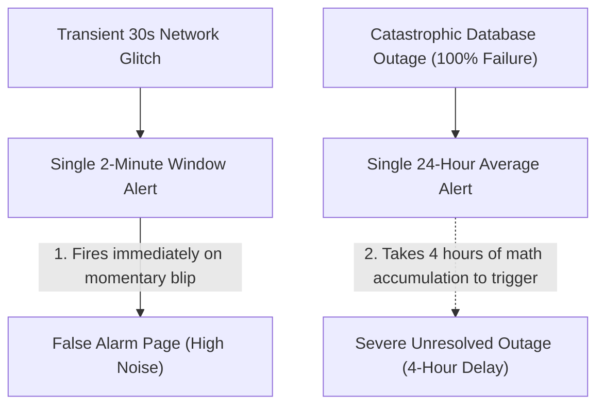
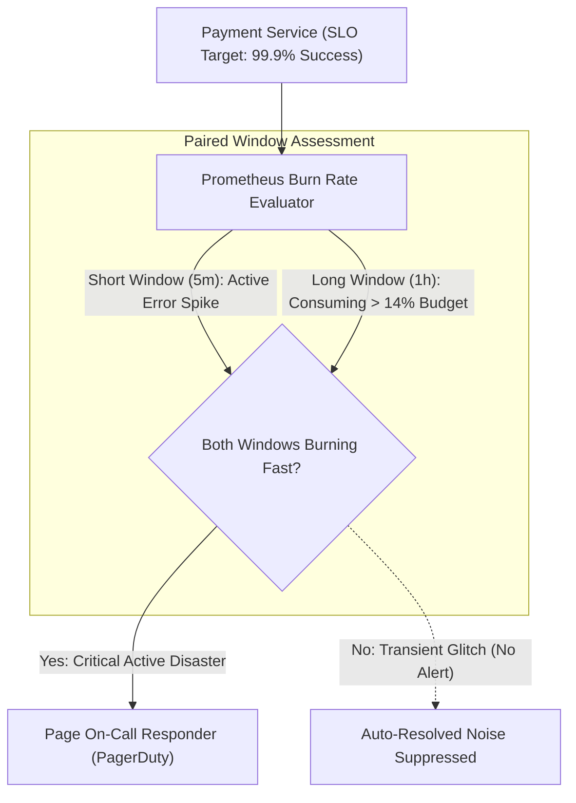
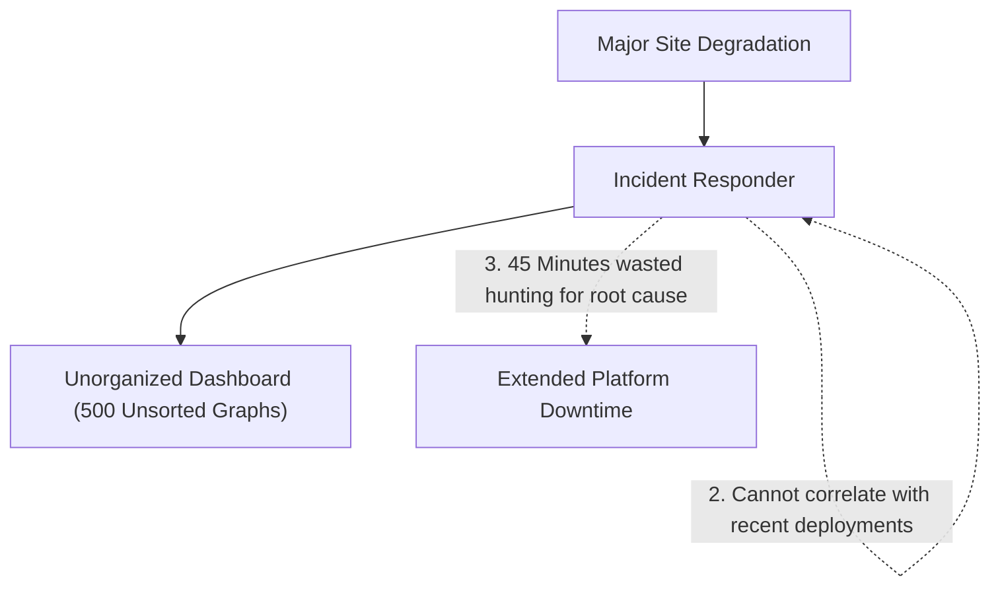
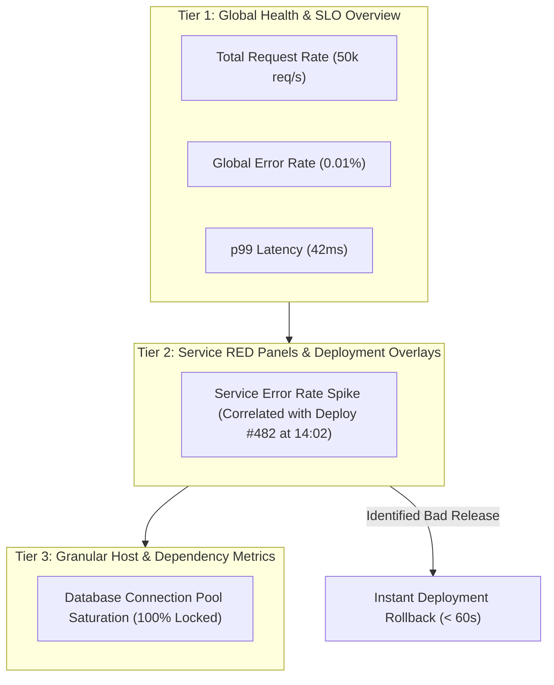

## Time-Series Metric Collection and Scraping Models

In distributed server environments, managing individual host health without automated metrics collection leads to blind operational outages. When applications emit metrics by opening individual TCP network connections to a centralized monitoring server on every single transaction, the monitoring server quickly becomes overwhelmed with thousands of concurrent incoming sockets, causing connection drops and telemetry loss.

Conversely, if an agent pushes metrics synchronously during request processing, monitoring delays directly degrade customer API latencies.

Time-series metric engines (such as Prometheus or VictoriaMetrics) decouple application runtime performance from metrics collection using an asynchronous pull scraping model. Applications maintain in-memory counters, gauges, and latency histogram buckets updated in sub-nanoseconds, exposing them over a lightweight HTTP metrics endpoint.

The time-series monitoring server periodically discovers application instances through service discovery mechanisms (such as Kubernetes API integration) and scrapes the aggregated metrics endpoint every fifteen seconds, persisting structured data points with zero impact on active customer request flows.

Pull-based metric scraping provides predictable network overhead, eliminates push socket saturation, and immediately reveals crashed application instances when scrapes fail. Systems deploy push gateways only for short-lived ephemeral batch jobs that terminate before the next scheduled scrape cycle.

## Golden Signals and Symptom-Based Alerting

Legacy alerting architectures frequently trigger high-urgency pages based on low-level infrastructure causes (such as alerting on-call engineers at three in the morning because a single server reached ninety percent CPU utilization). However, modern multi-core servers often operate efficiently at high CPU levels during normal batch processing without impacting customer experience, while critical software bugs (such as an unhandled null pointer exception dropping user checkouts) can occur while CPU utilization remains at a completely normal fifteen percent.

Alerting on low-level resource causes generates excessive false positives, creating alert fatigue (a dangerous condition where engineers become desensitized to notifications and ignore genuine critical outages).

Production observability focuses on the Four Golden Signals: Latency (time taken to serve a request), Traffic (demand placed on the system such as requests per second), Errors (rate of requests that fail with 5xx status codes), and Saturation (how full system resources like queue depths and memory buffers are). Alerting rules evaluate user-facing symptoms (such as customer error rates crossing two percent or ninety-ninth percentile checkout latency exceeding five hundred milliseconds) rather than internal hardware causes.

When an alert triggers, on-call responders receive notifications that represent genuine, active customer degradation, accompanied by direct links to diagnostic telemetry dashboards.

Symptom-based golden signal alerting eliminates false alarm noise and guarantees rapid engineering response during real customer-impacting outages. Engineering teams audit alert rules quarterly to retire low-value alerts and preserve responder focus.

## Multi-Window Multi-Burn-Rate Error Budget Alerting

Simple alerting rules evaluated over a single short time window (such as triggering an alert if error rate exceeds one percent for two minutes) fire frequently on minor transient traffic spikes, waking up engineers for glitches that resolve themselves automatically in sixty seconds. Conversely, evaluating error rates over a single long time window (such as error rate over twenty-four hours) delays critical incident detection by several hours during catastrophic full-site outages.

Teams struggle to balance rapid alert detection during severe disasters against high reset stability during minor transient hiccups.

Multi-window multi-burn-rate alerting monitors the consumption rate of an application Service Level Objective error budget (the allowed fraction of total requests that may fail within a thirty-day rolling window, such as zero point one percent errors for a ninety-nine point nine percent availability target). The alerting engine calculates the burn rate across paired short and long time windows simultaneously (for example, verifying that error rate is high over a one-hour window and also actively high over a five-minute window).

A high burn rate consuming fourteen percent of the thirty-day error budget within one hour triggers an immediate high-priority pager notification, while a slow burn rate consuming five percent over six hours routes a low-priority notification to a daytime ticketing queue.

Multi-window burn-rate alerting provides mathematically rigorous incident detection that catches severe disasters within two minutes while ignoring self-healing transient glitches. This methodology aligns alerting directly with contractual service level agreements and customer reliability expectations.

## Dashboard Design and Real-Time Infrastructure Health

When major infrastructure incidents occur, poorly structured observability dashboards with hundreds of unorganized, overlapping graphs slow down incident triage. Responders waste valuable minutes navigating cluttered screens, deciphering obscure host names, and struggling to determine which upstream dependency initiated the failure cascade.

Lack of visual hierarchy and missing deployment markers make it difficult to correlate sudden error rate increases with recent software releases or configuration changes.

Modern operational dashboards follow a standardized three-tiered visual hierarchy that guides engineers from high-level platform health down to granular root causes. The top tier displays overarching business health and Service Level Indicators (overall request throughput, total error percentage, and ninety-ninth percentile response latency).

The middle tier organizes services into RED method panels (Rate, Errors, Duration) with automated deployment overlay markers, allowing responders to immediately correlate an error spike with a specific continuous integration deployment timestamp and trigger an instant rollback.

Structured dashboard hierarchies minimize Mean Time to Resolution during critical operational outages. Engineering teams embed standardized runbook links directly into dashboard panel headers so responders can access step-by-step remediation procedures with a single click.
