## Hypertext Transfer Protocol and Transport Layer Security

The Hypertext Transfer Protocol operates as an application layer request-response standard where clients initiate communication and servers reply with data. In unencrypted HTTP version 1.1 networks, sending plain-text payloads across public internet routers exposes sensitive session credentials and personal data to eavesdropping and man-in-the-middle attacks (malicious interception where third parties secretly intercept and alter network communications).

Furthermore, HTTP version 1.1 requires sequential head-of-line blocking on single TCP connections (where an earlier slow request blocks all subsequent requests behind it on the same socket), forcing browsers to open dozens of parallel connections and exhausting server socket limits.

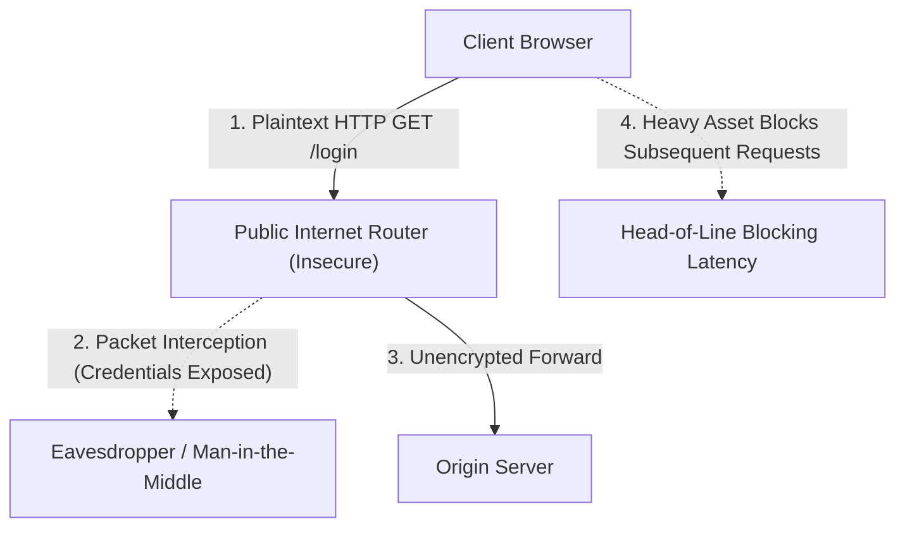

Transport Layer Security encrypts communication channels using asymmetric public key cryptographic handshakes (a security protocol where a server proves identity with a certificate and exchanges a temporary symmetric session key). Modern HTTP version 2 and HTTP version 3 multiplex hundreds of concurrent requests over a single connection using binary frames, eliminating head-of-line blocking and reducing connection overhead.

The API gateway terminates TLS encryption at the infrastructure perimeter (handling cryptographic handshakes at the edge so internal microservices do not waste CPU cycles on security overhead), forwarding clean decrypted requests across secure internal networks.

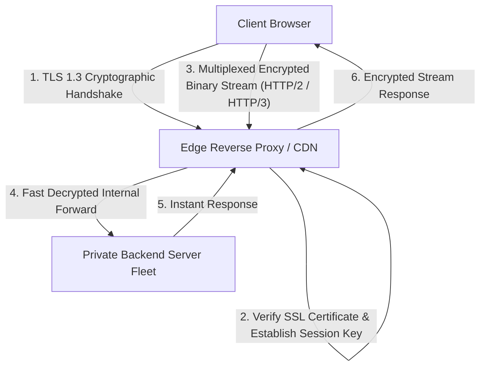

This combination secures data in transit against eavesdropping while delivering sub-millisecond connection reuse across concurrent web requests. System architectures rely on edge content delivery networks to cache TLS session tickets and terminate encryption close to global users.

## Transmission Control Protocol and Reliable Byte Streams

Unreliable physical transmission lines suffer packet loss, out-of-order packet arrival, and network buffer congestion. When application services transmit financial database updates, SSH remote commands, or software binaries without transport verification, lost or rearranged packets result in truncated files, corrupted records, and invalid system state.

Attempting to implement custom packet retransmission logic inside every individual application introduces immense developer complexity and risks uncontrolled congestion collapse (a catastrophic network failure where retransmissions saturate available bandwidth).

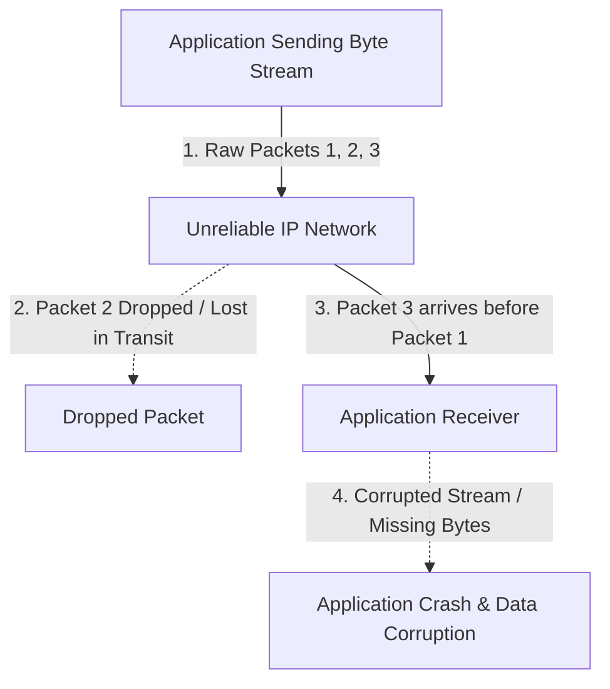

The Transmission Control Protocol provides a connection-oriented, reliable byte stream over unreliable IP networks through a structured three-way handshake (a synchronization sequence where sender and receiver agree on initial sequence numbers). TCP guarantees that every transmitted byte arrives intact and in exact sequential order by assigning incrementing sequence numbers to every packet and requiring explicit receiver acknowledgments.

If an acknowledgment is missing, TCP automatically retransmits the missing segment and regulates transmission speeds dynamically using sliding window flow control and congestion avoidance algorithms.

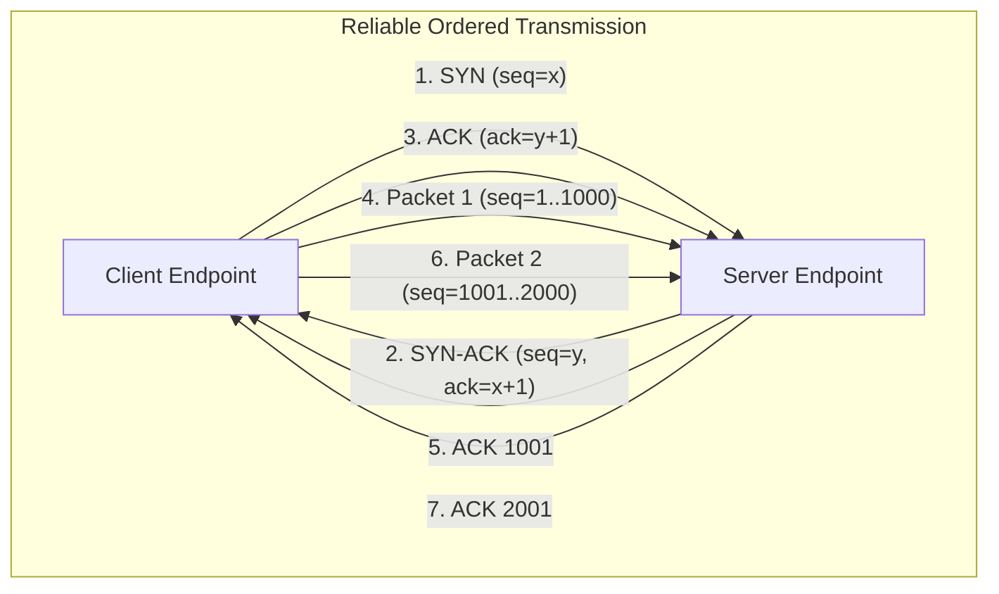

TCP guarantees absolute data accuracy and ordered delivery for mission-critical protocols like SQL databases, file transfers, and web browsing. The protocol trades connection setup latency (the initial round-trip time required for the handshake) and head-of-line byte buffering for total transmission reliability.

## User Datagram Protocol and Low-Latency Datagrams

Real-time interactive applications (such as live voice calls, multiplayer video games, and high-frequency video conferencing) require continuous, ultra-low latency updates. When real-time systems use connection-oriented protocols like TCP, a single lost packet causes the receiving operating system to pause data delivery and wait for retransmission, introducing noticeable audio stuttering and visual freezes.

In fast-paced competitive gaming or live video feeds, an outdated packet containing player coordinates or video frames from two hundred milliseconds ago is completely useless and should be discarded rather than retransmitted.

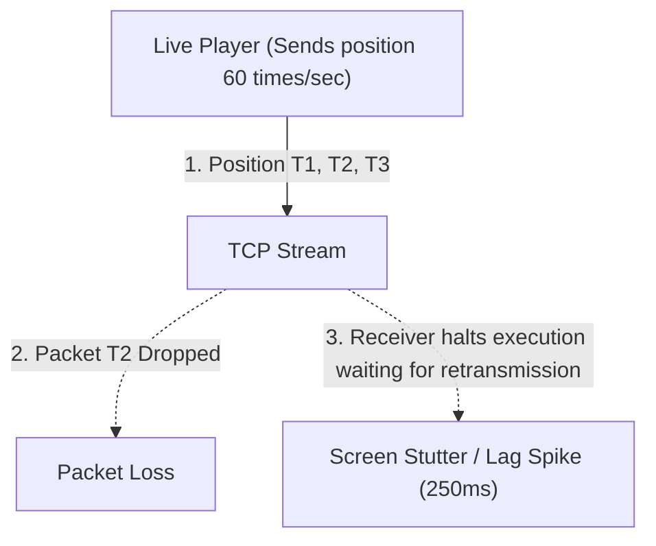

The User Datagram Protocol is a lightweight, connectionless transport protocol that transmits independent datagrams (self-contained data packets) immediately with zero handshake delay and zero retransmission guarantees. If a packet is dropped by an intermediate router, UDP does not retry, allowing subsequent real-time packets to be delivered instantly without buffering delays.

Applications process the incoming stream continuously, replacing lost coordinates or dropped video frames with the latest arriving state snapshot.

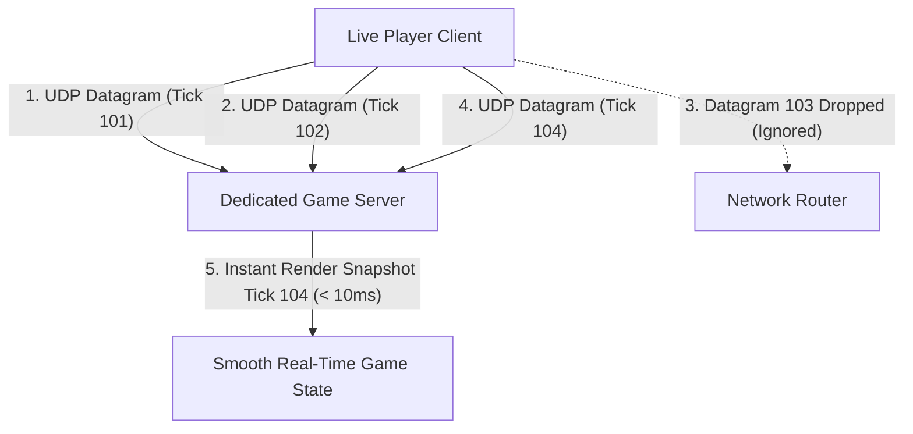

UDP delivers minimal latency and low transport overhead for time-sensitive, loss-tolerant streams. Applications implement optional sequencing or forward error correction (reconstructing lost packets mathematically from redundant data bits) at the application layer when specialized reliability is needed.

## WebSockets and Full-Duplex Bidirectional Streams

Traditional HTTP request-response architectures require the client to initiate all communication, preventing servers from pushing real-time updates directly to clients. Web applications attempting real-time features (like live chat rooms, stock market tickers, or multiplayer collaboration tools) resort to short polling (sending repeated HTTP GET requests every second), creating massive HTTP header overhead and overwhelming backend connection pools with empty responses.

Long polling reduces empty responses but still requires tearing down and renegotiating HTTP connections repeatedly, driving up server CPU utilization and adding network latency.

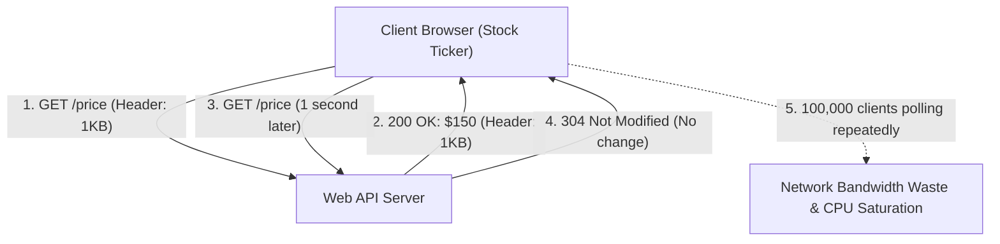

The WebSocket protocol initiates with a standard HTTP upgrade handshake and transitions immediately into a persistent, full-duplex TCP socket connection (a two-way communication channel where both client and server send messages independently at any millisecond). The connection remains open with tiny two-byte framing overhead, allowing servers to push live price updates or chat messages to millions of connected clients instantly without waiting for client requests.

Backend server fleets manage WebSocket connections using distributed pub-sub message brokers (such as Redis Pub/Sub) to broadcast updates across thousands of open persistent sockets simultaneously.

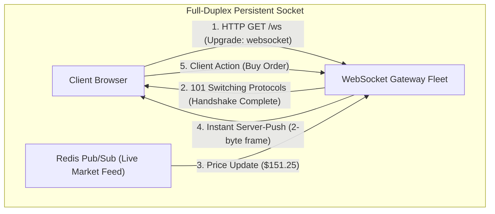

WebSockets deliver sub-millisecond bidirectional communication and reduce network bandwidth consumption by eliminating repetitive HTTP headers. Systems must deploy specialized connection gateways to manage millions of persistent concurrent sockets and handle automatic reconnection logic during mobile network handoffs.

## Google Remote Procedure Calls and Binary Multiplexing

Internal microservices communicating over standard REST JSON APIs spend significant CPU time serializing objects into text strings and parsing large JSON payloads on every request. JSON formats include repetitive verbose field names and lack compile-time type validation, leading to runtime data parsing bugs and bloated network bandwidth consumption inside high-density data centers.

Furthermore, managing dozens of disparate REST endpoint contracts across multi-language engineering teams creates documentation drift and broken service integrations.

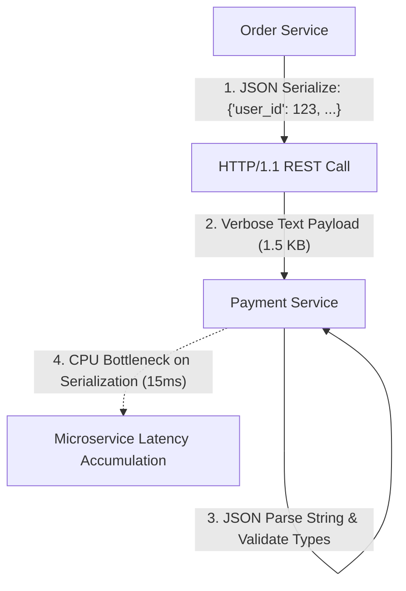

Google Remote Procedure Calls (gRPC) utilizes Protocol Buffers (a language-neutral binary serialization format that encodes structured data into compact binary bytes based on strict schema contracts). Microservices define typed service contracts in interface definition files, automatically generating high-performance client stubs and server interfaces across multiple programming languages.

Operating over HTTP/2, gRPC multiplexes multiple remote calls over single persistent connections, supporting bidirectional streaming, deadline propagation (automatically canceling downstream work if an upstream caller times out), and built-in binary compression.

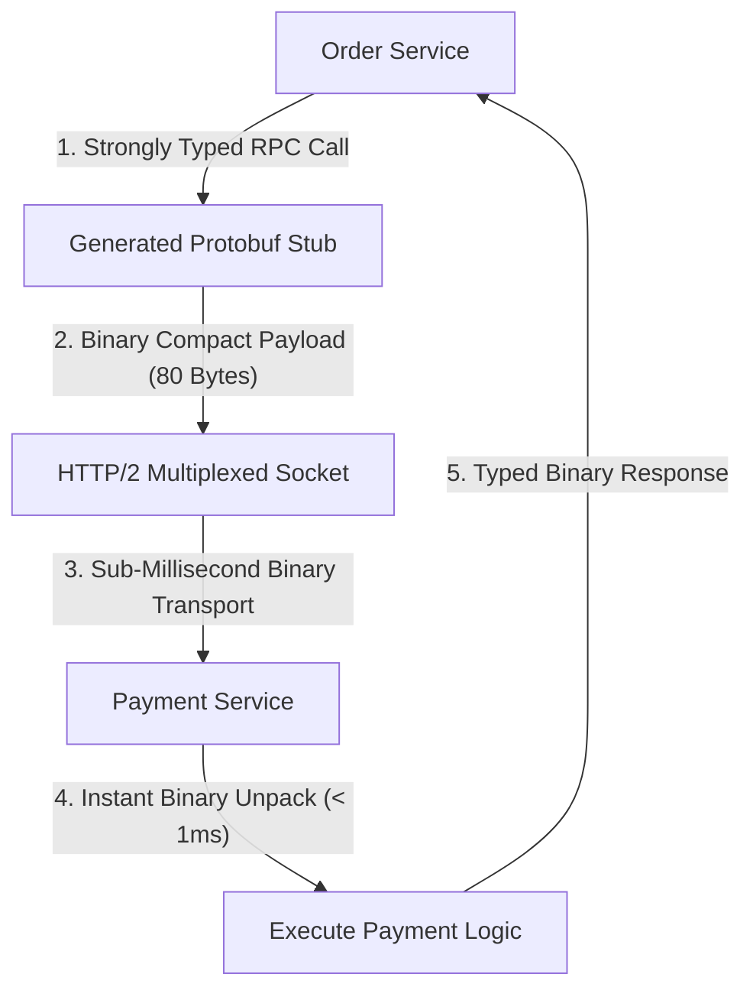

gRPC delivers up to ten times faster serialization throughput and drastically reduces network bandwidth inside backend microservice meshes. Because Protocol Buffers require compiled schemas, public browser clients typically interact through an edge API gateway that translates external JSON requests into internal gRPC calls.

## Message Queuing Telemetry Transport for Constrained Devices

Internet-of-Things devices (such as battery-powered agricultural soil sensors, smart home appliances, and vehicle GPS trackers) operate over fragile cellular networks with strict electrical power constraints. Connecting constrained devices over heavy protocols like HTTP or WebSockets exhausts device battery power through continuous large header transmissions and memory-heavy keepalive loops.

When thousands of remote sensors attempt to publish small telemetry readings over HTTP, mobile data costs surge and devices lose connectivity whenever cellular signals weaken.

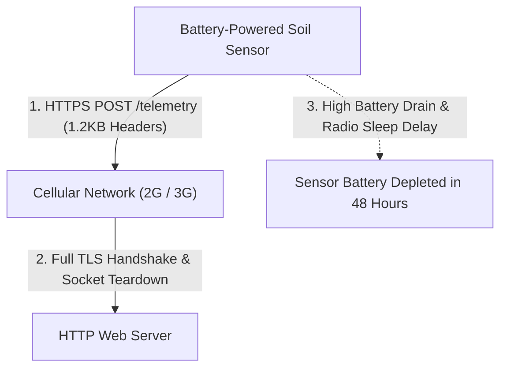

Message Queuing Telemetry Transport (MQTT) is a lightweight publish-subscribe protocol engineered specifically for low-bandwidth, high-latency, constrained network environments. MQTT packets require only a two-byte fixed header, minimizing network payload overhead and preserving device battery life.

The protocol provides three distinct Quality of Service levels (QoS 0 for at-most-once fire-and-forget, QoS 1 for at-least-once delivery, and QoS 2 for exactly-once delivery) alongside persistent session queues and last-will-and-testament messages (automated notifications published by the broker if a remote device disconnects unexpectedly).

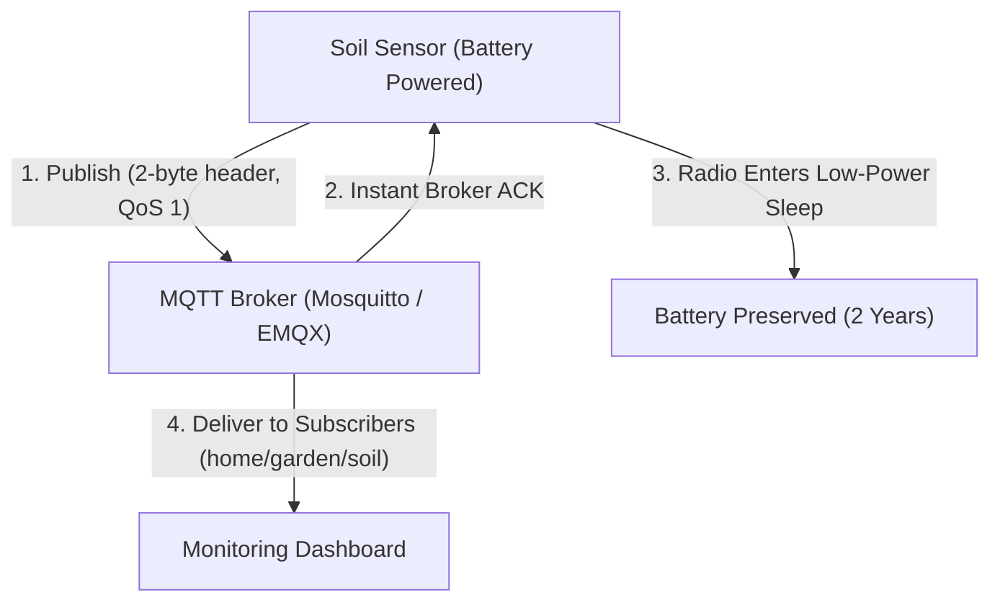

MQTT provides reliable telemetry ingestion across millions of distributed hardware devices over constrained wireless links. Systems connect MQTT brokers to backend message streaming pipelines to ingest high-volume telemetry into analytics databases.

## Domain Name System and GeoDNS Routing

Internet routing relies on numerical IP addresses, but human users navigate networks using memorable domain names. Without an efficient address resolution mechanism, user devices cannot locate the physical servers hosting web applications.

Furthermore, if a global web platform resolves all domain queries to a single centralized server IP address, users on other continents suffer severe latency, and regional data center outages take down global traffic.

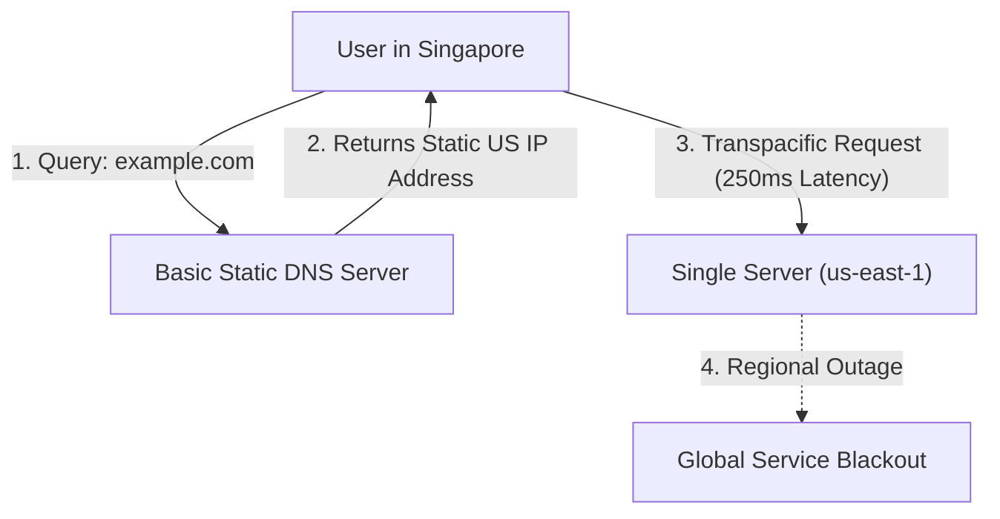

The Domain Name System functions as the decentralized hierarchical phonebook of the internet, resolving human domain names into computer-routable IP addresses through recursive resolvers, root servers, top-level domain servers, and authoritative nameservers. GeoDNS (geographic traffic routing) inspects the client IP address or subnet during the DNS lookup and returns the IP address of the closest regional edge data center.

GeoDNS services perform continuous health checks on backend server pools, automatically removing degraded data center IPs from DNS responses and rerouting traffic to healthy regional clusters within seconds.

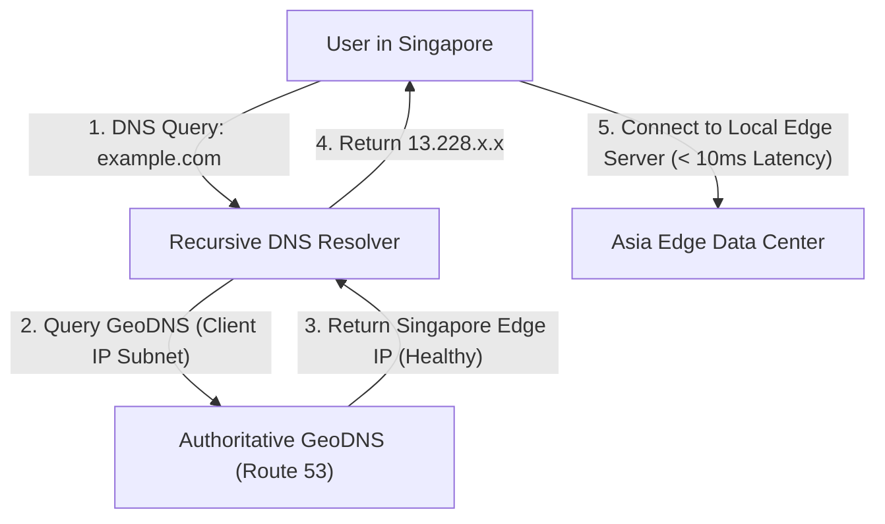

GeoDNS steering optimizes global latency and provides high-level disaster recovery across multiple geographic regions. Because DNS responses are cached by internet service providers according to time-to-live settings, systems set short TTL values (such as sixty seconds) to enable rapid traffic failover during major incidents.

## Advanced Message Queuing Protocol and Message Exchanges

Basic point-to-point queues lack flexible routing mechanisms, forcing producers to know the exact consumer queue destinations before publishing. When complex enterprise applications need to route a single business event (such as an order created event) to multiple independent downstream systems (such as billing, inventory, analytics, and shipping) with customized filtering rules, hardcoding queue logic in application servers creates fragile architectural coupling.

If a downstream billing system crashes, unbuffered direct API calls drop transactions, resulting in unbilled orders and severe financial discrepancies.

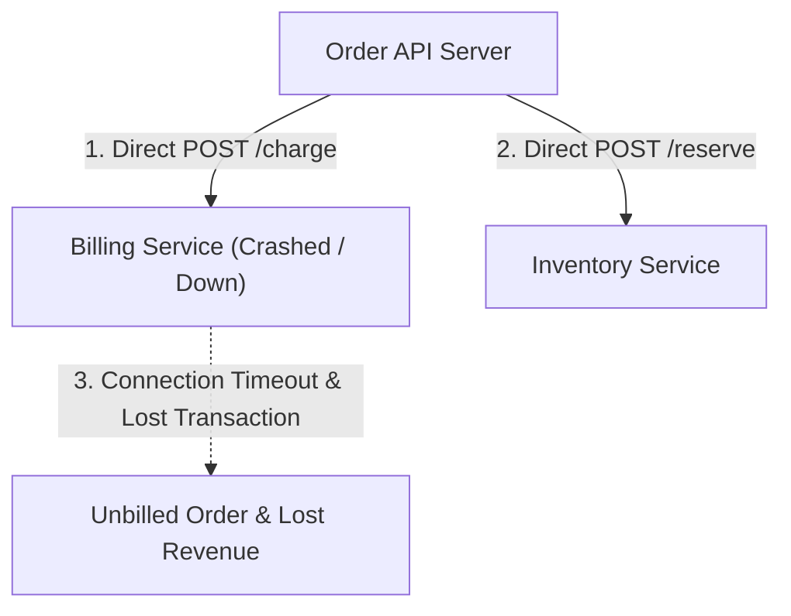

The Advanced Message Queuing Protocol (AMQP) standardizes enterprise messaging through message brokers (such as RabbitMQ) that decouple producers from storage queues using flexible exchanges. Producers publish messages to an exchange with a routing key, and the exchange routes copies of the message to bound queues based on predefined rules (direct routing for exact matches, topic routing for wildcard pattern matches, and fanout routing for universal broadcasting).

Downstream worker services pull messages from their dedicated queues at their own processing capacity, acknowledging messages only after successful persistence to ensure zero data loss.

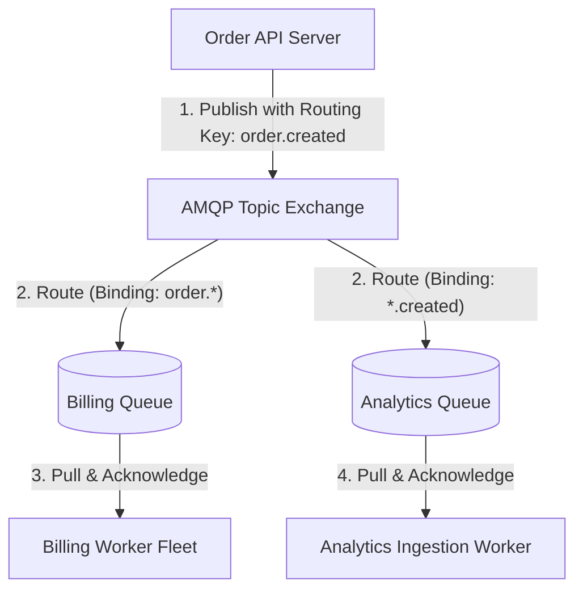

AMQP provides durable enterprise message queuing, fine-grained publish-subscribe routing, and guaranteed message delivery. The protocol safeguards distributed workflows from downstream service outages by buffering work in persistent queues until workers recover.

## Web Real-Time Communication and Direct Browser Streaming

Streaming real-time video, audio, and large data files between users through centralized media servers incurs massive cloud bandwidth costs and adds unnecessary latency hops. When two users in the same city communicate through a central cloud server located thousands of miles away, media streams suffer transit latency delays and video quality degradation.

Centralized media proxies also present a critical security target where unencrypted communication streams could potentially be intercepted on server disks.

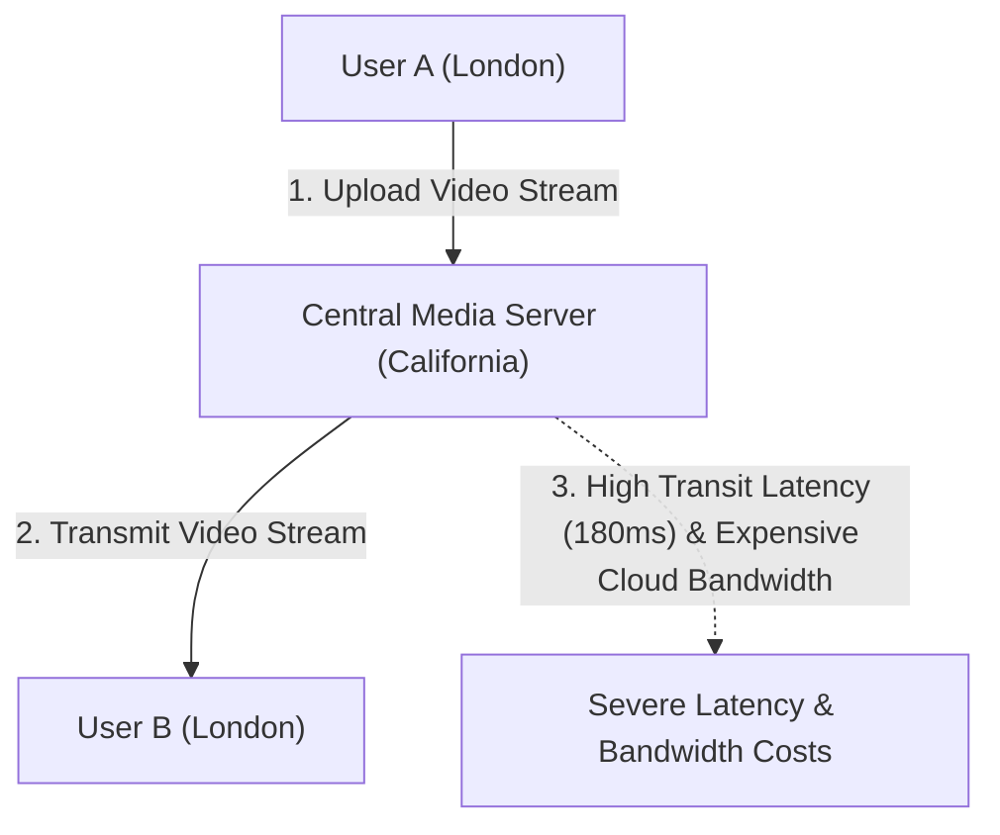

Web Real-Time Communication (WebRTC) enables direct, peer-to-peer audio, video, and data streaming between web browsers without routing media traffic through intermediate servers. Browsers use a lightweight signaling server only during the initial connection setup to exchange session description protocol profiles and interactive connectivity establishment network candidates (discovering public IP addresses and ports through STUN and TURN traversal servers).

Once the direct peer connection is established, audio and video streams travel directly between participant browsers over secure real-time transport protocol channels encrypted with end-to-end DTLS-SRTP encryption.

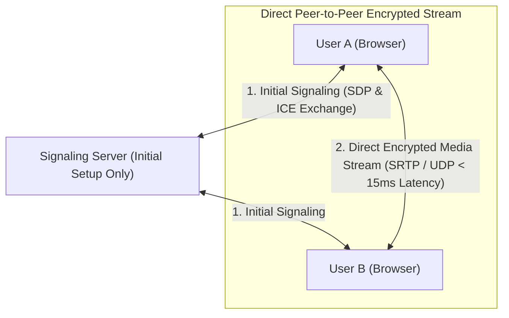

WebRTC eliminates central media server bandwidth expenses and achieves sub-fifty-millisecond real-time communication for video calling and browser file sharing. When direct peer connections are blocked by strict symmetric corporate firewalls, the connection falls back cleanly to relay traversal servers (TURN servers) to maintain connectivity.
