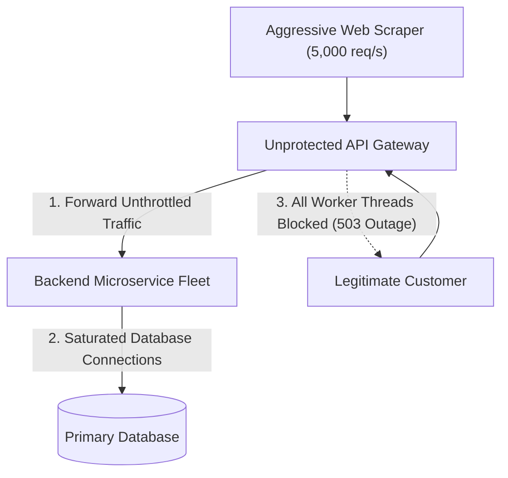
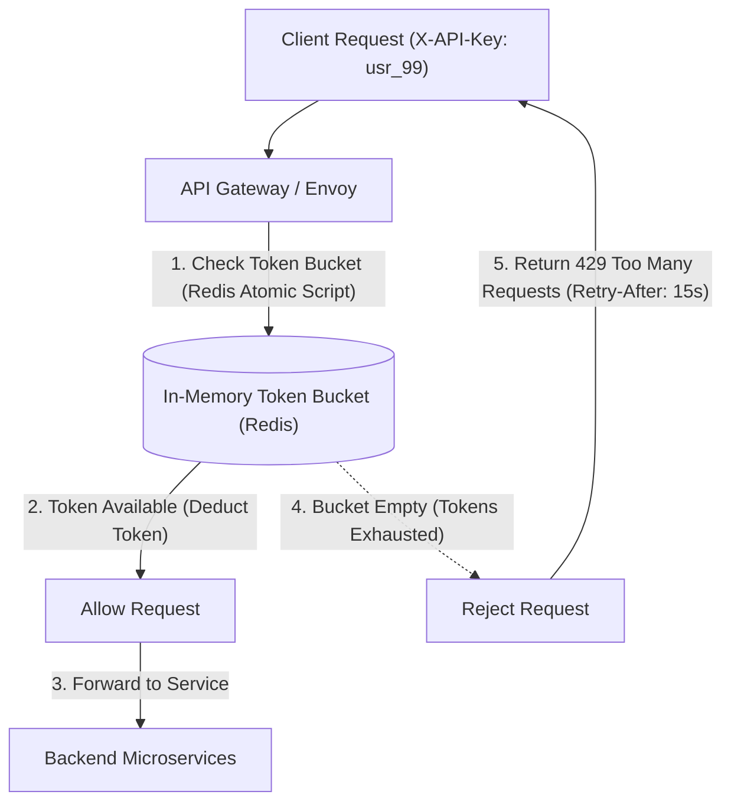
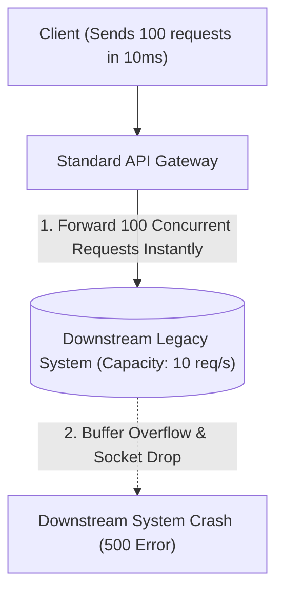
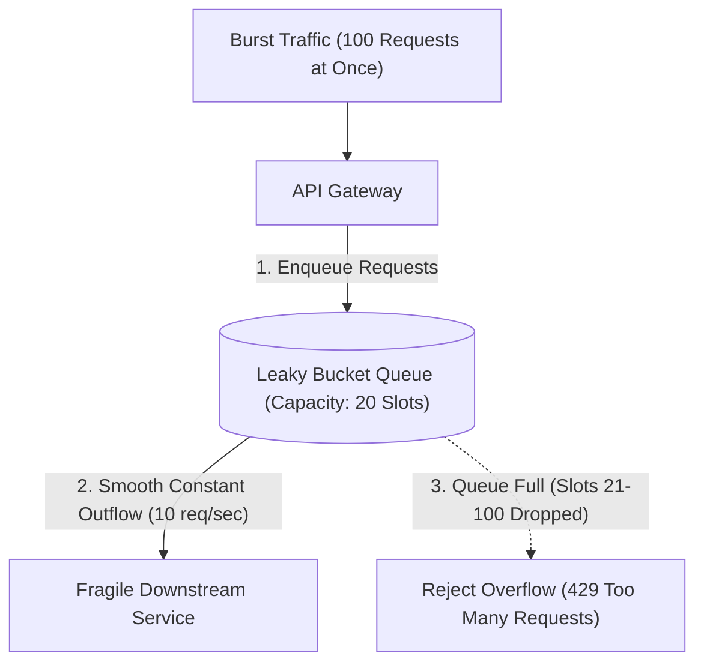
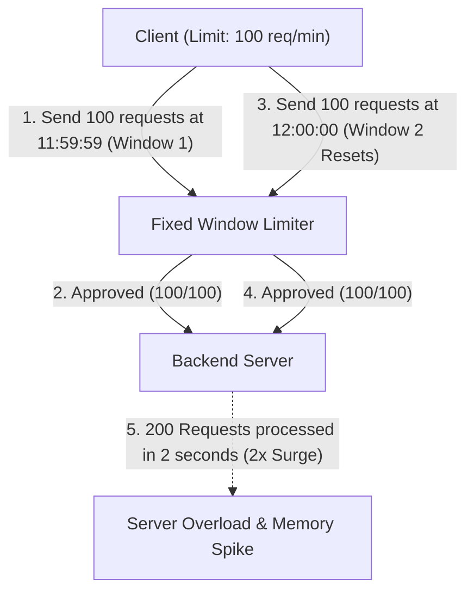
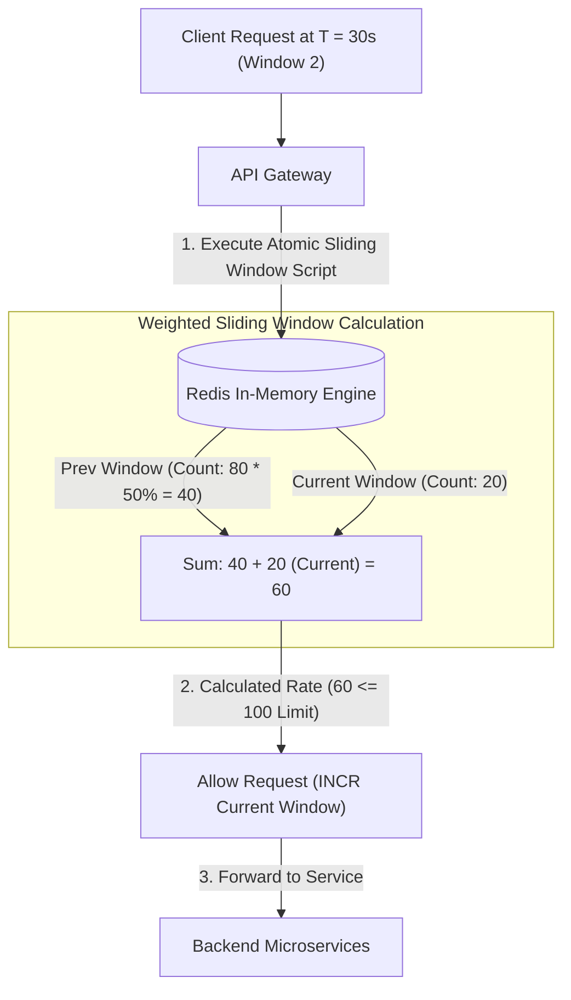
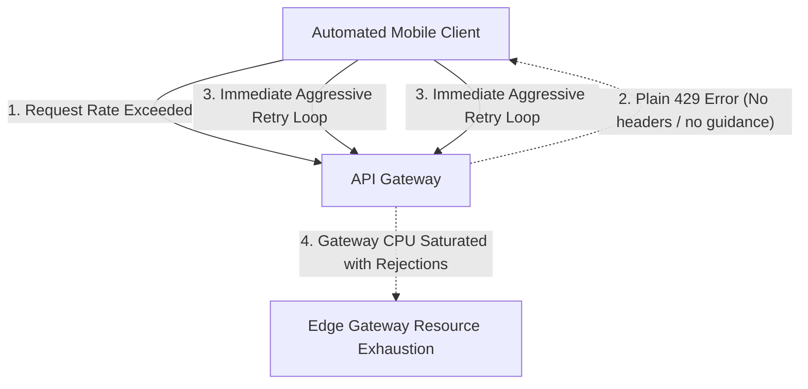
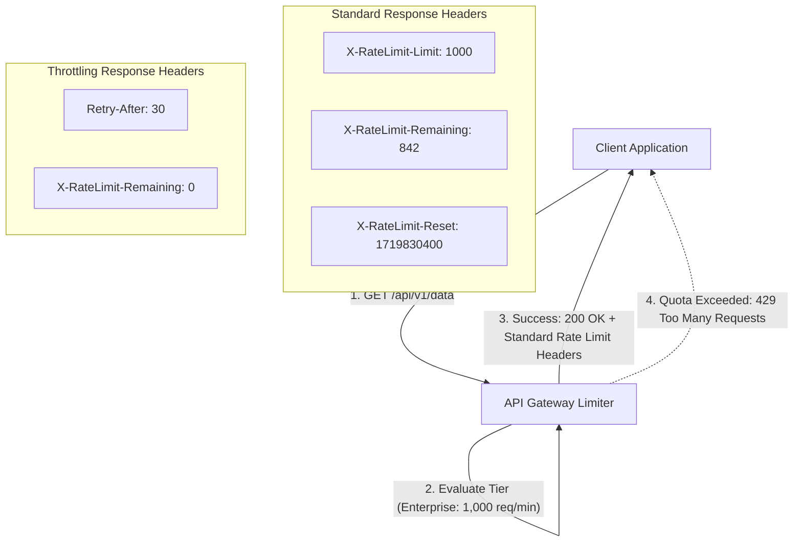

## Token Bucket and Burst Rate Limiting

Public application programming interfaces without ingress rate limits are vulnerable to distributed denial-of-service attacks (malicious attempts to disrupt normal server traffic by overwhelming the target with a flood of internet requests), credential stuffing scripts (automated bots testing stolen passwords against login endpoints), and resource exhaustion caused by noisy neighbors (unruly client applications that consume an unfair share of shared server resources).

When unconstrained traffic surges hit backend microservices directly, application thread pools become completely saturated, database connection pools exhaust, and legitimate paying users receive cascading 503 service unavailable errors.

The token bucket algorithm controls incoming traffic by adding virtual tokens to a client bucket at a constant, predefined refill rate up to a maximum bucket capacity limit. When a client request arrives at the edge API gateway, the gateway attempts to draw a token from the client bucket; if a token is available, the token is deducted and the request proceeds to the backend services.

If the bucket is empty because the client exceeded their quota, the gateway immediately rejects the request with an HTTP status 429 too many requests response without consuming any backend compute resources.

The token bucket algorithm accommodates natural bursts of traffic (such as a mobile application loading multiple home screen feeds simultaneously) up to the bucket capacity while strictly enforcing a sustainable average throughput limit. Systems store token counts and refill timestamps in centralized in-memory datastores to coordinate quotas across distributed API gateway instances.

## Leaky Bucket and Smooth Traffic Shaping

While token bucket algorithms permit short bursts of traffic up to bucket capacity, certain downstream systems (such as legacy core banking ledgers, rate-limited third-party partner APIs, or hardware disk flushes) cannot tolerate any sudden traffic spikes whatsoever. If a client discharges fifty requests simultaneously within five milliseconds, the sudden burst can overload downstream queue buffers and cause transient memory pressure.

Dropping burst requests abruptly with error codes damages client user experiences when the client simply needs requests to be processed at a steady, reliable rhythm.

The leaky bucket algorithm shapes incoming traffic into a completely smooth, constant outflow rate using a first-in first-out buffer queue. Incoming client requests enter the top of the bucket queue regardless of arrival burstiness; if the queue has available space, requests are held temporarily and dispatched to downstream services at a strictly regulated, constant pace (for example, exactly ten requests per second).

If incoming traffic arrives faster than the constant outflow rate and fills the queue capacity completely, newly arriving excess requests overflow and are immediately rejected.

Leaky bucket traffic shaping eliminates burst-induced jitter and protects fragile downstream infrastructure from resource saturation. This pattern is ideal for data ingestion pipelines and third-party webhook dispatchers that require smooth, continuous data delivery.

## Sliding Window Counter and Distributed Redis Limiting

Fixed window counter algorithms divide time into fixed blocks (such as sixty-second intervals) and increment a simple integer counter per client. However, fixed window limiters suffer from a severe boundary surge vulnerability (a flaw where a client sends their entire quota at the last second of window one and another full quota at the first second of window two, allowing double the allowed traffic within a two-second interval).

Sliding window log algorithms fix this by storing timestamps for every single request in Redis sorted sets, but storing individual timestamps consumes massive amounts of memory when scaling to millions of active users.

The sliding window counter algorithm calculates traffic by blending the request count of the previous window with the active count of the current window using a time-weighted percentage. If the current time is thirty seconds into a sixty-second window, the algorithm weights the previous window count by fifty percent and adds the current window counter to estimate real-time rolling velocity.

API gateways execute this sliding window calculation inside an atomic Lua script in Redis (a single script that runs directly on the in-memory server without inter-command network round trips), requiring only two lightweight integer counters per user while preventing boundary surge exploits.

Sliding window counters provide high accuracy protection against burst exploits while maintaining minimal memory usage and sub-millisecond evaluation speed. Distributed clusters scale smoothly because rate-limiting state is decoupled from individual web proxy instances.

## Client Quotas and Informative Throttling Headers

When client applications receive abrupt HTTP status 429 rejection responses without diagnostic metadata, frontend developers and client automated systems struggle to understand why their requests failed. Clients without backoff guidance frequently execute immediate, aggressive retries, generating a secondary wave of unhelpful traffic that prolongs edge gateway saturation.

Furthermore, multi-tenant software-as-a-service platforms need clear visibility to differentiate between free-tier rate limits, enterprise tier quotas, and system-wide emergency degradation throttles.

Production rate limiters return standardized HTTP response headers on every API transaction, providing clients with real-time quota visibility and programmatic backoff directives. Headers communicate the total allowed quota limit, the exact number of remaining tokens in the active window, and the precise Unix epoch timestamp when the rate limit window resets.

When a client exceeds their allowance and receives an HTTP 429 status code, the response includes an explicit retry-after header specifying the exact number of seconds the client must sleep before re-attempting communication.

Transparent rate limiting headers empower client applications to self-regulate traffic dynamically and implement automated client-side backoff delays. This cooperation between edge proxies and client libraries reduces wasted network traffic and maintains high system stability during peak operational demand.
