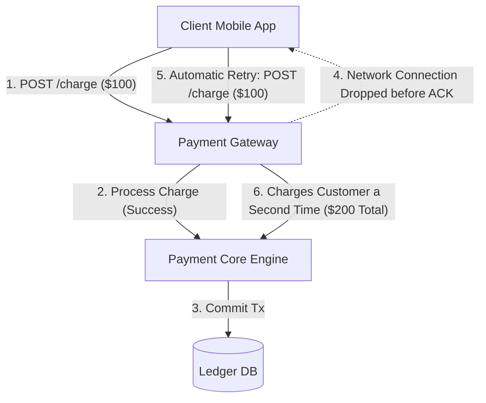
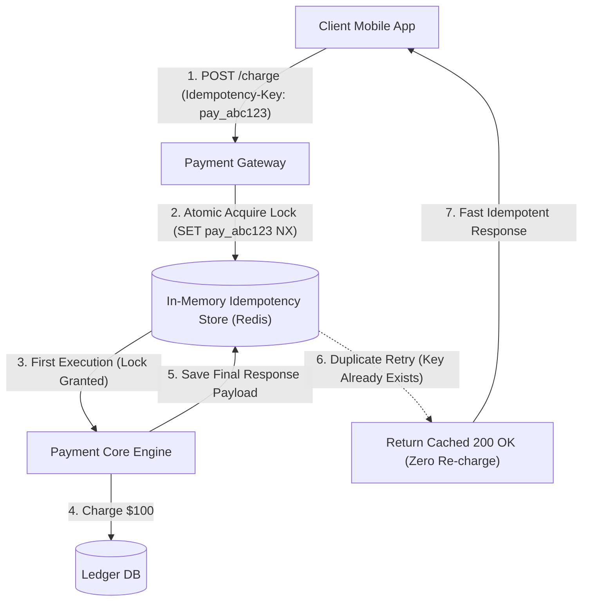
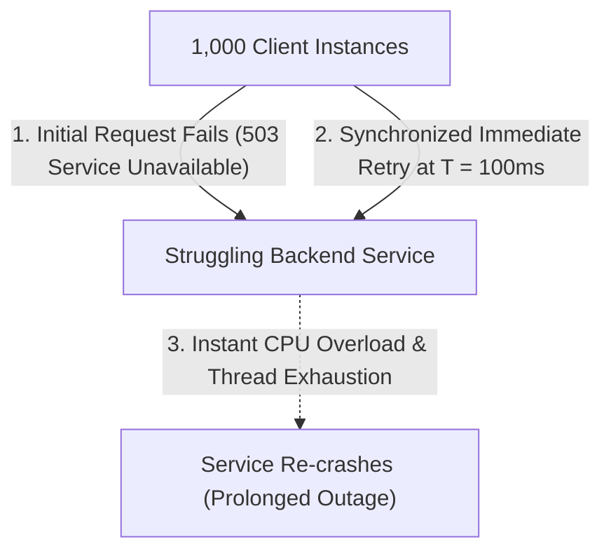
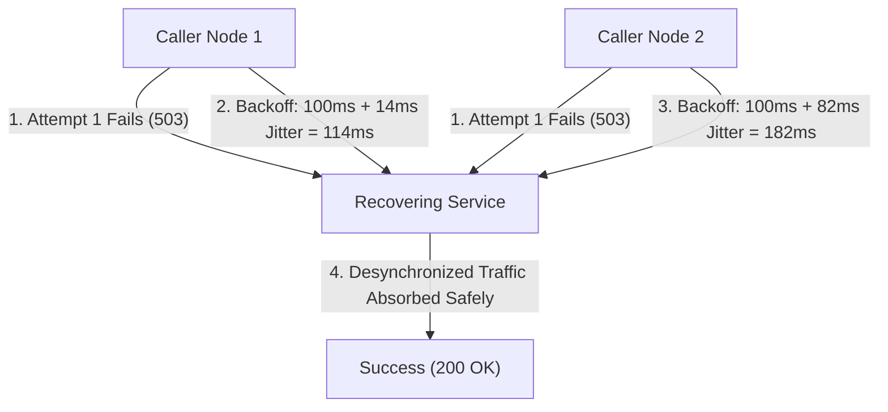
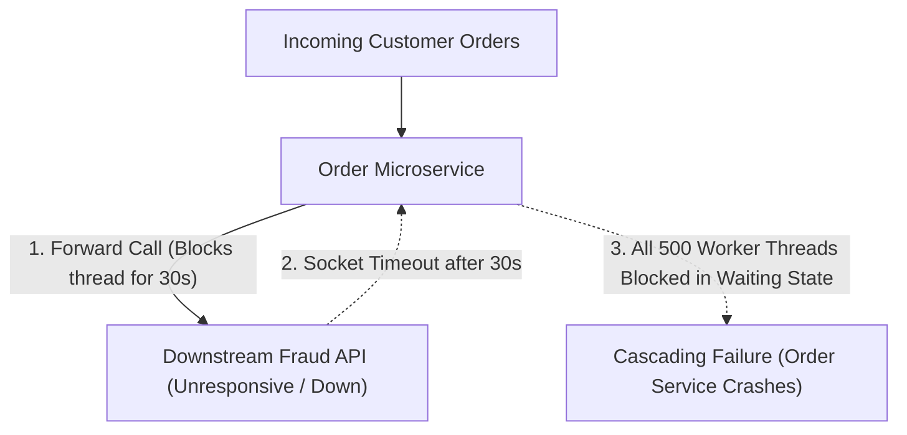
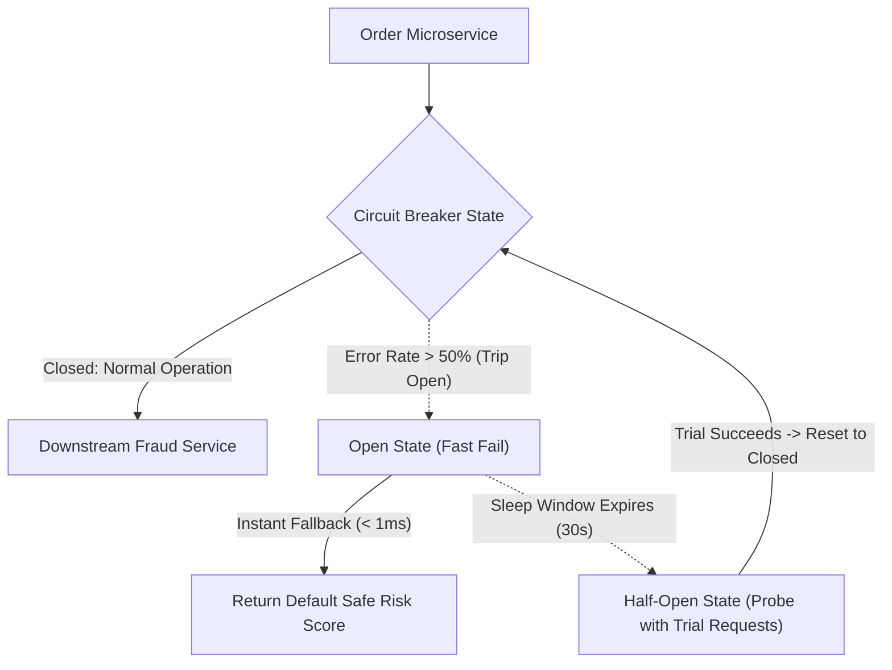
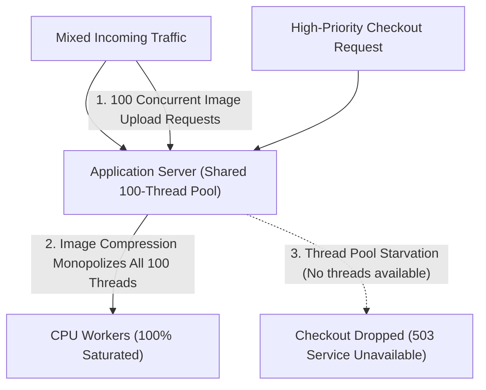
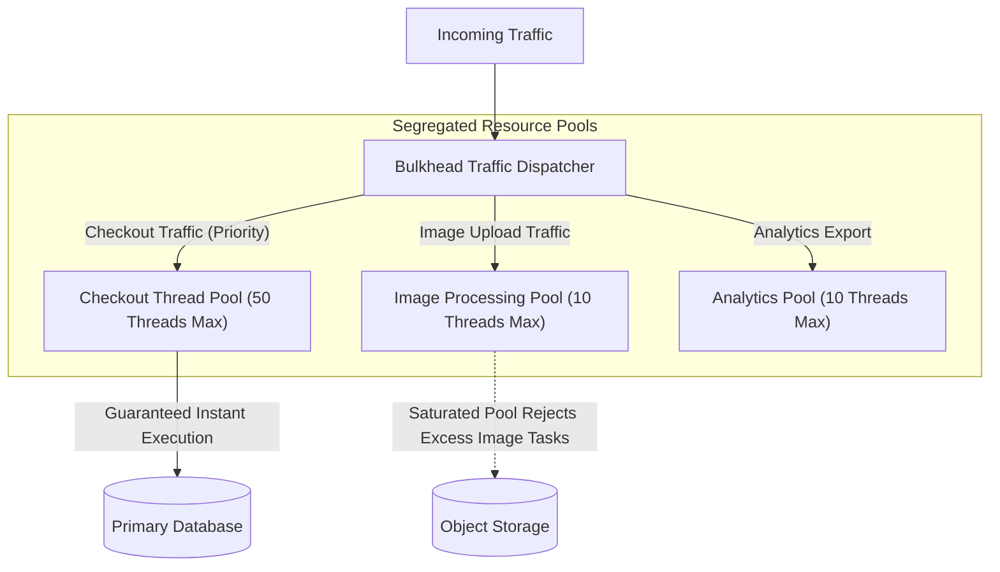
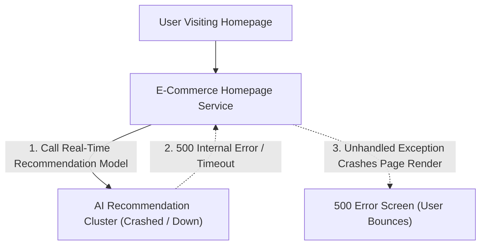
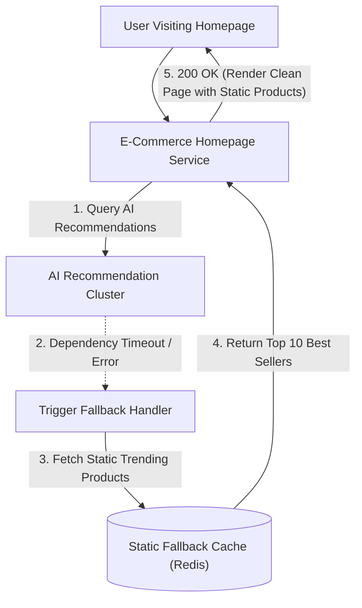

## Idempotency Keys and Duplicate Request Prevention

In distributed network architectures, client network connections frequently drop after the server has successfully processed a mutation but before the success response reaches the client. When a mobile application experiences a socket timeout on an order checkout request, the client application automatically retries the payment transaction.

Without idempotency protections, the server treats the retried request as a brand-new transaction, executing duplicate credit card charges and creating redundant shipment orders in the database.

An idempotency key (a unique client-generated identifier such as a UUID version 4 attached to the HTTP request headers) guarantees that executing the same operation multiple times yields the exact same outcome as the first attempt. When the gateway receives a request containing an idempotency key, it executes an atomic in-memory lock (such as setting an expiring key in Redis with set-if-not-exists semantics).

If a duplicate request arrives with the same key while the operation is in flight or after completion, the server bypasses the payment engine and returns the cached response of the initial execution without re-executing side effects.

Idempotency keys eliminate double-billing anomalies and make distributed operations safely retryable over lossy mobile networks. Systems set a time-to-live duration on stored idempotency keys (such as twenty-four hours) to allow safe client retries while purging old transaction records automatically.

## Exponential Backoff with Jitter and Retry Storm Prevention

When a downstream database or microservice experiences a transient slowdown or momentary network glitch, upstream services immediately trigger automated retries. If hundreds of calling instances execute retries with fixed, immediate timers (for example, all retrying every one hundred milliseconds), the recovering downstream server is hit by a massive thundering herd retry storm (a synchronized wave of thousands of concurrent requests that immediately crashes a service that was just beginning to recover).

Immediate retry loops amplify traffic volume exponentially during outages, transforming small transient hiccups into prolonged, system-wide cascading outages.

Exponential backoff with jitter prevents retry storms by exponentially increasing the delay between successive retry attempts while injecting random mathematical noise (jitter). On each failed attempt, the client calculates the backoff wait duration by multiplying the base delay by two raised to the power of the attempt count, adding a random interval of milliseconds.

Randomized jitter desynchronizes the retry timers across the thousands of calling instances, smoothing the aggregate retry traffic into an evenly distributed trickle that the recovering service can handle safely.

Exponential backoff with jitter enables autonomous recovery from transient network glitches without risking secondary crash waves. Calling services enforce a maximum retry count limit (typically three to five attempts) before failing fast and logging an error.

## Circuit Breaker Pattern and Fast Failing

When a downstream dependency (such as a third-party credit card validation API or remote fraud detection microservice) suffers an outage and stops responding, upstream callers continue forwarding requests and waiting for standard socket timeout intervals (such as thirty seconds per request). As hundreds of incoming requests block waiting on frozen network connections, upstream server thread pools and memory allocations exhaust rapidly.

Within seconds, thread starvation cascades backward through the call chain, taking down completely unrelated services and causing a total platform outage.

The circuit breaker pattern wraps remote service calls in a state machine that tracks failure rates across a rolling time window. Under normal operation (closed state), requests flow through to the downstream dependency; if the error or timeout rate exceeds a defined threshold (such as fifty percent failures over ten seconds), the circuit breaker trips into an open state.

While open, the circuit breaker immediately short-circuits subsequent calls locally without making any network requests, failing fast in sub-milliseconds and returning a fallback response. After a sleep cooling period, the breaker enters a half-open state, allowing a small trial probe of requests to test if the downstream service has recovered before fully closing the circuit.

Circuit breakers insulate distributed architectures from slow or unresponsive dependencies, preventing thread starvation from spreading across service boundaries. Upstream services remain responsive and capable of handling core traffic even when non-critical auxiliary services are completely offline.

## Bulkhead Isolation and Resource Partitioning

In shared-resource architectures where all features execute inside a single application process or share a common thread pool, compute-heavy or slow auxiliary operations can consume all available system capacity. For example, if a background image resizing endpoint or analytical export feature suddenly experiences high traffic, it consumes all available CPU worker threads and database connections.

Critical, high-revenue user journeys like product checkout or account authentication become starved of compute threads, failing completely due to an issue in an auxiliary feature.

The bulkhead pattern (named after the watertight partition compartments in a ship hull that prevent a single hull breach from sinking the entire vessel) isolates system resources into segregated, dedicated compartments. Applications allocate separate, dedicated thread pools, CPU quotas, and database connection pools for distinct business domains based on criticality.

If the non-critical image processing pool becomes completely saturated, newly arriving image requests are rejected or queued locally, while the isolated checkout thread pool continues processing customer purchases with zero disruption.

Bulkhead partitioning guarantees that performance degradation, memory leaks, or traffic spikes in secondary features cannot compromise mission-critical revenue streams. Systems enforce bulkheads across thread pools, microservice container deployments, and independent database clusters.

## Graceful Degradation and Fallback Strategies

When primary backend dependencies (such as personalized recommendation engines, live inventory counters, or third-party review systems) suffer partial infrastructure outages, naive applications crash entirely and render generic 500 internal server error pages to users. Showing an error screen destroys user trust and halts all conversions even though eighty percent of the core application features are fully operational.

Failing completely because a non-essential supplementary widget cannot load represents an unacceptable availability failure for modern web platforms.

Graceful degradation is an architectural strategy where an application detects dependency failures and switches dynamically to a reduced, simplified, or cached operational mode rather than failing completely. When the machine learning recommendation service becomes unreachable, the homepage service catches the failure, suppresses the error, and falls back to rendering a static list of top-selling products retrieved from a fast local cache.

The user receives a fully functional, attractive shopping interface with zero visible errors, completely unaware that an internal backend service is undergoing maintenance.

Graceful degradation maximizes business continuity and user satisfaction during partial infrastructure outages. Systems define explicit tiered fallback hierarchies for all non-essential components across web and mobile user interfaces.
