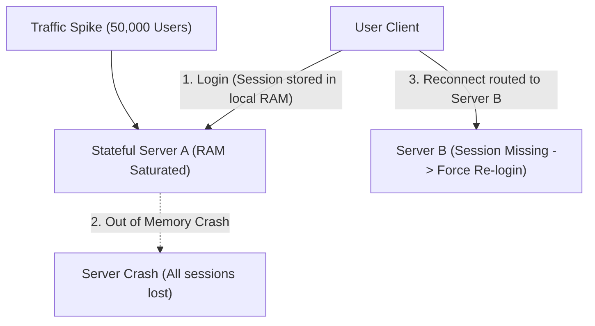
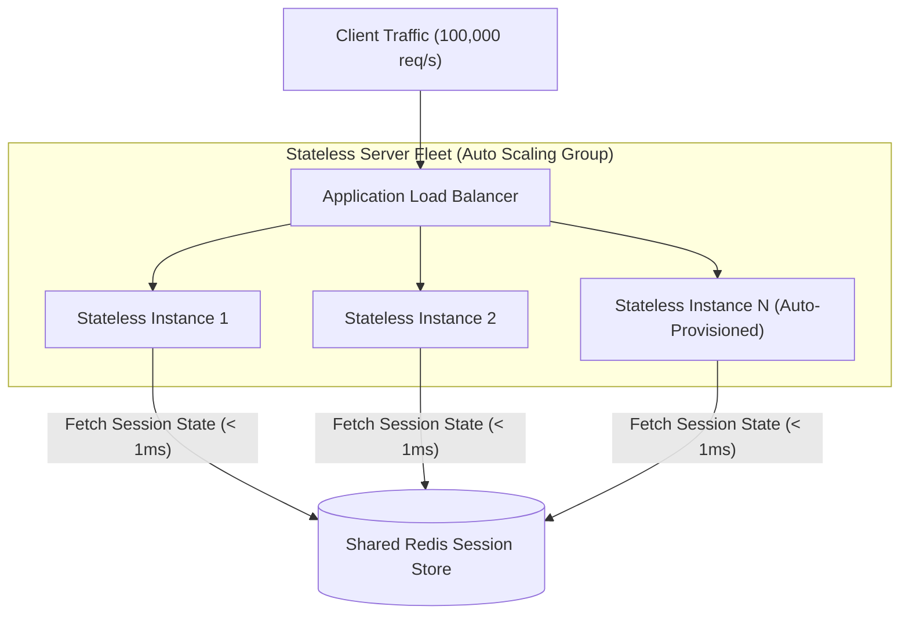
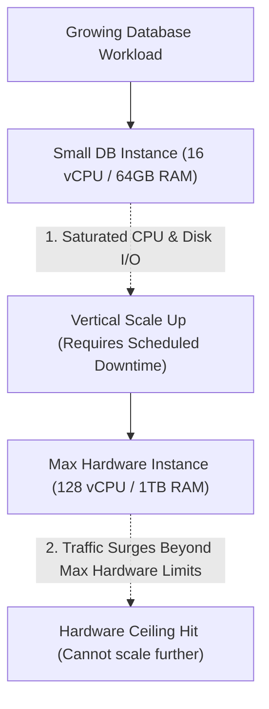
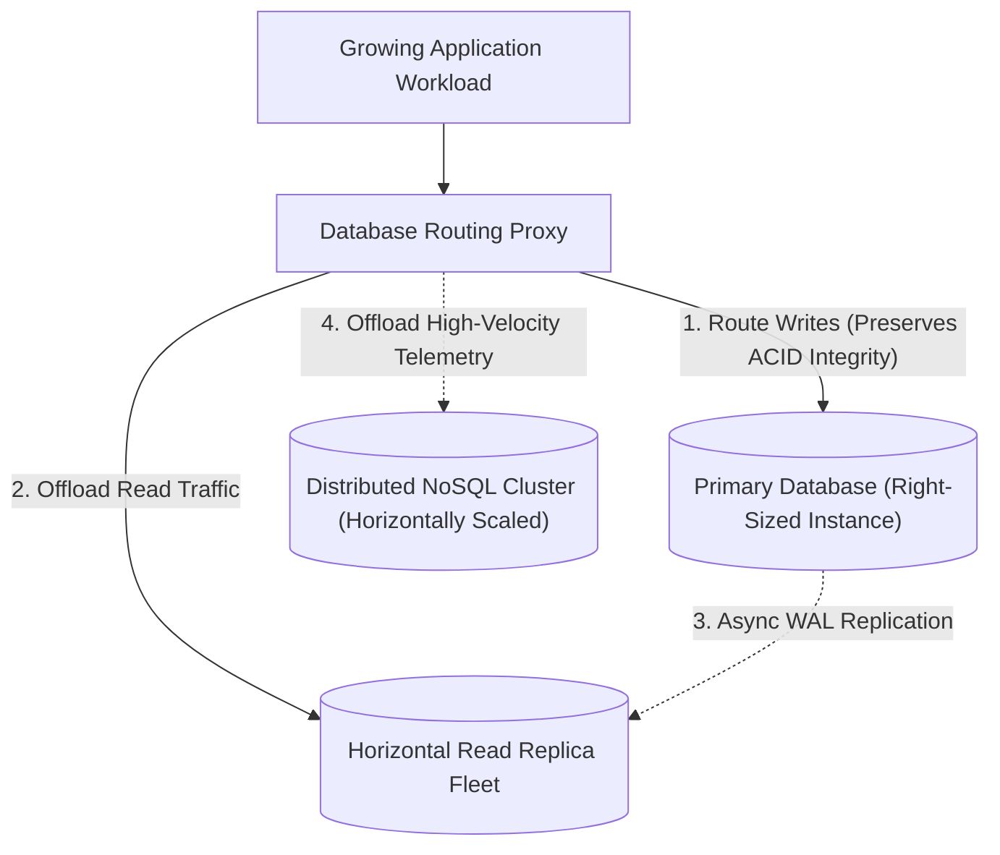
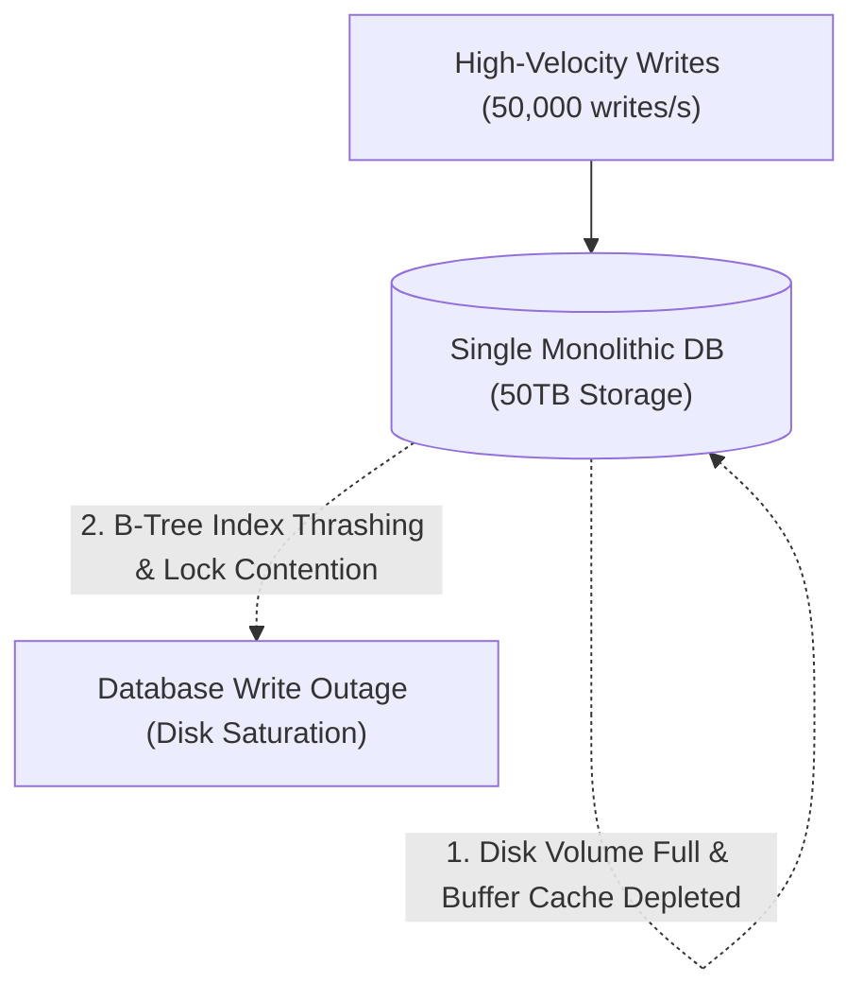
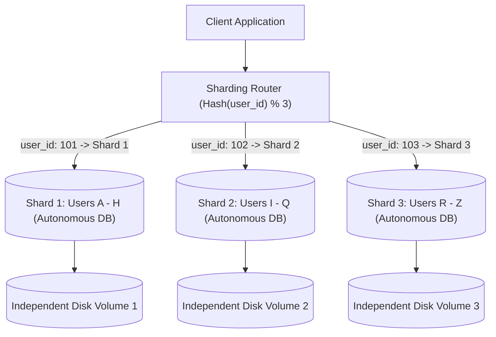
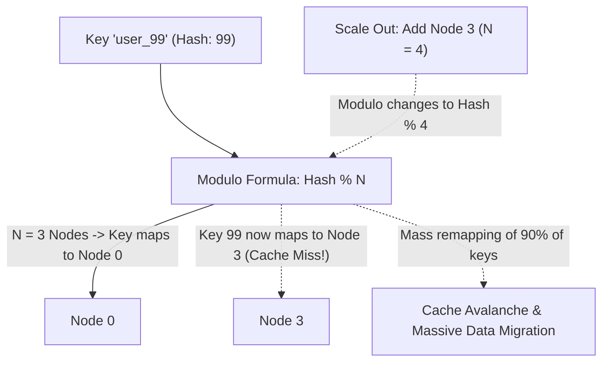
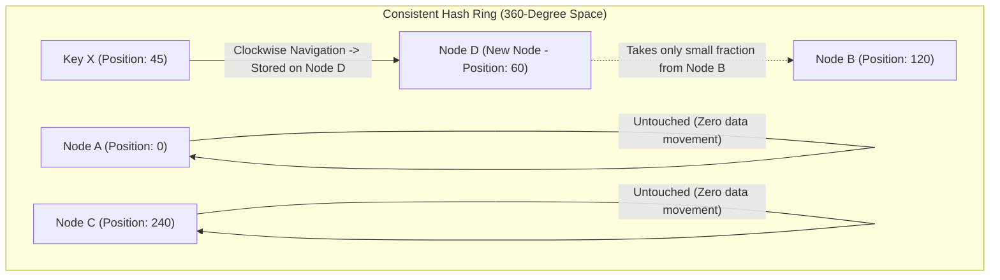

## Horizontal Scaling and Stateless Server Fleets

Stateful monolithic server architectures store user session states (in-memory user login credentials, shopping cart items, and active websocket handles) directly inside local server RAM. When incoming user traffic surges, the single application server runs out of physical memory and CPU processing capacity, while opening additional server nodes fails because user requests routed to a new machine cannot find the session state stored on the previous machine.

Storing session data locally ties clients to specific physical machines, creating severe operational bottlenecks where servers cannot be restarted, upgraded, or dynamically scaled without abruptly logging out users.

Horizontal scaling (scaling out) distributes compute workloads across a dynamic pool of stateless application servers placed behind an edge load balancer. Stateless servers store zero session state in local memory, persisting all transient user sessions and authentication tokens in a shared, high-speed in-memory datastore (such as Redis) or encoding state into cryptographically signed JSON Web Tokens held by the client.

Cloud orchestration platforms utilize Auto Scaling Groups (automated scaling controllers that monitor metric thresholds like average CPU utilization or request latency) to provision additional server instances dynamically during traffic surges and terminate idle instances when demand subsides.

Stateless horizontal scaling allows web applications to handle virtually unlimited concurrent traffic by adding inexpensive commodity compute nodes. Systems achieve high fault tolerance because the load balancer automatically detects unhealthy instances and redirects traffic to healthy nodes without user disruption.

## Vertical Scaling and Hardware Resource Ceilings

When single-node database instances or legacy enterprise monolithic systems encounter performance bottlenecks, engineering teams frequently choose vertical scaling (scaling up by upgrading the physical or virtual hardware specifications of an existing server, such as upgrading from 16 CPU cores to 128 cores and 64 gigabytes of RAM to 1 terabyte of RAM). While vertical scaling requires zero architectural code changes, physical server hardware introduces strict upper boundaries known as the hardware ceiling (the maximum compute, memory, and bus throughput capacity that current physical computer hardware can provide on a single motherboard).

Beyond hardware limits, vertical scaling exhibits an exponential cost curve (where ultra-high-end enterprise server instances cost disproportionately more per gigabyte of RAM than standard commodity machines) and requires scheduled maintenance downtime whenever resizing instances.

Modern architectures use vertical scaling as an initial pragmatic stepping stone for relational databases while simultaneously planning modular horizontal partitioning before reaching the hardware ceiling. For read-heavy relational workloads, systems deploy asynchronous read replicas behind database proxies to offload read traffic from the primary write node.

For write-heavy workloads approaching the hardware ceiling, systems introduce horizontal database sharding or transition high-throughput event ingestion components into distributed NoSQL datastores.

Pairing vertical instance optimization with targeted horizontal offloading maximizes infrastructure cost efficiency. Systems maintain ACID relational consistency for core business ledgers while scaling read and telemetry throughput horizontally across independent nodes.

## Database Sharding and Horizontal Partitioning

Single relational database instances face physical storage and write input-output limits when datasets grow to tens of terabytes or write traffic exceeds tens of thousands of queries per second. When a table contains hundreds of millions of rows, B-Tree index scans slow down and disk storage fills the physical volume capacity.

Attempting to run complex analytics or write batches on massive monolithic tables degrades transaction latency across the entire database cluster.

Database sharding (horizontal partitioning) splits a massive database table across multiple independent physical database instances called shards, where each shard stores a distinct subset of total rows based on a shard key (a specific column attribute such as user identification number or tenant ID). A lightweight sharding router evaluates the shard key of each incoming query using mathematical hashing (such as applying a modulo hash function to the user ID) and routes the query directly to the specific shard hosting that user data.

Because each shard operates as an autonomous database with its own CPU, RAM, and disk volume, total cluster write throughput and storage capacity expand linearly as new shards are added.

Database sharding provides virtually unlimited horizontal storage and write throughput scaling for massive multi-tenant platforms. Systems avoid cross-shard joins (expensive distributed operations that join tables located on different physical machines over the network) by co-locating related entity records on the same shard using consistent shard keys.

## Consistent Hashing and Virtual Node Rebalancing

Traditional sharding routers distribute data across database or caching nodes using a simple modulo hash formula (calculating the hash of the key modulo the total number of server nodes). However, when the cluster scales by adding a new server node or contracts when a server node crashes, the modulo divisor changes (for example, transitioning from modulo four to modulo five).

Changing the divisor causes virtually all existing keys (up to ninety percent of all stored data) to remap to different server nodes, triggering a catastrophic cache storm (mass simultaneous cache misses that hammer backend databases) and requiring massive, complex data migrations across database shards.

Consistent hashing maps both server nodes and data keys to positions along a continuous circular ring (a fixed integer mathematical space from zero to two raised to the power of thirty-two minus one). When looking up a key, the router hashes the key to locate its point on the ring and travels clockwise to find the first server node encountered.

When a new server node is added to the ring, it takes over only a small fraction of keys from its immediate clockwise neighbor, leaving the vast majority of existing key mappings completely untouched.

Consistent hashing ensures that adding or removing server nodes moves only a minimal fraction of total data (specifically one divided by the total number of nodes). Systems deploy virtual nodes (assigning multiple pseudo-random positions along the ring to each physical server) to distribute data and traffic load evenly across physical machines, preventing hot spots.
