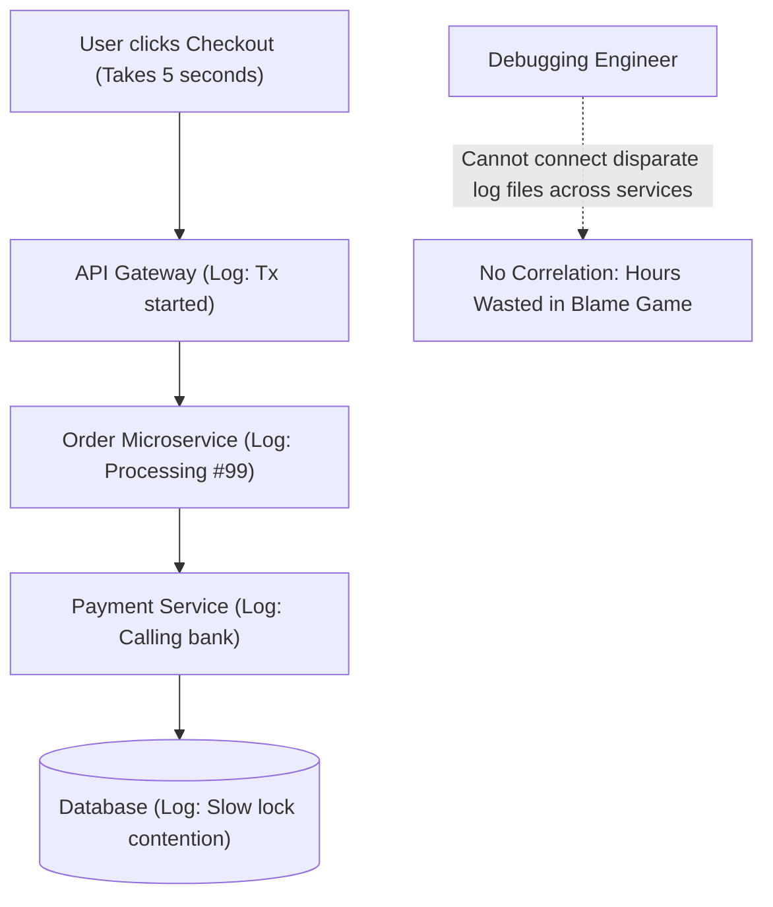
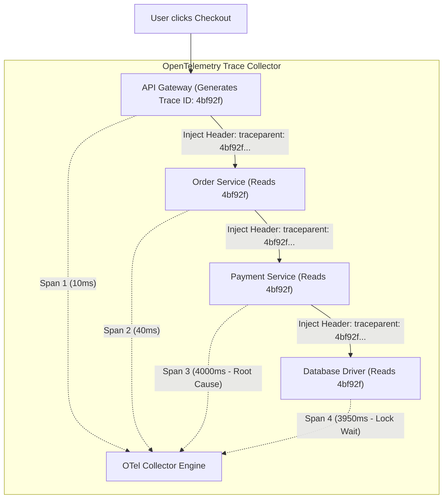
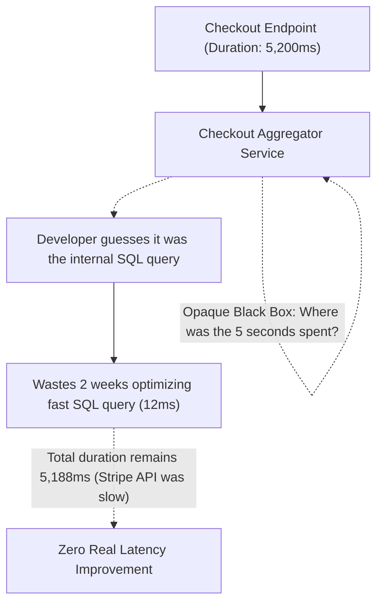
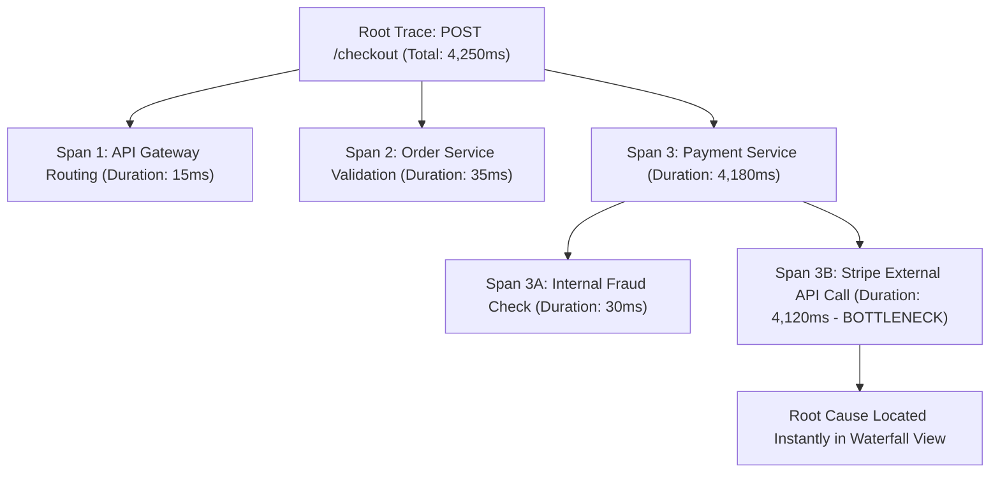
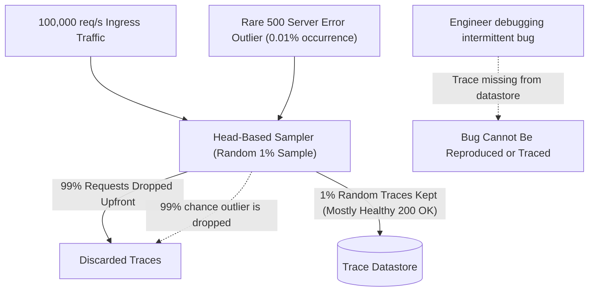
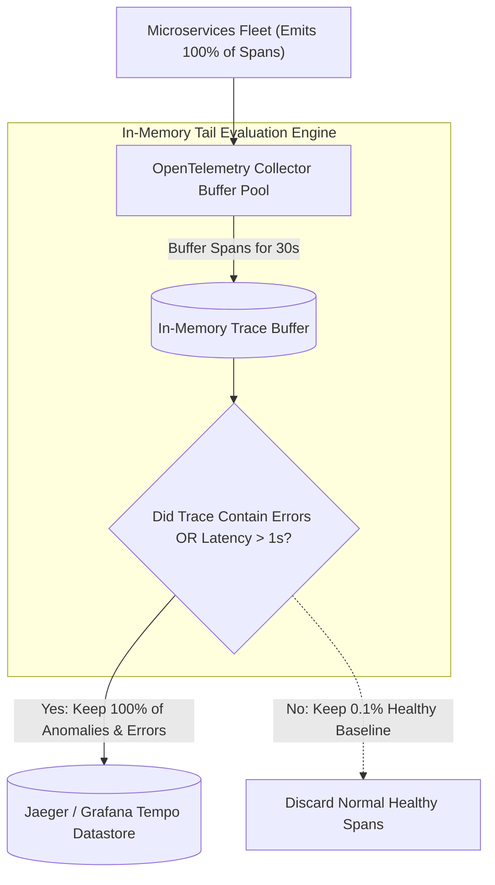
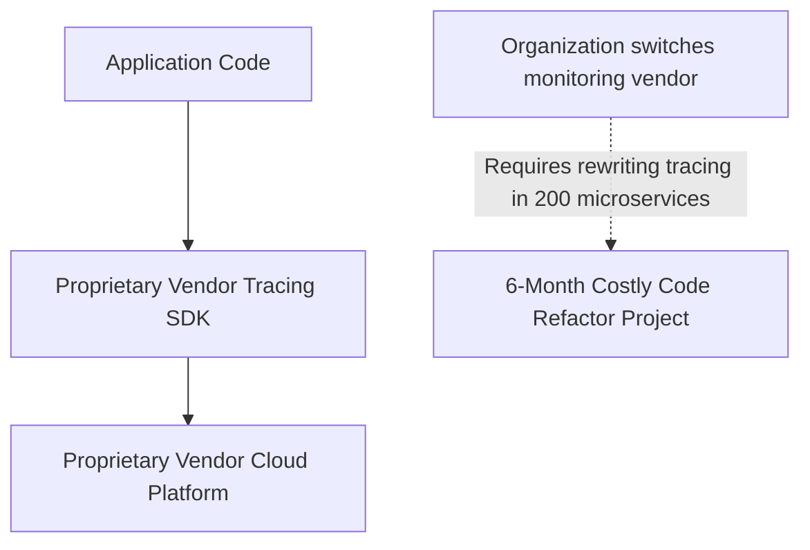
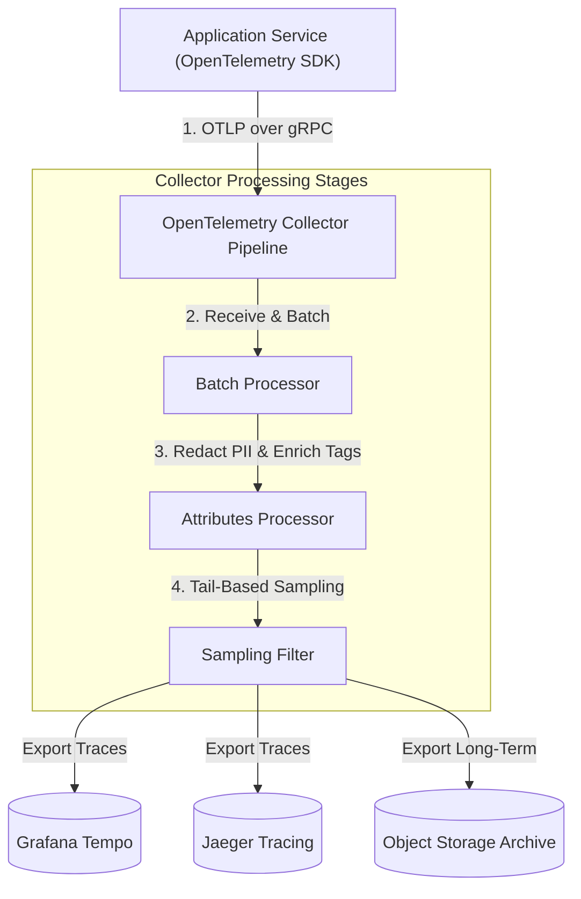

## Distributed Context Propagation and Trace Correlation

In complex microservice ecosystems, a single user click (such as clicking the checkout button on an e-commerce platform) triggers a chain of dozens of synchronous remote procedure calls and asynchronous message events across multiple independent backend services. When an individual service encounters a slow SQL query or drops a request, isolated logs in individual services cannot be tied back to the original user transaction.

Without cross-service correlation identifiers, engineers cannot reconstruct the end-to-end execution path, leaving teams arguing over which service team is responsible for slow response times.

Distributed context propagation injects a globally unique trace identifier (a 128-bit hexadecimal identifier that represents the end-to-end request journey) into the network protocol headers of every inter-service call. Following the W3C Trace Context standard, services pass a standardized traceparent header across HTTP, gRPC, and message queue boundaries, preserving the parent trace ID and active span context across asynchronous thread boundaries.

When any microservice emits a log statement, error event, or metric during that transaction, the logging library automatically attaches the active trace identifier to the telemetry payload.

Context propagation links every downstream database query, remote API call, and background queue message to a single, searchable transaction lifecycle. Engineers search by trace ID in observability platforms to view the exact end-to-end journey across all microservices instantly.

## Spans and Critical Path Latency Attribution

When an aggregated API endpoint experiences high latency (for example, taking five seconds to complete), diagnosing which specific internal operation caused the delay is challenging when looking only at total request duration. If a service executes three database queries sequentially and four external third-party API calls in parallel, simple stopwatches cannot isolate whether the slowdown was caused by thread waiting, database locks, or external vendor latency.

Guessing bottlenecks without granular timing data leads engineering teams to waste weeks refactoring fast code while leaving the actual root bottleneck untouched.

A span represents a single contiguous unit of timed work within a distributed trace, capturing an operation name, start timestamp, finish timestamp, span status, and custom key-value metadata attributes. Spans form a directed acyclic graph hierarchy where parent spans encompass the duration of their child spans, explicitly mapping the critical path (the sequence of dependent operations that determines the total overall duration of the request).

Visualizing the trace as an interactive waterfall tree exposes the exact millisecond breakdown of synchronous child operations versus concurrent parallel executions, pinpointing the slowest span immediately.

Span hierarchy analysis eliminates guesswork and focuses engineering optimization efforts directly on the operations dominating the critical path. Teams configure automated alerts that notify service owners whenever specific child spans violate defined latency boundaries.

## Head-Based versus Tail-Based Trace Sampling

Collecting, serializing, transmitting, and indexing one hundred percent of every distributed trace across high-throughput platforms (processing hundreds of thousands of requests per second) generates petabytes of trace telemetry. Ingestion network bandwidth costs and observability storage bills rapidly exceed the compute costs of the actual production application.

However, naive head-based sampling (flipping a coin at the edge gateway to sample only one percent of requests randomly) drops ninety-nine percent of rare runtime exceptions and high-latency outlier anomalies, rendering tracing useless for debugging intermittent production bugs.

Tail-based sampling defers the sampling decision until the entire distributed transaction has finished executing. Microservices stream all trace spans into an intermediate collector buffer pool (such as an OpenTelemetry Collector cluster), which buffers spans in memory for thirty seconds until the root span completes.

The collector evaluates the complete trace against intelligent filtering rules: if the trace contains an HTTP 5xx error status, an unhandled exception tag, or a latency duration exceeding the ninety-fifth percentile threshold, the entire trace is retained and persisted to storage, while normal, healthy, fast transactions are sampled down aggressively.

Tail-based sampling guarantees one hundred percent visibility into application errors and performance anomalies while reducing telemetry storage costs by up to ninety percent. Systems scale collector memory buffers across clusters to handle high transaction velocities without data loss.

## OpenTelemetry Architecture and Collector Pipelines

Proprietary vendor tracing agents tightly couple application codebases to specific commercial observability software development kits. When an organization decides to switch monitoring vendors or migrate to self-hosted open-source datastores, engineering teams face months of painful codebase refactoring to remove vendor-specific SDK imports and rewrite custom instrumentation.

Furthermore, running multiple proprietary vendor agents concurrently inside application containers introduces significant CPU overhead and memory footprint bloat.

OpenTelemetry (OTel) provides a vendor-neutral, open industry standard for instrumenting, generating, and exporting distributed traces, metrics, and logs. Applications instrument their code once using standard OpenTelemetry SDKs and export telemetry over high-speed OpenTelemetry Protocol (OTLP) to an external OpenTelemetry Collector pipeline.

The collector operates as an out-of-process proxy that receives, batches, filters, transforms, and fans out telemetry streams to multiple backend destinations (such as Grafana Tempo, Jaeger, and AWS X-Ray) simultaneously through simple configuration file updates without touching application code.

The OpenTelemetry Collector architecture completely decouples application code from storage backends, providing total architectural flexibility and zero vendor lock-in. Organizations can route subsets of telemetry to local development clusters and production observability platforms simultaneously through declarative pipeline configurations.
