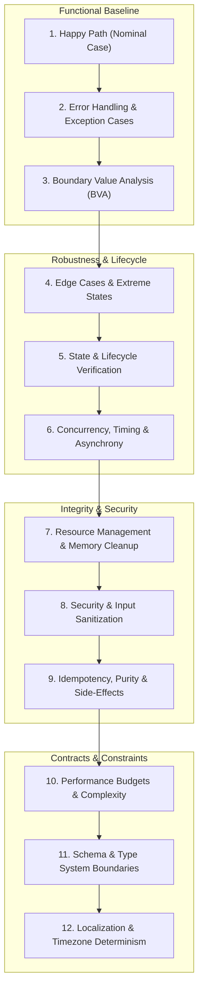

# Unit Testing Perspectives Mapper

A comprehensive, language- and framework-agnostic testing perspective engine. Use this skill to map out, verify, and implement airtight unit test suites across any programming language (TypeScript, Python, Rust, Go, Java, C++) and testing framework (Vitest, PyTest, cargo test, Go testing, JUnit 5, GoogleTest).

---

## When to Use This Skill

Activate this skill whenever you need to:
- Design or audit unit test suites for any component, function, struct, or API module.
- Perform Test-Driven Development (TDD) or map test cases before implementing new features.
- Troubleshoot brittle, incomplete, or flaky test suites by conducting a perspective audit.
- Uncover hidden edge cases, resource leaks, security vectors, and race conditions before code hits production.
- Generate multi-framework test blueprints with clean, idiomatic assertion contracts.

---

## The 12 Core Testing Perspectives Framework

When auditing or testing any unit of code, systematically evaluate all 12 dimensions:



---

### Perspective 1: The Happy Path (Nominal Case)

* **Goal:** Verify that the code functions correctly under ideal, standard operational conditions with valid inputs.
* **What to Test:** Standard valid inputs, primary output structures, expected return types, and expected state transitions.
* **Checklist:**
  - [ ] Core business logic produces exact expected result for typical inputs.
  - [ ] Return values match expected types and domain values.
  - [ ] Primary output state matches specification contracts.

---

### Perspective 2: Error Handling & Exception Cases

* **Goal:** Verify that the code fails safely, predictably, and gracefully under invalid inputs or upstream dependency failures.
* **What to Test:** Malformed data payloads, missing mandatory parameters/fields, dependency errors (database offline, network drop), permission denials, and type mismatches.
* **Checklist:**
  - [ ] Are custom exceptions or error codes thrown with actionable message context?
  - [ ] Does the unit prevent unhandled process panics or uncaught promise rejections?
  - [ ] Are failure results returned cleanly (`Result<T, E>`, `Option<T>`, tuple `(val, err)`) without corruption?

---

### Perspective 3: Boundary Value Analysis (BVA)

* **Goal:** Verify behavior at the exact operational limits and thresholds where off-by-one errors and strict inequality bugs occur.
* **What to Test:**
  - Exact minimum ($min$) and just below ($min - 1$).
  - Exact maximum ($max$) and just above ($max + 1$).
  - Zero/Empty states (`""`, `[]`, `{}` `0`, `0.0`, `null`, `undefined`, `None`).
* **Checklist:**
  - [ ] Are strict inequality bounds (`<` vs `<=`, `>` vs `>=`) correct at operational boundaries?
  - [ ] Does the unit handle 0-length arrays/strings without index-out-of-bounds exceptions?
  - [ ] Are integer overflow/underflow boundaries handled safely?

---

### Perspective 4: Edge Cases & Extreme States

* **Goal:** Verify resilience under degenerate, extreme, or unexpected input combinations.
* **What to Test:** Massively sized payloads (e.g., 100MB strings), special characters (`\0`, `\n`, `\r\n`), Unicode/emojis (`🚀`, `ﷺ`, zero-width spaces), whitespace variations, and duplicate action triggers.
* **Checklist:**
  - [ ] Are multi-byte UTF-8 string lengths computed correctly by character count vs byte length?
  - [ ] Are duplicate submissions or double-invocations handled safely?
  - [ ] Does the code handle control characters (`\0`, `\b`) without string truncation?

---

### Perspective 5: State & Lifecycle Verification

* **Goal:** Verify internal state transitions over time, initialization integrity, and proper cleanup/teardown.
* **What to Test:** Initial default state upon construction/instantiation, sequential state transitions across multiple method invocations, resetting state, and unmounting/teardown.
* **Checklist:**
  - [ ] Is the initial state clean and predictable?
  - [ ] Does invalid state transition attempt fail without mutating the current valid state?
  - [ ] Are internal caches or buffers cleared cleanly on reset?

---

### Perspective 6: Concurrency, Timing & Asynchrony

* **Goal:** Verify correctness in non-blocking operations, asynchronous flows, and time-dependent execution paths.
* **What to Test:** Promise/Future resolutions and rejections, timeout handling, artificial network delays, out-of-order responses, and rapid interleaved execution.
* **Checklist:**
  - [ ] Do overlapping parallel calls handle race conditions without overwriting newer data with stale data?
  - [ ] Does the unit handle promise cancellations or task abort signals (`AbortSignal`)?
  - [ ] Are virtual fake clocks used instead of real clock delays (`setTimeout`, `sleep`)?

---

### Perspective 7: Resource Management & Memory Cleanup

* **Goal:** Ensure deterministic cleanup of system resources and prevent memory leaks.
* **What to Test:** Closing file descriptors, releasing DB connection pools, unsubscribing from event listeners, clearing intervals/timers, and freeing allocated memory handles.
* **Checklist:**
  - [ ] Are file handles and network sockets closed in `finally` / `defer` / `RAII Drop` blocks?
  - [ ] Are long-lived event listeners detached when components or services unmount?
  - [ ] Does repeated creation and destruction of the unit leave zero lingering heap leaks?

---

### Perspective 8: Security & Input Sanitization

* **Goal:** Verify immunity against common security vulnerabilities and malicious payload injections.
* **What to Test:** Injection attack strings (SQLi: `' OR 1=1 --`, XSS: `<script>alert(1)</script>`, Path Traversal: `../../etc/passwd`, Command Injection: `; rm -rf /`), prototype pollution (`__proto__`), and unvalidated URLs.
* **Checklist:**
  - [ ] Are input parameters escape-encoded or parameterized before processing?
  - [ ] Does path resolving prevent jailbreaking outside the designated root directory?
  - [ ] Are object property assignments protected against prototype pollution?

---

### Perspective 9: Idempotency, Purity & Side-Effect Isolation

* **Goal:** Verify that functions produce predictable outcomes without unintended side effects or global mutations.
* **What to Test:** Idempotency (executing the function $N$ times yields the exact same state as executing it 1 time), side-effect isolation (verifying global variables, env vars, and outer state remain unmutated), and mock call verification.
* **Checklist:**
  - [ ] Is calling the operation multiple times safe and idempotent?
  - [ ] Does the function avoid mutating input arguments or environment variables?
  - [ ] Are mock call assertions verifying that external services were called with exact payload parameters?

---

### Perspective 10: Performance Budgets & Complexity

* **Goal:** Enforce execution time ceilings, memory limits, and algorithmic bounds to prevent performance regressions.
* **What to Test:** Execution latency budgets for large inputs ($N=10,000$), recursion stack depth constraints, and preventing $O(N^2)$ or $O(2^N)$ algorithmic degradation.
* **Checklist:**
  - [ ] Does execution complete within the specified millisecond budget for maximum input payload sizes?
  - [ ] Is stack allocation safe against Deep Recursion StackOverflow crashes?
  - [ ] Are memory allocation sizes bounded during bulk data transformations?

---

### Perspective 11: Schema & Type System Boundaries

* **Goal:** Enforce structural type contracts, schema validations, and serialization roundtripping.
* **What to Test:** JSON/Protobuf/BSON serialization and deserialization, generic type constraints, enum variant exhaustiveness, and structural field mapping.
* **Checklist:**
  - [ ] Does serialization followed by deserialization (`deserialize(serialize(obj))`) preserve exact object equality?
  - [ ] Are unknown or extra schema fields stripped or handled according to policy?
  - [ ] Are enum variants exhaustively matched without silent default fallthroughs?

---

### Perspective 12: Localization, Timezone & i18n Determinism

* **Goal:** Ensure global portability regardless of system locale, timezone, or regional formatting settings.
* **What to Test:** UTC vs Local time parsing, Daylight Saving Time (DST) transitions, locale-dependent number/currency parsing (`1,000.00` vs `1.000,00`), and Right-to-Left (RTL) string handling.
* **Checklist:**
  - [ ] Are timestamp calculations timezone-agnostic and explicitly bound to UTC?
  - [ ] Are date/time calculations safe across Daylight Saving Time (DST) leap hours?
  - [ ] Are number and currency parses robust against locale differences?

---

## Polyglot Test Implementation Blueprints

### 1. TypeScript / Vitest Blueprint

```typescript
import { describe, it, expect, vi, beforeEach, afterEach } from 'vitest';
import { UserAccountManager } from './account-manager';

describe('UserAccountManager (12-Perspective Test Suite)', () => {
  beforeEach(() => {
    vi.useFakeTimers();
  });

  afterEach(() => {
    vi.useRealTimers();
    vi.restoreAllMocks();
  });

  // Perspective 1: Happy Path
  it('should create user account with valid parameters', async () => {
    const manager = new UserAccountManager();
    const user = await manager.createUser({ username: 'julio', age: 30 });
    expect(user.id).toBeDefined();
    expect(user.status).toBe('ACTIVE');
  });

  // Perspective 2: Error Handling
  it('should throw ValidationError on empty username', async () => {
    const manager = new UserAccountManager();
    await expect(manager.createUser({ username: '', age: 30 }))
      .rejects.toThrowError('Username cannot be empty');
  });

  // Perspective 3: BVA
  it('should reject age below minimum threshold (age = 17)', async () => {
    const manager = new UserAccountManager();
    await expect(manager.createUser({ username: 'julio', age: 17 }))
      .rejects.toThrowError('Age must be at least 18');
  });

  // Perspective 6: Concurrency & Fake Timers
  it('should lock account after 3 failed login attempts within 60s', async () => {
    const manager = new UserAccountManager();
    await manager.failedAttempt('user-1');
    await manager.failedAttempt('user-1');
    
    vi.advanceTimersByTime(30000); // Advance fake clock by 30s
    await manager.failedAttempt('user-1');

    expect(manager.isLocked('user-1')).toBe(true);
  });

  // Perspective 7: Resource Teardown
  it('should detach event listeners on dispose', () => {
    const manager = new UserAccountManager();
    const spy = vi.spyOn(manager, 'removeAllListeners');
    manager.dispose();
    expect(spy).toHaveBeenCalledOnce();
  });
});
```

### 2. Python / PyTest Blueprint

```python
import pytest
from unittest.mock import Mock
from account_manager import UserAccountManager, ValidationError

# Perspective 1 & 3: Happy Path & BVA Parametrization
@pytest.mark.parametrize("username, age, expected_valid", [
    ("valid_user", 18, True),   # Exact min boundary
    ("valid_user", 100, True),  # Upper normal bound
    ("a", 18, True),            # Min string length bound
])
def test_create_user_valid_boundaries(username, age, expected_valid):
    manager = UserAccountManager()
    user = manager.create_user(username=username, age=age)
    assert user.is_active == expected_valid

# Perspective 2: Exception Verification
def test_create_user_invalid_age():
    manager = UserAccountManager()
    with pytest.raises(ValidationError, match="Age must be at least 18"):
        manager.create_user(username="julio", age=17)

# Perspective 8: Security & Sanitization
def test_prevent_path_traversal_in_avatar_upload(tmp_path):
    manager = UserAccountManager(storage_dir=tmp_path)
    with pytest.raises(ValueError, match="Invalid path traversal detected"):
        manager.upload_avatar(user_id="123", filename="../../../etc/passwd")

# Perspective 9: Idempotency & Mock Verification
def test_deactivate_user_idempotency():
    mock_notifier = Mock()
    manager = UserAccountManager(notifier=mock_notifier)
    
    manager.deactivate_user("user-1")
    manager.deactivate_user("user-1")  # Second execution
    
    # Notification sent exactly once despite double call
    mock_notifier.send_deactivation_notice.assert_called_once_with("user-1")
```

### 3. Rust / Cargo Test Blueprint

```rust
#[cfg(test)]
mod tests {
    use super::*;

    // Perspective 1: Happy Path
    #[test]
    fn test_valid_user_creation() {
        let manager = UserAccountManager::new();
        let user = manager.create_user("julio", 25).unwrap();
        assert_eq!(user.username, "julio");
    }

    // Perspective 2: Error Variants
    #[test]
    fn test_invalid_age_error_variant() {
        let manager = UserAccountManager::new();
        let result = manager.create_user("julio", 17);
        assert!(matches!(result, Err(UserError::Underage { min_required: 18 })));
    }

    // Perspective 3 & 4: Property-Based BVA Testing
    use proptest::prelude::*;
    proptest! {
        #[test]
        fn test_username_sanitization_never_panics(s in "\\PC*") {
            let manager = UserAccountManager::new();
            let _ = manager.sanitize_username(&s);
        }
    }

    // Perspective 7: RAII Drop Cleanup Verification
    #[test]
    fn test_resource_cleanup_on_drop() {
        let (tx, rx) = std::sync::mpsc::channel();
        {
            let _resource = ManagedResource::new(tx);
            // Resource in scope
        } // Resource dropped here
        assert!(rx.recv().is_ok()); // Verifies Drop signal was sent
    }
}
```

### 4. Go / Testing Blueprint

```go
package account_test

import (
	"context"
	"testing"
	"time"

	"github.com/stretchr/testify/assert"
	"github.com/stretchr/testify/require"
)

// Perspective 1 & 3: Table-Driven Testing (BVA + Happy Path)
func TestCreateUser_Boundaries(t *testing.T) {
	tests := []struct {
		name      string
		username  string
		age       int
		expectErr bool
	}{
		{name: "Valid Min Age", username: "julio", age: 18, expectErr: false},
		{name: "Underage", username: "julio", age: 17, expectErr: true},
		{name: "Empty Username", username: "", age: 25, expectErr: true},
	}

	for _, tt := range tests {
		t.Run(tt.name, func(t *testing.T) {
			svc := NewService()
			user, err := svc.CreateUser(tt.username, tt.age)
			if tt.expectErr {
				assert.Error(t, err)
			} else {
				require.NoError(t, err)
				assert.Equal(t, tt.username, user.Username)
			}
		})
	}
}

// Perspective 6: Context Timeout & Asynchrony
func TestProcessJob_ContextCancellation(t *testing.T) {
	svc := NewService()
	ctx, cancel := context.WithTimeout(context.Background(), 10*time.Millisecond)
	defer cancel()

	err := svc.ProcessLongJob(ctx)
	assert.ErrorIs(t, err, context.DeadlineExceeded)
}
```

---

## Flakiness Elimination Guidelines

To ensure tests are 100% deterministic and never fail intermittently in CI pipelines:
1. **Never use real delays**: Do not call `sleep()`, `setTimeout()`, or `thread::sleep()`. Use virtual/fake clocks (`vi.useFakeTimers()`, `time.Freeze()`, or dependency-injected clock providers).
2. **Deterministic Seeds**: When using pseudo-random data, seed the generator explicitly (`rand.Seed(42)`).
3. **No Network / I/O Calls**: Mock or stub external HTTP requests and database connections using in-memory SQLite/mocks.
4. **Isolate Clock/Timezones**: Force test suites to run under `TZ=UTC`.
5. **Clean State Teardown**: Always clean up global singletons, environment variables, or temporary directory files in `afterEach` / `t.Cleanup()`.

---

## Standardized Perspective Mapping Output Report Schema

When executing this skill to generate a perspective map for a target function or module, format the response using this standard schema:

```markdown
# Unit Test Perspectives Map: `<ModuleName/FunctionName>`

## Target Signature & Overview
- **Language/Framework:** `<TypeScript | Python | Rust | Go | Java>`
- **Module Under Test:** `<Path or Function Signature>`

---

## Perspective Audit Matrix

| # | Perspective Dimension | Status | Key Test Scenarios |
|---|---|---|---|
| 1 | Happy Path | 🟢 Covered | Normal inputs, valid return types |
| 2 | Error Handling | 🟢 Covered | Throw custom exceptions, illegal arguments |
| 3 | Boundary Value Analysis | 🟢 Covered | $Min$, $Min-1$, $Max$, $Max+1$, empty inputs |
| 4 | Edge Cases & Extremes | 🟢 Covered | UTF-8 surrogate pairs, large payloads |
| 5 | State & Lifecycle | 🟢 Covered | Initial state, reset handlers, unmount |
| 6 | Async & Concurrency | 🟢 Covered | Fake timers, race conditions, timeouts |
| 7 | Resource Management | 🟢 Covered | File descriptor & handle cleanup |
| 8 | Security & Injection | 🟢 Covered | SQLi, XSS, Path Traversal vectors |
| 9 | Idempotency & Purity | 🟢 Covered | Repeated calls, side-effect isolation |
| 10 | Performance & Bounds | 🟢 Covered | Latency ceiling, stack limits |
| 11 | Schema & Type Contracts | 🟢 Covered | Serialization roundtrips, enum variants |
| 12 | Localization & Timezones| 🟢 Covered | UTC timestamp handling, DST shifts |

---

## Concrete Test Code Implementation
`<Language-Specific Test Code>`
```
