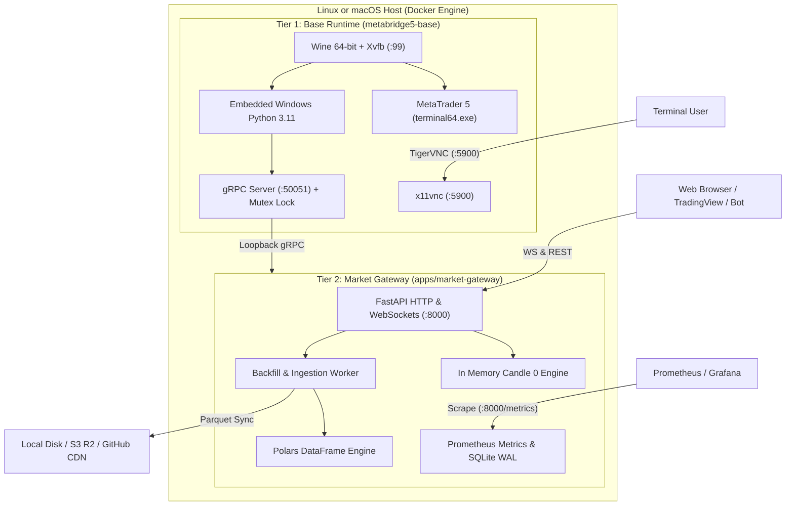
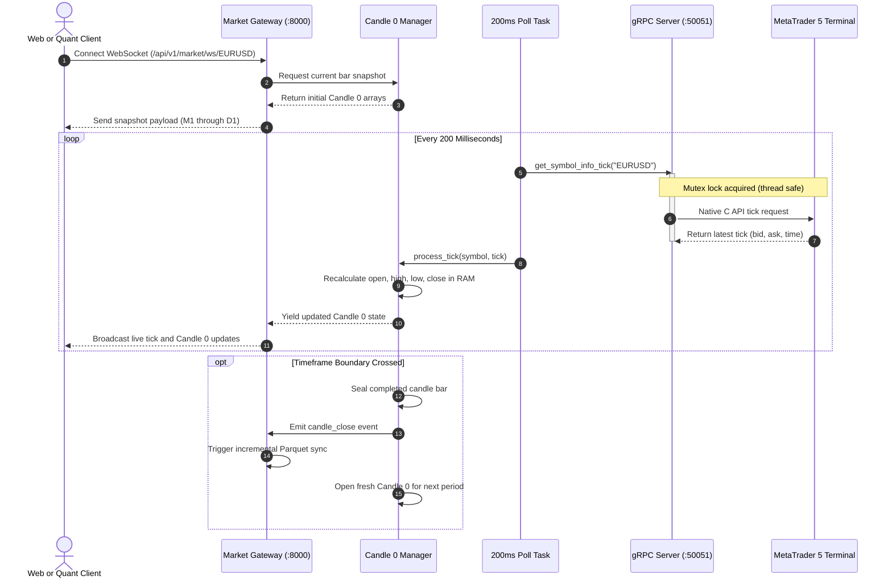
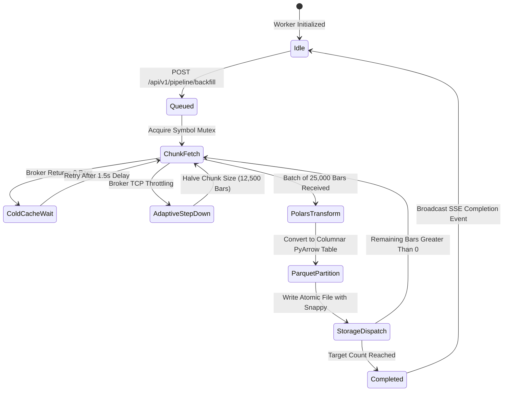
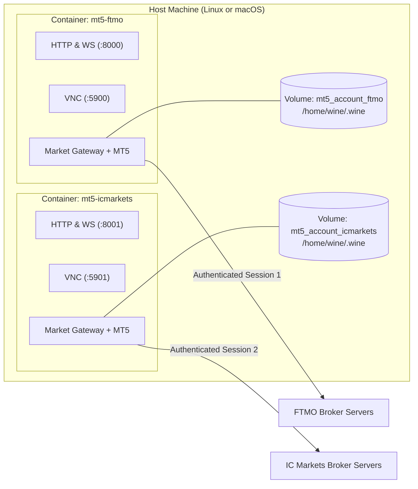

<div align="center">


# MetaBridge5

**Headless container infrastructure for extracting multi broker historical asset prices and real time market data.**

<p align="center">
  
  
  
  
  
  
</p>

</div>

---

> [!NOTE]
> **Built for Linux and macOS:** MetaBridge5 runs directly on modern Linux distributions and macOS using Docker. All terminal commands documented below are standard POSIX shell commands tested to work via copy and paste across bash, zsh, and standard terminals. For remote visual desktop setup, commands default to TigerVNC (`vncviewer`) on Linux and macOS, or native macOS Screen Sharing (`open vnc://`).

## Macro Architectural Overview

MetaBridge5 is a containerized trading infrastructure for extracting multi broker historical asset prices and real time market data. Built with Alpine Linux 3.19, Wine 9, Python 3.11, FastAPI 0.115, Polars 1.12, and PyArrow 18, the system delivers sub millisecond in memory Candle 0 calculations, resilient chunked historical ingestion, and low latency quote broadcasting over WebSockets and REST. The containerized MetaTrader 5 terminal running inside Wine functions as the authoritative Single Source of Truth for raw broker liquidity and tick feeds, while the Tier 2 market gateway operates as an insulated, reactive cloud projection that shields downstream consumers from terminal crashes, threading bugs, and Windows licensing quirks.



---

## Why I Built This

I needed clean historical price data across several different brokers to analyze asset pricing, spreads, and market behavior. If you trade or do quantitative research across multiple brokers, you already know the problem. Every broker has their own liquidity feed, their own execution latency, and slightly different prices. To run reliable analysis and backtests, you cannot rely on generic data feeds. You need the exact historical bars recorded by the broker you trade on.

Getting that data out of MetaTrader 5 was a constant headache.

MetaTrader 5 was built for Windows desktop users. For years, the only way to pull data was running desktop terminals on a physical Windows machine or paying for Windows Server virtual machines. Windows updates rebooted the machines without warning. Terminal windows locked up. If you tried to run multiple instances to pull data from different brokers, account sessions collided and kicked each other out.

When I tried running MT5 on Linux using Wine, new problems appeared:

1. Wine maps the whole Linux filesystem to the Windows environment by default through a `Z:\` symlink. That is an unnecessary security risk.
2. MetaTrader 5 encrypts stored passwords using Windows DPAPI. DPAPI binds to the Windows user security ID and folder path. If your container changes the Wine prefix path, the terminal refuses to log in.
3. The official MetaTrader 5 Python library is not thread safe. When multiple threads query the terminal at the same time, the native C API crashes with segmentation faults.
4. Pulling large blocks of historical bars triggers broker rate limits. Most brokers drop the network connection if you request 100,000 bars in one shot.

I created MetaBridge5 to solve this once and for all. It packages MetaTrader 5 inside a lightweight, headless Alpine Linux container with Wine. It wraps the terminal behind a thread safe gRPC bridge, pulls historical bars in safe chunks, and exports them directly into partitioned Apache Parquet datasets. It also listens to live ticks and streams real time data over WebSockets and REST.

I built this project so anyone who needs historical broker prices or headless MetaTrader 5 infrastructure can use it freely for their own research and trading projects.

---

## Future Roadmap

Data extraction and live streaming are the first phase of this project. I am actively working on upcoming enhancements to run directly inside the container infrastructure:

* Real time algorithmic price analysis. Running quantitative signal detectors, statistical arbitrage checks, and volatility anomaly models against live in memory tick and Candle 0 streams.
* Dedicated trade execution node. A separate container role focused on automated order routing, bracket order management, and live position synchronization.
* Machine learning indicator processing. Streaming live price features into pre trained models for real time market regime detection.

---

## Subsystem 1: Base Infrastructure Node (`metabridge5-base`)

The base image is the low level runtime foundation. Its entire purpose is to tame Wine and isolate MetaTrader 5 inside a minimal Alpine Linux container.

Running Windows software like MetaTrader 5 on Linux requires virtual displays, specific Windows DLL overrides, and root certificate setups. The base image bundles Wine 64 bit, an Xvfb virtual display buffer, and an embedded copy of Windows Python 3.11. Inside that environment, it boots a dedicated gRPC daemon on port 50051.

That daemon is the single piece of code in the entire project permitted to talk directly to the native MetaTrader 5 terminal. It wraps all calls in a reentrant mutex lock, completely shielding the rest of your stack from Windows quirks and terminal crashes. Once you build this base image, you rarely need to modify it. Use this image if you want to build custom services in Go, Rust, C++, or Python that talk directly to the terminal over gRPC.

### Configure Base Environment

Setting environment variables configures the internal display buffers and credential keys prior to boot. The container runtime inspects these variables during container initialization:

```bash
# ------------------------------------------------------------------------------
# Base Image Runtime Configuration (.env.base)
# ------------------------------------------------------------------------------

# Access password for remote x11vnc session
VNC_PASSWORD=metabridge5pass

# Secret bearer token for securing gRPC calls (optional)
METABRIDGE5_API_KEY=your_secret_api_key_here

# Internal Wine prefix path
WINEPREFIX=/home/wine/.wine

# Virtual X11 framebuffer display identifier
DISPLAY=:99
```

### Build Base Image

Building the base image packages Alpine Linux, Wine 64 bit, portable MetaTrader 5, and the Python gRPC daemon into a reusable image. The Docker engine caches the resulting layers under the tag `metabridge5-base:latest`:

```bash
# Build using Makefile target
make build-base

# Or build directly with Docker
docker build -f docker/Dockerfile.base -t metabridge5-base:latest .
```

### Launch Base Container

Starting the base container launches Xvfb, boots the x11vnc server, and initializes the Python gRPC daemon behind supervisor. The host exposes port 50051 for gRPC requests and port 5900 for visual administration:

```bash
# Run the base container
docker run -d \
  --name metabridge5-base \
  -p 50051:50051 \
  -p 5900:5900 \
  -e VNC_PASSWORD=metabridge5pass \
  -v mt5_account_base:/home/wine/.wine \
  metabridge5-base:latest

# View startup logs
docker logs -f metabridge5-base
```

### Stop Base Container

Stopping the container halts the supervisor process manager and closes active terminal connections cleanly. The Docker daemon releases bound host ports while preserving the mounted Wine prefix volume:

```bash
docker stop metabridge5-base
docker rm metabridge5-base
```

### Connect Base VNC Session

Connecting to the virtual display opens a graphical session into the running MetaTrader 5 terminal. The VNC client renders the Xvfb desktop buffer and accepts mouse and keyboard input for one time broker authentication:

```bash
# Connect using TigerVNC (Linux and macOS)
vncviewer localhost:5900

# Or on macOS using native Screen Sharing
open vnc://localhost:5900
```

When prompted, enter the password configured in `VNC_PASSWORD` (default `metabridge5pass`).

### Provision Broker Account

Authenticating through the desktop interface saves encrypted credentials directly into the Wine prefix via Windows DPAPI. The terminal connects to the broker liquidity server and confirms incoming network traffic:

1. Click `File` in the top menu and select `Login to Trade Account`.
2. Enter your account login number and password.
3. Select your broker server from the dropdown list. If your broker uses private trading servers, copy their `.srv` files into `MetaTrader5/Config/` before building, or search for your broker name in the login window.
4. Check the `Save password` box so Windows DPAPI encrypts and stores the session ticket into the Wine user directory.
5. Click `OK`. Verify that the connection icon in the bottom right corner turns green and displays incoming data rates.

### Query Base Daemon

Executing client queries against port 50051 retrieves real time quotes and historical bars through the gRPC bridge. The daemon acquires the reentrant mutex lock, executes the native C request, and returns structured protobuf responses:

```bash
python3 docker/daemon/test_client.py
```

You can also compile `docker/daemon/proto/metatrader.proto` into client stubs for your own services in Go, Rust, C++, or Python.

---

## Subsystem 2: Real Time Market Gateway (`apps/market-gateway`)

The market node is the public application service that builds on top of the base image. It runs standard Linux Python 3.11 with FastAPI, Polars, and PyArrow.

Instead of fighting Wine compatibility inside your application code, the market node talks to the base image gRPC daemon over internal loopback. It transforms raw terminal data into high performance cloud interfaces across four core systems:

In production, each broker account gets its own dedicated market node container instance. That keeps broker sessions completely isolated and prevents account collisions.

### Real Time Streaming Lifecycle



#### 1. Real Time Candle 0 Engine

In financial trading, Candle 0 represents the currently open, unfinished bar. Most trading setups poll the broker repeatedly for the latest candle, which burns CPU cycles and risks rate limit bans. The Candle 0 engine eliminates that friction entirely.

##### How It Works Behind the Scenes
The engine runs an asynchronous loop that queries the local gRPC daemon for fresh ticks every 200 milliseconds. When a tick arrives with a new timestamp or price, the in memory manager updates Candle 0 across all active timeframes simultaneously (M1, M5, M15, M30, H1, H4, D1).

It recalculates the open, high, low, close, and tick volume instantly in RAM. When the clock crosses a timeframe boundary, the engine automatically seals the finished candle, fires an incremental rollup event to the storage pipeline, and opens a clean new candle for the next period.

##### Capabilities
* Maintains active Candle 0 bars across 20+ timeframes simultaneously in RAM.
* Sub second tick tracking with 200 millisecond deduplication.
* Delivers immediate snapshot state upon WebSocket connection so charts never open blank.
* Dispatches candle close events to trigger automatic Parquet synchronization without cron jobs.
* Automatically halts background polling when no WebSocket clients or workers are listening.

##### Access and Interaction
* REST Snapshot for Single Timeframe: `GET /api/v1/market/candle0?symbol=EURUSD&timeframe=M1`
* REST Snapshot for All Timeframes: `GET /api/v1/market/candle0/all?symbol=EURUSD`
* Real Time WebSocket Stream: `ws://localhost:8000/api/v1/market/ws/{symbol}`

Every WebSocket message delivers the latest tick along with compact arrays `[time, open, high, low, close, volume]` for each active timeframe.

##### Recommended Tools
* `npx wscat` or websocat for terminal WebSocket streaming.
* `curl` and `jq` for REST snapshots.
* TradingView Lightweight Charts or Chart.js for frontend chart rendering.
* Python `websockets` or `aiohttp` for quantitative bots.

##### How to Test
Fetch a live Candle 0 snapshot via REST:
```bash
curl -s -H "X-API-Key: metabridge5secret" \
  "http://localhost:8000/api/v1/market/candle0?symbol=EURUSD&timeframe=M1" | jq
```

Stream live tick and Candle 0 updates over WebSocket:
```bash
# Connect using npx (Node.js) without global installation
npx wscat -c "ws://localhost:8000/api/v1/market/ws/EURUSD"

# Or using websocat
websocat "ws://localhost:8000/api/v1/market/ws/EURUSD"
```

---

#### 2. Background Backfill Worker

Extracting multi year historical records from MetaTrader 5 is notoriously fragile. If you request 100,000 bars in a single query, the broker server often cuts the TCP connection or returns empty arrays. The backfill worker handles large scale extraction safely.

##### Ingestion Lifecycle



##### How It Works Behind the Scenes
The worker splits large extraction requests into safe batches of 25,000 bars maximum. It paginates backwards in time through historical periods.

When MetaTrader 5 has not yet downloaded historical bars from the broker, the worker detects the empty response, pauses for 1.5 seconds, and retries up to three times while the terminal computes its internal cache. If the broker still throttles the connection, the worker dynamically halves the chunk size (down to 12,500 bars and smaller) before moving forward.

All extraction calls pass through the reentrant gRPC mutex, ensuring historical queries never interfere with live tick streaming.

##### Capabilities
* Background asynchronous processing that never blocks API workers or HTTP requests.
* Adaptive chunk sizing with automated step down backoff to survive broker rate limits.
* Comprehensive asset targeting: single asset (`symbol`), multiple assets (`symbols`), all active assets (`all_symbols: true`), or all broker catalog assets (`source: "broker"`).
* Timeframe customization: select specific intervals (`timeframes: ["M1", "H1"]`) or default to all 9 supported timeframes (`M1` through `MN1`).
* Relative lookback extraction via `days` (such as `days: 30` or `days: 365`), automatically deriving UTC calendar boundaries.
* Absolute bounds extraction via `date_from` and `date_to` or bar count extraction (`candle_count: 50000`).
* Granular pipeline controls to pause and resume ingestion globally, per symbol, or via exclusion (`scope: "exclude"` to ingest only USDJPY while pausing others).
* Real time status registry and Server Sent Events (SSE) broadcasting on `/api/v1/telemetry/stream`.
* Configurable incremental sync intervals (`5m`, `15m`, `1h`, `1d`).

##### Access and Interaction
* Trigger Historical Backfill: `POST /api/v1/pipeline/backfill`
* Inspect Pipeline Status: `GET /api/v1/pipeline/status`
* Check Ingestion Health: `GET /api/v1/pipeline/health`
* Granular Pause or Resume: `POST /api/v1/pipeline/pause` and `POST /api/v1/pipeline/resume`
* Bulk Exclusionary Control: `POST /api/v1/pipeline/control`
* Inspect Broker Master Catalog: `GET /api/v1/symbols/broker`
* Inspect Active Market Watch Assets: `GET /api/v1/symbols/active`

##### Recommended Tools
* `curl` and `jq` for triggering backfills and querying registry status.
* Server Sent Events clients or browser EventSource for monitoring `/api/v1/telemetry/stream`.
* Python `httpx` or `requests` for orchestrating multi asset ingestion scripts.

##### How to Test
Extract the last 30 days of data for all active assets across all standard timeframes:
```bash
curl -s -X POST -H "Content-Type: application/json" -H "X-API-Key: metabridge5secret" \
  -d '{"all_symbols": true, "days": 30}' \
  http://localhost:8000/api/v1/pipeline/backfill | jq
```

Extract the last 90 days for specific assets on M1 and H1 timeframes:
```bash
curl -s -X POST -H "Content-Type: application/json" -H "X-API-Key: metabridge5secret" \
  -d '{"symbols": ["EURUSD", "GBPUSD"], "timeframes": ["M1", "H1"], "days": 90}' \
  http://localhost:8000/api/v1/pipeline/backfill | jq
```

Check the progress in the status registry:
```bash
curl -s -H "X-API-Key: metabridge5secret" \
  "http://localhost:8000/api/v1/pipeline/status" | jq
```

Listen to live backfill chunk events over SSE:
```bash
curl -N http://localhost:8000/api/v1/telemetry/stream
```

---

#### 3. Multi Sink Exporter

Saving market data into monolithic SQL tables creates maintenance overhead and slow query speeds. The multi sink exporter serializes dataframes into columnar Apache Parquet files using Snappy compression and distributes them to your preferred storage target.

##### How It Works Behind the Scenes
When a backfill finishes or a candle closes, the exporter uses Polars and PyArrow to structure the data into standardized schemas. It partitions files hierarchically by symbol, timeframe, year, and month.

Writes are atomic: the exporter writes to a temporary file first and renames it once the data is safely on disk. This prevents partial reads by external processes.

Depending on your configured storage backend, the exporter saves files locally, uploads them to cloud buckets, or pushes them to a Git repository branch.

##### Capabilities
* Local Disk Backend (`STORAGE_BACKEND=local`): Writes structured partitions under `data/parquet/{symbol}/{timeframe}/{year}/{month}.parquet` and compact rolling buffers under `data/json/{symbol}/{timeframe}/recent.json`.
* Cloud Object Storage (`STORAGE_BACKEND=s3`): Compatible with AWS S3, Cloudflare R2, and MinIO buckets with automatic MIME detection and content hashing.
* Git Repository Sync (`STORAGE_BACKEND=github`): Commits and pushes Parquet datasets directly to a designated GitHub repository branch, creating a free, versioned data distribution network.
* 80% to 90% compression ratios compared to raw CSV files, with instant vectorized reading.

##### Access and Interaction
Configure the active sink through container environment variables:
* Local Disk: `STORAGE_BACKEND=local`
* Cloud Storage: `STORAGE_BACKEND=s3`, `S3_BUCKET_NAME=market-data`, `AWS_ACCESS_KEY_ID`, `AWS_SECRET_ACCESS_KEY`, `S3_ENDPOINT_URL` (for R2 or MinIO)
* Git Repository: `STORAGE_BACKEND=github`, `GITHUB_TOKEN`, `GITHUB_REPOSITORY`, `GITHUB_BRANCH`

##### Recommended Tools
* `duckdb` CLI or Python library for querying Parquet files with SQL.
* `parquet-tools` for inspecting file schemas and metadata.
* `awscli` or `rclone` for managing S3 and Cloudflare R2 buckets.
* Python `polars` for fast analytical research.

##### How to Test
Query local Parquet files directly with DuckDB:
```bash
duckdb -c "SELECT time, open, high, low, close, volume FROM 'data/parquet/EURUSD/M1/**/*.parquet' LIMIT 5;"
```

Read Parquet partitions with Python Polars:
```bash
python3 -c "import polars as pl; df = pl.read_parquet('data/parquet/EURUSD/M1/**/*.parquet'); print(df.tail())"
```

Verify cloud storage uploads when using S3 or Cloudflare R2:
```bash
aws --endpoint-url https://<account_id>.r2.cloudflarestorage.com s3 ls s3://market-data/parquet/EURUSD/
```

---

#### 4. Production Observability Endpoints

Running autonomous market feeds in production demands instant insight into feed health, tick staleness, and system errors. The market node provides built in telemetry without external agent dependencies.

##### How It Works Behind the Scenes
The service embeds native Prometheus metric instruments directly into the application loop. It tracks tick throughput, candle rollup counts, active WebSocket clients, and backfill execution timings.

For operational audit records, the gateway uses an internal audit logger configured in SQLite Write Ahead Logging (WAL) mode. WAL mode separates writers from readers, allowing trace queries to execute concurrently without locking the database file or degrading tick processing speed.

##### Capabilities
* Native Prometheus metrics on `/metrics` with symbol and timeframe labels.
* Instant liveness probe on `/health` reporting gRPC daemon state and storage engine status.
* Readiness probe on `/ready` validating terminal connectivity before receiving traffic.
* Real time telemetry stream on `/api/v1/telemetry/stream` yielding Server Sent Events for every candle rollup and chunk fetch.
* Queryable audit traces on `/api/v1/telemetry/traces` with filtering by symbol, event type, and component.
* Terminal journal tailing on `/api/v1/terminal/logs` to read native MetaTrader 5 logs without opening VNC.

##### Access and Interaction
* Prometheus Metrics: `GET /metrics`
* Liveness Health Check: `GET /health`
* Readiness Health Check: `GET /ready`
* Telemetry Trace Queries: `GET /api/v1/telemetry/traces?limit=50&symbol=EURUSD`
* Live MetaTrader 5 Journal Logs: `GET /api/v1/terminal/logs?lines=100`

##### Recommended Tools
* `curl` and `jq` for inspecting health and querying traces.
* Prometheus server for automated metric scraping.
* Grafana for visual dashboards tracking tick rates and backfill latency.
* `sqlite3` CLI for inspecting the trace database (`/tmp/metabridge5_traces.sqlite3`).

##### How to Test
Verify container health:
```bash
curl -s http://localhost:8000/health | jq
```

Scrape Prometheus metrics:
```bash
curl -s http://localhost:8000/metrics | grep metabridge5
```

Query the latest audit trace events:
```bash
curl -s -H "X-API-Key: metabridge5secret" \
  "http://localhost:8000/api/v1/telemetry/traces?limit=10" | jq
```

Tail the raw MetaTrader 5 terminal log:
```bash
curl -s -H "X-API-Key: metabridge5secret" \
  "http://localhost:8000/api/v1/terminal/logs?lines=20" | jq
```

---

### Configure Market Node Environment

Configuring runtime environment variables prepares the FastAPI gateway, storage engine, and audit sinks before execution. The application loads these keys upon process startup:

```bash
# ------------------------------------------------------------------------------
# Market Node Runtime Configuration (.env)
# ------------------------------------------------------------------------------

# Core API bearer token required for REST, WebSocket, and pipeline endpoints
METABRIDGE5_API_KEY=metabridge5secret

# Access password for remote x11vnc session
VNC_PASSWORD=metabridge5pass

# Comma separated assets to activate and stream on boot, or '*' / 'ALL_ACTIVE'
METABRIDGE5_SYMBOLS=EURUSD,GBPUSD,USDJPY

# Automatically trigger initial historical backfill on container boot for above symbols
METABRIDGE5_AUTO_BACKFILL_ON_START=false

# Scheduled multi timeframe dataset rollup interval ('D1', 'H1', 'M15')
METABRIDGE5_SYNC_INTERVAL=D1

# Storage driver for Parquet datasets: 'local', 's3', or 'github'
STORAGE_BACKEND=local

# S3 or Cloudflare R2 bucket name (required when STORAGE_BACKEND=s3)
S3_BUCKET_NAME=metabridge5-market-data

# Target S3 endpoint URL (set for Cloudflare R2 or MinIO)
# S3_ENDPOINT_URL=https://<accountid>.r2.cloudflarestorage.com
# S3_ACCESS_KEY_ID=your_access_key_id
# S3_SECRET_ACCESS_KEY=your_secret_access_key

# Destination for operational audit logs: 'sqlite', 'external', 'both', or 'none'
AUDIT_LOG_SINK=sqlite

# Local time zone inside the container
TZ=UTC
```

### Build Market Node Image

Building the market node compiles FastAPI, Polars, PyArrow, and the async ingestion pipeline on top of the base image. Because the market node extends `metabridge5-base:latest`, the foundational base image must exist locally before compiling the gateway:

```bash
# Option A: Automated sequential build via Makefile (builds base first if missing)
make build-market-node
# or build both targets explicitly:
make build-all

# Option B: Direct Docker commands (build base first, then market node)
docker build -f docker/Dockerfile.base -t metabridge5-base:latest .
docker build -f apps/market-gateway/Dockerfile -t metabridge5-market-node:latest .
```

### Launch Market Node Container

Deploying the market node brings up the complete stack with FastAPI on port 8000 and VNC on port 5900. Docker Compose runs the container as a managed background daemon:

```bash
# Start the service in the background
docker compose up -d

# Inspect live logs
docker compose logs -f
```

Or run it directly with Docker:

```bash
# Run the market node container
docker run -d \
  --name metabridge5-market \
  -p 8000:8000 \
  -p 5900:5900 \
  -e METABRIDGE5_API_KEY=metabridge5secret \
  -e VNC_PASSWORD=metabridge5pass \
  -e STORAGE_BACKEND=local \
  -v mt5_account_market:/home/wine/.wine \
  metabridge5-market-node:latest
```

### Stop Market Node Container

Halting the market node stops active WebSocket pollers and shuts down the FastAPI event loop. Docker Compose stops the container while keeping persistent volumes and Parquet datasets intact:

```bash
# If running via Compose
docker compose down

# If running via Docker CLI
docker stop metabridge5-market
docker rm metabridge5-market
```

### Connect Market Node VNC Session

Establishing a VNC session opens visual desktop access into the running terminal for broker configuration. The x11vnc server renders the virtual desktop on port 5900:

```bash
# Connect using TigerVNC (Linux and macOS)
vncviewer localhost:5900

# Or on macOS using native Screen Sharing
open vnc://localhost:5900
```

Enter your configured `VNC_PASSWORD` (default `metabridge5pass`).

### Provision Market Node Account

Authenticating via the graphical interface stores broker session tickets inside the mounted Wine prefix. The internal market gateway attaches to the local gRPC daemon and begins health checks and symbol monitoring automatically:

1. Open `File` and click `Login to Trade Account`.
2. Input your account login, password, and broker server name.
3. Keep `Save password` checked to preserve DPAPI credentials in the mounted volume.
4. Click `OK` and confirm that the terminal connects to your broker.

### Verify Gateway Smoke Test

Executing end to end health probes and WebSocket queries confirms full operational readiness across all interfaces. The gateway reports HTTP 200 on health probes and streams live price updates:

```bash
# Check service health
curl -s http://localhost:8000/health | jq

# Scrape Prometheus metrics
curl -s http://localhost:8000/metrics | grep metabridge5

# Fetch recent market rates
curl -s -H "X-API-Key: metabridge5secret" \
  "http://localhost:8000/api/v1/market/rates?symbol=EURUSD&timeframe=M1&count=5" | jq

# Stream live Candle 0 updates over WebSocket (Linux and macOS via npx)
npx wscat -c "ws://localhost:8000/api/v1/market/ws/EURUSD"

# Trigger an asynchronous historical backfill
curl -s -X POST -H "Content-Type: application/json" -H "X-API-Key: metabridge5secret" \
  -d '{"symbol": "EURUSD", "timeframes": ["M1"], "candle_count": 50000}' \
  http://localhost:8000/api/v1/pipeline/backfill | jq
```

---

## Subsystem 3: Multi Broker Account Isolation & Docker Volumes

MetaTrader 5 stores passwords and broker certificates in the Windows registry and user profile directory using Windows DPAPI encryption. That encryption binds keys to the internal Wine user identity inside `/home/wine/.wine`. If you recreate a container without mounting a volume to `/home/wine/.wine`, all encrypted passwords and server certificates vanish.

### Multi Broker Account Architecture



Switching accounts inside a single MetaTrader 5 instance causes certificate collisions and overwrites broker server definitions. Creating dedicated Docker named volumes for each broker account isolates DPAPI encryption, server definitions, and cache files completely.

### Create Account Volumes

Creating isolated named volumes allocates independent storage allocations on the host filesystem. Each volume maintains a self contained Wine prefix holding individual broker licenses and DPAPI encryption keys:

```bash
# Create dedicated volumes for each broker account
docker volume create mt5_account_ftmo
docker volume create mt5_account_icmarkets
```

### Launch Parallel Account Containers

Spinning up multiple containers concurrently maps each instance to unique host ports and dedicated storage volumes. Both broker feeds stream independently without session cross contamination:

```bash
# Launch the FTMO account container
docker run -d \
  --name mt5-ftmo \
  -p 8000:8000 \
  -p 5900:5900 \
  -e METABRIDGE5_API_KEY=ftmosecret \
  -e VNC_PASSWORD=vncftmo \
  -v mt5_account_ftmo:/home/wine/.wine \
  metabridge5-market-node:latest

# Launch the IC Markets account container
docker run -d \
  --name mt5-icmarkets \
  -p 8001:8000 \
  -p 5901:5900 \
  -e METABRIDGE5_API_KEY=icmarketsecret \
  -e VNC_PASSWORD=vncicmarkets \
  -v mt5_account_icmarkets:/home/wine/.wine \
  metabridge5-market-node:latest
```

Log in to each account once through its respective VNC port:

```bash
# Connect to FTMO account (port 5900)
vncviewer localhost:5900       # Linux / macOS (TigerVNC)
open vnc://localhost:5900      # macOS native Screen Sharing

# Connect to IC Markets account (port 5901)
vncviewer localhost:5901       # Linux / macOS (TigerVNC)
open vnc://localhost:5901      # macOS native Screen Sharing
```

The credentials and broker certificates remain completely isolated inside their separate volumes.

### Switch Accounts on Default Port

Swapping mounted volumes permits alternating between accounts on host port 8000 without credential loss. Stopping one container and launching another mounts the desired broker volume with saved credentials intact:

```bash
# Stop the current account
docker stop mt5-ftmo && docker rm mt5-ftmo

# Start the second account on port 8000 with its saved credentials intact
docker run -d \
  --name mt5-icmarkets \
  -p 8000:8000 \
  -p 5900:5900 \
  -e METABRIDGE5_API_KEY=icmarketsecret \
  -v mt5_account_icmarkets:/home/wine/.wine \
  metabridge5-market-node:latest
```

### Export Account Volume

Backing up an authenticated volume packages all DPAPI encryption keys, server definitions, and terminal configuration into a portable compressed tarball. The backup archive can be transferred securely across machines:

```bash
# Export the volume to a tarball archive
docker run --rm -v mt5_account_ftmo:/source -v "$(pwd):/backup" alpine \
  tar czf /backup/mt5_account_ftmo.tar.gz -C /source .
```

### Import Account Volume

Restoring an account volume uncompresses the saved Wine prefix on a fresh host without requiring re authentication. The container immediately detects the restored DPAPI credentials and connects to the broker:

```bash
# Create the volume and restore the archive
docker volume create mt5_account_ftmo
docker run --rm -v mt5_account_ftmo:/target -v "$(pwd):/backup" alpine \
  tar xzf /backup/mt5_account_ftmo.tar.gz -C /target
```

---

## Trench Lessons

Running MetaTrader 5 inside Linux containers taught me a few important lessons:

### Keep Historical Chunk Queries Below 25,000 Bars
If you ask MetaTrader 5 for 100,000 bars in a single request, the broker server often drops the TCP connection. The backfill worker chunks requests into 25,000 bars with brief pauses between queries. Stick to that limit to keep downloads stable.

### Block the Wine Z Drive
By default, Wine links the host root directory as `Z:\`. The container startup script automatically removes `/home/wine/.wine/dosdevices/z:` before launching the terminal. That keeps your host files protected.

---

## Documentation

* [Base Image Technical Guide](docker/README.md): Wine configuration, virtual display setup, and gRPC daemon mechanics.
* [Market Gateway API Reference](apps/market-gateway/README.md): REST endpoints, WebSocket contracts, and storage backend details.
* [Client Integration Specification](../agents/specs/metabridge5/client-api/SPEC.md): Integration recipes for React TradingView charts, Python bots, and Polars.
* [Asset Catalog](assets/README.md): Brand logos, vector files, favicons, and graphic specifications.
* [Engineering Specifications](../agents/specs/metabridge5/README.md): Complete specifications for base image, gateway, client API, and runtimes.

---

## License

This project is licensed under the MIT License. MetaTrader 5 is a registered trademark of MetaQuotes Ltd. This project is an independent tool and is not affiliated with or endorsed by MetaQuotes Ltd.
