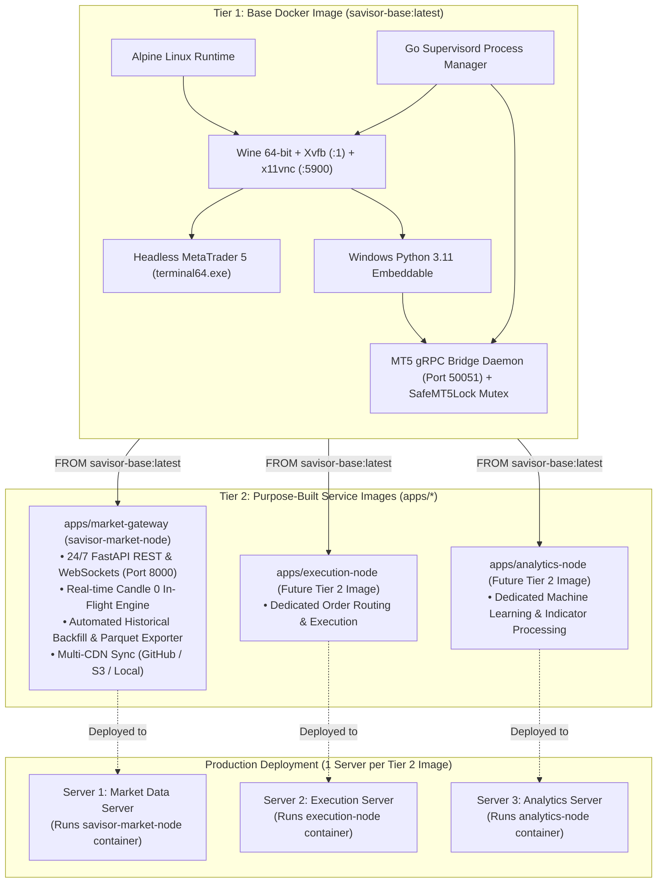

# Savisor Docker Image Monorepo

This repository is a modular **Docker Image Layering Monorepo** designed for building purpose-built container images for MetaTrader 5 financial services. 

The architecture is divided into two distinct layers:
- **Tier 1 (Base Docker Image: `savisor-base`)**: The shared foundational base image that containerizes MetaTrader 5 inside Wine and provides a thread-safe gRPC bridge daemon.
- **Tier 2 (Service Docker Images: `apps/*`)**: Specialized, standalone service images built *on top of* Tier 1 (such as `savisor-market-node`). Each Tier 2 image is deployed to **its own dedicated, isolated server** to perform its specific operational role.

---

## 1. Two-Tier Docker Image Layering Architecture



---

## 2. Architectural Principles

### A. Isolated Server Deployment
Each Tier 2 image is built for a specific purpose and deployed into **its own dedicated server**:
- **Isolated Broker Sessions**: Each server runs its own containerized MT5 instance connected to its designated broker account, avoiding duplicate session collisions.
- **Dedicated Hardware**: Each server dedicates 100% of its CPU and RAM to its specific workload.
- **Independent Lifecycles**: Redeploying, scaling, or upgrading one Tier 2 image has zero impact on other Tier 2 servers.

### B. The Market Node All-in-One Engine (`savisor-market-node`)
Within the Market Node service ([`apps/market-gateway`](file:///home/julio/Work/savisor/savisor-node/apps/market-gateway)):
- **Real-Time API & Streaming**: FastAPI REST and WebSockets deliver sub-second Candle 0 snapshots and live ticks on port `8000`.
- **Background Historical Backfill**: `BackfillWorker` and `ParquetExporter` run in the background, automatically pulling closed bars on timeframe rollovers and syncing Parquet and JSON files to storage backends (GitHub CDN, Cloudflare R2 / S3, or Local).
- **Single Container Footprint**: Consumes only **~400 – 600 MB total RAM** while maintaining 1 active broker connection.

### C. Clean Directory Organization (No Symlinks)
All codebases are organized with real, version-controlled directories without symbolic links, ensuring clean GitHub commits and predictable cross-platform builds.

---

## 3. Monorepo Directory Layout

```
savisor-node/
├── docker/                         # TIER 1: Base Docker Image (savisor-base)
│   ├── Dockerfile.base             # 4-stage build producing 'savisor-base:latest'
│   ├── README.md                   # Base Image technical manual & extension guide
│   ├── import_certs.py             # System root SSL certificate injector for Wine
│   ├── supervisord.conf            # Base supervisor configuration (Xvfb, VNC, MT5, gRPC)
│   ├── daemon/                     # MT5 gRPC Bridge (runs under Wine Python on port 50051)
│   │   ├── protos/terminal.proto   # Canonical MT5 Protobuf Schema
│   │   ├── grpc_server.py          # Thread-safe gRPC server with SafeMT5Lock mutex
│   │   ├── codegen.py              # Protobuf code generator
│   │   ├── terminal_pb2.py         # Generated message classes
│   │   └── terminal_pb2_grpc.py    # Generated client/server stubs
│   └── supervisord/                # Base lifecycle scripts (entrypoint, vnc setup)
│       ├── entrypoint.sh           # Container entrypoint
│       ├── startup_guard.sh        # Pre-boot environment validator
│       └── vnc_passwd_setup.sh     # Dynamic VNC password configuration
│
├── apps/                           # TIER 2: Purpose-Built Service Images
│   └── market-gateway/             # Market Node Image (savisor-market-node)
│       ├── Dockerfile              # Child Dockerfile (FROM savisor-base:latest)
│       ├── README.md               # Market Node operations & endpoints guide
│       ├── pyproject.toml          # Dependencies (FastAPI, Polars, PyArrow)
│       ├── supervisord.conf        # Drop-in supervisor config (starts uvicorn on port 8000)
│       ├── docs/                   # Deep-dive architecture and integration manuals
│       ├── app/                    # Service codebase (API, Engine, Pipeline, Storage, Telemetry)
│       └── tests/                  # 12-Perspective Unit Test Suite
│
├── MetaTrader5/                    # Portable MT5 binary & server configs (host-supplied)
├── docs/                           # Technical and optimization specifications
├── scripts/                        # Endpoint and pipeline verification tools
├── Makefile                        # Unified build and run orchestrations
├── docker-compose.yml              # Local multi-service orchestration
└── .dockerignore                   # Blocks caches, logs, and build artifacts
```

---

## 4. Quick Start: Building & Running

### Step 1: Supply MetaTrader 5 Portable Files
1. Install MetaTrader 5 on a Windows machine or Wine instance.
2. Run once in portable mode (`terminal64.exe /portable`) and log in to your broker account.
3. Remove host-specific license caches: delete `MetaTrader5/Config/terminal.lic` and `MetaTrader5/Config/accounts.dat`.
4. Copy the portable `MetaTrader5` directory to the root of this repository.

---

### Step 2: Build the Docker Images

```bash
# 1. Build the Tier 1 Base Image
make build-base

# 2. Build the Tier 2 Market Node Image
make build-market-node

# Or build both sequentially:
make build-all
```

---

### Step 3: Run the Market Node Container

#### Option A: Docker Compose
```bash
docker compose up -d
docker compose logs -f
```

#### Option B: Makefile & Docker Run
```bash
make run-market-node
```

The container exposes:
- **Port `8000`**: FastAPI REST API, WebSocket streams, and Prometheus `/metrics`.
- **Port `5900`**: x11vnc remote desktop for one-time visual broker login (`vncviewer localhost:5900`, password: `savisorpass`).

---

## 5. Adding New Tier 2 Images in Future Iterations

To create a new specialized Tier 2 service image, add a new directory under `apps/<image-name>/`:

### 1. Structure
```
apps/<image-name>/
├── Dockerfile
├── pyproject.toml
├── supervisord.conf
└── app/
    └── main.py
```

### 2. Dockerfile Contract
```dockerfile
FROM savisor-base:latest

USER root
RUN apk add --no-cache python3 py3-pip
COPY --from=ghcr.io/astral-sh/uv:latest /uv /usr/bin/

COPY apps/<image-name>/pyproject.toml /tmp/
RUN uv pip install --system --break-system-packages --no-cache -r /tmp/pyproject.toml && \
    rm -f /tmp/pyproject.toml

COPY --chown=wine:wine apps/<image-name>/app/ /home/wine/app/<image-name>/app/
COPY --chown=wine:wine apps/<image-name>/supervisord.conf /etc/supervisor/conf.d/<image-name>.conf

USER wine
```

### 3. Supervisord Drop-in Configuration (`supervisord.conf`)
```ini
[program:<image-name>]
command=python3 -u /home/wine/app/<image-name>/app/main.py
priority=6
autorestart=true
directory=/home/wine/app/<image-name>
environment=MT5_GRPC_SERVER="127.0.0.1:50051"
stdout_logfile=/dev/stdout
stdout_logfile_maxbytes=0
stderr_logfile=/dev/stderr
stderr_logfile_maxbytes=0
```

---

## 6. Documentation Hub

- 🏗️ **[Base Image Technical Manual](docker/README.md)**: Details on the 4-stage build, Wine insulation, gRPC daemon, and extension contracts.
- ⚡ **[Market Node Manual & API Reference](apps/market-gateway/README.md)**: REST endpoints, WebSocket contracts, Candle 0 engine, and storage sinks.
- 📖 **[Client Integration Recipes](docs/client_api.md)**: Integration code for React TradingView charts, Python bots, and DuckDB / Polars.
