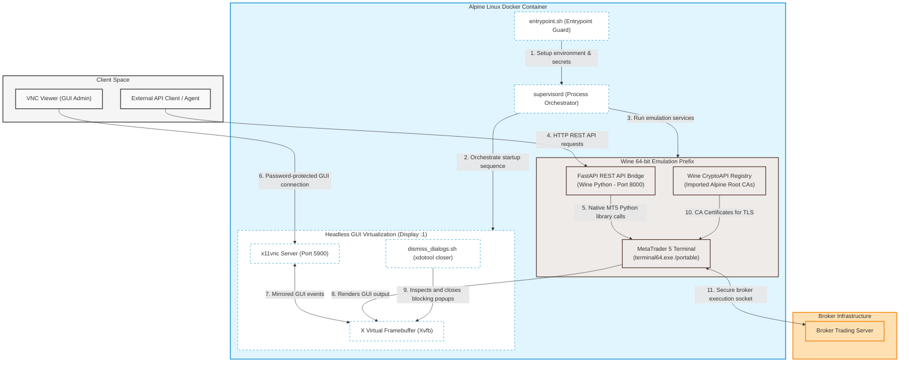

# Savisor Node

Savisor Node runs an isolated MetaTrader 5 (MT5) terminal under Wine in a lightweight Alpine Linux Docker container. It exposes a secure FastAPI REST API to programmatically interact with MT5 and a password-protected VNC server for graphical administration.

## System Architecture



The container integrates several layers to run and expose the Windows-native MetaTrader 5 client:

**Headless GUI Virtualization**
The container runs X Virtual Framebuffer (Xvfb) on display `:1` to virtualize the GUI screen in memory. Remote VNC access is provided via `x11vnc` with password authentication. An automated popup dialog dismisser script (`dismiss_dialogs.sh`) monitors active windows and closes blocking MT5 GUI dialogs using `xdotool`.

**Wine Windows Emulation**
A 64-bit Wine prefix is initialized to run the native Windows binaries. Custom registry settings are applied at build time to enable the modern flat light theme, configure cryptographic providers for secure broker TLS handshakes, and configure timezone detection.

**REST API Bridge**
A FastAPI application runs under Wine Python, acting as a stateless REST bridge. It translates HTTP requests into native MetaTrader 5 python library calls. Standard library calls are offloaded to separate threads via `asyncio.to_thread` to prevent blocking the async event loop during blocking network and Named Pipe operations.

**Certificate Importer**
The `import_certs.py` script parses system CA certificates from the Alpine host and imports them into the Wine prefix's CryptoAPI ROOT store. This resolves SSL/TLS handshake failures when the terminal connects to brokers.

**Supervisor Orchestration**
Process management is handled by `supervisord`, which controls the execution order, restart behavior, and logs of all internal services using priority-defined startup sequences.

## Process Startup Flow

Processes are started sequentially by Supervisor based on priority:

1. **Startup Guard** (Priority 0): Executes `startup_guard.sh` to verify required secrets exist before starting other services. If verification fails, the container stops.
2. **Xvfb** (Priority 1): Spawns the X11 virtual frame buffer on display `:1` at 1920x1080 resolution.
3. **VNC Password Setup** (Priority 2): Invokes `vnc_passwd_setup.sh` to write the encrypted password file.
4. **x11vnc** (Priority 3): Starts the VNC server on display `:1` using the written password.
5. **Wine/MT5** (Priority 4): Launches `terminal64.exe` in portable mode under Wine.
6. **REST API** (Priority 5): Runs the FastAPI server using Wine Python on port 8000.
7. **Dialog Dismisser** (Priority 6): Runs `dismiss_dialogs.sh` in a loop to close blocking GUI prompts.

## Secrets Configuration

Authentication secrets are required at startup. The container supports two loading methods:

**Direct Environment Injection**
Secrets can be passed directly as environment variables:
- `SAVISOR_API_KEY`: API key for REST endpoints.
- `VNC_PASSWORD`: Password for remote VNC GUI access.

**Filesystem Secrets Injection**
If environment variables are empty, the entrypoint script polls `/run/secrets` for injected secrets files:
- `/run/secrets/api_key`
- `/run/secrets/vnc_password`

This method enables integration with secure manager agents and container orchestrators that mount temporary filesystems (e.g., `tmpfs`).

## Setup and Installation

### 1. Prepare Portable MetaTrader 5
Prepare a portable MT5 installation on a Windows host machine:
1. Install MetaTrader 5 to `C:\MetaTrader5`.
2. Close the terminal and relaunch in portable mode:
   ```cmd
   C:\MetaTrader5\terminal64.exe /portable
   ```
3. Log into your broker, configure broker servers, and set up charts.
4. Close MT5 and copy the entire `C:\MetaTrader5` folder to the root of this project as `MetaTrader5/`.

### 2. Clean Host Artifacts
Before building, clear host-specific cached configurations from `MetaTrader5/Config/` to prevent broker connection issues:
- Delete `terminal.lic` (license cache)
- Delete `accounts.dat` (account cache)

### 3. Folder Structure
The workspace root must match:
```text
savisor-node/
├── Dockerfile
├── README.md
├── api/
│   ├── main.py
│   ├── auth.py
│   ├── routers/
│   └── schemas/
├── supervisord/
│   ├── entrypoint.sh
│   ├── supervisord.conf
│   └── ...
└── MetaTrader5/
    ├── terminal64.exe
    └── ...
```
## Pre-Flight Checklist

To ensure a smooth launch, run through the following checks before starting the container:

### Phase 1: Pre-Build (Ground Inspection)
- [ ] **Portable MT5 Files**: Copy the entire `C:\MetaTrader5` folder from a Windows machine to the project root as `MetaTrader5/` (including `terminal64.exe`).
- [ ] **Host Artifacts Purged**: Delete `MetaTrader5/Config/terminal.lic` and `MetaTrader5/Config/accounts.dat` to prevent connection conflicts.
- [ ] **Custom Broker CA Certificates**: If your broker requires custom TLS certificates, ensure they are registered in your system root certificate directories before building so they are imported during compilation.
- [ ] **API/VNC Secrets Prepared**: Choose a configuration method (e.g. environment variables `SAVISOR_API_KEY` and `VNC_PASSWORD`, or `/run/secrets/` mounts).

### Phase 2: Build & Host Check (Taxing to Runway)
- [ ] **Docker Engine Active**: Verify that the Docker daemon is running and accessible.
- [ ] **Image Built**: Run the docker build command and ensure it compiles successfully:
  ```bash
  docker build -t savisor/savisor-node:latest .
  ```
- [ ] **Host Port Availability**: Ensure that host ports `8000` (FastAPI) and `5900` (VNC Viewer) are not currently in use by other processes.

### Phase 3: Launch & Connection (Takeoff)
- [ ] **Container Booted**: Deploy the container and confirm the supervisor process is running by checking container logs:
  ```bash
  docker logs savisor-node
  ```
- [ ] **VNC Admin Check**: Connect to `localhost:5900` using a VNC client with your configured `VNC_PASSWORD` to confirm the MT5 GUI is virtualized correctly.
- [ ] **API Service Health**: Send a health check request to confirm the API is listening:
  ```bash
  curl -H "Authorization: Bearer <SAVISOR_API_KEY>" http://localhost:8000/health
  ```
- [ ] **Broker Authentication**: Perform the initial POST login to the broker to complete connection alignment:
  ```bash
  curl -X POST -H "Authorization: Bearer <SAVISOR_API_KEY>" \
    -H "Content-Type: application/json" \
    -d '{"login":123456,"password":"your_password","server":"Broker-Server"}' \
    http://localhost:8000/api/v1/terminals/trade/login
  ```

## Running the Container

### 1. Build the Image
```bash
docker build -t savisor/savisor-node:latest .
```

### 2. Run with Environment Variables
```bash
docker run -d \
  --name savisor-node \
  -p 8000:8000 \
  -p 5900:5900 \
  -e SAVISOR_API_KEY="secret-api-key-here" \
  -e VNC_PASSWORD="vnc-password-here" \
  savisor/savisor-node:latest
```

## API Endpoint Documentation

All operational endpoints require authentication headers: `Authorization: Bearer <SAVISOR_API_KEY>`.

### Public Endpoints

- `GET /`: Returns API service metadata.
- `GET /health`: Health check returning disk metrics and MT5 connection status.

### Diagnostics and Accounts

- `GET /api/v1/terminals/trade/terminal/info`: Get MT5 terminal client settings.
- `GET /api/v1/terminals/trade/account`: Get info on the connected trading account.
- `GET /api/v1/terminals/trade/version`: Get MT5 client build and release date.
- `GET /api/v1/terminals/trade/last-error`: Retrieve details of the last recorded error.
- `POST /api/v1/terminals/trade/login`: Programmatically authenticate to the broker account.
  - Request Body:
    ```json
    {
      "login": 123456,
      "password": "broker-password",
      "server": "Broker-Server-Name"
    }
    ```

### Symbols Watchlist

- `GET /api/v1/terminals/trade/symbols/total`: Total number of financial instruments.
- `GET /api/v1/terminals/trade/symbols`: Retrieve financial instruments. Optional query filter `group`.
- `POST /api/v1/terminals/trade/symbols/select`: Add/remove symbol from Market Watch window.
  - Request Body:
    ```json
    {
      "symbol": "EURUSD",
      "enable": true
    }
    ```
- `POST /api/v1/terminals/trade/symbols/info`: Get detail specifications for a symbol.
- `POST /api/v1/terminals/trade/symbols/info/tick`: Get the last tick bid/ask/last prices for a symbol.

### Market Depth

- `POST /api/v1/terminals/trade/market/book/add`: Subscribe to Market Depth changes.
- `GET /api/v1/terminals/trade/market/book/get`: Get active Market Depth levels. Query parameter `symbol`.
- `POST /api/v1/terminals/trade/market/book/release`: Unsubscribe from Market Depth events.

### Historical Rates & Ticks

- `POST /api/v1/terminals/trade/market/rates/from`: Get bars starting from a timestamp. Capped to 5,000 items.
  - Timeframe enums: `1` (M1), `16385` (H1), `16408` (D1).
- `POST /api/v1/terminals/trade/market/rates/from-pos`: Get bars starting from an index offset. Capped to 5,000 items.
- `POST /api/v1/terminals/trade/market/rates/range`: Get bars within a date range. Capped to 5,000 items.
- `POST /api/v1/terminals/trade/market/ticks/from`: Get ticks starting from a timestamp. Capped to 10,000 items.
  - Flag enums: `1` (info), `2` (trade), `-1` (all).
- `POST /api/v1/terminals/trade/market/ticks/range`: Get ticks within a date range. Capped to 10,000 items.

### Trading & Orders

- `POST /api/v1/terminals/trade/order`: Submit a buy/sell trade request.
  - Request Body:
    ```json
    {
      "action": 1,
      "symbol": "EURUSD",
      "volume": 0.1,
      "price": 1.10250,
      "type": 0,
      "type_filling": 0
    }
    ```
- `POST /api/v1/terminals/trade/order/check`: Check margin sufficiency and execution feasibility.
- `POST /api/v1/terminals/trade/order/calc/profit`: Estimate profit for a potential trading setup.
- `POST /api/v1/terminals/trade/order/calc/margin`: Estimate margin required for a trading operation.
- `GET /api/v1/terminals/trade/orders/total`: Count of active pending orders.
- `GET /api/v1/terminals/trade/orders`: Get active pending orders. Optional query parameters `symbol`, `group`, `ticket`.

### Active Positions

- `GET /api/v1/terminals/trade/positions/total`: Count of active market positions.
- `GET /api/v1/terminals/trade/positions`: Retrieve active positions. Optional query parameters `symbol`, `group`, `ticket`.

### History Queries

- `POST /api/v1/terminals/trade/history/orders/total`: Count of past orders in a range.
- `POST /api/v1/terminals/trade/history/orders`: List past orders by range, ticket, or position.
- `POST /api/v1/terminals/trade/history/deals/total`: Count of past execution deals in a range.
- `POST /api/v1/terminals/trade/history/deals`: List past execution deals by range, ticket, or position.

## Local Development

Python dependencies are managed via `uv` inside the `api/` directory.

**Code Formatting**
```bash
uv run --project api ruff format
```

**Static Analysis**
```bash
uv run --project api ruff check
```

**Unit Tests**
```bash
uv run --project api pytest
```
When running tests outside of the container, the MetaTrader 5 package is mocked using the `tests/mock_mt5.py` module.
