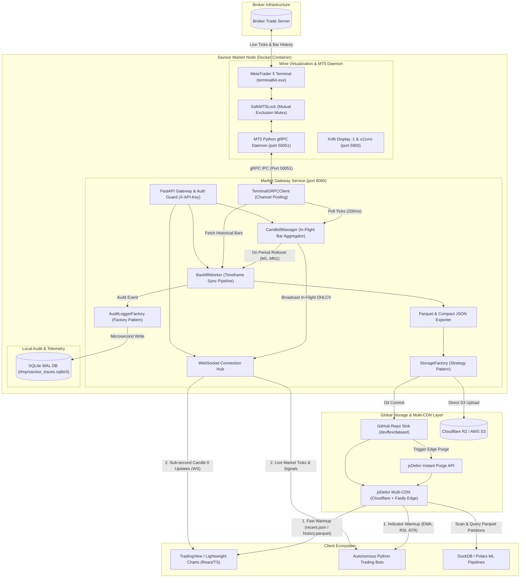

# Savisor Market Node

The **Savisor Market Node** is an autonomous, high-performance financial market data feed, in-flight **Candle 0** engine, and historical dataset pipeline designed for MetaTrader 5 broker terminals. It runs MetaTrader 5 inside an optimized, containerized Wine runtime alongside a high-throughput FastAPI/WebSocket server and automated pipeline workers managed by supervisord.

---

## 1. System Architecture & Data Flow



---

## 2. How the System Works & How It Is Built

### A. Core Operational Mechanism

1. **Virtualization & Display Layer**:
   - MetaTrader 5 runs inside an isolated Linux container using **Wine**, rendered into an **X Virtual Framebuffer (Xvfb)** on display `:1`.
   - An internal **x11vnc** daemon exposes port `5900` for optional GUI access (one-time broker login).

2. **Thread-Safe MT5 IPC Bridge (`SafeMT5Lock`)**:
   - The native MetaTrader 5 Python package is strictly single-threaded and unsafe under concurrent requests.
   - An internal Windows Python daemon (`grpc_server.py` on port `50051`) wraps all terminal calls inside a mutual exclusion lock (`SafeMT5Lock`) with a 10-second timeout, completely preventing race conditions and terminal deadlocks.

3. **In-Flight Candle 0 Aggregation Engine (`Candle0Manager`)**:
   - Ticks are polled every 200ms from the MT5 daemon and aggregated in memory across all timeframes (`M1` to `MN1`).
   - The active forming bar (Candle 0) updates in real-time (`open`, `high`, `low`, `close`, `tick_volume`, `bid`, `ask`).
   - When a period boundary crosses (e.g. `:00` seconds for M1, `:00` minutes for H1), the engine automatically closes the bar, fires an automated rollover callback, and spawns the new forming candle.

4. **Multi-Timeframe Parquet & Compact JSON Pipeline (`BackfillWorker`)**:
   - Closed candles and historical blocks are exported into:
     - **`history.parquet`**: Compressed Apache Parquet (Snappy compression) with sorted, deduplicated `time`, `OHLCV`, and volume columns.
     - **`recent.json`**: Ultra-lightweight array-of-arrays (`[[time, open, high, low, close, volume], ...]`) for instant frontend chart hydration ($<20\text{ KB}$ payload).
     - **`manifest.json`**: Index of available timeframes, date boundaries, and direct CDN URLs.

5. **Multi-CDN Storage & Instant Cache Invalidation (`StorageFactory`)**:
   - Pushes datasets directly to GitHub (`devffex/dataset`) or Cloudflare R2 / AWS S3.
   - When using GitHub, datasets are distributed worldwide via **jsDelivr Multi-CDN** (`cdn.jsdelivr.net`) across Cloudflare and Fastly edge nodes with **zero egress costs**.
   - Automatically triggers the jsDelivr purge API (`https://purge.jsdelivr.net/...`) upon candle rollover for instant global edge invalidation.

6. **Dual Telemetry & Audit Logging Layer (`AuditLoggerFactory`)**:
   - Records every dataset sync, rollover, and API query into an internal **SQLite database operating in WAL mode** (Write-Ahead Logging) for microsecond write performance without blocking the event loop.
   - Optionally fans out to external database sinks (PostgreSQL, Supabase, Loki) using non-blocking queues and bulkhead isolation.

---

## 3. Operational Workflow: Manual vs. Automated Operations

> [!IMPORTANT]
> **Zero Manual Chart Clicking Required**:
> You do **NOT** need to open MetaTrader 5 chart windows, scroll through historical bars, or manually click on `M1`, `M5`, `H1`, `D1` timeframe buttons to download broker history.
>
> The MetaTrader 5 terminal daemon automatically communicates with the broker's trade servers and downloads requested history in the background. Once logged into your broker account, **all further operations are 100% automated via REST and WebSocket APIs**.

### Operational Breakdown

| Operation | Mode | How It Works |
|---|---|---|
| **Broker Account Login** | **One-Time Setup** | Connect once via TigerVNC (`vncviewer localhost:5900`, password: `savisorpass`) to log in to your broker account, or pre-authenticate in the portable `MetaTrader5/` directory before building. |
| **Asset Watchlist Activation** | **100% Automated** | Call `POST /api/v1/symbols/active` with `{"symbol": "EURUSD"}`. The node activates the symbol in the broker's Market Watch. |
| **Broker History Downloads** | **100% Automated** | `BackfillWorker` queries MT5 via gRPC. The terminal daemon automatically downloads missing history from the broker in the background. |
| **Multi-Timeframe Generation (`M1`..`MN1`)** | **100% Automated** | Automatically generates datasets across all timeframes without opening chart windows. |
| **Parquet & Compact JSON Exports** | **100% Automated** | Compresses historical bars into Apache Parquet (`history.parquet`) and compact JSON (`recent.json`). |
| **Multi-CDN Sync & Edge Cache Purge** | **100% Automated** | Commits datasets to GitHub (`devffex/dataset`) and purges the jsDelivr edge cache automatically. |
| **Live Tick & Candle 0 Streaming** | **100% Automated** | Streams live ticks and aggregates the active forming Candle 0 over WebSockets (`WS /api/v1/market/ws/{symbol}`). |

---

## 4. Quick Start & Local Build

> [!IMPORTANT]
> **Build Locally First (Avoid "pull access denied")**:
> The `savisor-market-node:latest` image is built locally within this monorepo and is **not published on public Docker Hub**.
> If you run `docker run savisor-market-node:latest` before building, Docker will attempt to pull the image from Docker Hub and fail with `pull access denied`.

### Step 1: Supply MetaTrader 5 Portable Files
1. Install MetaTrader 5 on a Windows machine.
2. Run once in portable mode (`C:\MetaTrader5\terminal64.exe /portable`) and log in to your broker.
3. Clean up cache files to avoid connection conflicts: delete `MetaTrader5/Config/terminal.lic` and `MetaTrader5/Config/accounts.dat`.
4. Copy the entire `C:\MetaTrader5` folder to this project's root as `MetaTrader5/`.

---

### Step 2: Configure Environment Variables
Create or update `apps/market-gateway/.env`:

```ini
# Core API Security & Remote Desktop
SAVISOR_API_KEY=savisor_live_secret_key_9812
VNC_PASSWORD=savisorpass

# MT5 Connection
MT5_GRPC_SERVER=127.0.0.1:50051

# Storage Backend Strategy ('github' | 's3' | 'local')
STORAGE_BACKEND=github

# GitHub & jsDelivr Multi-CDN Configuration
GITHUB_TOKEN=ghp_yourGitHubPersonalAccessToken
GITHUB_REPO=devffex/dataset
GITHUB_BRANCH=main
GITHUB_CDN_BASE_URL=https://cdn.jsdelivr.net/gh/devffex/dataset@main

# Telemetry & Audit Logging Strategy ('sqlite' | 'external' | 'both' | 'none')
AUDIT_LOG_SINK=sqlite

# Runtime Environment
TZ=UTC
WINEDEBUG=-all
```

---

### Step 3: Build & Launch the Container

#### Option A: Using Docker Compose (Simplest)
From the monorepo root:
```bash
# Automatically builds and starts the container in one command:
docker compose up -d --build

# Follow live container logs:
docker compose logs -f
```

#### Option B: Using Makefile & Docker Run (Two-Step Local Build)
From the monorepo root:
```bash
# 1. Build the shared Wine + MT5 base image first
make build-base

# 2. Build the standalone market node image
make build-market-node

# 3. Run the container
docker run -d --name savisor-market-node \
  -p 8000:8000 \
  -p 5900:5900 \
  -e SAVISOR_API_KEY="savisor_live_secret_key_9812" \
  -e VNC_PASSWORD="savisorpass" \
  -e STORAGE_BACKEND="github" \
  -e GITHUB_TOKEN="ghp_yourGitHubPersonalAccessToken" \
  -e GITHUB_REPO="devffex/dataset" \
  -e GITHUB_BRANCH="main" \
  -e GITHUB_CDN_BASE_URL="https://cdn.jsdelivr.net/gh/devffex/dataset@main" \
  -e AUDIT_LOG_SINK="sqlite" \
  savisor-market-node:latest
```

---

## 5. Connecting via TigerVNC & Logging In

To perform the one-time broker authentication inside the virtualized Wine MetaTrader 5 desktop:

```bash
# Connect using TigerVNC CLI
vncviewer localhost:5900
```
*(Or launch the **TigerVNC Viewer** GUI and enter `localhost:5900` or `127.0.0.1:5900`)*

1. **VNC Password**: When prompted, enter `savisorpass` (or the value configured in `VNC_PASSWORD`).
2. **Authenticate MT5 Account**:
   - In MetaTrader 5, go to `File -> Login to Trade Account`.
   - Enter your Broker **Login**, **Password**, and **Server**.
   - Check **Save password** and click **OK**.
   - Confirm connection in the bottom right corner (green/blue signal bars).
3. **Close VNC**: You can safely close TigerVNC. All further data operations run **100% autonomously via the API**.

---

## 6. Provisioning Assets & Verifying Ingestion

### A. Health & Telemetry Probes
```bash
# Liveness Probe
curl -i http://localhost:8000/health

# Readiness Probe
curl -i http://localhost:8000/ready

# Prometheus Telemetry Metrics
curl http://localhost:8000/metrics
```

### B. Provision an Asset & Trigger Automatic Backfill
```bash
curl -i -X POST http://localhost:8000/api/v1/symbols/active \
  -H "X-API-Key: savisor_live_secret_key_9812" \
  -H "Content-Type: application/json" \
  -d '{
    "symbol": "EURUSD",
    "auto_backfill": true,
    "candle_count": 5000
  }'
```
This triggers the node to:
1. Activate `EURUSD` in MT5 Market Watch.
2. Fetch 5,000 historical bars across timeframes (`M1` to `MN1`) from MT5.
3. Compress into Apache Parquet (`data/EURUSD/H1/history.parquet`) and compact JSON (`data/EURUSD/H1/recent.json`).
4. Commit datasets to `devffex/dataset` on branch `main`.
5. Trigger the jsDelivr edge cache purge API.
6. Begin the live tick polling and Candle 0 engine.

### C. Access Datasets on jsDelivr Global Multi-CDN
* **Parquet History**: `https://cdn.jsdelivr.net/gh/devffex/dataset@main/data/EURUSD/H1/history.parquet`
* **Recent 500 Candles JSON**: `https://cdn.jsdelivr.net/gh/devffex/dataset@main/data/EURUSD/H1/recent.json`
* **Asset Manifest**: `https://cdn.jsdelivr.net/gh/devffex/dataset@main/data/EURUSD/manifest.json`
* **GitHub Repository View**: `https://github.com/devffex/dataset/tree/main/data/EURUSD`

### D. Stream Real-Time Candle 0 & Live Ticks
```bash
# Instant in-flight Candle 0 snapshot (M1 timeframe)
curl -i -H "X-API-Key: savisor_live_secret_key_9812" \
  "http://localhost:8000/api/v1/market/candle0?symbol=EURUSD&timeframe=M1"

# Connect to WebSocket stream (using wscat or frontend chart)
wscat -c ws://localhost:8000/api/v1/market/ws/EURUSD
```

---

## 7. Complete API Directory

| Endpoint | Method | Description |
|---|---|---|
| `/health` | `GET` | Node and daemon liveness probe (Public). |
| `/ready` | `GET` | Node readiness probe (Public). |
| `/metrics` | `GET` | Prometheus telemetry metrics (Public). |
| `/api/v1/telemetry/traces` | `GET` | Query internal SQLite WAL audit logs. |
| `/api/v1/market/candle0` | `GET` | Instant in-flight Candle 0 state for a symbol and timeframe. |
| `/api/v1/market/candle0/all` | `GET` | In-flight Candle 0 states across all timeframes. |
| `/api/v1/market/ws/{symbol}` | `WS` | Real-time WebSocket streaming live ticks and Candle 0 updates. |
| `/api/v1/market/rates` | `GET` | Retrieve historical candle arrays from terminal cache. |
| `/api/v1/market/rates/range` | `GET` | Retrieve candles by ISO date range. |
| `/api/v1/market/rates/from` | `GET` | Retrieve candles from starting timestamp. |
| `/api/v1/symbols/active` | `GET` | List actively tracked assets. |
| `/api/v1/symbols/active` | `POST` | Add/provision symbol and trigger automatic backfill. |
| `/api/v1/symbols/active/{symbol}` | `DELETE` | De-provision symbol from active watchlist. |
| `/api/v1/pipeline/backfill` | `POST` | Trigger deep historical backfill across timeframes. |
| `/api/v1/pipeline/status` | `GET` | Inspect backfill worker status registry. |

*(Legacy `/api/v1/chart/...` routes remain supported as backward-compatible aliases)*

---

## 8. Directory Layout

```text
savisor-monorepo/
├── docker/
│   ├── supervisord/             # Shared startup scripts (entrypoint, vnc setup)
│   ├── daemon/                  # MT5 Python gRPC Daemon & Proto definitions
│   ├── import_certs.py          # Wine cryptographic CAs synchronizer
│   ├── supervisord.conf         # Base supervisor config
│   └── Dockerfile.base          # Heavy Wine + MT5 + Python base image
│
├── apps/
│   ├── market-gateway/          # Real-Time Market Data, Candle 0 & Pipeline Node
│   │   ├── src/                 # Engine (Candle 0), Pipeline (Parquet/Backfill), Storage, Telemetry
│   │   ├── tests/               # 12-Perspective Unit Test Suite (28 tests)
│   │   ├── supervisord.conf     # Supervisord program configuration
│   │   ├── pyproject.toml       # Python package dependencies (uv)
│   │   ├── .env.example         # Environment template
│   │   └── Dockerfile           # Market Node child Dockerfile
│   │
│   ├── data-pipeline/           # Batch Data Ingest target
│   └── trading-bot/             # Algorithmic Trading Bot target
│
├── docs/
│   ├── client_api.md            # Client integration recipes (React, Python, ML)
│   ├── base_image_optimization.md
│   └── metatrader_lightweight.md
│
├── MetaTrader5/                 # Portable MT5 binary (host-supplied)
├── docker-compose.yml           # Production Docker Compose orchestration
├── Makefile                     # Build & run automations
└── README.md
```

---

## 9. Local Development & Automated Tests

All tests, formatting, and linting are managed using `uv`:

```bash
# 1. Sync virtual environment
uv sync --project apps/market-gateway --all-groups

# 2. Run linter and formatter checks
uv run --project apps/market-gateway ruff check apps/market-gateway/src apps/market-gateway/tests
uv run --project apps/market-gateway ruff format apps/market-gateway/src apps/market-gateway/tests

# 3. Run the 12-Perspective Unit Test Suite (28 tests)
PYTHONPATH=apps/market-gateway uv run --project apps/market-gateway pytest apps/market-gateway/tests -v
```

---

## 10. Client Integration Documentation

For complete client integration recipes (TradingView Lightweight Charts in React/TypeScript, Python Trading Bots with indicator warmup, DuckDB / Polars ML pipelines, and full REST/WS schema specs), see:
👉 **[Client API & Integration Guide](file:///home/julio/Work/savisor/savisor-node/docs/client_api.md)**
