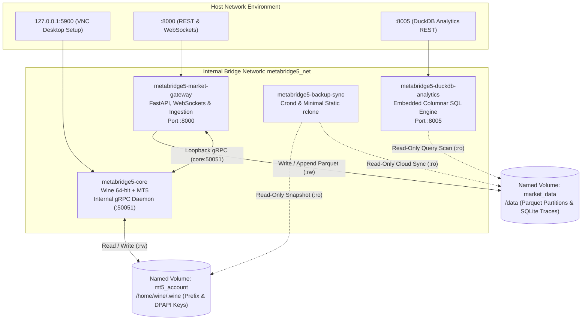
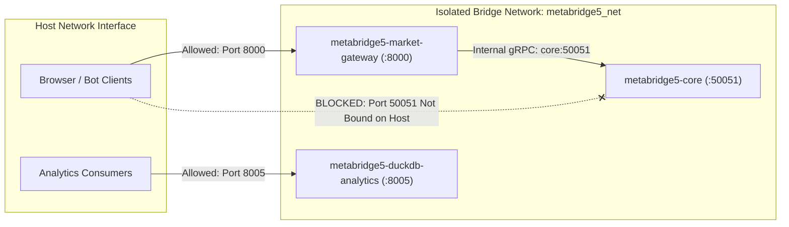
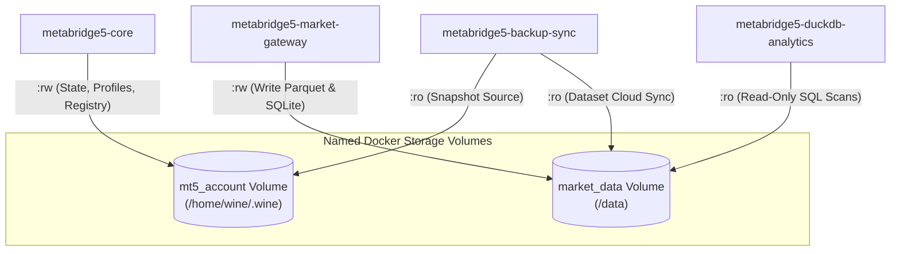

<div align="center">


# MetaBridge5

**Modular container infrastructure for MetaTrader 5 market data extraction, real-time streaming, and analytical query execution.**

<p align="center">
  
  
  
  
  
</p>

</div>

---

MetaBridge5 separates financial trading infrastructure into four purpose-built container images.
Each container handles one job instead of running everything inside a single monolithic virtual machine.
Services communicate across an internal Docker bridge network, keeping sensitive broker connections isolated from direct host exposure.



---

## 1. Subsystem Documentation Router

Detailed architectural pillars, build instructions, and operational runbooks live in dedicated documentation for each container:

| Container Image | Primary Role | Host Ports | Documentation |
|---|---|---|---|
| `metabridge5-core` | Headless Wine runtime, MetaTrader 5 terminal, and internal gRPC daemon | `127.0.0.1:5900` (VNC loopback) | [docker/README.md](file:///home/julio/work/devffex/MetaBridge5/docker/README.md) |
| `metabridge5-market-gateway` | FastAPI web server, WebSocket quote hub, Candle 0 manager, and Parquet backfill | `8000:8000` | [apps/market-gateway/README.md](file:///home/julio/work/devffex/MetaBridge5/apps/market-gateway/README.md) |
| `metabridge5-duckdb-analytics` | Read-only embedded DuckDB engine executing vectorized SQL queries across Parquet files | `8005:8005` | [apps/duckdb-analytics/README.md](file:///home/julio/work/devffex/MetaBridge5/apps/duckdb-analytics/README.md) |
| `metabridge5-backup-sync` | Scheduled volume snapshotting, SHA-256 integrity verification, and cloud synchronization | None | [apps/backup-sync/README.md](file:///home/julio/work/devffex/MetaBridge5/apps/backup-sync/README.md) |

---

## 2. Container Roles and Separation of Concerns

### `metabridge5-core`
Runs the Windows MetaTrader 5 terminal through Wine and hosts an internal gRPC daemon on port 50051.
The image isolates the emulated Windows environment from web application runtimes.
It pre-bakes registry templates to boot uninitialized volumes in 20 milliseconds.
It intercepts shutdown signals using Tini and sends standard `WM_CLOSE` commands to commit open databases cleanly.

### `metabridge5-market-gateway`
Connects to core over gRPC, fetches live prices and historical bars, manages Candle 0 states, and exposes the public REST API and WebSockets on port 8000.
Built on native Alpine Linux, the container operates independently from Wine.
If the core terminal restarts, the gateway retains connected WebSocket clients and reconnects upstream with exponential backoff.
It also formats historical bar batches into partitioned Apache Parquet structures on disk.

### `metabridge5-duckdb-analytics`
Mounts the historical Parquet data directory read-only and runs SQL queries on port 8005 without placing load on live trading.
The service embeds DuckDB to scan columnar chunks directly from disk.
An Abstract Syntax Tree security guard enforces that only `SELECT` and `WITH` statements run.
The container runtime caps resource consumption to 2.0 CPU cores and 2 GB memory.

### `metabridge5-backup-sync`
Wakes up on schedule, creates an atomic snapshot of the MT5 account volume, and pushes it to cloud storage using rclone.
The daemon bundles a custom, statically compiled rclone binary measuring 22.8 megabytes.
It creates daily and weekly compressed tarballs, calculates SHA-256 integrity signatures, and uploads archives to Cloudflare R2 or Amazon S3.
It also includes an automated restoration mode for disaster recovery.

---

## 3. Network Isolation and Security Architecture

The containers run inside a shared Docker bridge network (`metabridge5_net`) for security and service discovery.
In Docker, containers on the same network reach each other by container name (for example, `core:50051`).
Port 50051 is not published to the host network interface.
Only the gateway can talk to MT5, which keeps the trading terminal insulated from direct public network access.



For manual broker configuration, the core container exposes VNC strictly on host loopback `127.0.0.1:5900`.
The VNC server disables itself during automated headless operations when `START_VNC=false`.

---

## 4. Shared Storage Volumes and Protection Rules

Two Docker named volumes manage persistence across container lifecycles:



- **`mt5_account`**: Stores the Wine user profile, registry files, and encrypted broker account identifiers. It mounts read-write (`:rw`) on `core` and read-only (`:ro`) on `backup-sync`.
- **`market_data`**: Stores partitioned Apache Parquet files, JSON caches, and the SQLite audit log. It mounts read-write (`:rw`) on `market-gateway`, and read-only (`:ro`) on `duckdb-analytics` and `backup-sync`. Read-only mounts prevent background queries from causing file locks.

---

## 5. Verified Container Image Size Budgets

The build pipeline enforces strict size budgets on all container images using [scripts/check_image_sizes.sh](file:///home/julio/work/devffex/MetaBridge5/scripts/check_image_sizes.sh):

| Container Image | Budget Ceiling | Certified Local Size | Safety Margin | Verification Status |
|---|---|---|---|---|
| `metabridge5-duckdb-analytics:latest` | <= 150 MB | **118.1 MB** | +31.9 MB | **PASS** |
| `metabridge5-backup-sync:latest` | <= 60 MB | **35.1 MB** | +24.9 MB | **PASS** |
| `metabridge5-market-gateway:latest` | <= 125 MB | **111.7 MB** | +13.3 MB | **PASS** |
| `metabridge5-core:latest` | <= 530 MB | **527.7 MB** | +2.3 MB | **PASS** |
| **Combined Core + Gateway** | <= 650 MB | **639.4 MB** | +10.6 MB | **PASS** |

---

## 6. Quickstart and Orchestration

### Prerequisites
- Docker Engine 24+ and Docker Compose v2.
- GNU Make.

### 1. Build Container Stack
Build all purpose-built images and verify sizes:

```bash
make build-all
make size-check
```

### 2. Launch Container Topology
Start all four services in the background:

```bash
make up
```

Verify that all four containers reach healthy status:

```bash
docker compose ps
```

### 3. Verify Health Endpoints
Query the live services on the host:

```bash
# Market Gateway Liveness and Readiness
curl http://localhost:8000/health
curl http://localhost:8000/ready

# DuckDB Analytics Liveness
curl http://localhost:8005/health

# Run an Analytical Query
curl -s -X POST http://localhost:8005/api/v1/analytics/query \
  -H "Content-Type: application/json" \
  -d '{"sql_query": "SELECT 1 + 1 AS result"}'
```

### 4. Stop Container Stack

```bash
make down
```
