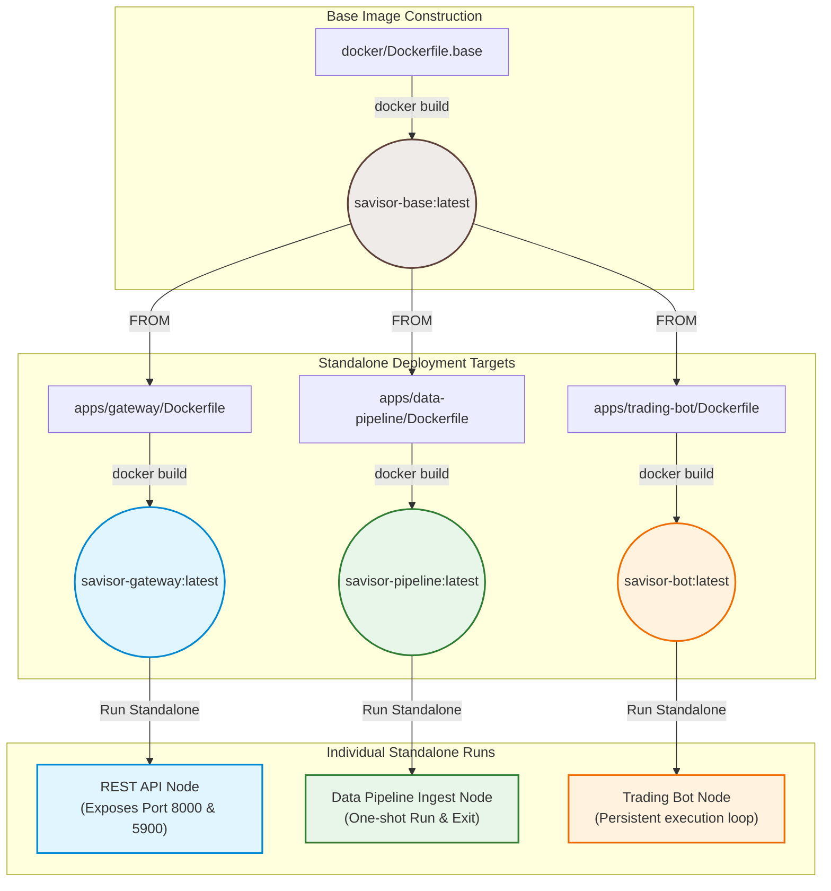

# Savisor Monorepo

Savisor is an algorithmic trading codebase organized as a monorepo. It uses a **Shared Base Image** architecture to build target-specific, standalone Docker containers, all based on Wine, VNC, and MetaTrader 5, while keeping individual images as lightweight and fast-building as possible.

---

## Architecture



### Key Concepts

* **Shared Base Image (`savisor-base`)**: Handles all heavy layers—Wine emulation, X Virtual Framebuffer (Xvfb), virtual display configuration, VNC setups, certificate synchronization, MetaTrader 5 terminal installations, and a Windows Python environment loaded with core packages (`numpy`, `pandas`, `MetaTrader5`).
* **Standalone Deployment targets**: Child Dockerfiles inherit `FROM savisor-base` and only inject their specific codebase, supervisord service parameters, and package requirements (e.g. `fastapi` in the Gateway, or machine learning libraries in the Bot).
* **Supervisord Inclusion**: The base image provides `/etc/supervisord.conf` with core virtualization layers. Child Dockerfiles mount their specific configuration under `/etc/supervisor/conf.d/*.conf` to start their specific Python scripts.

---

## MetaTrader 5 Interaction Modes

Savisor supports two distinct engineering approaches for interacting with the MetaTrader 5 instance running inside a container:

### Mode A: Batch / Bulk Ingestion Engine
* **Best for**: Mass Data Collection, Historical Backfill, ETL, CSV/Parquet Exports, and Disk-Heavy Writes.
* **High Throughput & Efficiency**: Optimized for volume over immediacy. It fetches large blocks of historical candles (e.g., 50,000 bars) and writes them to SQLite/CSV using bulk transactions (like SQLite WAL mode) to maximize disk I/O efficiency.
* **Stateless & Resilient**: Can be executed on demand, scheduled via cron/Airflow, or run in parallel per asset symbol without keeping long-running state in memory.
* **Resource Cleanup**: Starts up, executes the backfill job, flushes to disk, and cleanly exits or prunes temporary resources.

### Mode B: Persistent Event-Driven Daemon (gRPC / Streaming)
* **Best for**: Autonomous Trading Agents, Live Tick Monitoring, Order Execution, and Sub-second Market Reactions.
* **Ultra-Low Latency**: Keeps the Docker container, Wine MT5 instance, and gRPC server alive continuously in RAM. Eliminates process startup time and file I/O overhead.
* **Event-Driven & In-Memory**: Streams live ticks/bars directly to the agent over persistent gRPC or WebSocket channels. Live market state remains in memory (RAM) so the agent can evaluate trading signals and place orders in milliseconds.
* **Bi-directional Control**: Allows the agent to receive live tick events and immediately push execution commands (`BUY`, `SELL`, `MODIFY_STOP_LOSS`) back through the persistent connection without writing to disk first.

---

## Directory Layout

```text
savisor-monorepo/
├── docker/
│   ├── supervisord/             # Shared startup scripts (entrypoint, dismiss popups)
│   ├── import_certs.py          # Wine cryptographic CAs synchronizer
│   ├── supervisord.conf         # Base supervisor config
│   └── Dockerfile.base          # Heavy Wine + MT5 + Python base image
│
├── apps/
│   ├── gateway/                 # REST API Gateway target
│   │   ├── api/                 # FastAPI code and tests
│   │   ├── supervisord.conf     # Runs FastAPI uvicorn server
│   │   └── Dockerfile           
│   │
│   ├── data-pipeline/           # Ingest Data Pipeline target
│   │   ├── src/                 # Ingest main scripts
│   │   ├── supervisord.conf     # Runs one-shot pipeline and exits container
│   │   └── Dockerfile           
│   │
│   └── trading-bot/             # Algorithmic Trading Bot target
│       ├── src/                 # Trading bot loops
│       ├── supervisord.conf     # Runs persistent bot daemon
│       └── Dockerfile           
│
├── MetaTrader5/                 # Portable MT5 binary (host-supplied)
├── Makefile                     # Build & run automations
└── README.md
```

---

## Quick Start

### 1. Supply MetaTrader 5
1. Install MetaTrader 5 on a Windows machine.
2. Run once in portable mode (`C:\MetaTrader5\terminal64.exe /portable`) and log in to your broker.
3. Clean up cache files to avoid connection conflicts: delete `MetaTrader5/Config/terminal.lic` and `MetaTrader5/Config/accounts.dat`.
4. Copy the entire `C:\MetaTrader5` folder to this project's root as `MetaTrader5/`.

### 2. Orchestration & Builds

Build targets are managed using the root-level [Makefile](file:///home/julio/Work/savisor/savisor-node/Makefile):

```bash
# Build the base Wine/MT5 image (required first)
make build-base

# Build individual standalone targets
make build-gateway
make build-pipeline
make build-bot

# Or build all images sequentially
make build-all
```

### 3. Local Testing

To spin up and test individual standalone containers, use the Makefile runner targets. Secrets (`SAVISOR_API_KEY` and `VNC_PASSWORD`) are pre-injected automatically for quick checks:

```bash
# Run the API Gateway (port 8000 and VNC 5900 exposed)
make run-gateway

# Run the Ingest Pipeline (will execute data fetch and shut down container)
make run-pipeline

# Run the Trading Bot (will start tick monitor loop)
make run-bot
```

---

## Local Development & Unit Tests

API logic, tests, and formatting are managed using `uv` inside the gateway app directory:

```bash
# Sync local virtual environment
uv sync --project apps/gateway/api

# Run linter checks
uv run --project apps/gateway/api ruff check

# Run unit tests (utilizing MockMT5 fallback)
uv run --project apps/gateway/api pytest
```
