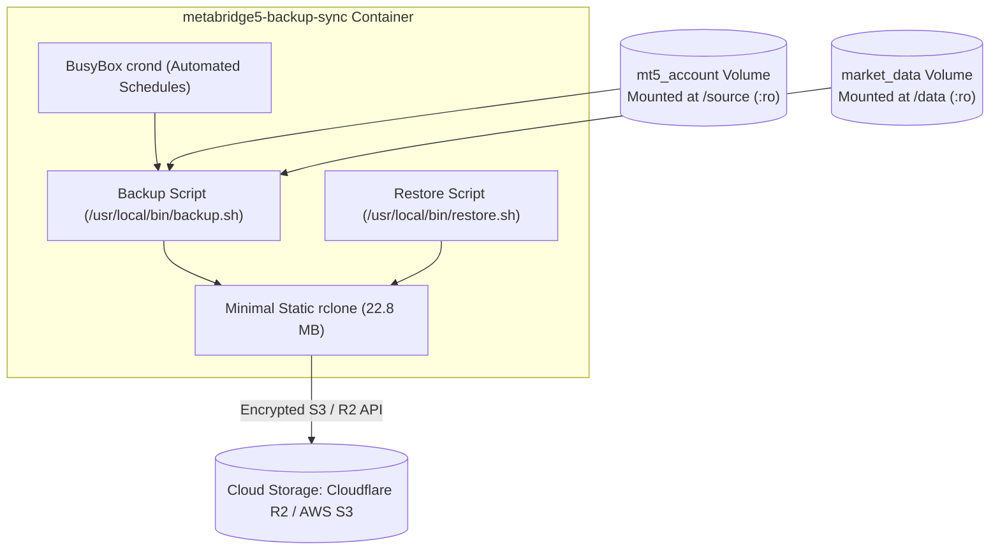
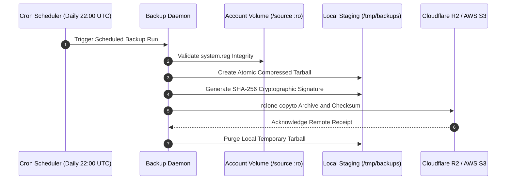
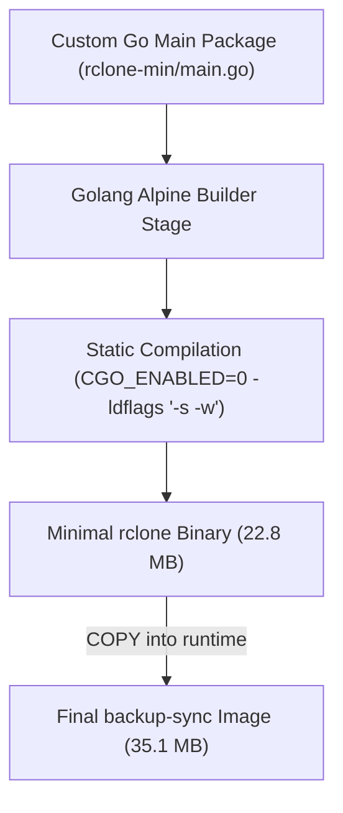
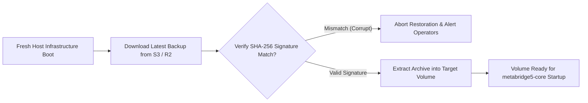

# MetaBridge5 Backup and Synchronization Daemon (`metabridge5-backup-sync`)

The `metabridge5-backup-sync` container provides autonomous volume backups, cloud object storage synchronization, and disaster recovery for MetaBridge5.
It attaches to persistent data volumes strictly in read-only mode.
It wakes up on automated cron schedules to produce compressed tarball snapshots of the MetaTrader 5 account volume.
It verifies cryptographic SHA-256 checksums on all archives before uploading to cloud storage.
It also synchronizes historical Parquet dataset partitions to offsite object stores using a custom static rclone binary.



---

## 1. Read-Only Account Volume Snapshotting and Atomic Archive Packaging

Rebuilding broker connections manually after server outages requires visual desktop interactions to enter passwords and tokens.
Because MetaTrader 5 stores authenticated sessions within the Wine user registry and security identifiers, backing up the persistent storage volume guarantees instant restoration.
The backup daemon attaches to the account volume in read-only mode to prevent file lock contention.



The backup script verifies that registry hives exist before creating the snapshot.
It excludes temporary files and logs to keep archive sizes small.
It calculates an SHA-256 hash immediately after packaging and stores the signature in a companion file.

```bash
#!/bin/sh
set -eu

SOURCE_DIR="${VOLUME_MOUNT:-/source}"
BACKUP_DIR="/tmp/backups"
TIMESTAMP=$(date -u +"%Y%m%d_%H%M%S")
ARCHIVE_NAME="mt5_account_backup_${TIMESTAMP}.tar.gz"

mkdir -p "${BACKUP_DIR}"

# Create atomic archive excluding unneeded runtime logs and sockets
tar --exclude='*.log' --exclude='*.tmp' --exclude='.wine-*' \
    -czf "${BACKUP_DIR}/${ARCHIVE_NAME}" -C "${SOURCE_DIR}" .

# Generate cryptographic signature
(cd "${BACKUP_DIR}" && sha256sum "${ARCHIVE_NAME}" > "${ARCHIVE_NAME}.sha256")
```

---

## 2. Scheduled Synchronization with Minimal Static rclone

Standard cloud command-line utilities add substantial disk weight to container images.
Stock distribution rclone packages weigh over 80 megabytes because they include dozens of unneeded cloud backends.
This container compiles a minimal, statically linked Go rclone binary containing only the `local` and `s3` backends.



The custom compilation reduces the binary size to 22.8 megabytes.
The final container image measures only 35.1 megabytes, well below the 60 megabyte ceiling.
The binary natively authenticates with Cloudflare R2, Amazon S3, and local MinIO storage.

```go
package main

import (
	_ "github.com/rclone/rclone/backend/local"
	_ "github.com/rclone/rclone/backend/s3"
	_ "github.com/rclone/rclone/cmd/copy"
	_ "github.com/rclone/rclone/cmd/copyto"
	_ "github.com/rclone/rclone/cmd/lsf"
	_ "github.com/rclone/rclone/cmd/sync"
	_ "github.com/rclone/rclone/cmd/version"
	"github.com/rclone/rclone/cmd"
)

func main() {
	cmd.Main()
}
```

---

## 3. Disaster Recovery Restoration and Cryptographic Verification

Recovering from hardware failures requires an automated recovery sequence to restore volume state without manual adjustments.
The container includes a restoration command that downloads the latest archive and verifies its cryptographic hash.
If the checksum does not match, the restore aborts immediately to protect against volume corruption.



Once the checksum passes verification, the script unpacks the archive into the target directory.
This ensures that the target volume contains valid registry hives before dependent trading containers boot.

```bash
SHA_FILE="${RESTORE_ARCHIVE}.sha256"
if [ -f "${SHA_FILE}" ]; then
    echo "[restore] Verifying SHA-256 integrity signature..."
    ARCHIVE_DIR=$(dirname "${RESTORE_ARCHIVE}")
    ARCHIVE_FILE=$(basename "${RESTORE_ARCHIVE}")
    (cd "${ARCHIVE_DIR}" && sha256sum -c "${ARCHIVE_FILE}.sha256")
fi

tar -xzf "${RESTORE_ARCHIVE}" -C "${TARGET_DIR}"
```

---

## 4. Operational Runbook

### Docker Compose Service Definition

```yaml
services:
  backup-sync:
    build:
      context: apps/backup-sync
      dockerfile: Dockerfile
    image: metabridge5-backup-sync:latest
    container_name: metabridge5-backup-sync
    restart: unless-stopped
    depends_on:
      core:
        condition: service_started
    volumes:
      - mt5_account:/source:ro     # Read-only account snapshot mount
      - market_data:/data:ro       # Read-only dataset sync mount
    networks:
      - metabridge5
    environment:
      - VOLUME_MOUNT=/source
      - PARQUET_DIR=/data/parquet
      - TZ=UTC
      - R2_ACCESS_KEY_ID=${R2_ACCESS_KEY_ID:-}
      - R2_SECRET_ACCESS_KEY=${R2_SECRET_ACCESS_KEY:-}
      - R2_ACCOUNT_ID=${R2_ACCOUNT_ID:-}
      - S3_ACCESS_KEY_ID=${S3_ACCESS_KEY_ID:-}
      - S3_SECRET_ACCESS_KEY=${S3_SECRET_ACCESS_KEY:-}
      - S3_BUCKET_NAME=${S3_BUCKET_NAME:-metabridge5-market-data}
      - S3_ENDPOINT_URL=${S3_ENDPOINT_URL:-}
    healthcheck:
      test: ["CMD", "/usr/local/bin/healthcheck.sh"]
      interval: 30s
      timeout: 5s
      retries: 3
      start_period: 10s
```

### Automated Backup Schedules

The daemon executes automated jobs configured in `/etc/crontab`:

```cron
# 1. Daily MT5 account snapshot at 22:00 UTC (after market close)
0 22 * * * /usr/local/bin/backup.sh >> /var/log/backup.log 2>&1

# 2. Hourly Parquet incremental dataset synchronization
0 * * * * /usr/local/bin/sync-parquet.sh >> /var/log/sync-parquet.log 2>&1

# 3. Weekly cold maintenance snapshot on Saturday at 12:00 UTC
0 12 * * 6 /usr/local/bin/backup.sh >> /var/log/backup.log 2>&1
```

### Manual Disaster Recovery Runbook

To restore a fresh volume from an existing archive:

1. Stop the core container to avoid file conflicts:
   ```bash
   docker stop metabridge5-core
   ```
2. Run the restoration command inside the backup container:
   ```bash
   docker exec -it metabridge5-backup-sync sh -c \
     'TARGET_DIR=/source RESTORE_ARCHIVE=/tmp/backups/mt5_account_backup_latest.tar.gz /usr/local/bin/restore.sh'
   ```
3. Restart the core container:
   ```bash
   docker start metabridge5-core
   ```

---

## 5. Build and Test Commands

Build the backup daemon image:

```bash
make build-backup
```

Verify image size against the hard 60 MB budget:

```bash
make size-check
```
