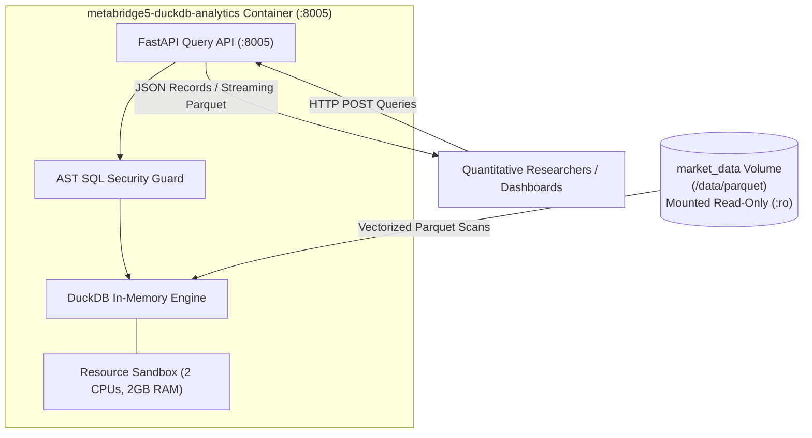
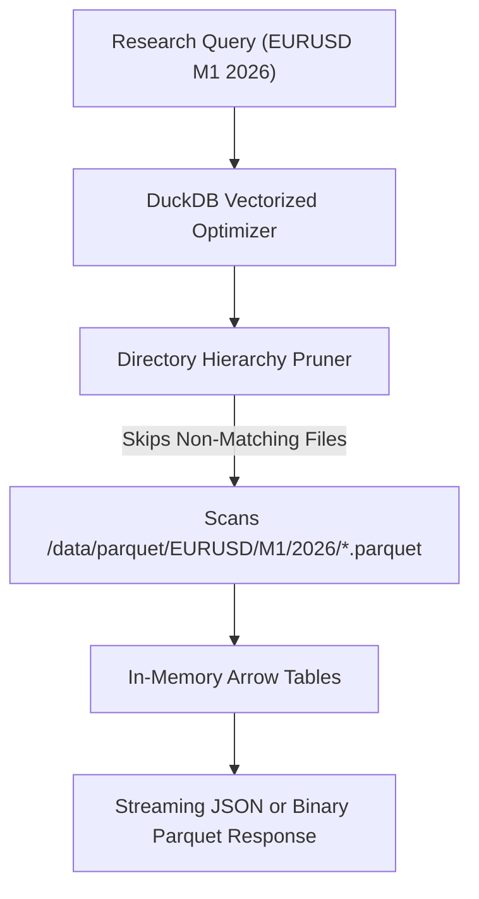
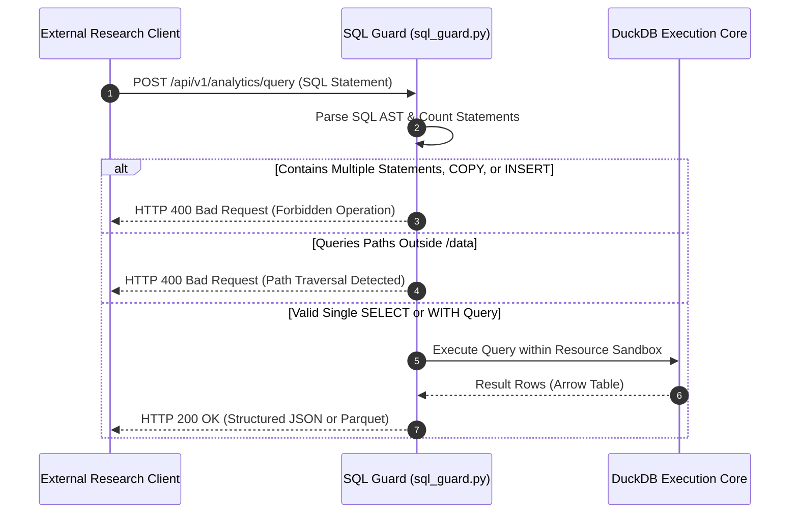
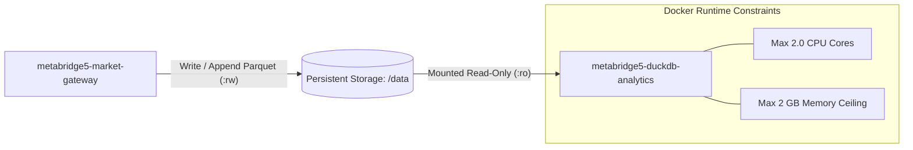

# MetaBridge5 DuckDB Analytics Engine (`metabridge5-duckdb-analytics`)

The `metabridge5-duckdb-analytics` container provides an autonomous analytical query engine for MetaBridge5.
It embeds DuckDB to run vectorized SQL queries directly against historical Apache Parquet files on disk.
It mounts the persistent `/data` volume strictly in read-only mode (`:ro`).
It exposes a lightweight HTTP REST interface on port 8005 for quantitative analysis and data export.
Running queries in an isolated container prevents heavy analytical jobs from slowing down live trade execution.



---

## 1. Zero-Copy Parquet Partition Pruning and Columnar Aggregation

Quantitative research requires scanning millions of historical price bars across broad date ranges.
The analytics container scans partitioned Parquet files directly from disk without loading entire tables into memory.
DuckDB reads directory paths (`/data/parquet/{symbol}/{timeframe}/{year}/{month}.parquet`) and prunes non-matching files before reading disk blocks.



The database reads compressed columnar chunks into CPU memory without intermediate row serialization.
This provides millisecond query execution across gigabytes of historical broker records.

```sql
SELECT 
    symbol,
    date_trunc('day', to_timestamp(time)) AS day,
    FIRST(open) AS open_price,
    MAX(high) AS high_price,
    MIN(low) AS low_price,
    LAST(close) AS close_price,
    SUM(tick_volume) AS total_volume
FROM read_parquet('/data/parquet/EURUSD/M1/2026/*.parquet')
GROUP BY 1, 2
ORDER BY 2 ASC;
```

---

## 2. AST SQL Query Guardrails and Restricted Execution

Running arbitrary queries over HTTP creates security risks if user queries remain unvalidated.
The service passes every incoming query through an Abstract Syntax Tree (AST) validator before execution.
The guard rejects write queries, database mutations, configuration changes, and filesystem traversal attempts.



The security guard enforces four strict execution rules:
1. It permits only single statement queries.
2. It allows only queries starting with `SELECT` or `WITH`.
3. It blocks destructive keywords such as `DROP`, `DELETE`, `INSERT`, `COPY`, `INSTALL`, and `LOAD`.
4. It restricts file path parameters strictly to the `/data` directory hierarchy.

```python
class SQLGuard:
    FORBIDDEN_KEYWORDS = {
        "DROP", "DELETE", "INSERT", "UPDATE", "ALTER", "CREATE",
        "COPY", "EXPORT", "IMPORT", "ATTACH", "DETACH", "PRAGMA",
        "SET", "RESET", "INSTALL", "LOAD", "CHECKPOINT"
    }

    def validate_query(self, sql: str) -> str:
        statements = [s.strip() for s in sql.strip().split(";") if s.strip()]
        if len(statements) != 1:
            raise HTTPException(status_code=400, detail="Only single SQL statements permitted.")
        stmt = statements[0]
        if not (stmt.upper().startswith("SELECT") or stmt.upper().startswith("WITH")):
            raise HTTPException(status_code=400, detail="Only SELECT and WITH queries are allowed.")
        return stmt
```

---

## 3. Read-Only Storage Isolation and Container Resource Governance

Analytical queries run against the same underlying storage volume where the market gateway writes live market data.
To prevent filesystem deadlocks or write-lock collisions, the analytics container mounts `/data` strictly read-only (`:ro`).
The container cannot modify, lock, or delete active data files.



Intensive analytical scans across years of tick records can consume host processor cycles.
Docker Compose applies explicit resource boundaries on the container.
The runtime caps execution to 2.0 CPU cores and 2 GB of memory.
This guarantees that analytical queries never starve live quote ingestion or trade execution threads.

---

## 4. Operational Configuration

### Docker Compose Service Definition

```yaml
services:
  duckdb-analytics:
    build:
      context: apps/duckdb-analytics
      dockerfile: Dockerfile
    image: metabridge5-duckdb-analytics:latest
    container_name: metabridge5-duckdb-analytics
    restart: unless-stopped
    depends_on:
      market-gateway:
        condition: service_started
    ports:
      - "8005:8005"   # Analytics Query API
    environment:
      - METABRIDGE5_DATA_DIR=/data
      - PORT=8005
      - TZ=UTC
    volumes:
      - market_data:/data:ro   # Strictly read-only volume mount
    networks:
      - metabridge5
    deploy:
      resources:
        limits:
          cpus: "2.0"
          memory: 2G
    healthcheck:
      test: ["CMD-SHELL", "python3 -c 'import urllib.request; urllib.request.urlopen(\"http://127.0.0.1:8005/health\")' || exit 1"]
      interval: 15s
      timeout: 5s
      retries: 3
      start_period: 15s
```

### Environment Variables

| Variable | Default | Purpose |
|---|---|---|
| `METABRIDGE5_DATA_DIR` | `/data` | Read-only path pointing to partitioned Parquet files. |
| `PORT` | `8005` | HTTP port for the query REST server. |
| `TZ` | `UTC` | Timezone setting for date and timestamp functions. |

### API Endpoints

| Method | Path | Description |
|---|---|---|
| `GET` | `/health` | Health check verifying HTTP server and DuckDB memory status. |
| `POST` | `/api/v1/analytics/query` | Executes validated SQL queries and returns records in JSON format. |
| `POST` | `/api/v1/analytics/query.parquet` | Executes validated SQL queries and streams compressed Parquet binary streams. |

#### Example Query: JSON Format

```bash
curl -s -X POST http://localhost:8005/api/v1/analytics/query \
  -H "Content-Type: application/json" \
  -d '{"sql_query": "SELECT count(*) AS total_bars FROM read_parquet(\"/data/parquet/EURUSD/M1/*/*.parquet\")"}'
```

#### Example Query: Streaming Parquet Export

```bash
curl -s -X POST http://localhost:8005/api/v1/analytics/query.parquet \
  -H "Content-Type: application/json" \
  -d '{"sql_query": "SELECT * FROM read_parquet(\"/data/parquet/EURUSD/M1/2026/*.parquet\") WHERE volume > 100"}' \
  --output filtered_bars.parquet
```

---

## 5. Build and Test Commands

Run the analytics test suite:

```bash
apps/duckdb-analytics/.venv/bin/pytest apps/duckdb-analytics/tests
```

Build the container image:

```bash
make build-analytics
```

Verify image size against the hard 150 MB budget:

```bash
make size-check
```
