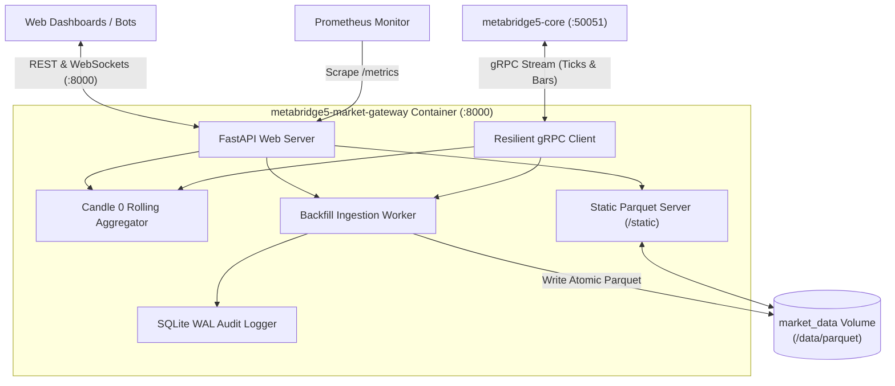
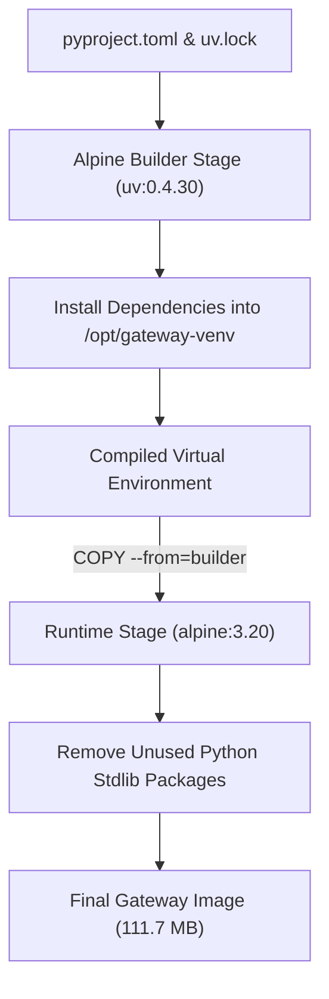
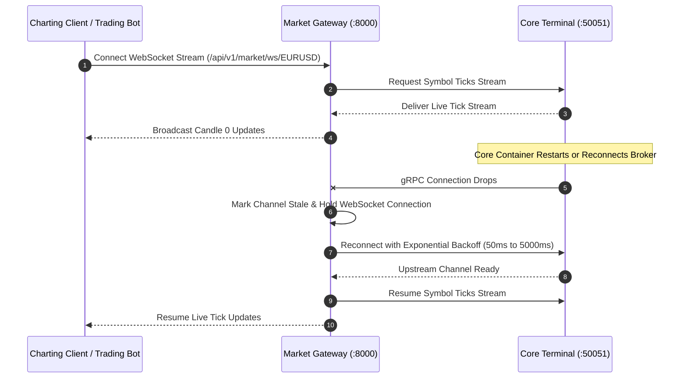

# MetaBridge5 Market Gateway (`metabridge5-market-gateway`)

The `metabridge5-market-gateway` container provides the real-time financial API for MetaBridge5.
It runs on native Alpine Linux 3.20 without emulation layers or Windows binaries.
It connects to `metabridge5-core` over internal gRPC to collect ticks and fetch historical bars.
It exposes public REST endpoints and WebSocket channels on port 8000.
It also computes in-flight Candle 0 states in memory and writes partitioned Apache Parquet datasets to `/data`.



---

## 1. Decoupled Alpine Virtualenv Compilation and Size Optimization

Previous versions bundled the web gateway inside the Wine image.
That setup forced simple web services to inherit heavy Windows dependencies.
The gateway now builds as an independent container on native Alpine Linux.
A multi-stage build uses `uv` to compile dependencies into a standalone virtual environment.



The runtime stage strips unneeded Python standard library packages before finalizing the container.
Removing packages like `ensurepip`, `pydoc_data`, and test suites saves 15 megabytes.
The final container weighs only 111.7 megabytes, well under the 125 megabyte budget.

```dockerfile
FROM ghcr.io/astral-sh/uv:0.4.30-alpine3.20 AS builder

WORKDIR /build
COPY pyproject.toml uv.lock ./
RUN uv venv /opt/gateway-venv && \
    uv sync --frozen --no-dev --no-install-project

FROM alpine:3.20
RUN apk add --no-cache python3 tini
COPY --from=builder /opt/gateway-venv /opt/gateway-venv
RUN rm -rf /usr/lib/python3.12/ensurepip /usr/lib/python3.12/idlelib /usr/lib/python3.12/test
```

---

## 2. Resilient Loopback gRPC Transport and Network Failure Recovery

Running services in separate network namespaces requires reliable network recovery.
The gateway client connects to the core terminal using proactive keepalive pings.
If the core container restarts during maintenance, the gateway holds client WebSocket connections open.
It reconnects to the upstream terminal with an exponential backoff starting at 50 milliseconds.



The client marks cached quotes as stale while the upstream link recovers.
Once the channel transitions to the ready state, the gateway requests fresh quotes immediately.
This prevents delivery of corrupted market data without dropping downstream clients.

```python
class TerminalGRPCClient:
    def __init__(self):
        host = os.environ.get("TERMINAL_GRPC_HOST", "core")
        port = os.environ.get("TERMINAL_GRPC_PORT", "50051")
        options = [
            ("grpc.keepalive_time_ms", 10000),
            ("grpc.keepalive_timeout_ms", 5000),
            ("grpc.initial_reconnect_backoff_ms", 50),
            ("grpc.max_reconnect_backoff_ms", 5000),
        ]
        self.channel = grpc.insecure_channel(f"{host}:{port}", options=options)
```

---

## 3. In-Memory Candle 0 Aggregation and Vectorized Parquet Export

Downstream trading systems need live price bars before brokers close the current candle.
The Candle 0 engine aggregates incoming ticks in memory across nine standard timeframes (M1 to MN1).
It calculates high, low, open, close, and volume values in real time without querying the broker database.
WebSocket subscribers receive updated candles within milliseconds of every incoming tick.

```mermaid
flowchart LR
    Bars["Raw MT5 Historical Bars (25,000 Bar Batches)"] --> Schema["Polars Vectorized Structuring"]
    Schema --> TempFile["Write Staging File (.tmp.parquet)"]
    TempFile --> AtomicRename["Atomic Filesystem Rename"]
    AtomicRename --> FinalPath["/data/parquet/{symbol}/{timeframe}/{year}/{month}.parquet"]
    FinalPath --> StaticHTTP["Mounted HTTP Endpoint (/static/parquet/...)"]
    StaticHTTP --> Downstream["DuckDB Analytics / External Research"]
```



Historical ingestion jobs write price bars directly into partitioned Apache Parquet files.
The worker writes records into temporary staging files first.
An atomic filesystem rename moves the finished file into the target directory.
This prevents analytical readers from encountering half-written data blocks.
The gateway mounts `/data` onto a static HTTP route for direct file downloads.

---

## 4. Operational Configuration

### Docker Compose Service Definition

```yaml
services:
  market-gateway:
    build:
      context: apps/market-gateway
      dockerfile: Dockerfile
    image: metabridge5-market-gateway:latest
    container_name: metabridge5-market-gateway
    restart: unless-stopped
    stop_grace_period: 45s
    depends_on:
      core:
        condition: service_started
    ports:
      - "8000:8000"   # Public REST, WebSockets & Prometheus Metrics
    environment:
      - TERMINAL_GRPC_HOST=core
      - TERMINAL_GRPC_PORT=50051
      - METABRIDGE5_DATA_DIR=/data
      - METABRIDGE5_API_KEY=dev_metabridge5_secret_key_123
      - STORAGE_BACKEND=local
      - AUDIT_LOG_SINK=sqlite
      - TZ=UTC
    volumes:
      - market_data:/data
    networks:
      - metabridge5
    healthcheck:
      test: ["CMD-SHELL", "python3 -c 'import urllib.request; urllib.request.urlopen(\"http://127.0.0.1:8000/health\")' || exit 1"]
      interval: 15s
      timeout: 5s
      retries: 3
      start_period: 15s
```

### Environment Variables

| Variable | Default | Purpose |
|---|---|---|
| `TERMINAL_GRPC_HOST` | `core` | DNS hostname of the core container on network `metabridge5_net`. |
| `TERMINAL_GRPC_PORT` | `50051` | Internal gRPC port exposed by `metabridge5-core`. |
| `METABRIDGE5_DATA_DIR` | `/data` | Root path for Parquet datasets, JSON caches, and SQLite WAL logs. |
| `METABRIDGE5_API_KEY` | `dev_metabridge5_secret_key_123` | Security key for authenticating incoming API requests. |
| `STORAGE_BACKEND` | `local` | Primary storage provider: `local`, `s3`, or `github`. |
| `AUDIT_LOG_SINK` | `sqlite` | Destination for request audit traces: `sqlite`, `external`, or `none`. |

### Primary API Routes

| Method | Path | Authentication | Description |
|---|---|---|---|
| `GET` | `/health` | No | Basic process liveness probe. |
| `GET` | `/ready` | No | Upstream readiness probe verifying connection to Core. |
| `GET` | `/metrics` | No | Prometheus metrics scrape endpoint. |
| `GET` | `/api/v1/market/candle0` | Required | Current in-flight Candle 0 state for an asset. |
| `WS` | `/api/v1/market/ws/{symbol}` | Required | Real-time WebSocket stream for ticks and candle updates. |
| `GET` | `/api/v1/market/rates` | Required | Historical bar cache from the terminal. |
| `POST` | `/api/v1/pipeline/backfill` | Required | Triggers on-demand historical Parquet generation. |
| `GET` | `/static/parquet/{path}` | No | Direct HTTP download for exported Parquet dataset files. |

---

## 5. Build and Test Commands

Run the test suite:

```bash
make test
```

Build the container image:

```bash
make build-gateway
```

Verify image size against the hard 125 MB budget:

```bash
make size-check
```
