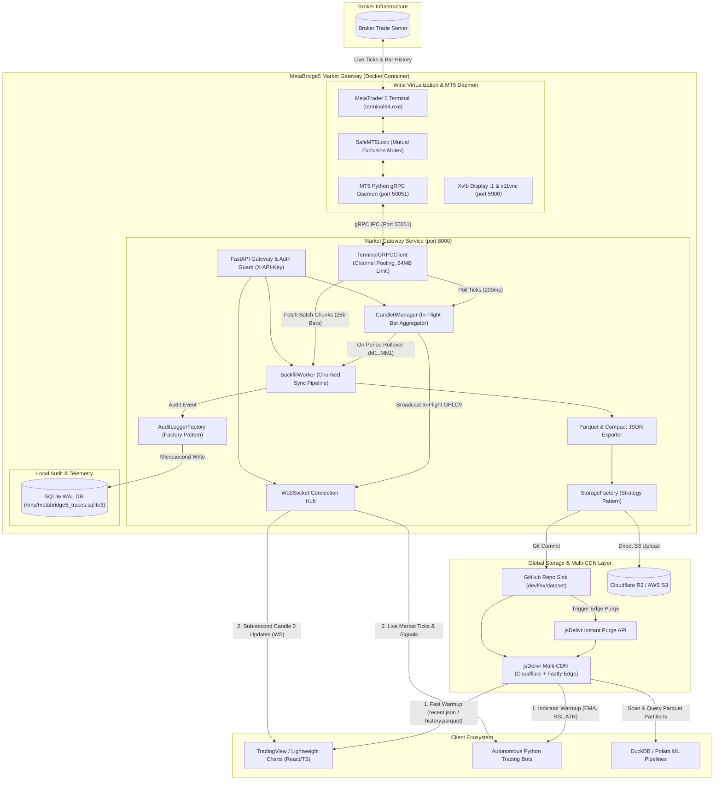

# MetaBridge5 Market Gateway

The **MetaBridge5 Market Gateway** is an autonomous, containerized financial data collection, real-time in-flight **Candle 0** engine, and historical dataset pipeline designed for MetaTrader 5 broker terminals.

It runs inside a containerized Wine runtime alongside a high-throughput FastAPI/WebSocket server and automated pipeline workers managed by supervisord.

---

## 1. System Architecture



👉 **Full Architecture Deep Dive**: [Architecture & System Design Manual](docs/architecture.md)

---

## 2. Configuration & Environment (`.env`)

Configure your environment inside `apps/market-gateway/.env` (no production secrets in version control):

```ini
# ==============================================================================
# MetaBridge5 Market Gateway Configuration (.env)
# ==============================================================================

# 1. API Security & VNC Password
METABRIDGE5_API_KEY=your_secret_api_key_here
VNC_PASSWORD=your_vnc_password_here

# 2. MT5 gRPC Daemon Connection
MT5_GRPC_SERVER=127.0.0.1:50051

# 3. Storage Backend Strategy ('github' | 's3' | 'local')
STORAGE_BACKEND=github

# 4. GitHub & jsDelivr Multi-CDN Configuration (Used when STORAGE_BACKEND=github)
GITHUB_TOKEN=ghp_yourPersonalAccessTokenHere
GITHUB_REPO=your_organization/your_dataset_repo
GITHUB_BRANCH=main
GITHUB_CDN_BASE_URL=https://cdn.jsdelivr.net/gh/your_organization/your_dataset_repo@main

# 5. S3 / Cloudflare R2 Configuration (Used when STORAGE_BACKEND=s3)
S3_BUCKET_NAME=your-market-data-bucket
S3_ENDPOINT_URL=https://<account_id>.r2.cloudflarestorage.com
S3_ACCESS_KEY_ID=your_s3_access_key_id
S3_SECRET_ACCESS_KEY=your_s3_secret_access_key
S3_REGION_NAME=auto
S3_CDN_BASE_URL=https://data.yourdomain.com

# 6. Audit & Telemetry Configuration ('sqlite' | 'external' | 'both' | 'none')
AUDIT_LOG_SINK=sqlite
AUDIT_SQLITE_PATH=/tmp/metabridge5_traces.sqlite3
AUDIT_EXTERNAL_URL=http://telemetry.internal/api/v1/traces

# 7. Mock Mode (1 = Enable offline synthetic data without MT5 terminal)
METAFORGE_MOCK_MT5=0

# 8. Runtime Diagnostics
TZ=UTC
WINEDEBUG=-all
```

---

## 3. Running & Operations

### Recommended: Docker Named Volume Persistence

To preserve your broker login across container updates without re-entering passwords:

```bash
# 1. Create a persistent named volume
docker volume create metabridge5_mt5_data

# 2. Build local images from monorepo root
make build-base
make build-market-node

# 3. Launch container with volume attached (foreground live logs)
docker run -it --rm --name metabridge5-market-node \
  -p 8000:8000 \
  -p 5900:5900 \
  -v metabridge5_mt5_data:/home/wine/.wine/drive_c/MetaTrader5 \
  -e METABRIDGE5_API_KEY="your_secret_api_key_here" \
  -e VNC_PASSWORD="your_vnc_password_here" \
  -e STORAGE_BACKEND="github" \
  -e GITHUB_TOKEN="ghp_yourPersonalAccessTokenHere" \
  -e GITHUB_REPO="your_organization/your_dataset_repo" \
  -e GITHUB_BRANCH="main" \
  -e AUDIT_LOG_SINK="sqlite" \
  metabridge5-market-node:latest
```

👉 **Authentication & Session Persistence Guide**: [Docker Named Volume Authentication Manual](docs/authentication_persistence.md)

---

### One-Time Broker Authentication via TigerVNC

1. Connect to the virtual desktop:
   ```bash
   vncviewer localhost:5900
   ```
2. Enter the VNC password (`your_vnc_password_here`).
3. In MetaTrader 5, go to `File -> Login to Trade Account`.
4. Enter your Broker **Login**, **Password**, and select your broker **Server**.
5. Check **Save password** and click **OK**.
6. Confirm green/blue signal bars in the bottom right corner.
7. **Close TigerVNC**: All further data operations are 100% automated by the API.

---

## 4. Container Health, Observability & Ingestion Controls

### System Probes & Diagnostics
| Probe / Diagnostic | Command | Plain-English Purpose |
|---|---|---|
| **Liveness Probe** | `curl -i http://localhost:8000/health` | Asks *"Is the API process alive and is the internal MT5 gRPC bridge responding?"* |
| **Readiness Probe** | `curl -i http://localhost:8000/ready` | Asks *"Is the system ready to accept trading traffic and are connections initialized?"* |
| **Pipeline Health Monitor** | `curl -s -H "X-API-Key: ..." http://localhost:8000/api/v1/pipeline/health` | Pure-verdict evaluator checking price feed freshness and detecting stuck jobs. |
| **Live SSE Telemetry Stream** | `curl -N http://localhost:8000/api/v1/telemetry/stream` | Real-time Server-Sent Events stream yielding NDJSON events for every candle rollup. |
| **Prometheus Metrics** | `curl -s http://localhost:8000/metrics` | Asks *"What are the tick counters, active WebSocket connections, and latency histograms?"* |
| **Process Inspection** | `docker top metabridge5-market-node` | Asks *"Are all 6 internal processes (Supervisord, Wine, MT5, gRPC, Uvicorn, Xvfb) active in RAM?"* |

### Granular & Exclusionary Ingestion Controls
```bash
# Pause EURUSD ingestion individually
curl -X POST "http://localhost:8000/api/v1/pipeline/pause?symbol=EURUSD" -H "X-API-Key: your_key"

# Ingest ONLY USDJPY and pause all other active symbols
curl -X POST http://localhost:8000/api/v1/pipeline/control -H "X-API-Key: your_key" \
  -H "Content-Type: application/json" -d '{"action": "pause", "scope": "exclude", "symbols": ["USDJPY"]}'

# Resume all symbols globally
curl -X POST http://localhost:8000/api/v1/pipeline/resume -H "X-API-Key: your_key"
```


---

## 5. Documentation Hub

Explore the modular technical manuals in the `docs/` folder:

| Manual | Description |
|---|---|
| 📖 **[Architecture & System Design](docs/architecture.md)** | Container process matrix, thread safety mutex (`SafeMT5Lock`), 64MB buffers, and data flow. |
| 🔑 **[Authentication & Volume Persistence](docs/authentication_persistence.md)** | Why portable MT5 hashes fail across OS boundaries and how Docker Named Volumes persist sessions. |
| ⚡ **[Real-Time Streaming & Candle 0 Engine](docs/realtime_candle0_streaming.md)** | In-flight OHLCV aggregation, REST snapshots, and live WebSocket streaming contracts. |
| 📦 **[Historical Ingestion & Backfill Pipeline](docs/historical_pipeline_ingestion.md)** | Batch chunking (100k+ candles), ISO 8601 multi-year date ranges, Snappy Parquet, and CDN purge. |
| 📊 **[Observability, Logs & Telemetry](docs/observability_telemetry.md)** | Raw MT5 platform logs (`/api/v1/terminal/logs`), SQLite WAL audit traces, and Prometheus metrics. |
| 📡 **[Complete API Reference Directory](docs/api_reference.md)** | Complete reference table and request/response models for all 17 REST & WebSocket routes. |
| 💻 **[Client Integration Recipes](docs/client_integration.md)** | Code snippets for React/TradingView Lightweight Charts, Python trading bots, and DuckDB/Polars. |

---

## 6. Testing & Development

### Local Validation
```bash
# 1. Sync virtual environment
uv sync --project apps/market-gateway --all-groups

# 2. Run linter and formatter
uv run --project apps/market-gateway ruff check apps/market-gateway/src apps/market-gateway/tests
uv run --project apps/market-gateway ruff format apps/market-gateway/src apps/market-gateway/tests

# 3. Run unit tests
PYTHONPATH=apps/market-gateway uv run --project apps/market-gateway pytest apps/market-gateway/tests -v
```

### Rapid Development & Improvement Loop (Zero Re-Authentication)
When applying code changes, fixes, or new endpoints, redeploy the running container in under 5 seconds without losing session authentication:

```bash
make build-market-node && \
docker rm -f metabridge5-market-node && \
docker run -d --name metabridge5-market-node \
  -p 8000:8000 \
  -p 5900:5900 \
  -v metabridge5_mt5_data:/home/wine/.wine \
  --env-file apps/market-gateway/.env \
  metabridge5-market-node:latest
```

---

## 7. Software Engineering & Testing Standards

The MetaBridge5 Market Gateway implements enterprise backend design patterns and a comprehensive 12-perspective unit testing engine:

* **Backend Design Patterns Applied**:
  * **Factory & Strategy**: `StorageFactory` and `StorageBackend` strategies (`GitHub`, `S3`, `Local`).
  * **Observer (Pub/Sub)**: `EventBroadcaster` (SSE) and `Candle0Manager` period-close callbacks.
  * **Composite Pattern**: `CompositeAuditSink` grouping multiple telemetry destinations.
  * **Adapter Pattern**: `TerminalGRPCClient` adapting low-level Protobuf RPC stubs.
  * **Stream Sink Pattern**: `StreamParquetSink` chunked memory buffering, Snappy compression, and atomic upload.
  * **Repository Pattern**: `SQLiteAuditSink` parameterized WAL queries and schema encapsulation.
  * **Dependency Injection**: `BackfillWorker` receiving explicit service interfaces.
* **12-Perspective Testing Engine**:
  * Evaluates all 12 testing dimensions (Happy Path, Error Handling, Boundary Value Analysis, Edge Cases, State/FSM, Concurrency, Resource Teardown, Security/SQLi Sanitization, Idempotency, Performance Budgets, Schema Contracts, and UTC Determinism).
  * Run perspective test suite:
    ```bash
    PYTHONPATH=apps/market-gateway uv run --project apps/market-gateway pytest apps/market-gateway/tests/test_perspectives_matrix.py -v
    ```


