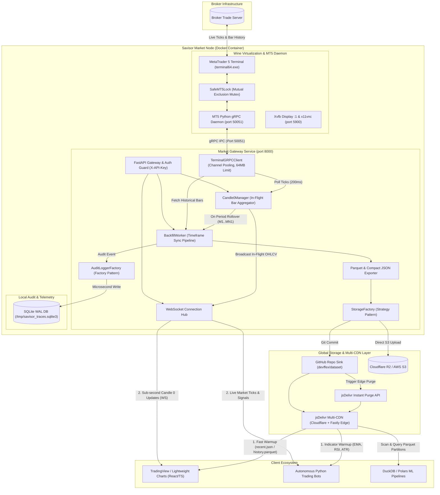

# Savisor Market Node: Complete Application Handbook

The **Savisor Market Node** is an autonomous, production-grade market data collection, in-flight **Candle 0** engine, and historical dataset pipeline designed for MetaTrader 5 broker terminals. It runs inside a containerized Wine runtime alongside a high-throughput FastAPI/WebSocket server and automated pipeline workers managed by supervisord.

This handbook is the definitive reference manual covering all operations, configurations, asset provisioning workflows, real-time data streaming contracts, historical dataset schemas, CDN distribution, and telemetry inspection.

---

## Handbook Table of Contents

1. [Architecture & Container Topology](#1-architecture--container-topology)
2. [Configuration & Environment Reference](#2-configuration--environment-reference)
3. [Container Operations & Lifecycle](#3-container-operations--lifecycle)
4. [Asset Discovery & Dynamic Provisioning](#4-asset-discovery--dynamic-provisioning)
5. [Real-Time Streaming & In-Flight Candle 0 Engine](#5-real-time-streaming--in-flight-candle-0-engine)
6. [Historical Data Ingestion & Backfill Pipeline](#6-historical-data-ingestion--backfill-pipeline)
7. [Historical Rates REST Queries](#7-historical-rates-rest-queries)
8. [Data Assets, Storage Formats & Multi-CDN Distribution](#8-data-assets-storage-formats--multi-cdn-distribution)
9. [Observability, Logs & Telemetry](#9-observability-logs--telemetry)
10. [Client Integration Recipes](#10-client-integration-recipes)
11. [Complete API Directory](#11-complete-api-directory)
12. [Local Testing & Development](#12-local-testing--development)

---

## 1. Architecture & Container Topology



### Container Process Supervision Matrix

All container services are isolated and orchestrated via `supervisord` (`/etc/supervisord.conf`):

| Service | Process / Binary | Role | Port |
|---|---|---|---|
| **`xvfb`** | `Xvfb :1 -screen 0 1920x1080x16` | Headless virtual display buffer. | Internal |
| **`x11vnc`** | `x11vnc -display :1 -rfbauth ...` | Remote desktop server for one-time broker setup. | `5900` |
| **`wine`** | `terminal64.exe /portable` | Native Windows MetaTrader 5 trading terminal. | Outbound |
| **`api`** | `grpc_server.py 50051` | Windows Python gRPC daemon with `SafeMT5Lock`. | `50051` (internal) |
| **`market-gateway`** | `uvicorn app.main:app --port 8000` | Linux Python REST API, WebSocket broadcaster & pipeline. | `8000` |

---

## 2. Configuration & Environment Reference

Configuration is managed via environment variables passed directly to the container or configured inside `apps/market-gateway/.env`:

```ini
# ==============================================================================
# Savisor Market Node Configuration (.env)
# ==============================================================================

# 1. API Security & VNC Desktop
SAVISOR_API_KEY=savisor_live_secret_key_9812
VNC_PASSWORD=savisorpass

# 2. MT5 gRPC Daemon Connection
MT5_GRPC_SERVER=127.0.0.1:50051

# 3. Storage Backend Strategy ('github' | 's3' | 'local')
STORAGE_BACKEND=github

# 4. GitHub & jsDelivr Multi-CDN Configuration
GITHUB_TOKEN=ghp_yourGitHubPersonalAccessToken
GITHUB_REPO=devffex/dataset
GITHUB_BRANCH=main
GITHUB_CDN_BASE_URL=https://cdn.jsdelivr.net/gh/devffex/dataset@main

# 5. S3 / Cloudflare R2 Configuration (Used when STORAGE_BACKEND=s3)
S3_BUCKET_NAME=savisor-market-data
S3_ENDPOINT_URL=https://<account_id>.r2.cloudflarestorage.com
S3_ACCESS_KEY_ID=your_r2_access_key
S3_SECRET_ACCESS_KEY=your_r2_secret_key
S3_REGION_NAME=auto
S3_CDN_BASE_URL=https://data.savisor.com

# 6. Audit & Telemetry Configuration ('sqlite' | 'external' | 'both' | 'none')
AUDIT_LOG_SINK=sqlite
AUDIT_SQLITE_PATH=/tmp/savisor_traces.sqlite3
AUDIT_EXTERNAL_URL=http://telemetry.internal/api/v1/traces

# 7. Mock Mode (1 = Enable offline synthetic data without MT5 terminal)
METAFORGE_MOCK_MT5=0

# 8. Runtime Diagnostics
TZ=UTC
WINEDEBUG=-all
```

---

## 3. Container Operations & Lifecycle

### Quick Start: Building & Launching

```bash
# Option A: Single-command Docker Compose build and run
docker compose up -d --build

# Option B: Two-step Makefile local build
make build-base
make build-market-node
docker run -d --name savisor-market-node \
  -p 8000:8000 \
  -p 5900:5900 \
  -e SAVISOR_API_KEY="savisor_live_secret_key_9812" \
  -e VNC_PASSWORD="savisorpass" \
  -e STORAGE_BACKEND="github" \
  -e GITHUB_TOKEN="ghp_yourToken" \
  -e GITHUB_REPO="devffex/dataset" \
  -e GITHUB_BRANCH="main" \
  -e AUDIT_LOG_SINK="sqlite" \
  savisor-market-node:latest
```

### One-Time Broker Authentication via TigerVNC

To log into your broker account inside the containerized MetaTrader 5:

```bash
# Connect using TigerVNC Viewer CLI
vncviewer localhost:5900
```
*(Or open the **TigerVNC Viewer** GUI and enter `localhost:5900` or `127.0.0.1:5900`)*

1. Enter the password: `savisorpass` (or your configured `VNC_PASSWORD`).
2. In MetaTrader 5, navigate to `File -> Login to Trade Account`.
3. Enter your Broker **Login**, **Password**, and select/type your broker **Server**.
4. Check **Save password** and click **OK**.
5. Verify connection status in the bottom right corner (green/blue signal bars).
6. **Close TigerVNC**: You do **NOT** need to keep VNC open or click on any charts. All further operations are 100% automated by the API.

### Checking Container Health & Telemetry

```bash
# Liveness Probe
curl -i http://localhost:8000/health

# Readiness Probe
curl -i http://localhost:8000/ready

# Prometheus Telemetry Metrics
curl http://localhost:8000/metrics

# Inspect Live Process Tree inside Container
docker top savisor-market-node
```

---

## 4. Asset Discovery & Dynamic Provisioning

### Discovering Broker Instruments

Query the full broker instrument list with optional group filtering (e.g. `*forex*`, `*crypto*`, `*indices*`, `*commodities*`):

```bash
curl -s -H "X-API-Key: savisor_live_secret_key_9812" \
  "http://localhost:8000/api/v1/symbols/broker?group=*forex*"
```

**Response**:
```json
{
  "symbols": [
    {
      "name": "EURUSD",
      "path": "Forex\\EURUSD",
      "digits": 5,
      "spread": 1,
      "trade_contract_size": 100000.0,
      "currency_base": "EUR",
      "currency_profit": "USD",
      "bid": 1.16529,
      "ask": 1.16530
    }
  ]
}
```

### Dynamic Asset Provisioning & Auto-Backfill

Provision a symbol into the active Market Watch and automatically queue historical Parquet/JSON backfills:

```bash
curl -i -X POST http://localhost:8000/api/v1/symbols/active \
  -H "X-API-Key: savisor_live_secret_key_9812" \
  -H "Content-Type: application/json" \
  -d '{
    "symbol": "EURUSD",
    "auto_backfill": true,
    "candle_count": 5000
  }'
```

**Response**:
```json
{
  "symbol": "EURUSD",
  "success": true,
  "message": "Symbol EURUSD provisioned and activated.",
  "backfill_status": "queued"
}
```

### Querying the Active Watchlist

```bash
curl -s -H "X-API-Key: savisor_live_secret_key_9812" \
  http://localhost:8000/api/v1/symbols/active
```

### De-Provisioning an Asset

```bash
curl -i -X DELETE http://localhost:8000/api/v1/symbols/active/EURUSD \
  -H "X-API-Key: savisor_live_secret_key_9812"
```

---

## 5. Real-Time Streaming & In-Flight Candle 0 Engine

### What is Candle 0?
In financial trading, **Candle 0** is the active forming bar for the current unfinished period. The Savisor Candle 0 engine polls ticks every 200ms from the MT5 daemon, maintaining real-time OHLCV states across all timeframes (`M1`, `M5`, `M15`, `M30`, `H1`, `H4`, `D1`, `W1`, `MN1`) in memory.

When a period boundary passes (e.g. `:00` seconds on M1), the engine finalizes the closed candle, triggers an incremental rollup event, and starts the new forming candle with zero data loss.

### REST Candle 0 Snapshots

```bash
# 1. Instant snapshot for specific timeframe (M1)
curl -s -H "X-API-Key: savisor_live_secret_key_9812" \
  "http://localhost:8000/api/v1/market/candle0?symbol=EURUSD&timeframe=M1"
```

**Response**:
```json
{
  "time": 1787779320,
  "open": 1.16527,
  "high": 1.16529,
  "low": 1.16527,
  "close": 1.16529,
  "tick_volume": 4,
  "last_tick_time": 1787779354,
  "bid": 1.16529,
  "ask": 1.16530
}
```

```bash
# 2. Instant snapshot across ALL 9 timeframes
curl -s -H "X-API-Key: savisor_live_secret_key_9812" \
  "http://localhost:8000/api/v1/market/candle0/all?symbol=EURUSD"
```

### Live WebSocket Feed (`WS /api/v1/market/ws/{symbol}`)

Connect via WebSocket to receive sub-second tick broadcasts and in-flight Candle 0 updates:

```text
ws://localhost:8000/api/v1/market/ws/EURUSD
```

#### 1. Immediate Connection Snapshot
Upon connection acceptance (`websocket.accept()`), the server immediately delivers the current in-flight Candle 0 state for all active timeframes so frontends render instantly:

```json
{
  "type": "snapshot",
  "symbol": "EURUSD",
  "candle0": {
    "M1": [1787779320, 1.16527, 1.16529, 1.16527, 1.16529, 4, 1.16529, 1.1653],
    "M5": [1787779200, 1.16534, 1.16534, 1.16527, 1.16529, 8, 1.16529, 1.1653],
    "H1": [1787778000, 1.16534, 1.16534, 1.16527, 1.16529, 12, 1.16529, 1.1653]
  }
}
```
*Compact Array Format*: `[time, open, high, low, close, tick_volume, bid, ask]`

#### 2. Live Tick Broadcast Message
On every new price tick from MT5:

```json
{
  "type": "tick",
  "symbol": "EURUSD",
  "time": 1787779355,
  "bid": 1.16531,
  "ask": 1.16532,
  "last": 1.16531,
  "volume": 1,
  "candle0": {
    "M1": [1787779320, 1.16527, 1.16531, 1.16527, 1.16531, 5, 1.16531, 1.16532]
  }
}
```

---

## 6. Historical Data Ingestion & Backfill Pipeline

### On-Demand Deep Historical Backfill

Trigger backfilling across custom timeframes and candle depths ($1,000$ to $50,000+$ bars):

```bash
curl -i -X POST http://localhost:8000/api/v1/pipeline/backfill \
  -H "X-API-Key: savisor_live_secret_key_9812" \
  -H "Content-Type: application/json" \
  -d '{
    "symbol": "EURUSD",
    "timeframes": ["M1", "M5", "M15", "M30", "H1", "H4", "D1"],
    "candle_count": 10000
  }'
```

### Inspecting Backfill Status

```bash
curl -s -H "X-API-Key: savisor_live_secret_key_9812" \
  "http://localhost:8000/api/v1/pipeline/status?symbol=EURUSD"
```

**Response**:
```json
{
  "symbol": "EURUSD",
  "status": "in_progress",
  "started_at": 1787768485,
  "timeframes": {
    "M1": {
      "candle_count": 5000,
      "start_time": 1787306520,
      "end_time": 1787779260,
      "parquet_uploaded": true,
      "json_uploaded": true,
      "parquet_url": "https://cdn.jsdelivr.net/gh/devffex/dataset@main/data/EURUSD/M1/history.parquet",
      "json_url": "https://cdn.jsdelivr.net/gh/devffex/dataset@main/data/EURUSD/M1/recent.json"
    }
  }
}
```

---

## 7. Historical Rates REST Queries

Retrieve historical candle arrays directly from the terminal cache via REST:

### 1. By Bar Count (Recent Bars)
```bash
curl -s -H "X-API-Key: savisor_live_secret_key_9812" \
  "http://localhost:8000/api/v1/market/rates?symbol=EURUSD&timeframe=H1&count=500"
```

**Response**: Array of compact candle tuples:
```json
[
  [1785290400, 1.13851, 1.13866, 1.13822, 1.13859, 5297],
  [1785294000, 1.13859, 1.13916, 1.13828, 1.13911, 6742]
]
```
*Tuple Schema*: `[timestamp_seconds, open, high, low, close, tick_volume]`

### 2. By ISO 8601 Date Range
```bash
curl -s -H "X-API-Key: savisor_live_secret_key_9812" \
  "http://localhost:8000/api/v1/market/rates/range?symbol=EURUSD&timeframe=H1&date_from=2026-01-01T00:00:00Z&date_to=2026-02-01T00:00:00Z"
```

### 3. Forward from Starting Timestamp
```bash
curl -s -H "X-API-Key: savisor_live_secret_key_9812" \
  "http://localhost:8000/api/v1/market/rates/from?symbol=EURUSD&timeframe=H1&date_from=2026-01-01T00:00:00Z&count=1000"
```

---

## 8. Data Assets, Storage Formats & Multi-CDN Distribution

### Data Hierarchy in Storage Destination

```text
data/
└── <SYMBOL>/
    ├── manifest.json                  # Asset metadata and timeframe index
    ├── M1/
    │   ├── history.parquet            # Complete compressed historical partition
    │   └── recent.json                # Latest 500 candles array
    ├── M5/
    │   ├── history.parquet
    │   └── recent.json
    ├── H1/
    │   ├── history.parquet
    │   └── recent.json
    └── D1/
        ├── history.parquet
        └── recent.json
```

### Schema Specifications

#### 1. `history.parquet` (Apache Parquet Snappy)
* **Schema**:
  * `time`: `int64` (Unix epoch timestamp in seconds)
  * `open`: `float64`
  * `high`: `float64`
  * `low`: `float64`
  * `close`: `float64`
  * `tick_volume`: `int64`
  * `spread`: `int32`
  * `real_volume`: `int64`
* **Compression**: Snappy codec with byte-range query support for DuckDB / Polars.

#### 2. `recent.json` (Compact Frontend Array)
```json
[
  [1787778000, 1.16534, 1.16534, 1.16527, 1.16529, 6],
  [1787781600, 1.16529, 1.16540, 1.16525, 1.16538, 14]
]
```

#### 3. `manifest.json` (Asset Metadata)
```json
{
  "symbol": "EURUSD",
  "updated_at": 1787768520,
  "timeframes": {
    "M1": {
      "candle_count": 5000,
      "start_time": 1787306520,
      "end_time": 1787779260,
      "parquet_url": "https://cdn.jsdelivr.net/gh/devffex/dataset@main/data/EURUSD/M1/history.parquet",
      "json_url": "https://cdn.jsdelivr.net/gh/devffex/dataset@main/data/EURUSD/M1/recent.json"
    }
  }
}
```

### Public jsDelivr Multi-CDN URLs & Instant Purge
* **Base URL**: `https://cdn.jsdelivr.net/gh/devffex/dataset@main`
* **Recent JSON**: `https://cdn.jsdelivr.net/gh/devffex/dataset@main/data/EURUSD/H1/recent.json`
* **Parquet History**: `https://cdn.jsdelivr.net/gh/devffex/dataset@main/data/EURUSD/H1/history.parquet`
* **Manifest Metadata**: `https://cdn.jsdelivr.net/gh/devffex/dataset@main/data/EURUSD/manifest.json`
* **Instant Edge Cache Purge API**: Automatically called on candle rollovers:
  ```text
  GET https://purge.jsdelivr.net/gh/devffex/dataset@main/data/EURUSD/H1/recent.json
  ```

---

## 9. Observability, Logs & Telemetry

### 1. MetaTrader 5 Platform Journal Logs (`GET /api/v1/terminal/logs`)
Inspect raw daily platform journal logs (`YYYYMMDD.log`) written by MT5:

```bash
# Tail the latest 50 lines from today's MT5 log file
curl -s -H "X-API-Key: savisor_live_secret_key_9812" \
  "http://localhost:8000/api/v1/terminal/logs?lines=50"
```

**Response**:
```json
{
  "file": "20260826.log",
  "total_lines": 124,
  "returned_lines": 3,
  "lines": [
    "Terminal: MetaTrader 5 x64 build 5836 started for MetaQuotes Ltd.",
    "Network: '111718618': authorized on MetaQuotes-Demo through Access Point 29",
    "Network: '111718618': previous successful authorization performed on 2026.08.26"
  ]
}
```

### 2. Internal SQLite WAL Audit Traces (`GET /api/v1/telemetry/traces`)
Query structured operational event traces recorded with zero latency into SQLite WAL mode:

```bash
curl -s -H "X-API-Key: savisor_live_secret_key_9812" \
  "http://localhost:8000/api/v1/telemetry/traces?symbol=EURUSD&limit=10"
```

**Response**:
```json
{
  "sink": "SQLiteAuditSink",
  "count": 2,
  "traces": [
    {
      "id": "bb741dd8-fd57-4ca7-960f-d33a0568dc62",
      "timestamp": 1787768485,
      "trace_id": "f7c21973",
      "component": "pipeline",
      "event": "backfill_started",
      "symbol": "EURUSD",
      "status": "info",
      "metadata": { "timeframes": ["M1", "M5", "M15", "M30", "H1", "H4", "D1"], "candle_count": 5000 }
    }
  ]
}
```

### 3. Prometheus Metrics Scrape (`GET /metrics`)
The node exports Prometheus metrics for alerting and dashboard monitoring:
* `savisor_ticks_processed_total{symbol="EURUSD"}`: Tick counter.
* `savisor_candle0_updates_total{symbol="EURUSD", timeframe="M1"}`: In-flight candle aggregation count.
* `savisor_candle0_closes_total{symbol="EURUSD", timeframe="M1"}`: Closed candle rollovers.
* `savisor_active_ws_connections{symbol="EURUSD"}`: Active WebSocket client gauge.
* `savisor_backfill_duration_seconds_bucket`: Backfill latency histogram.

---

## 10. Client Integration Recipes

### A. React / TypeScript + TradingView Lightweight Charts
```typescript
import { createChart } from "lightweight-charts";

async function initChart(container: HTMLElement, symbol: string = "EURUSD", timeframe: string = "H1") {
  const chart = createChart(container, { width: 800, height: 400 });
  const series = chart.addCandlestickSeries();

  // 1. Fast Warmup from jsDelivr Multi-CDN
  const cdnUrl = `https://cdn.jsdelivr.net/gh/devffex/dataset@main/data/${symbol}/${timeframe}/recent.json`;
  const res = await fetch(cdnUrl);
  const rawCandles: [number, number, number, number, number, number][] = await res.json();
  
  const history = rawCandles.map(([time, open, high, low, close]) => ({
    time, open, high, low, close
  }));
  series.setData(history);

  // 2. Stream Live Candle 0 & Ticks over WebSocket
  const ws = new WebSocket(`ws://localhost:8000/api/v1/market/ws/${symbol}`);
  ws.onmessage = (event) => {
    const data = JSON.parse(event.data);
    if (data.candle0 && data.candle0[timeframe]) {
      const [time, open, high, low, close] = data.candle0[timeframe];
      series.update({ time, open, high, low, close });
    }
  };
}
```

### B. Python Bot (Warmup + Live WebSocket Signals)
```python
import asyncio, json, httpx, websockets

async def run_bot(symbol: str = "EURUSD", timeframe: str = "M1"):
    # 1. Warmup historical bars from CDN
    async with httpx.AsyncClient() as client:
        res = await client.get(f"https://cdn.jsdelivr.net/gh/devffex/dataset@main/data/{symbol}/{timeframe}/recent.json")
        candles = res.json()
        print(f"Loaded {len(candles)} historical warmup bars from CDN")

    # 2. Connect to live WebSocket feed
    async with websockets.connect(f"ws://localhost:8000/api/v1/market/ws/{symbol}") as ws:
        async for message in ws:
            msg = json.loads(message)
            if msg.get("type") in ("snapshot", "tick") and timeframe in msg.get("candle0", {}):
                t, o, h, l, c, vol, bid, ask = msg["candle0"][timeframe]
                print(f"[{symbol} {timeframe}] Live Bar -> Open: {o} | High: {h} | Low: {l} | Close: {c} | Bid: {bid}")

asyncio.run(run_bot())
```

### C. DuckDB / Polars ML Ingestion (Direct Parquet Query)
```python
import duckdb

# Query historical Parquet directly across global CDN
df = duckdb.query("""
    SELECT 
        to_timestamp(time) AS timestamp,
        open, high, low, close, tick_volume,
        (close - open) / open * 100 AS return_pct
    FROM 'https://cdn.jsdelivr.net/gh/devffex/dataset@main/data/EURUSD/H1/history.parquet'
    WHERE time >= 1770000000
    ORDER BY time ASC
""").df()

print(df.head())
```

---

## 11. Complete API Directory

| Endpoint | Method | Auth | Query Parameters | Description |
|---|---|---|---|---|
| `/health` | `GET` | None | None | Service liveness probe. |
| `/ready` | `GET` | None | None | Node readiness probe. |
| `/metrics` | `GET` | None | None | Prometheus telemetry metrics. |
| `/api/v1/terminal/logs` | `GET` | `X-API-Key` | `lines`, `date` | Retrieve and tail raw MT5 platform logs. |
| `/api/v1/telemetry/traces` | `GET` | `X-API-Key` | `limit`, `symbol`, `event`, `component` | Query internal SQLite WAL audit traces. |
| `/api/v1/symbols/broker` | `GET` | `X-API-Key` | `group` | Query broker instrument catalog with wildcard filter. |
| `/api/v1/symbols/active` | `GET` | `X-API-Key` | None | List actively tracked symbols in Market Watch. |
| `/api/v1/symbols/active` | `POST` | `X-API-Key` | Payload | Provision symbol and optionally trigger auto-backfill. |
| `/api/v1/symbols/active/{symbol}` | `DELETE` | `X-API-Key` | Path: `symbol` | De-provision symbol from active watchlist. |
| `/api/v1/market/candle0` | `GET` | `X-API-Key` | `symbol`, `timeframe` | Instant in-flight Candle 0 state. |
| `/api/v1/market/candle0/all` | `GET` | `X-API-Key` | `symbol` | In-flight Candle 0 states across all timeframes. |
| `/api/v1/market/ws/{symbol}` | `WS` | None | Path: `symbol` | Real-time WebSocket streaming live ticks & Candle 0. |
| `/api/v1/market/rates` | `GET` | `X-API-Key` | `symbol`, `timeframe`, `count` | Cached candle array from MT5. |
| `/api/v1/market/rates/range` | `GET` | `X-API-Key` | `symbol`, `timeframe`, `date_from`, `date_to` | Candle array by ISO date range. |
| `/api/v1/market/rates/from` | `GET` | `X-API-Key` | `symbol`, `timeframe`, `date_from`, `count` | Candle array from start timestamp. |
| `/api/v1/pipeline/backfill` | `POST` | `X-API-Key` | Payload | Trigger deep historical backfill across timeframes. |
| `/api/v1/pipeline/status` | `GET` | `X-API-Key` | `symbol` | Inspect backfill worker status registry. |

---

## 12. Local Testing & Development

All linting, formatting, and tests are executed using `uv`:

```bash
# 1. Sync virtual environment
uv sync --project apps/market-gateway --all-groups

# 2. Run linter and formatter checks
uv run --project apps/market-gateway ruff check apps/market-gateway/src apps/market-gateway/tests
uv run --project apps/market-gateway ruff format apps/market-gateway/src apps/market-gateway/tests

# 3. Run the complete Unit Testing Suite (30 tests)
PYTHONPATH=apps/market-gateway uv run --project apps/market-gateway pytest apps/market-gateway/tests -v
```
