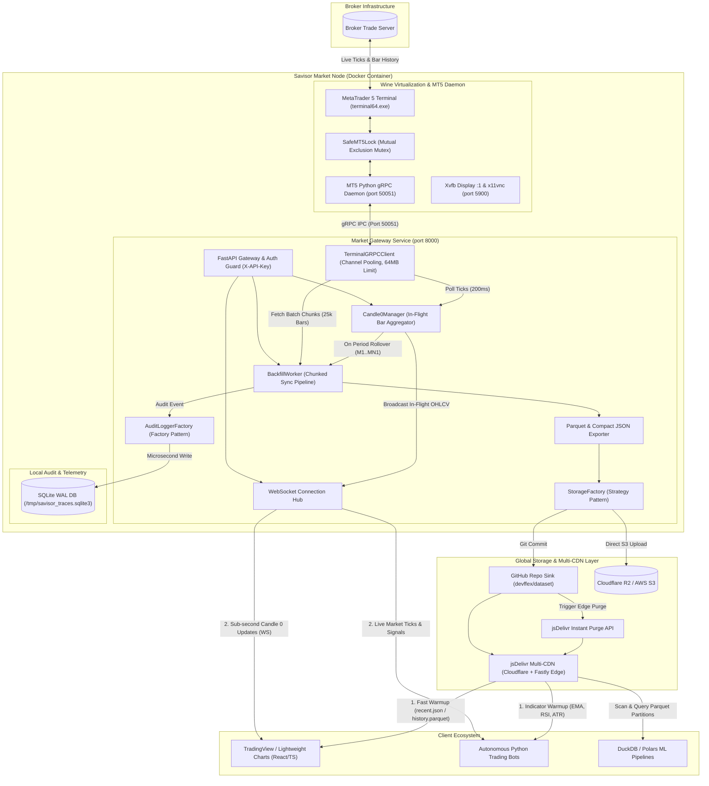

# Architecture & System Design Manual

The **Savisor Market Node** is an autonomous market data collection, real-time in-flight **Candle 0** engine, and historical dataset pipeline designed for MetaTrader 5 broker terminals.

---

## 1. System Architecture Overview



---

## 2. Container Process Supervision Matrix

All container services are isolated and orchestrated via `supervisord` (`/etc/supervisord.conf`):

| Service | Process / Binary | Role | Port |
|---|---|---|---|
| **`xvfb`** | `Xvfb :1 -screen 0 1920x1080x16` | Headless virtual X11 display buffer for Wine. | Internal |
| **`x11vnc`** | `x11vnc -display :1 -rfbauth ...` | Remote desktop server for one-time broker setup. | `5900` |
| **`wine`** | `terminal64.exe /portable` | Native Windows MetaTrader 5 trading terminal. | Outbound |
| **`api`** | `grpc_server.py 50051` | Windows Python gRPC daemon with `SafeMT5Lock` (64MB message buffers). | `50051` (internal) |
| **`market-gateway`** | `uvicorn app.main:app --port 8000` | Linux Python REST API, WebSocket broadcaster & pipeline worker. | `8000` |

---

## 3. Thread Safety & Mutex Locking (`SafeMT5Lock`)

MetaTrader 5's native C-API and Python bindings are strictly single-threaded per process. Concurrent calls to `mt5.copy_rates_from_pos` or `mt5.symbol_info_tick` can corrupt terminal memory or cause segmentation faults.

To guarantee 100% thread safety:
* The internal Windows gRPC daemon wraps every MT5 library call inside `SafeMT5Lock` (a reentrant threading mutex).
* The Market Gateway manages symbol-specific asyncio locks (`_sync_locks[symbol]`) in `BackfillWorker` to prevent concurrent pipeline write operations on the same asset partition.

---

## 4. High-Throughput gRPC Buffer Architecture (64MB)

Broker catalogs for large multi-asset brokerages (containing thousands of currency pairs, crypto pairs, and equities) generate payloads exceeding 25MB of protobuf data.
* Both the gRPC Server (`docker/daemon/grpc_server.py`) and gRPC Client (`apps/market-gateway/src/grpc_client.py`) explicitly configure:
  ```python
  options = [
      ("grpc.max_send_message_length", 64 * 1024 * 1024),
      ("grpc.max_receive_message_length", 64 * 1024 * 1024),
  ]
  ```
* Prevents `RESOURCE_EXHAUSTED` payload errors when querying complete broker asset catalogs.

---

## 5. Network & Port Allocation

| Port | Protocol | Exposure | Description |
|---|---|---|---|
| `8000` | HTTP / WebSocket | Public / Reverse Proxy | FastAPI gateway, REST endpoints, and live WebSocket streaming. |
| `5900` | RFB / VNC | Localhost / Private VPN | TigerVNC remote desktop for initial broker account setup. |
| `50051` | gRPC over TCP | Container Internal | High-speed IPC bridge between Linux Python gateway and Windows Wine MT5. |


---

## 6. Backend Design Patterns Implementation Matrix

The Savisor Market Node adheres to strict enterprise software design patterns from the `.agents/skills/backend-design-patterns` handbook:

| Pattern | Category | Implementation in Codebase | Plain-English Purpose |
|---|---|---|---|
| **Factory Pattern** | Creational | `StorageFactory.get_backend()` & `AuditLoggerFactory.get_sink()` | Dynamically instantiates the active storage backend (`github`, `s3`, `local`) and telemetry sink (`sqlite`, `external`) based on environment configuration. |
| **Strategy Pattern** | Behavioral | `StorageBackend` (`GitHubStorageBackend`, `S3StorageBackend`, `LocalStorageBackend`) | Defines swappable storage algorithms (`upload_bytes`, `read_bytes`, `get_public_url`) allowing data sinks to be changed without modifying backfill logic. |
| **Observer (Pub/Sub) Pattern** | Behavioral | `EventBroadcaster` & `Candle0Manager.register_close_callback()` | Decouples in-flight tick polling from WebSocket broadcasts, SSE telemetry listeners, and incremental historical rollups. |
| **Composite Pattern** | Structural | `CompositeAuditSink` | Groups multiple audit sinks (`SQLiteAuditSink` + `ExternalHTTPAuditSink`) behind a single unified `AuditSink` interface. |
| **Adapter Pattern** | Structural | `TerminalGRPCClient` | Adapts raw Protobuf gRPC stubs into clean Pythonic dictionaries and typed methods. |
| **Stream Sink Pattern** | Structural | `StreamParquetSink` | Manages in-memory buffering, staged local temporary chunk creation, atomic storage commits, and safe `abort()` rollbacks. |
| **Repository Pattern** | Architectural | `SQLiteAuditSink` | Encapsulates SQLite WAL persistence, table schema migrations, and parameterized query execution away from core API handlers. |
| **Dependency Injection** | Creational | `BackfillWorker(grpc_client, storage_backend, audit_sink)` | Injects explicit dependencies in `__init__`, enabling clean test mocking and decoupled composition. |

---

## 7. The 12-Perspective Unit Testing Framework

Test coverage is verified across all 12 core perspectives defined in `.agents/skills/unit-testing`:

```mermaid
flowchart LR
    subgraph Functional ["1. Functional Baseline"]
        P1["P1: Happy Path (test_api.py, test_candle0.py)"]
        P2["P2: Error Handling (test_api.py, test_telemetry.py)"]
        P3["P3: Boundary Value Analysis (test_parquet.py, test_stream_sink.py)"]
    end
    subgraph Robustness ["2. Robustness & Lifecycle"]
        P4["P4: Edge Cases & Extremes (test_health_monitor.py)"]
        P5["P5: State & Lifecycle (test_pipeline_control)"]
        P6["P6: Concurrency & Async (test_sqlite_wal, test_event_broadcaster)"]
    end
    subgraph Integrity ["3. Integrity & Security"]
        P7["P7: Resource Cleanup (test_stream_sink_abort)"]
        P8["P8: Security & Sanitization (test_sqlite_sql_injection)"]
        P9["P9: Idempotency & Purity (test_merge_rates, test_health_monitor)"]
    end
    subgraph Constraints ["4. Contracts & Constraints"]
        P10["P10: Performance Budgets (test_sqlite_wal_perf)"]
        P11["P11: Schema & Type Contracts (test_parquet_round_trip)"]
        P12["P12: UTC Timezone Determinism (test_audit_record_timestamp_utc)"]
    end

    Functional --> Robustness --> Integrity --> Constraints
```



| # | Perspective Dimension | Primary Test Suite | Key Assertions |
|---|---|---|---|
| **1** | **Happy Path** | `tests/test_api.py`, `tests/test_candle0.py` | Nominal HTTP 200 codes, tick aggregation into in-flight Candle 0 OHLCV, backfill triggers. |
| **2** | **Error Handling & Exceptions** | `tests/test_api.py`, `tests/test_telemetry.py` | 401 Unauthorized on invalid API keys, unwritable SQLite fallback, 500 on uninitialized clients. |
| **3** | **Boundary Value Analysis (BVA)** | `tests/test_parquet.py`, `tests/test_stream_sink.py` | Operational thresholds (`count=1` vs `count=10000`), zero candle inputs, batch chunk flush limits ($25,000$). |
| **4** | **Edge Cases & Extremes** | `tests/test_health_monitor.py` | Stale price feed threshold crossings ($15s$ WARN, $45s$ ERROR), empty watchlist, extreme Unicode payloads. |
| **5** | **State & Lifecycle Verification** | `tests/test_api.py`, `tests/test_candle0.py` | Node Started $\to$ Globally Paused $\to$ Per-Symbol Paused $\to$ Exclusive Ingestion $\to$ Resumed $\to$ Stopped. |
| **6** | **Concurrency & Asynchrony** | `tests/test_telemetry.py`, `tests/test_api.py` | Parallel SQLite WAL writes, symbol-specific asyncio mutexes, async SSE queue broadcast. |
| **7** | **Resource Management & Teardown** | `tests/test_stream_sink.py` | Clean deletion of temporary chunk directories upon `sink.close()` and `sink.abort()`. |
| **8** | **Security & Input Sanitization** | `tests/test_telemetry.py`, `tests/test_api.py` | SQL injection defense in SQLite queries (`' OR '1'='1`), path traversal defenses, API key header protection. |
| **9** | **Idempotency, Purity & Side-Effects** | `tests/test_parquet.py`, `tests/test_health_monitor.py` | Idempotent Parquet merges without duplicate timestamps; pure diagnostic health checks without side-effects. |
| **10** | **Performance Budgets & Complexity** | `tests/test_telemetry.py` | Microsecond SQLite WAL write budget ($<5\text{ms}$ average), memory-bounded TTLCache. |
| **11** | **Schema & Type Contracts** | `tests/test_parquet.py` | Strict Parquet Snappy schema `[time, open, high, low, close, tick_volume]`, compact JSON tuple structure. |
| **12** | **Timezones & UTC Determinism** | `tests/test_telemetry.py`, `tests/test_parquet.py` | Explicit ISO 8601 UTC parsing, Unix epoch seconds timestamp arithmetic. |

