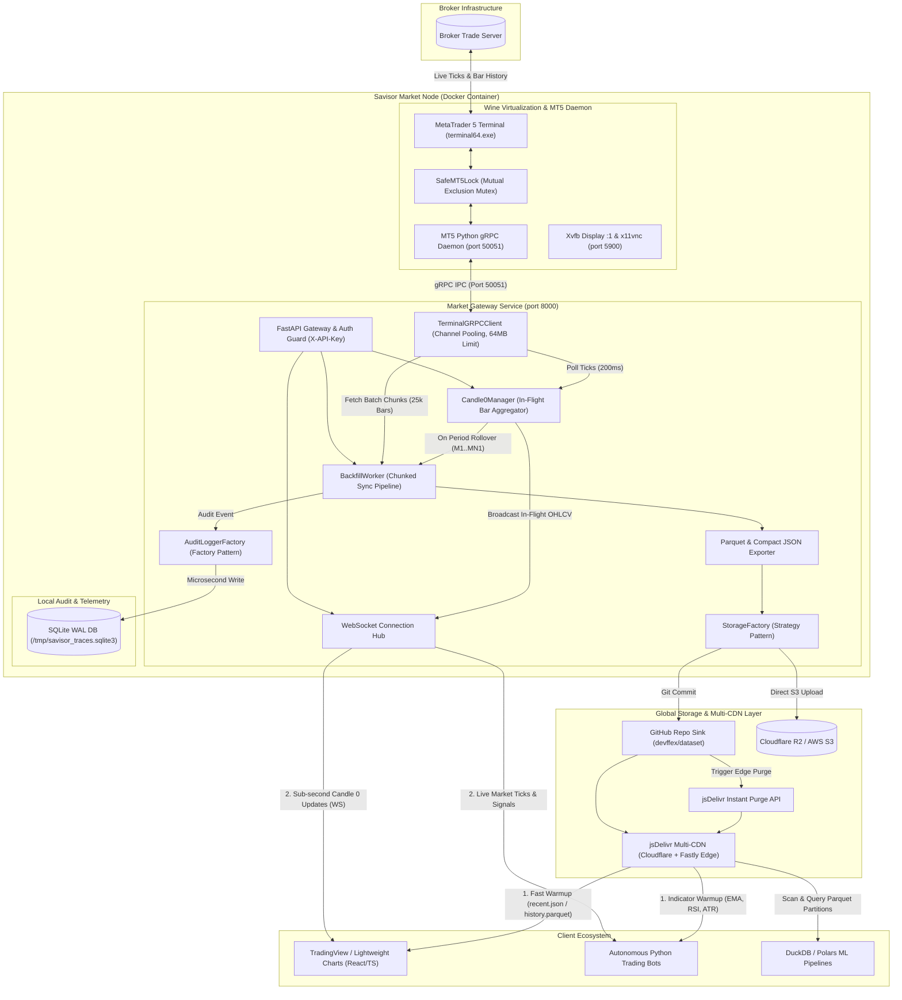

# Architecture & System Design Manual

The **Savisor Market Node** is an autonomous market data collection, real-time in-flight **Candle 0** engine, and historical dataset pipeline designed for MetaTrader 5 broker terminals.

---

## 1. System Architecture Overview



---

## 2. Container Process Supervision Matrix

All container services are isolated and orchestrated via `supervisord` (`/etc/supervisord.conf`):

| Service | Process / Binary | Role | Port |
|---|---|---|---|
| **`xvfb`** | `Xvfb :1 -screen 0 1920x1080x16` | Headless virtual X11 display buffer for Wine. | Internal |
| **`x11vnc`** | `x11vnc -display :1 -rfbauth ...` | Remote desktop server for one-time broker setup. | `5900` |
| **`wine`** | `terminal64.exe /portable` | Native Windows MetaTrader 5 trading terminal. | Outbound |
| **`api`** | `grpc_server.py 50051` | Windows Python gRPC daemon with `SafeMT5Lock` (64MB message buffers). | `50051` (internal) |
| **`market-gateway`** | `uvicorn app.main:app --port 8000` | Linux Python REST API, WebSocket broadcaster & pipeline worker. | `8000` |

---

## 3. Thread Safety & Mutex Locking (`SafeMT5Lock`)

MetaTrader 5's native C-API and Python bindings are strictly single-threaded per process. Concurrent calls to `mt5.copy_rates_from_pos` or `mt5.symbol_info_tick` can corrupt terminal memory or cause segmentation faults.

To guarantee 100% thread safety:
* The internal Windows gRPC daemon wraps every MT5 library call inside `SafeMT5Lock` (a reentrant threading mutex).
* The Market Gateway manages symbol-specific asyncio locks (`_sync_locks[symbol]`) in `BackfillWorker` to prevent concurrent pipeline write operations on the same asset partition.

---

## 4. High-Throughput gRPC Buffer Architecture (64MB)

Broker catalogs for large multi-asset brokerages (containing thousands of currency pairs, crypto pairs, and equities) generate payloads exceeding 25MB of protobuf data.
* Both the gRPC Server (`docker/daemon/grpc_server.py`) and gRPC Client (`apps/market-gateway/src/grpc_client.py`) explicitly configure:
  ```python
  options = [
      ("grpc.max_send_message_length", 64 * 1024 * 1024),
      ("grpc.max_receive_message_length", 64 * 1024 * 1024),
  ]
  ```
* Prevents `RESOURCE_EXHAUSTED` payload errors when querying complete broker asset catalogs.

---

## 5. Network & Port Allocation

| Port | Protocol | Exposure | Description |
|---|---|---|---|
| `8000` | HTTP / WebSocket | Public / Reverse Proxy | FastAPI gateway, REST endpoints, and live WebSocket streaming. |
| `5900` | RFB / VNC | Localhost / Private VPN | TigerVNC remote desktop for initial broker account setup. |
| `50051` | gRPC over TCP | Container Internal | High-speed IPC bridge between Linux Python gateway and Windows Wine MT5. |
