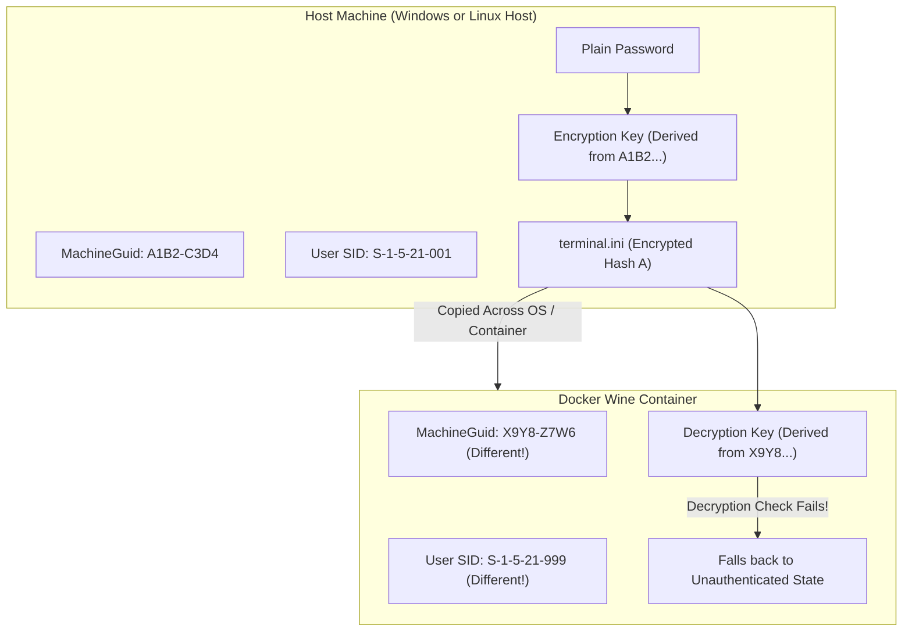
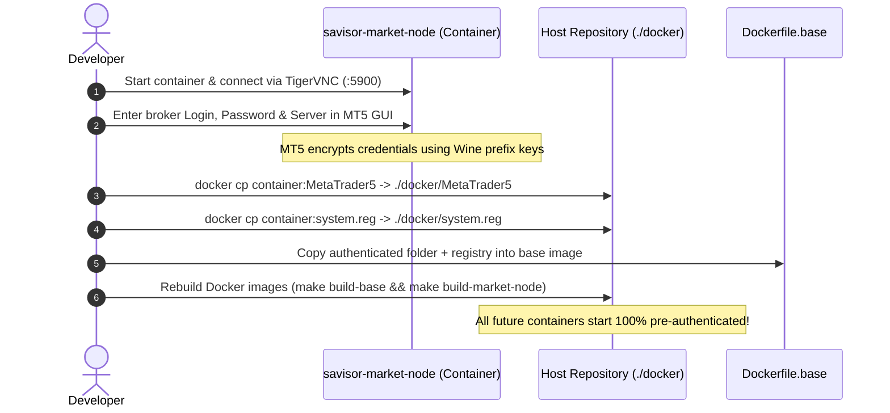
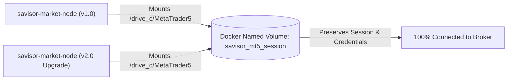

# MetaTrader 5 Authentication Persistence & Cross-System Portability Guide

A comprehensive guide explaining why MetaTrader 5 credentials fail when copied across operating systems or containers, and how to resolve this using 4 production-grade persistence strategies.

---

## 1. Why the "Hash / Deserialization" Problem Occurs

When you log into a broker account on MetaTrader 5, the terminal saves your login and encrypted password inside:
* `C:\MetaTrader5\config\terminal.ini`
* `C:\MetaTrader5\bases\<Broker-Server>\`

### The Machine-Bound Cryptographic Salt
MetaTrader 5 does **not** store passwords in plain text. Instead, it encrypts them using Windows DPAPI (Data Protection API) and proprietary machine fingerprinting algorithms. The encryption key is derived from:

1. **Windows Registry `MachineGuid`**: Found at `HKEY_LOCAL_MACHINE\Software\Microsoft\Cryptography\MachineGuid`.
2. **User & Computer SIDs**: The Windows / Wine security identifier assigned to the user profile.
3. **Hardware & Volume Serial Numbers**: The virtual disk serial number and CPU identity.



### The Breakdown
When you copy a "portable" `MetaTrader5/` directory from Windows or a different Linux machine into a new Docker container, the Wine prefix generates a brand-new `MachineGuid` and user SID. When MT5 boots, it detects a mismatch between the encryption key and the stored hash in `terminal.ini`, discards the stored credentials, and opens in a disconnected, unauthenticated state.

---

## 2. The 4 Workaround Strategies

Here are the 4 best strategies to achieve permanent authentication, ranked from simplest to most robust:

---

### Strategy 1: Container-to-Host Snapshot (Pre-Baked Image)

> **Best For**: Rapid local prototyping, offline testing, and standalone Docker images.

#### How It Works
Instead of authenticating on your host PC and copying into the container, you authenticate **inside the exact Wine container environment**. Because the encryption keys are created by the container's Wine prefix, copying those files back into the Docker build context ensures that future container images boot pre-authenticated.



#### Step-by-Step Execution Guide:

**Step 1: Start the container and log in via TigerVNC**:
```bash
# Connect with TigerVNC
vncviewer localhost:5900
```
In MetaTrader 5:
1. Go to `File -> Login to Trade Account`.
2. Enter your Broker **Login**, **Password**, and **Server**.
3. Check **Save password** and click **OK**.
4. Confirm green/blue signal bars in the bottom right corner.

**Step 2: Copy the authenticated files from the container to your host**:
```bash
# Copy the authenticated MT5 directory
docker cp savisor-market-node:/home/wine/.wine/drive_c/MetaTrader5 ./docker/MetaTrader5

# Copy the Wine registry files (preserves MachineGuid & SIDs)
docker cp savisor-market-node:/home/wine/.wine/system.reg ./docker/system.reg
docker cp savisor-market-node:/home/wine/.wine/user.reg ./docker/user.reg
```

**Step 3: Rebuild your local base image**:
```bash
make build-base
make build-market-node
```
Every new container built from this image will boot pre-authenticated.

---

### Strategy 2: Persistent Docker Named Volume (Recommended for Single-Node Deployments)

> **Best For**: Single-node production servers, VPS instances, and long-running Docker nodes.

#### How It Works
Instead of modifying Docker images, persist the entire `MetaTrader5` directory and Wine prefix on a dedicated Docker volume. You log in once; when you update or restart the container, the session remains permanently active.



#### How to execute it:

```bash
# 1. Create a persistent named volume
docker volume create savisor_mt5_data

# 2. Run your container mounting the volume
docker run -it --rm --name savisor-market-node \
  -p 8000:8000 \
  -p 5900:5900 \
  -v savisor_mt5_data:/home/wine/.wine/drive_c/MetaTrader5 \
  -e SAVISOR_API_KEY="your_secret_api_key_here" \
  -e VNC_PASSWORD="your_vnc_password_here" \
  -e STORAGE_BACKEND="github" \
  -e GITHUB_TOKEN="ghp_yourPersonalAccessTokenHere" \
  -e GITHUB_REPO="your_org/dataset" \
  -e GITHUB_BRANCH="main" \
  savisor-market-node:latest
```

**Docker Compose Configuration**:
```yaml
services:
  market-node:
    image: savisor-market-node:latest
    ports:
      - "8000:8000"
      - "5900:5900"
    volumes:
      - savisor_mt5_data:/home/wine/.wine/drive_c/MetaTrader5
    env_file:
      - .env

volumes:
  savisor_mt5_data:
    driver: local
```

* **Advantage**: Zero rebuilds required when changing broker passwords. Log in once via VNC; the volume preserves the session forever.

---

### Strategy 3: Programmatic API Login (`mt5.initialize()`) — *Zero Manual Interaction*

> **Best For**: Automated CI/CD, Kubernetes auto-scaling clusters, and fully autonomous deployments.

#### How It Works
The MetaTrader 5 Python library accepts broker credentials directly in the `initialize()` method. This completely bypasses the encrypted `terminal.ini` file on disk.

```python
import os
import MetaTrader5 as mt5

# In docker/daemon/grpc_server.py
login = int(os.getenv("MT5_LOGIN", "0"))
password = os.getenv("MT5_PASSWORD", "")
server = os.getenv("MT5_SERVER", "")

if login and password and server:
    # Programmatic headless login on every startup
    initialized = mt5.initialize(
        path=r"C:\MetaTrader5\terminal64.exe",
        login=login,
        password=password,
        server=server,
        portable=True,
        timeout=60000
    )
else:
    # Standard fallback to saved GUI session
    initialized = mt5.initialize(
        path=r"C:\MetaTrader5\terminal64.exe",
        portable=True,
        timeout=60000
    )
```

#### How to execute it:
Simply pass your broker credentials as container environment variables:

```bash
docker run -it --rm --name savisor-market-node \
  -p 8000:8000 \
  -e MT5_LOGIN="111718618" \
  -e MT5_PASSWORD="your_broker_password" \
  -e MT5_SERVER="MetaQuotes-Demo" \
  -e SAVISOR_API_KEY="your_secret_api_key_here" \
  savisor-market-node:latest
```

* **Advantage**: **100% headless**. Zero VNC viewer needed, zero file copying, and works across any cloud provider (AWS ECS, Google Cloud Run, Kubernetes).

---

### Strategy 4: Automated Headless `startup.ini` File

> **Best For**: Environments where Python `mt5.initialize()` parameters are not used, but zero GUI interaction is desired.

#### How It Works
MetaTrader 5 supports a command-line switch `/config:<path>` to read plaintext login credentials on startup and generate its local cryptographic keys dynamically:

**1. Create a `startup.ini` template inside `docker/MetaTrader5/config/startup.ini`**:
```ini
[Common]
Login=111718618
Password=your_broker_password
Server=MetaQuotes-Demo
EnableNews=0
```

**2. Launch MetaTrader 5 via supervisord**:
```ini
[program:wine]
command=wine C:\MetaTrader5\terminal64.exe /portable /config:C:\MetaTrader5\config\startup.ini
```

* **Advantage**: MetaTrader 5 reads the credentials at boot, establishes the network connection, and generates its internal session automatically.

---

## 3. Strategy Comparison & Decision Matrix

| Dimension | Strategy 1: Container Snapshot | Strategy 2: Persistent Volume | Strategy 3: Programmatic API | Strategy 4: `startup.ini` |
|---|---|---|---|---|
| **Manual Steps** | VNC login once + file copy | VNC login once per volume | **Zero (100% automated)** | Create ini file |
| **Secrets in Image** | Encrypted binary in image | Stored in volume | **None (Env variables)** | Plaintext in ini |
| **Portability across OS** | High (contained in image) | Medium (host volume) | **Maximum (Cloud native)** | High |
| **Kubernetes / CI/CD** | Low (hard to automate) | Medium (PVC required) | **Ideal (Env secrets)** | Good (ConfigMaps) |
| **Recovery on Crash** | Instant | Instant | Instant | Instant |

---

## 4. Final Recommendation

1. **For Local Development & Fast Image Testing**:
   * Use **Strategy 1** (Log in inside the container once $\to$ `docker cp` to host $\to$ rebuild).
2. **For Production VPS / Single Docker Server**:
   * Use **Strategy 2** (Mount `savisor_mt5_data:/home/wine/.wine/drive_c/MetaTrader5` volume).
3. **For Autonomous Cloud & CI/CD Pipelines**:
   * Use **Strategy 3** (Pass `MT5_LOGIN`, `MT5_PASSWORD`, `MT5_SERVER` as container environment variables).
