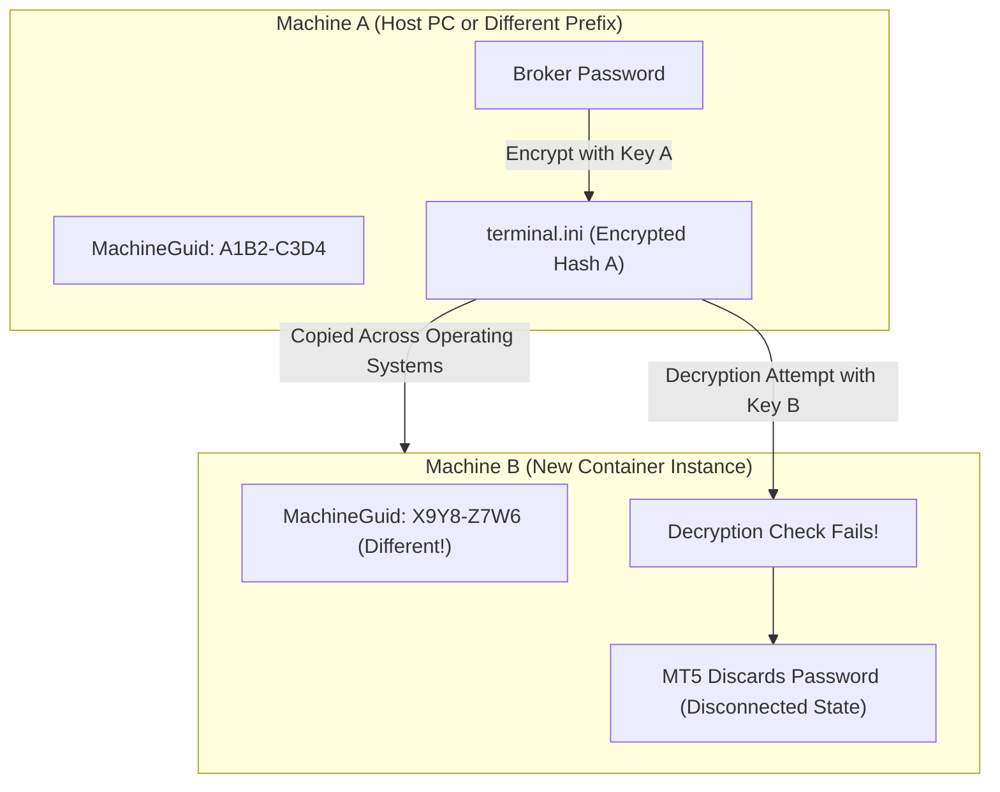
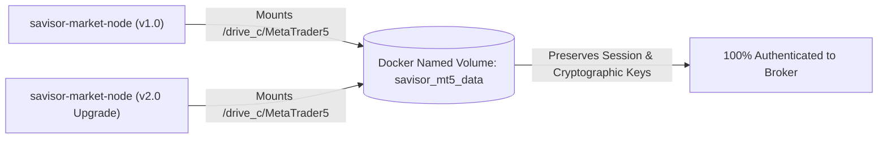

# MetaTrader 5 Authentication Persistence Guide (Docker Named Volumes)

This guide explains why MetaTrader 5 broker credentials fail when copying portable files across machines, and documents the single recommended production approach: **Persistent Docker Named Volumes**.

---

## 1. Why the "Hash / Deserialization" Problem Occurs

When you log into a broker account on MetaTrader 5, the terminal saves your login and encrypted password inside `C:\MetaTrader5\config\terminal.ini` and `C:\MetaTrader5\bases\<Broker-Server>\`.

### The Machine-Bound Cryptographic Salt
MetaTrader 5 does **not** store passwords in plain text. Instead, it encrypts them using Windows DPAPI and machine-specific cryptographic salts derived from:

1. **Windows Registry `MachineGuid`**: Located at `HKEY_LOCAL_MACHINE\Software\Microsoft\Cryptography\MachineGuid`.
2. **User & Computer SIDs**: The Windows / Wine security identifier assigned to the user profile.
3. **Volume Serial Numbers**: Virtual disk identifiers.



### The Breakdown
When you copy a portable `MetaTrader5/` directory from a host PC into a newly created container, the Wine prefix has a different `MachineGuid` and user SID. When MT5 attempts to decrypt `terminal.ini`, the cryptographic check fails, the password is discarded, and the terminal starts disconnected.

---

## 2. The Recommended Solution: Persistent Docker Named Volume

The recommended, production-grade approach is to **persist the entire MetaTrader 5 installation and its Wine session on a Docker Named Volume**.

### Why This Works
* When you run the container with a named volume, the container's Wine environment initializes its specific `MachineGuid` and registry keys directly on that volume.
* You connect **once** via TigerVNC (`vncviewer localhost:5900`) and log into your broker account.
* MetaTrader 5 encrypts the password matching the volume's Wine prefix keys.
* When you stop, upgrade, or recreate the container, the volume retains the authenticated session. New containers attach to the existing volume and **start 100% authenticated immediately with zero manual steps**.



---

## 3. Step-by-Step Setup Guide

### Step 1: Create the Named Volume

```bash
docker volume create savisor_mt5_data
```

### Step 2: Run the Container with the Volume Attached

```bash
docker run -it --rm --name savisor-market-node \
  -p 8000:8000 \
  -p 5900:5900 \
  -v savisor_mt5_data:/home/wine/.wine/drive_c/MetaTrader5 \
  -e SAVISOR_API_KEY="your_secret_api_key_here" \
  -e VNC_PASSWORD="your_vnc_password_here" \
  -e STORAGE_BACKEND="github" \
  -e GITHUB_TOKEN="ghp_yourPersonalAccessTokenHere" \
  -e GITHUB_REPO="your_organization/your_dataset_repo" \
  -e GITHUB_BRANCH="main" \
  -e AUDIT_LOG_SINK="sqlite" \
  savisor-market-node:latest
```

### Step 3: Perform the One-Time Broker Login via TigerVNC

1. Connect to the running container:
   ```bash
   vncviewer localhost:5900
   ```
2. Enter your VNC password (`your_vnc_password_here`).
3. In MetaTrader 5, go to `File -> Login to Trade Account`.
4. Enter your Broker **Login**, **Password**, and select your broker **Server**.
5. Check **Save password** and click **OK**.
6. Confirm the green/blue connection signal in the bottom right corner.
7. **Close TigerVNC**: You can close TigerVNC permanently.

---

## 4. Docker Compose Setup (Recommended for Production)

Configure your `docker-compose.yml` to use named volumes automatically:

```yaml
version: "3.8"

services:
  market-node:
    image: savisor-market-node:latest
    build:
      context: ../../
      dockerfile: docker/Dockerfile.market-gateway
    container_name: savisor-market-node
    restart: unless-stopped
    ports:
      - "8000:8000"
      - "5900:5900"
    volumes:
      - savisor_mt5_data:/home/wine/.wine/drive_c/MetaTrader5
    env_file:
      - .env

volumes:
  savisor_mt5_data:
    driver: local
```

### Upgrading the Node
When deploying new code versions or updated Docker images:
```bash
# 1. Pull / Rebuild the new image
docker compose build

# 2. Restart the service (the named volume preserves login state)
docker compose up
```
The node will boot, mount `savisor_mt5_data`, connect to the broker immediately, and resume data streaming and pipeline operations with zero downtime and zero manual VNC interaction.
