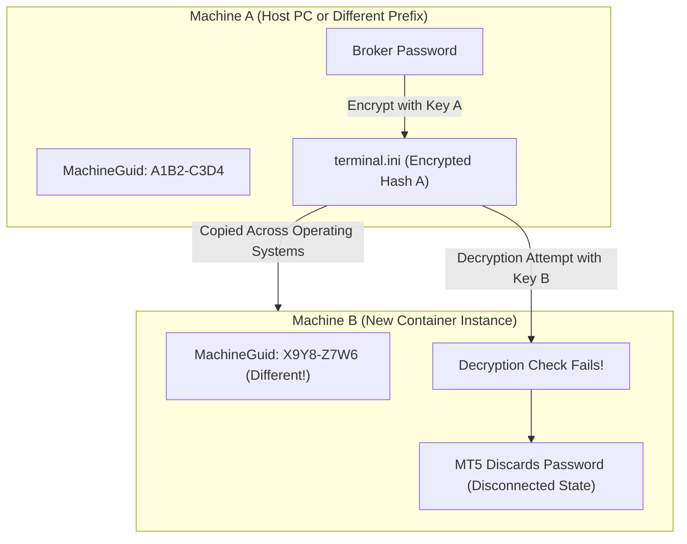
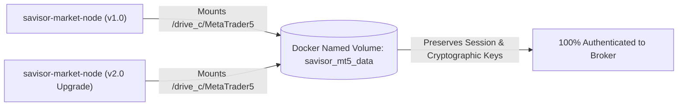
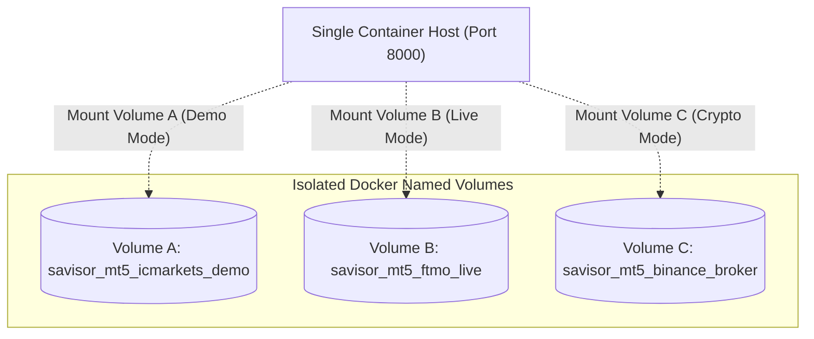
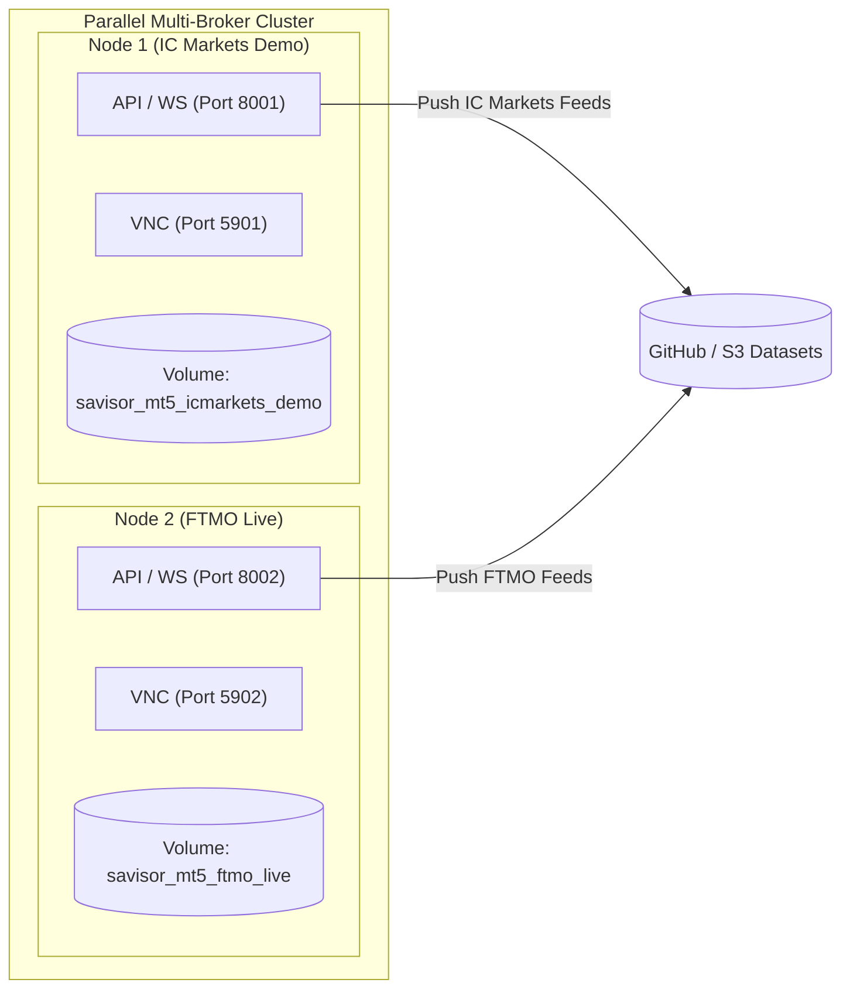

# MetaTrader 5 Authentication Persistence Guide (Docker Named Volumes)

This guide explains why MetaTrader 5 broker credentials fail when copying portable files across machines, and documents the production approach using **Persistent Docker Named Volumes** for single-node setups, on-demand broker switching, and parallel multi-broker ingestion.

---

## 1. Why the "Hash / Deserialization" Problem Occurs

When you log into a broker account on MetaTrader 5, the terminal saves your login and encrypted password inside `C:\MetaTrader5\config\terminal.ini` and `C:\MetaTrader5\bases\<Broker-Server>\`.

### The Machine-Bound Cryptographic Salt
MetaTrader 5 does **not** store passwords in plain text. Instead, it encrypts them using Windows DPAPI and machine-specific cryptographic salts derived from:

1. **Windows Registry `MachineGuid`**: Located at `HKEY_LOCAL_MACHINE\Software\Microsoft\Cryptography\MachineGuid`.
2. **User & Computer SIDs**: The Windows / Wine security identifier assigned to the user profile.
3. **Volume Serial Numbers**: Virtual disk identifiers.



### The Breakdown
When you copy a portable `MetaTrader5/` directory from a host PC into a newly created container, the Wine prefix has a different `MachineGuid` and user SID. When MT5 attempts to decrypt `terminal.ini`, the cryptographic check fails, the password is discarded, and the terminal starts disconnected.

---

## 2. The Core Solution: Persistent Docker Named Volumes

The production-grade solution is to **persist the entire MetaTrader 5 installation and its Wine session on a Docker Named Volume**.

### Why This Works
* When you run the container with a named volume, the container's Wine environment initializes its specific `MachineGuid` and registry keys directly on that volume.
* You connect **once** via TigerVNC (`vncviewer localhost:5900`) and log into your broker account.
* MetaTrader 5 encrypts the password matching the volume's Wine prefix keys.
* When you stop, upgrade, or recreate the container, the volume retains the authenticated session. New containers attach to the existing volume and **start 100% authenticated immediately with zero manual steps**.



---

## 3. Single-Node Setup Guide (Step-by-Step)

### Step 1: Create the Named Volume

```bash
docker volume create savisor_mt5_data
```

### Step 2: Run the Container with the Volume Attached

```bash
docker run -it --rm --name savisor-market-node \
  -p 8000:8000 \
  -p 5900:5900 \
  -v savisor_mt5_data:/home/wine/.wine/drive_c/MetaTrader5 \
  -e SAVISOR_API_KEY="your_secret_api_key_here" \
  -e VNC_PASSWORD="your_vnc_password_here" \
  -e STORAGE_BACKEND="github" \
  -e GITHUB_TOKEN="ghp_yourPersonalAccessTokenHere" \
  -e GITHUB_REPO="your_organization/your_dataset_repo" \
  -e GITHUB_BRANCH="main" \
  -e AUDIT_LOG_SINK="sqlite" \
  savisor-market-node:latest
```

### Step 3: Perform the One-Time Broker Login via TigerVNC

1. Connect to the running container:
   ```bash
   vncviewer localhost:5900
   ```
2. Enter your VNC password (`your_vnc_password_here`).
3. In MetaTrader 5, go to `File -> Login to Trade Account`.
4. Enter your Broker **Login**, **Password**, and select your broker **Server**.
5. Check **Save password** and click **OK**.
6. Confirm the green/blue connection signal in the bottom right corner.
7. **Close TigerVNC**: You can close TigerVNC permanently.

---

### Step 4: Docker Compose Setup (Single Node)

Configure your `docker-compose.yml` to use named volumes automatically:

```yaml
version: "3.8"

services:
  market-node:
    image: savisor-market-node:latest
    build:
      context: ../../
      dockerfile: docker/Dockerfile.market-gateway
    container_name: savisor-market-node
    restart: unless-stopped
    ports:
      - "8000:8000"
      - "5900:5900"
    volumes:
      - savisor_mt5_data:/home/wine/.wine/drive_c/MetaTrader5
    env_file:
      - .env

volumes:
  savisor_mt5_data:
    driver: local
```

---

## 4. Pattern 1: Switching Between Broker Accounts on a Single Container

One of the biggest advantages of Docker named volumes is filesystem isolation. You can maintain multiple dedicated volumes for different broker accounts (e.g. Demo vs. Live, or multiple prop firms) and **hot-swap between them on demand on a single container host**.



### Step 1: Create Distinct Named Volumes per Broker

```bash
# Broker A: IC Markets Demo
docker volume create savisor_mt5_icmarkets_demo

# Broker B: FTMO Live Account
docker volume create savisor_mt5_ftmo_live
```

---

### Step 2: Authenticate Each Volume Once

* **Authenticate Broker A (IC Markets)**:
  ```bash
  docker run -it --rm --name savisor-market-node \
    -p 8000:8000 -p 5900:5900 \
    -v savisor_mt5_icmarkets_demo:/home/wine/.wine/drive_c/MetaTrader5 \
    savisor-market-node:latest
  ```
  Connect via VNC (`vncviewer localhost:5900`), log into **IC Markets**, verify connection, and exit (`Ctrl+C`).

* **Authenticate Broker B (FTMO)**:
  ```bash
  docker run -it --rm --name savisor-market-node \
    -p 8000:8000 -p 5900:5900 \
    -v savisor_mt5_ftmo_live:/home/wine/.wine/drive_c/MetaTrader5 \
    savisor-market-node:latest
  ```
  Connect via VNC (`vncviewer localhost:5900`), log into **FTMO**, verify connection, and exit (`Ctrl+C`).

---

### Step 3: Switch Between Broker Accounts at Will

To run the container with **Broker A**:
```bash
docker run -it --rm --name savisor-market-node \
  -p 8000:8000 -p 5900:5900 \
  -v savisor_mt5_icmarkets_demo:/home/wine/.wine/drive_c/MetaTrader5 \
  --env-file .env.icmarkets \
  savisor-market-node:latest
```

To stop and switch to **Broker B**:
```bash
docker run -it --rm --name savisor-market-node \
  -p 8000:8000 -p 5900:5900 \
  -v savisor_mt5_ftmo_live:/home/wine/.wine/drive_c/MetaTrader5 \
  --env-file .env.ftmo \
  savisor-market-node:latest
```

* **Zero Re-Authentication**: Both volumes permanently preserve their respective broker server lists, encrypted tokens, cached symbol histories, and chart settings without conflicting.

---

## 5. Pattern 2: Running Multiple Broker Nodes Concurrently (Parallel Ingestion)

If you need to collect real-time data, stream WebSockets, or backfill from **multiple brokers simultaneously**, run multiple container instances side-by-side on distinct host ports, with each container attached to its dedicated volume:



---

### Complete Multi-Broker Compose Configuration (`docker-compose.multi.yml`)

```yaml
version: "3.8"

services:
  # ============================================================================
  # Node 1: IC Markets (Demo Ingestion & Testing)
  # ============================================================================
  market-node-icmarkets:
    image: savisor-market-node:latest
    container_name: savisor-node-icmarkets
    restart: unless-stopped
    ports:
      - "8001:8000"   # API & WebSockets accessible on host port 8001
      - "5901:5900"   # TigerVNC accessible on host port 5901
    volumes:
      - savisor_mt5_icmarkets_demo:/home/wine/.wine/drive_c/MetaTrader5
    env_file:
      - .env.icmarkets
    environment:
      - VNC_PASSWORD=vnc_icmarkets_pass

  # ============================================================================
  # Node 2: FTMO (Live Ingestion & Production Feeds)
  # ============================================================================
  market-node-ftmo:
    image: savisor-market-node:latest
    container_name: savisor-node-ftmo
    restart: unless-stopped
    ports:
      - "8002:8000"   # API & WebSockets accessible on host port 8002
      - "5902:5900"   # TigerVNC accessible on host port 5902
    volumes:
      - savisor_mt5_ftmo_live:/home/wine/.wine/drive_c/MetaTrader5
    env_file:
      - .env.ftmo
    environment:
      - VNC_PASSWORD=vnc_ftmo_pass

volumes:
  savisor_mt5_icmarkets_demo:
    driver: local
  savisor_mt5_ftmo_live:
    driver: local
```

---

### Managing the Multi-Broker Cluster

```bash
# 1. Start all broker nodes in parallel
docker compose -f docker-compose.multi.yml up -d

# 2. View logs for IC Markets node
docker compose -f docker-compose.multi.yml logs -f market-node-icmarkets

# 3. View logs for FTMO node
docker compose -f docker-compose.multi.yml logs -f market-node-ftmo

# 4. Check status of both nodes
docker compose -f docker-compose.multi.yml ps
```

---

## 6. Why This Architecture Is Optimal

1. **Zero Credential Collisions**: Each broker's encrypted DPAPI session lives on its own volume without overwriting other brokers.
2. **Instant Hot-Swapping**: Switching brokers takes less than 3 seconds (stopping the container and starting with another volume).
3. **Independent Caching & Backfilling**: Historical Parquet files, broker spreads, and symbol catalogs remain completely isolated.
4. **Resilient Multi-Feed Strategy**: Trading bots can connect to `ws://localhost:8001/api/v1/market/ws/EURUSD` (IC Markets) and `ws://localhost:8002/api/v1/market/ws/EURUSD` (FTMO) simultaneously for multi-broker spread monitoring and arbitrage.
