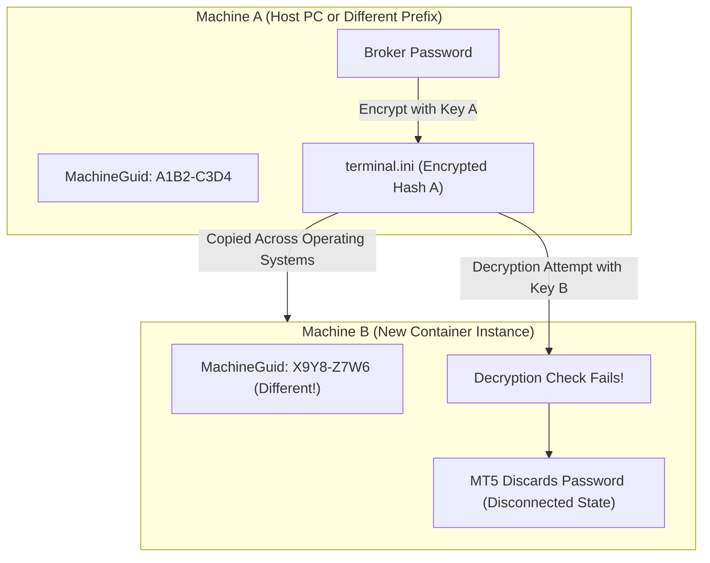
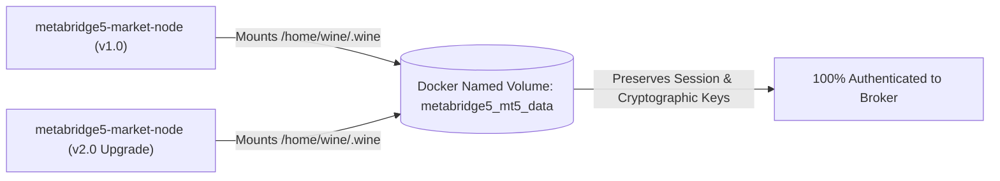
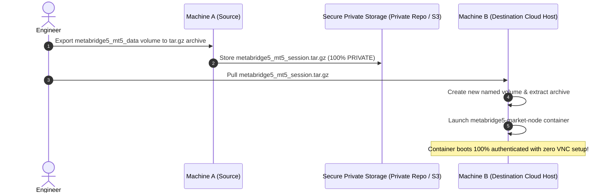
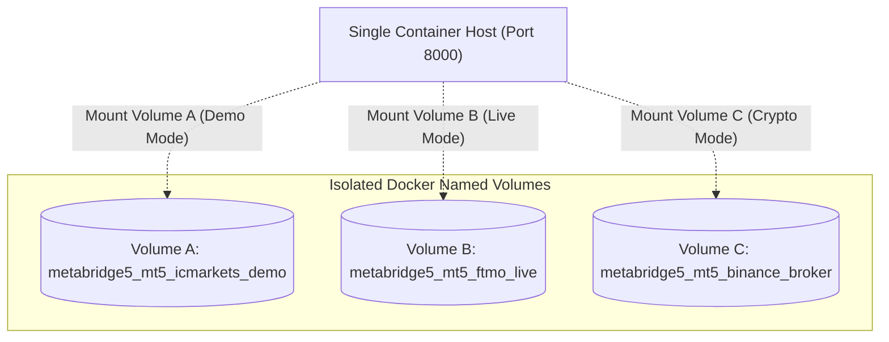
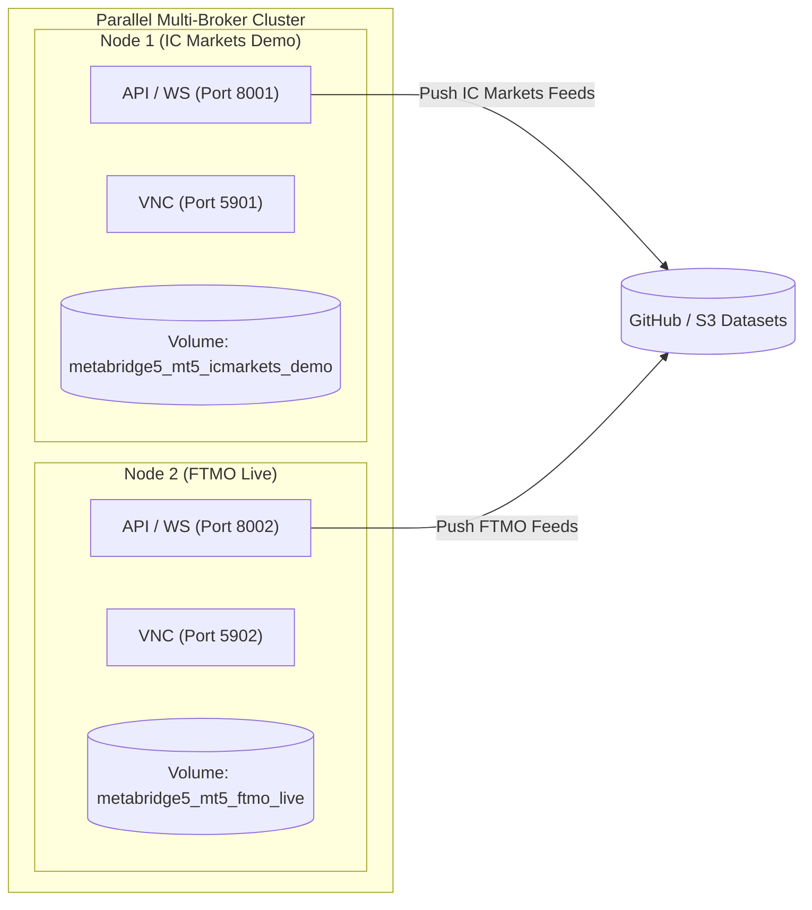
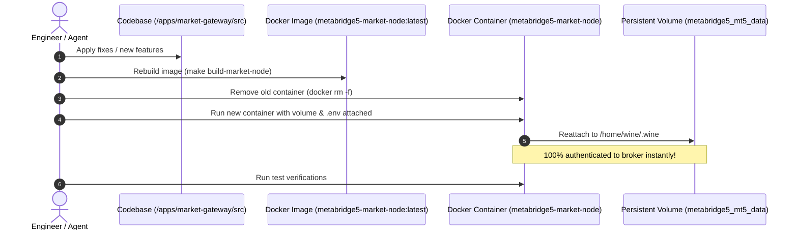

# MetaTrader 5 Authentication Persistence Guide (Docker Named Volumes)

This guide explains why MetaTrader 5 broker credentials fail when copying portable files across machines, and documents the production approach using **Persistent Docker Named Volumes** for volume creation, cross-machine archiving/restoration, on-demand broker switching, and parallel multi-broker ingestion using pure Docker CLI commands.

---

## 1. Why the "Hash / Deserialization" Problem Occurs

When you log into a broker account on MetaTrader 5, the terminal saves your login and encrypted password inside `C:\MetaTrader5\config\terminal.ini` and `C:\MetaTrader5\bases\<Broker-Server>\`.

### The Machine-Bound Cryptographic Salt
MetaTrader 5 does **not** store passwords in plain text. Instead, it encrypts them using Windows DPAPI and machine-specific cryptographic salts derived from:

1. **Windows Registry `MachineGuid`**: Located at `HKEY_LOCAL_MACHINE\Software\Microsoft\Cryptography\MachineGuid`.
2. **User & Computer SIDs**: The Windows / Wine security identifier assigned to the user profile.
3. **Volume Serial Numbers**: Virtual disk identifiers.



### The Breakdown
When you copy a portable `MetaTrader5/` directory from a host PC into a newly created container, the Wine prefix has a different `MachineGuid` and user SID. When MT5 attempts to decrypt `terminal.ini`, the cryptographic check fails, the password is discarded, and the terminal starts disconnected.

---

## 2. The Core Solution: Persistent Docker Named Volumes

The production-grade solution is to **persist the entire MetaTrader 5 installation and its Wine session on a Docker Named Volume**.

### Why This Works
* When you run the container with a named volume, the container's Wine environment initializes its specific `MachineGuid` and registry keys directly on that volume.
* You connect **once** via TigerVNC (`vncviewer localhost:5900`) and log into your broker account.
* MetaTrader 5 encrypts the password matching the volume's Wine prefix keys.
* When you stop, upgrade, or recreate the container, the volume retains the authenticated session. New containers attach to the existing volume and **start 100% authenticated immediately with zero manual steps**.



---

## 3. Single-Node Setup Guide (Step-by-Step)

### Step 1: Create the Named Volume

```bash
docker volume create metabridge5_mt5_data
```

---

### Step 2: Run the Container with the Volume Attached

```bash
docker run -it --rm --name metabridge5-market-node \
  -p 8000:8000 \
  -p 5900:5900 \
  -v metabridge5_mt5_data:/home/wine/.wine \
  --env-file apps/market-gateway/.env \
  metabridge5-market-node:latest
```

---

### Step 3: Perform the One-Time Broker Login via TigerVNC

1. Connect to the running container:
   ```bash
   vncviewer localhost:5900
   ```
2. Enter your VNC password (`your_vnc_password_here`).
3. In MetaTrader 5, go to `File -> Login to Trade Account`.
4. Enter your Broker **Login**, **Password**, and select your broker **Server**.
5. Check **Save password** and click **OK**.
6. Confirm the green/blue connection signal in the bottom right corner.
7. **Close TigerVNC**: You can close TigerVNC permanently.

---

### Step 4: Running in Background (Production)

Once authenticated, you can launch the container as a persistent background daemon:

```bash
docker run -d --name metabridge5-market-node \
  --restart unless-stopped \
  -p 8000:8000 \
  -p 5900:5900 \
  -v metabridge5_mt5_data:/home/wine/.wine \
  --env-file apps/market-gateway/.env \
  metabridge5-market-node:latest
```

---

## 4. Volume Backup, Export & Cross-Machine Portability (Archiving & Restoring)

Once you have provisioned and authenticated a volume on Machine A, you can export it into a compressed `.tar.gz` archive, store it securely, and restore it onto **any other Linux machine, VPS, or cloud host**.



---

### The Critical Technical Requirement: What You Must Archive

> [!IMPORTANT]
> **Capture the Entire Wine Prefix & Cryptographic Salts**:
> You must archive the entire `/home/wine/.wine` directory (which contains `drive_c/MetaTrader5` **plus** the Wine registry files `system.reg` and `user.reg`).
> 
> Because MetaTrader 5 encrypts login tokens using the `MachineGuid` stored in `system.reg`, capturing the full Wine prefix guarantees that when restored on Machine B, the cryptographic environment matches 100% and MT5 decrypts your credentials instantly without throwing security deletion errors.

---

### The Critical Security Rule

> [!CAUTION]
> **Store in 100% Private Locations Only**:
> The `metabridge5_mt5_session.tar.gz` archive contains your encrypted broker tokens and trading session states.
> * **Never** upload this archive to a public GitHub repository.
> * Store it **only** in a 100% private GitHub repository, private S3/Cloudflare R2 bucket, or an encrypted local drive.

---

### Step-by-Step Export and Restore Procedure

#### Step 1: Export from the Running Container on Machine A (Source Machine)
Run these commands on your original machine while `metabridge5-market-node` is running:

```bash
# 1. Create the compressed archive inside the running container
docker exec metabridge5-market-node tar -czf /tmp/metabridge5_mt5_session.tar.gz -C /home/wine/.wine .

# 2. Copy the archive directly to the apps/market-gateway directory
docker cp metabridge5-market-node:/tmp/metabridge5_mt5_session.tar.gz apps/market-gateway/metabridge5_mt5_session.tar.gz

# 3. Clean up the temporary archive inside the container
docker exec metabridge5-market-node rm -f /tmp/metabridge5_mt5_session.tar.gz
```

*The archive is saved to:*
```text
apps/market-gateway/metabridge5_mt5_session.tar.gz
```

---

#### Step 2: Store in a Secure Private Location
Upload `apps/market-gateway/metabridge5_mt5_session.tar.gz` to your **private repository** or private cloud object storage.

---

#### Step 3: Restore into a New Volume on Machine B (Destination Machine)
On your destination machine or cloud server (from the `apps/market-gateway` directory):

```bash
# 1. Create the named volume on Machine B
docker volume create metabridge5_mt5_data

# 2. Extract the archive into the new volume
docker run --rm \
  -v metabridge5_mt5_data:/to_volume \
  -v apps/market-gateway:/backup \
  alpine tar -xzf /backup/metabridge5_mt5_session.tar.gz -C /to_volume
```

---

#### Step 4: Launch the Container on Machine B

```bash
docker run -it --rm --name metabridge5-market-node \
  -p 8000:8000 \
  -p 5900:5900 \
  -v metabridge5_mt5_data:/home/wine/.wine \
  --env-file apps/market-gateway/.env \
  metabridge5-market-node:latest
```

### Result
The container on Machine B mounts the restored volume at `/home/wine/.wine`, detects the identical cryptographic session, and **boots 100% connected to your broker with zero manual VNC viewer interaction or password entry required**.

---

## 5. Pattern 1: Switching Between Broker Accounts on a Single Container

You can maintain multiple dedicated volumes for different broker accounts (e.g. Demo vs. Live, or multiple prop firms) and **hot-swap between them on demand on a single container host**.



### Step 1: Create Distinct Named Volumes per Broker

```bash
# Broker A: IC Markets Demo
docker volume create metabridge5_mt5_icmarkets_demo

# Broker B: FTMO Live Account
docker volume create metabridge5_mt5_ftmo_live
```

---

### Step 2: Authenticate Each Volume Once

* **Authenticate Broker A (IC Markets)**:
  ```bash
  docker run -it --rm --name metabridge5-market-node \
    -p 8000:8000 -p 5900:5900 \
    -v metabridge5_mt5_icmarkets_demo:/home/wine/.wine \
    --env-file apps/market-gateway/.env.icmarkets \
    metabridge5-market-node:latest
  ```
  Connect via VNC (`vncviewer localhost:5900`), log into **IC Markets**, verify connection, and exit (`Ctrl+C`).

* **Authenticate Broker B (FTMO)**:
  ```bash
  docker run -it --rm --name metabridge5-market-node \
    -p 8000:8000 -p 5900:5900 \
    -v metabridge5_mt5_ftmo_live:/home/wine/.wine \
    --env-file apps/market-gateway/.env.ftmo \
    metabridge5-market-node:latest
  ```
  Connect via VNC (`vncviewer localhost:5900`), log into **FTMO**, verify connection, and exit (`Ctrl+C`).

---

### Step 3: Switch Between Broker Accounts at Will

To run the container with **Broker A**:
```bash
docker run -it --rm --name metabridge5-market-node \
  -p 8000:8000 -p 5900:5900 \
  -v metabridge5_mt5_icmarkets_demo:/home/wine/.wine \
  --env-file apps/market-gateway/.env.icmarkets \
  metabridge5-market-node:latest
```

To stop and switch to **Broker B**:
```bash
docker run -it --rm --name metabridge5-market-node \
  -p 8000:8000 -p 5900:5900 \
  -v metabridge5_mt5_ftmo_live:/home/wine/.wine \
  --env-file apps/market-gateway/.env.ftmo \
  metabridge5-market-node:latest
```

* **Zero Re-Authentication**: Both volumes permanently preserve their respective broker server lists, encrypted tokens, cached symbol histories, and chart settings without conflicting.

---

## 6. Pattern 2: Running Multiple Broker Nodes Concurrently (Parallel Ingestion)

If you need to collect real-time data, stream WebSockets, or backfill from **multiple brokers simultaneously**, run multiple container instances side-by-side on distinct host ports, with each container attached to its dedicated volume using pure Docker commands:



---

### Launching the Multi-Broker Nodes via Docker CLI

#### 1. Launch Node 1 (IC Markets Demo on Port 8001):
```bash
docker run -d --name metabridge5-node-icmarkets \
  --restart unless-stopped \
  -p 8001:8000 \
  -p 5901:5900 \
  -v metabridge5_mt5_icmarkets_demo:/home/wine/.wine \
  --env-file apps/market-gateway/.env.icmarkets \
  -e VNC_PASSWORD="vnc_icmarkets_pass" \
  metabridge5-market-node:latest
```

#### 2. Launch Node 2 (FTMO Live on Port 8002):
```bash
docker run -d --name metabridge5-node-ftmo \
  --restart unless-stopped \
  -p 8002:8000 \
  -p 5902:5900 \
  -v metabridge5_mt5_ftmo_live:/home/wine/.wine \
  --env-file apps/market-gateway/.env.ftmo \
  -e VNC_PASSWORD="vnc_ftmo_pass" \
  metabridge5-market-node:latest
```

---

### Managing the Running Nodes

```bash
# View active broker containers
docker ps

# Follow logs for IC Markets node
docker logs -f metabridge5-node-icmarkets

# Follow logs for FTMO node
docker logs -f metabridge5-node-ftmo

# Stop both nodes
docker stop metabridge5-node-icmarkets metabridge5-node-ftmo
```

---

---

## 7. Improvement & Testing Loop (Zero Re-Authentication Updates)

During active development and bug-fixing cycles (e.g. implementing 5–10 code fixes, new feature endpoints, or performance tweaks), you need to redeploy and test changes rapidly.

Because your broker login, encrypted credentials, and Wine cryptographic registry keys live on the persistent Docker named volume (`metabridge5_mt5_data`), **re-authentication and TigerVNC are NEVER required when updating the code**.

When you modify the codebase, you only need to rebuild the application image, recreate the container, and reattach it to the existing volume.



---

### The 3-Step Update Process

#### Step 1: Rebuild the Application Image
Rebuild the gateway image to bake in your new code (Docker layer caching ensures this completes in 1–3 seconds):
```bash
make build-market-node
```

#### Step 2: Stop and Remove the Old Container
Stop and delete the running container instance:
```bash
docker rm -f metabridge5-market-node
```
*Note: Removing the container only removes the temporary container execution layer. The named volume `metabridge5_mt5_data` and your session files remain completely untouched.*

#### Step 3: Run the New Container Attached to the Volume
Start the new container mounting the existing volume and loading your `.env` file:
```bash
docker run -d --name metabridge5-market-node \
  -p 8000:8000 \
  -p 5900:5900 \
  -v metabridge5_mt5_data:/home/wine/.wine \
  --env-file apps/market-gateway/.env \
  metabridge5-market-node:latest
```

---

### Single-Command Quick Update Shortcut
You can chain all 3 steps into a single copy-paste command to deploy and verify code changes in under 5 seconds:

```bash
make build-market-node && \
docker rm -f metabridge5-market-node && \
docker run -d --name metabridge5-market-node \
  -p 8000:8000 \
  -p 5900:5900 \
  -v metabridge5_mt5_data:/home/wine/.wine \
  --env-file apps/market-gateway/.env \
  metabridge5-market-node:latest
```

### Result
The new container boots with your updated code, attaches to `metabridge5_mt5_data`, detects the existing session, and connects to the broker **100% authenticated immediately with zero downtime or manual login required**.

---

## 8. Why This Architecture Is Optimal

1. **Zero Credential Collisions**: Each broker's encrypted DPAPI session lives on its own volume without overwriting other brokers.
2. **Instant Hot-Swapping**: Switching brokers takes less than 3 seconds (stopping the container and starting with another volume).
3. **Frictionless Development Loops**: Rebuilding and updating the container preserves 100% of broker credentials and chart history without VNC.
4. **Independent Caching & Backfilling**: Historical Parquet files, broker spreads, and symbol catalogs remain completely isolated.
5. **Cross-Machine Portability**: Exporting the volume allows instant deployment across new cloud instances without re-authenticating.
6. **Resilient Multi-Feed Strategy**: Trading bots can connect to `ws://localhost:8001/api/v1/market/ws/EURUSD` (IC Markets) and `ws://localhost:8002/api/v1/market/ws/EURUSD` (FTMO) simultaneously for multi-broker spread monitoring and arbitrage.

