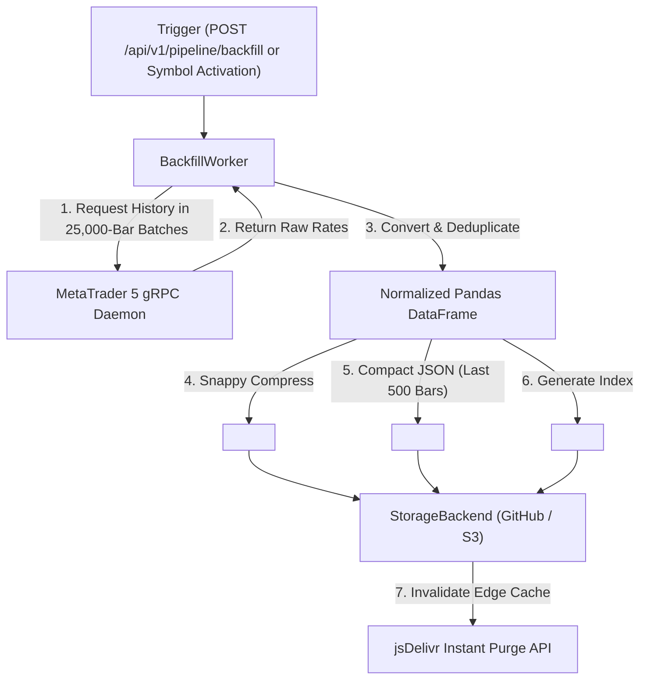

# Historical Ingestion & Backfill Pipeline Manual

This manual covers the automated historical data ingestion pipeline, batch chunking for large candle counts (100,000+ bars), Apache Parquet schemas, and public Multi-CDN distribution.

---

## 1. Pipeline Overview

The **BackfillWorker** synchronizes historical broker data, converts raw rates into analytics-ready formats, and publishes them to the configured storage backend (GitHub, S3/R2, or Local).



---

## 2. Batch Chunking for Large Ingestions (100,000+ Candles)

When requesting very large datasets ($100,000+$ bars), querying everything in a single call risks broker connection deadlines and memory pressure.

`BackfillWorker` automatically partitions requests into sequential chunks of 25,000 bars:
1. Paginates backwards (`start_pos = 0, 25000, 50000...`) until the target count is satisfied or the broker reaches the earliest available bar.
2. Combines all chunks into a unified DataFrame.
3. Removes duplicate timestamps and sorts strictly ascending by timestamp.
4. Merges idempotently with any existing Parquet file on disk/cloud.

---

## 3. Asset Discovery & Definition

Before triggering extraction, understand where assets originate and how they are classified:

1. **Broker Master Catalog (`GET /api/v1/symbols/broker`)**: Every asset symbol offered by the connected broker (e.g. Forex pairs, crypto indices, commodities).
2. **Active Market Watch (`GET /api/v1/symbols/active`)**: The subset of broker assets currently enabled in the MetaTrader 5 terminal for tick reception and real time processing.
3. **Gateway Startup Watchlist (`METABRIDGE5_SYMBOLS`)**: Configured in `.env` (e.g. `METABRIDGE5_SYMBOLS=EURUSD,GBPUSD,USDJPY`), which activates those assets upon container boot.

---

## 4. Triggering Historical Extraction

The `POST /api/v1/pipeline/backfill` endpoint supports extracting a single asset, a selected list of assets, or all available assets, across custom or default timeframes, bounded by relative days, bar counts, or ISO calendar ranges.

### A. Extract ALL Available Active Assets (Relative Days)

Extract the last 30 days of history for all active Market Watch assets across all standard timeframes:

```bash
curl -i -X POST http://localhost:8000/api/v1/pipeline/backfill \
  -H "X-API-Key: your_secret_api_key_here" \
  -H "Content-Type: application/json" \
  -d '{
    "all_symbols": true,
    "days": 30
  }'
```

### B. Extract ALL Broker Catalog Assets (Entire Broker Master List)

To extract history for every asset supported by the broker (e.g. 500+ pairs):

```bash
curl -i -X POST http://localhost:8000/api/v1/pipeline/backfill \
  -H "X-API-Key: your_secret_api_key_here" \
  -H "Content-Type: application/json" \
  -d '{
    "all_symbols": true,
    "source": "broker",
    "days": 90,
    "timeframes": ["H1", "D1"]
  }'
```

### C. Extract Multiple Targeted Assets & Specific Timeframes

```bash
curl -i -X POST http://localhost:8000/api/v1/pipeline/backfill \
  -H "X-API-Key: your_secret_api_key_here" \
  -H "Content-Type: application/json" \
  -d '{
    "symbols": ["EURUSD", "GBPUSD", "USDJPY"],
    "timeframes": ["M1", "M5", "H1", "D1"],
    "days": 60
  }'
```

### D. Single Asset Deep Backfill by Bar Count (100,000+ Bars)

```bash
curl -i -X POST http://localhost:8000/api/v1/pipeline/backfill \
  -H "X-API-Key: your_secret_api_key_here" \
  -H "Content-Type: application/json" \
  -d '{
    "symbol": "EURUSD",
    "timeframes": ["M1", "M5", "M15", "M30", "H1", "H4", "D1"],
    "candle_count": 100000
  }'
```

### E. Explicit Calendar Date Range Backfill (ISO 8601)

```bash
curl -i -X POST http://localhost:8000/api/v1/pipeline/backfill \
  -H "X-API-Key: your_secret_api_key_here" \
  -H "Content-Type: application/json" \
  -d '{
    "symbol": "EURUSD",
    "timeframes": ["H1", "H4", "D1"],
    "date_from": "2018-01-01T00:00:00Z",
    "date_to": "2026-08-26T00:00:00Z"
  }'
```

---

## 5. Inspecting Backfill Progress & Pipeline Status

```bash
curl -s -H "X-API-Key: your_secret_api_key_here" \
  "http://localhost:8000/api/v1/pipeline/status?symbol=EURUSD"
```

**Sample Status**:
```json
{
  "symbol": "EURUSD",
  "status": "completed",
  "started_at": 1787768485,
  "completed_at": 1787768520,
  "duration_ms": 35000.42,
  "timeframes": {
    "M1": {
      "candle_count": 100000,
      "start_time": 1781200000,
      "end_time": 1787779260,
      "parquet_uploaded": true,
      "json_uploaded": true,
      "parquet_url": "https://cdn.jsdelivr.net/gh/your_org/dataset@main/EURUSD/M1/history.parquet",
      "json_url": "https://cdn.jsdelivr.net/gh/your_org/dataset@main/EURUSD/M1/recent.json"
    }
  }
}
```

---

## 4. Data Assets & Storage Formats

### Directory Hierarchy in Storage Destination

```text
<SYMBOL>/
├── manifest.json                  # Asset metadata and timeframe index
├── M1/
│   ├── history.parquet            # Complete compressed historical partition
│   └── recent.json                # Latest 500 candles array
├── M5/
│   ├── history.parquet
│   └── recent.json
├── H1/
│   ├── history.parquet
│   └── recent.json
└── D1/
    ├── history.parquet
    └── recent.json
```

---

### Schema Specifications

#### 1. `history.parquet` (Apache Parquet Snappy)
* **Columns**:
  * `time`: `int64` (Unix epoch timestamp in seconds)
  * `open`: `float64`
  * `high`: `float64`
  * `low`: `float64`
  * `close`: `float64`
  * `tick_volume`: `int64`
* **Compression**: Snappy codec with byte-range query support for DuckDB / Polars.

#### 2. `recent.json` (Compact Array of Arrays)
```json
[
  [1787778000, 1.16534, 1.16534, 1.16527, 1.16529, 6],
  [1787781600, 1.16529, 1.16540, 1.16525, 1.16538, 14]
]
```
*Array Tuple*: `[timestamp_seconds, open, high, low, close, tick_volume]`

#### 3. `manifest.json` (Asset Metadata)
```json
{
  "symbol": "EURUSD",
  "updated_at": 1787768520,
  "timeframes": {
    "M1": {
      "candle_count": 100000,
      "start_time": 1781200000,
      "end_time": 1787779260,
      "parquet_url": "https://cdn.jsdelivr.net/gh/your_org/dataset@main/EURUSD/M1/history.parquet",
      "json_url": "https://cdn.jsdelivr.net/gh/your_org/dataset@main/EURUSD/M1/recent.json"
    }
  }
}
```

---

---

## 6. Streaming Sink Architecture (`StreamParquetSink`)

Adopted from the enterprise streaming sink patterns in `cifra-connectors`:
* **Chunked In-Memory Buffers**: Collects candle data in memory up to `metabridge5_PARQUET_BATCH_ROWS` (default: `25,000` rows).
* **Staged Chunk Creation**: Periodically writes flushed rows into local temporary Snappy Parquet chunks in `/tmp/metabridge5_sink_<symbol>_<tf>_*`.
* **Atomic Storage Upload**: Merges all chunks with existing cloud history and commits the complete Parquet and JSON files atomically in one storage operation.
* **Safe Error Abort**: If a network timeout or broker error occurs mid-stream, `sink.abort()` executes automatically to cleanly wipe local temporary staging files without corrupting existing datasets.

---

## 7. Granular Per-Symbol & Exclusionary Pipeline Ingestion Controls

Operators can dynamically control which symbols actively extract data and push to storage without stopping the container or closing real-time WebSocket feeds:

### A. Global Pause & Resume
```bash
# Globally pause all ingestion and storage pushes
curl -X POST http://localhost:8000/api/v1/pipeline/pause \
  -H "X-API-Key: your_secret_api_key_here"

# Globally resume all ingestion
curl -X POST http://localhost:8000/api/v1/pipeline/resume \
  -H "X-API-Key: your_secret_api_key_here"
```

### B. Per-Symbol Pause & Resume
```bash
# Pause ONLY EURUSD (other symbols continue ingesting)
curl -X POST "http://localhost:8000/api/v1/pipeline/pause?symbol=EURUSD" \
  -H "X-API-Key: your_secret_api_key_here"

# Resume ONLY EURUSD
curl -X POST "http://localhost:8000/api/v1/pipeline/resume?symbol=EURUSD" \
  -H "X-API-Key: your_secret_api_key_here"
```

### C. Bulk Exclusionary Control (Ingest ONLY Specific Symbols)
To ingest data for one or more specific symbols (e.g. `USDJPY`) and pause all other active watchlist symbols in a single call:

```bash
curl -X POST http://localhost:8000/api/v1/pipeline/control \
  -H "X-API-Key: your_secret_api_key_here" \
  -H "Content-Type: application/json" \
  -d '{
    "action": "pause",
    "scope": "exclude",
    "symbols": ["USDJPY"]
  }'
```

