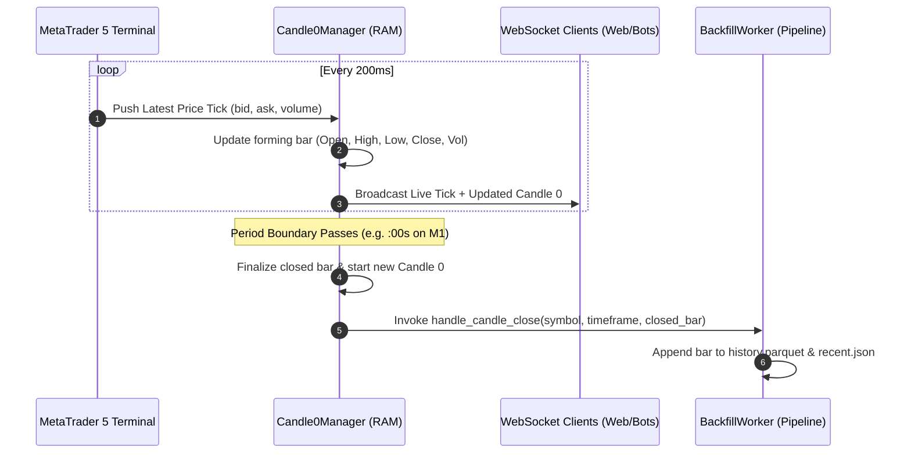

# Real-Time Streaming & In-Flight Candle 0 Engine

This guide covers the architecture, data models, REST endpoints, and WebSocket streaming protocols of the **Candle 0 Engine**.

---

## 1. What is Candle 0?

In financial market data, **Candle 0** is the currently forming, unfinished candle of the active time period. 

Most traditional data APIs only publish finalized historical bars (Candle 1, Candle 2, etc.), which creates a 1-minute to 1-hour lag in frontend charts. The MetaBridge5 Market Gateway eliminates this lag by polling sub-second ticks from MetaTrader 5 (every 200ms) and aggregating the live forming OHLCV bar across all 9 standard timeframes in memory.



---

## 2. In-Flight Candle 0 State Model

Every in-flight candle maintains:
* `time`: Unix epoch timestamp in seconds of the bar's start time (e.g., `1787779320`).
* `open`: The first price recorded at the start of the period.
* `high`: The highest price reached during the period.
* `low`: The lowest price reached during the period.
* `close`: The latest price recorded (updated on every tick).
* `tick_volume`: Cumulative tick count within the period.
* `bid`: Latest live bid price.
* `ask`: Latest live ask price.

---

## 3. REST Snapshot Endpoints

### A. Specific Timeframe Snapshot
Retrieve the active forming Candle 0 for a single timeframe:

```bash
curl -s -H "X-API-Key: your_secret_api_key_here" \
  "http://localhost:8000/api/v1/market/candle0?symbol=EURUSD&timeframe=M1"
```

**Response**:
```json
{
  "time": 1787779320,
  "open": 1.16527,
  "high": 1.16529,
  "low": 1.16527,
  "close": 1.16529,
  "tick_volume": 4,
  "last_tick_time": 1787779354,
  "bid": 1.16529,
  "ask": 1.16530
}
```

---

### B. All Timeframes Snapshot
Retrieve active Candle 0 states across all 9 timeframes (`M1`, `M5`, `M15`, `M30`, `H1`, `H4`, `D1`, `W1`, `MN1`) in a single call:

```bash
curl -s -H "X-API-Key: your_secret_api_key_here" \
  "http://localhost:8000/api/v1/market/candle0/all?symbol=EURUSD"
```

---

## 4. Live WebSocket Streaming (`WS /api/v1/market/ws/{symbol}`)

Connect via standard WebSockets to receive instant snapshots and sub-second live ticks:

```text
ws://localhost:8000/api/v1/market/ws/EURUSD
```

### 1. Immediate State Snapshot on Connect
As soon as a client connects and completes the WebSocket handshake (`ws.accept()`), the server immediately dispatches an initial state snapshot:

```json
{
  "type": "snapshot",
  "symbol": "EURUSD",
  "candle0": {
    "M1": [1787779320, 1.16527, 1.16529, 1.16527, 1.16529, 4, 1.16529, 1.1653],
    "M5": [1787779200, 1.16534, 1.16534, 1.16527, 1.16529, 8, 1.16529, 1.1653],
    "H1": [1787778000, 1.16534, 1.16534, 1.16527, 1.16529, 12, 1.16529, 1.1653]
  }
}
```

**Compact Candle Tuple Schema**:
```text
[time_epoch, open_price, high_price, low_price, close_price, tick_volume, bid_price, ask_price]
```

### 2. Live Tick Broadcast
On every incoming market tick from the terminal:

```json
{
  "type": "tick",
  "symbol": "EURUSD",
  "time": 1787779355,
  "bid": 1.16531,
  "ask": 1.16532,
  "last": 1.16531,
  "volume": 1,
  "candle0": {
    "M1": [1787779320, 1.16527, 1.16531, 1.16527, 1.16531, 5, 1.16531, 1.16532]
  }
}
```

---

## 5. Automated Rollover & Incremental Sync

When a period boundary elapses:
1. `Candle0Manager` finalizes the closed candle.
2. It resets the internal memory state with the new period's start time.
3. It asynchronously invokes the registered `handle_candle_close` callback on `BackfillWorker`.
4. `BackfillWorker` merges the closed bar into `recent.json` and `history.parquet` without requiring a full historical re-download.
