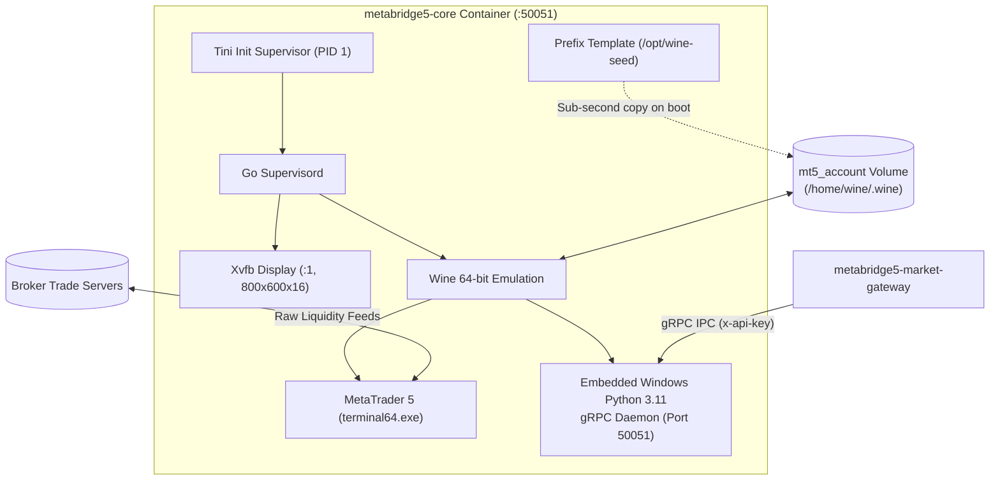
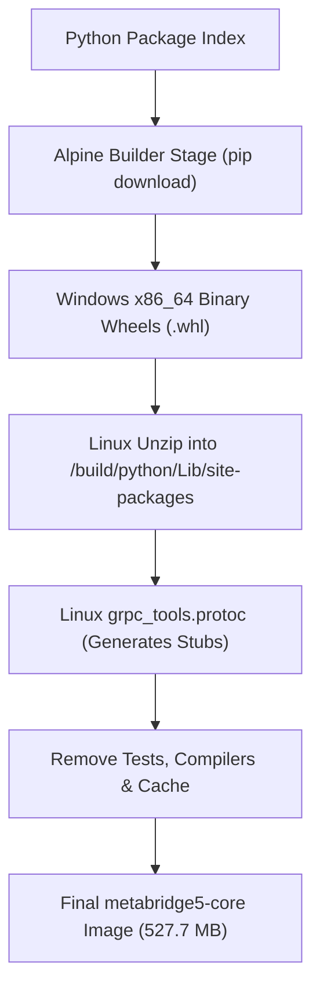
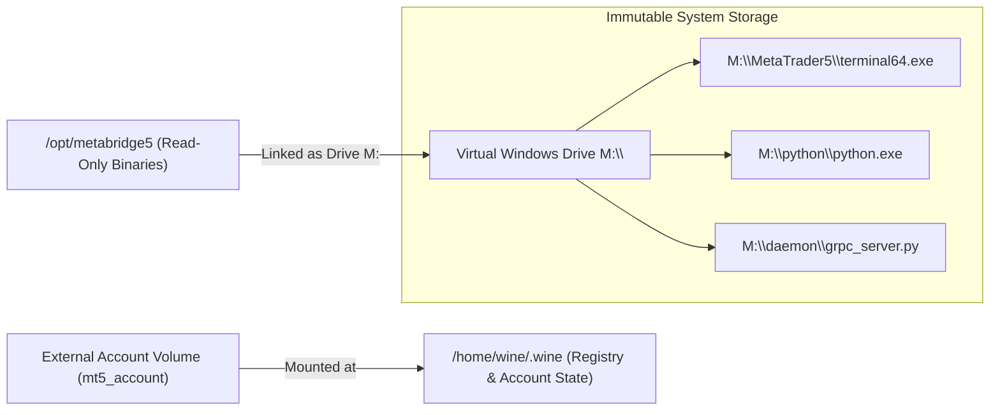
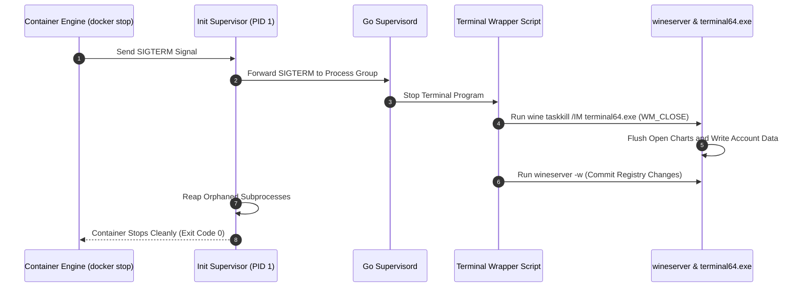

# MetaBridge5 Core Appliance (`metabridge5-core`)

The `metabridge5-core` container provides the headless Windows emulation foundation for MetaBridge5.
It isolates the MetaTrader 5 desktop client inside a minimal Wine runtime on Alpine Linux.
It exposes a thread-safe gRPC daemon on internal port 50051.
The container exposes no public HTTP routes and connects exclusively to the internal bridge network.



---

## 1. Native Wheel Extraction and Build Pruning

Building Windows container dependencies normally requires running Windows Python installers inside Wine during image builds.
That approach is slow and bloats image layers.
Instead, the builder stage downloads compiled Windows binary wheels directly on native Linux.
Standard decompression tools extract these archives into `/opt/metabridge5/python/Lib/site-packages`.



The build process generates protocol buffer stubs using native Linux tools before copying them to the Windows tree.
This prevents build tools, compilers, and temporary package caches from leaking into the final runtime image.
The final image contains only the pre-compiled Python files and the gRPC server script.

```dockerfile
FROM alpine:3.20 AS python-builder

RUN apk add --no-cache python3 py3-pip curl unzip && \
    pip install --no-cache-dir --break-system-packages grpcio-tools==1.62.2

RUN mkdir -p /tmp/wheels && \
    pip download --dest /tmp/wheels --only-binary=:all: \
        --platform win_amd64 --python-version 3.11 --implementation cp --abi cp311 \
        grpcio==1.62.2 protobuf==4.25.3 numpy==1.26.4 MetaTrader5 psutil==5.9.8 && \
    for whl in /tmp/wheels/*.whl; do unzip -q -o "$whl" -d /tmp/python/Lib/site-packages/; done
```

---

## 2. Isolated Immutable Binaries and Sub-Second Seed Deployment

Storing application binaries inside the default Wine prefix risks directory masking when operators mount external volumes.
The image isolates the MetaTrader 5 installation and the Windows Python runtime in `/opt/metabridge5`.
The container maps this directory into the virtual Windows environment as drive `M:`.
User account mounts over `/home/wine/.wine` never overwrite or mask application code.



Empty volumes cause cold-boot delays because standard Wine initialization runs slow configuration routines.
The image creates a pre-configured registry template inside `/opt/wine-seed` during the image build.
On startup, the entrypoint detects empty volumes and copies the seed template in 20 milliseconds.
This skips runtime configuration cycles and provides instant terminal boots.

```bash
#!/usr/bin/env bash
set -euo pipefail

WINE_PREFIX="${WINEPREFIX:-/home/wine/.wine}"
SEED_DIR="/opt/wine-seed"
APP_DIR="/opt/metabridge5"

if [ ! -f "${WINE_PREFIX}/system.reg" ]; then
    echo "[entrypoint] Blank volume detected. Initializing from seed template..."
    cp -a "${SEED_DIR}/." "${WINE_PREFIX}/"
    mkdir -p "${WINE_PREFIX}/dosdevices"
    ln -sfn "${APP_DIR}" "${WINE_PREFIX}/dosdevices/m:"
    rm -f "${WINE_PREFIX}/dosdevices/z:"
    echo "[entrypoint] Seed deployment completed in sub-second time."
fi
```

---

## 3. Process Reaping and Graceful Terminal Shutdown

Windows programs running under Wine can leave orphaned processes when terminating.
The container runs Tini as PID 1 to reap zombie processes and forward operating system signals.
When stopping the container, a shutdown trap intercepts the termination signal.
The trap issues a standard `WM_CLOSE` message to `terminal64.exe` using `wine taskkill`.



The graceful shutdown sequence gives the terminal time to write open databases and flush registry hives.
Supervisord waits up to 20 seconds for the terminal process to halt.
If the terminal stops cleanly, the wrapper calls `wineserver -w` to sync files to disk.

---

## 4. Operational Configuration

### Docker Compose Service Definition

```yaml
services:
  core:
    build:
      context: .
      dockerfile: docker/Dockerfile.core
    image: metabridge5-core:latest
    container_name: metabridge5-core
    restart: unless-stopped
    stop_grace_period: 45s
    ports:
      - "127.0.0.1:5900:5900"   # VNC Remote Desktop (loopback only)
    environment:
      - METABRIDGE5_API_KEY=dev_metabridge5_secret_key_123
      - VNC_PASSWORD=metabridge5pass
      - START_VNC=false
      - TZ=UTC
      - WINEDEBUG=-all
    volumes:
      - mt5_account:/home/wine/.wine
    networks:
      - metabridge5
    healthcheck:
      test: ["CMD", "/opt/metabridge5/healthcheck.sh"]
      interval: 15s
      timeout: 5s
      retries: 3
      start_period: 60s
```

### Environment Variables

| Variable | Default | Purpose |
|---|---|---|
| `METABRIDGE5_API_KEY` | `dev_metabridge5_secret_key_123` | Authentication key required for incoming gRPC metadata calls. |
| `START_VNC` | `false` | Enables x11vnc server on port 5900 for manual broker login setup. |
| `VNC_PASSWORD` | `metabridge5pass` | Access password for the VNC remote desktop session. |
| `TZ` | `UTC` | Sets container timezone for consistent log timestamps. |
| `WINEDEBUG` | `-all` | Disables noisy Wine debug log channels. |

### Network and Port Security

Port 50051 binds inside the container network only.
The service does not publish port 50051 to the host.
Other containers on network `metabridge5_net` communicate with core using the internal DNS hostname `core:50051`.
Port 5900 binds strictly to host loopback `127.0.0.1:5900`.
This prevents unauthorized desktop access across public network interfaces.

### Healthcheck Script

The container includes a native health verification probe at `/opt/metabridge5/healthcheck.sh`.
It verifies two conditions:
1. It verifies that port 50051 accepts TCP socket connections on localhost.
2. It verifies that `terminal64.exe` runs inside the active process table.

If either check fails, the probe exits with status code 1.

---

## 5. Build and Test Commands

Build the core image using the project Makefile:

```bash
make build-core
```

Verify image size against the hard 530 MB budget:

```bash
make size-check
```
