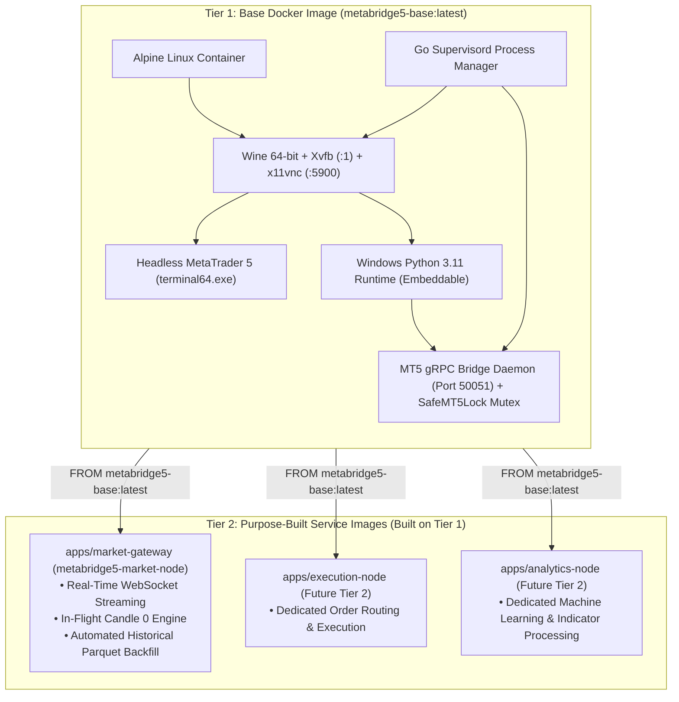
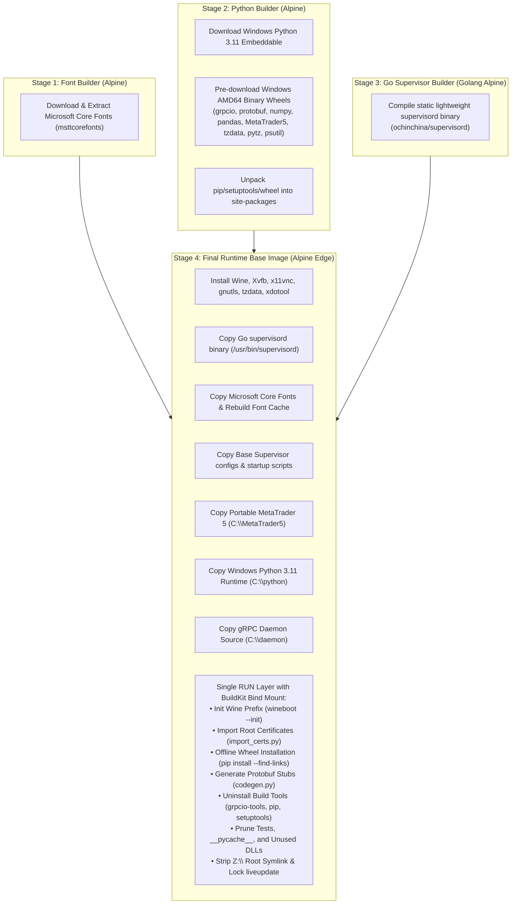

# metabridge5 Base Docker Image (`metabridge5-base`)

The **MetaBridge5 Base Image** is the **Tier 1 Base Docker Image** of this codebase. It provides the unique foundational container environment for running MetaTrader 5 inside Wine and exposes a thread-safe **MT5 gRPC Bridge Daemon** on port `50051`.

> [!IMPORTANT]
> **Foundation Layer — Zero Application Code**:
> This base image contains **no business logic or application code**. It is the shared base layer used to build any Tier 2 specialized service images (such as `metabridge5-market-node`).

---

## 1. Role in the Two-Tier Image Architecture



### Deployment Model: Isolated Server Per Tier 2 Image
Each Tier 2 image is built on top of `metabridge5-base` and is deployed into **its own dedicated, isolated server**:
- **Independent Lifecycles**: Redeploying or modifying a Tier 2 image does not rebuild or impact other images.
- **Isolated MT5 Instances**: Each deployed server runs its own containerized MT5 terminal session connected to its specific broker account.
- **Zero Resource Contention**: Each server dedicates its RAM and CPU entirely to that specific service's workload.

---

## 2. Multi-Stage Build Pipeline

[`docker/Dockerfile.base`](docker/Dockerfile.base) uses a 4-stage build to produce a minimal, self-contained base image:



---

## 3. Directory Layout

```
docker/
├── Dockerfile.base         # Multi-stage base image definition
├── README.md               # This documentation
├── import_certs.py         # Injects system root certificates into Wine CryptoAPI
├── supervisord.conf        # Base supervisor configuration (starts Xvfb, VNC, MT5, gRPC)
│
├── daemon/                 # Minimal MT5 gRPC Bridge (runs under Wine Python on port 50051)
│   ├── protos/
│   │   └── terminal.proto  # Canonical MT5 Protobuf Schema (Ticks, Rates, Account, Orders)
│   ├── grpc_server.py      # Thread-safe gRPC server implementation with SafeMT5Lock
│   ├── codegen.py          # Generates Python protobuf stubs (terminal_pb2*.py)
│   ├── terminal_pb2.py     # Generated protobuf message classes
│   ├── terminal_pb2_grpc.py# Generated protobuf gRPC client/server stubs
│   └── test_client.py      # Host verification script for gRPC daemon
│
└── supervisord/            # Base startup and lifecycle scripts
    ├── entrypoint.sh       # Container entrypoint
    ├── startup_guard.sh    # Pre-boot environment validator
    └── vnc_passwd_setup.sh # Configures VNC authentication for GUI access
```

---

## 4. Security & Optimization Features

1. **Non-Root Execution**: Runs under the dedicated unprivileged user `wine` (UID `1000`).
2. **Filesystem Traversal Insulation (`Z:\` Drive Deletion)**: Wine automatically creates a symlink `Z:\ -> /` pointing to the Linux root filesystem. This symlink is **permanently deleted during build** to prevent sandbox escapes from the Wine layer.
3. **Disabled LiveUpdate**: MetaTrader 5 `liveupdate` directories in the installation and `AppData` paths are locked to read-only files (`chmod 444`), preventing unmanaged in-flight updates in production.
4. **No Build-Tool Leaks**: `pip`, `setuptools`, `wheel`, and `grpcio-tools` are uninstalled and deleted from the image after compile time.
5. **No Linux Python Supervisor Overhead**: Compiling the Go-based `supervisord` binary avoids installing standard Linux `python3` and `setuptools` just for process management (saving ~45 MB).
6. **Zero Bytecode Write Bloat**: Configured with `ENV PYTHONDONTWRITEBYTECODE=1` and `WINEDEBUG=-all`.

---

## 5. How to Create New Tier 2 Images On Top of This Base

To build a new specialized Tier 2 service image, create a folder under `apps/<image-name>/`:

### A. Dockerfile Pattern
```dockerfile
# 1. Inherit from the base image
FROM metabridge5-base:latest

USER root

# 2. Install native Linux runtime dependencies
RUN apk add --no-cache python3 py3-pip
COPY --from=ghcr.io/astral-sh/uv:latest /uv /usr/bin/

# 3. Install application dependencies
COPY pyproject.toml /tmp/
RUN uv pip install --system --break-system-packages --no-cache -r /tmp/pyproject.toml && \
    rm -f /tmp/pyproject.toml

# 4. Copy application source code (real directories, no symlinks)
COPY --chown=wine:wine app/ /home/wine/app/<image-name>/app/

# 5. Drop application supervisor configuration into /etc/supervisor/conf.d/
COPY --chown=wine:wine supervisord.conf /etc/supervisor/conf.d/<image-name>.conf

USER wine
# Entrypoint is inherited: /usr/bin/supervisord -c /etc/supervisord.conf
```

### B. Supervisord Drop-in Configuration (`supervisord.conf`)

The base `supervisord.conf` automatically includes all `.conf` files located in `/etc/supervisor/conf.d/*.conf`:

```ini
[program:<image-name>]
command=python3 -u /home/wine/app/<image-name>/app/main.py
priority=6
autorestart=true
directory=/home/wine/app/<image-name>
environment=MT5_GRPC_SERVER="127.0.0.1:50051"
stdout_logfile=/dev/stdout
stdout_logfile_maxbytes=0
stderr_logfile=/dev/stderr
stderr_logfile_maxbytes=0
```

---

## 6. Building the Base Image

```bash
make build-base
# Or directly:
docker build -f docker/Dockerfile.base -t metabridge5-base:latest .
```
