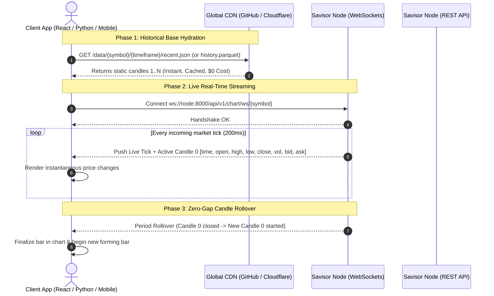

# Savisor Client API & Integration Guide

The **Savisor Autonomous Node** provides a high-performance **Hybrid CDN + WebSocket Architecture** designed to support external applications—such as web charting frontends (TradingView / Lightweight Charts), algorithmic trading bots, quantitative machine learning pipelines, and mobile apps—with ultra-low latency and zero cloud egress cost.

---

## 1. Core Architectural Pattern for Clients



---

## 2. Client Use Case Implementations

### Use Case 1: React / TypeScript Frontend Charting (TradingView Lightweight Charts)

This recipe demonstrates how a browser charting interface loads historical candles from the free CDN and stitches real-time updates seamlessly.

```typescript
import { createChart, IChartApi, ISeriesApi } from 'lightweight-charts';

interface Candle0Payload {
  type: string;
  symbol: string;
  time: number;
  bid: number;
  ask: number;
  last: number;
  volume: number;
  candle0: Record<string, [number, number, number, number, number, number, number, number]>;
}

export async function initChart(container: HTMLElement, symbol = 'EURUSD', timeframe = 'H1') {
  // 1. Initialize Lightweight Chart
  const chart: IChartApi = createChart(container, { width: 800, height: 500 });
  const candleSeries = chart.addCandlestickSeries();

  // 2. Fetch Historical Base from Free GitHub / Cloudflare CDN
  const cdnUrl = `https://raw.githubusercontent.com/your-org/market-data/main/data/${symbol}/${timeframe}/recent.json`;
  const res = await fetch(cdnUrl);
  // Compact Array Format: [[time, open, high, low, close, volume], ...]
  const rawCandles: [number, number, number, number, number, number][] = await res.json();

  const formattedCandles = rawCandles.map(([time, open, high, low, close]) => ({
    time: time as any,
    open,
    high,
    low,
    close,
  }));
  candleSeries.setData(formattedCandles);

  // 3. Connect to Real-Time WebSocket for Live Candle 0 Updates
  const ws = new WebSocket(`ws://localhost:8000/api/v1/chart/ws/${symbol}`);

  ws.onmessage = (event) => {
    const data: Candle0Payload = JSON.parse(event.data);
    if (data.candle0 && data.candle0[timeframe]) {
      // Candle 0 format: [time, open, high, low, close, volume, bid, ask]
      const [cTime, cOpen, cHigh, cLow, cClose] = data.candle0[timeframe];
      
      // Update chart in real time (stitches onto historical base)
      candleSeries.update({
        time: cTime as any,
        open: cOpen,
        high: cHigh,
        low: cLow,
        close: cClose,
      });
    }
  };

  ws.onerror = (err) => console.error('WebSocket error:', err);
  return { chart, ws };
}
```

---

### Use Case 2: Python Algorithmic Trading Bot & Indicator Warmup

This recipe demonstrates how an automated trading bot warms up historical indicators (EMA, RSI, ATR) using Parquet datasets from the CDN and connects to the sub-second tick stream for execution signals.

```python
import asyncio
import json
import websockets
import pandas as pd

CDN_BASE_URL = "https://raw.githubusercontent.com/your-org/market-data/main"
NODE_WS_URL = "ws://localhost:8000/api/v1/chart/ws"

async def run_trading_agent(symbol="EURUSD", timeframe="M5"):
    # 1. Warm up indicators using historical Parquet dataset from CDN
    parquet_url = f"{CDN_BASE_URL}/data/{symbol}/{timeframe}/history.parquet"
    print(f"Hydrating historical indicators from {parquet_url}...")
    df = pd.read_parquet(parquet_url)
    
    # Calculate 50 EMA and 200 EMA
    df["ema_50"] = df["close"].ewm(span=50, adjust=False).mean()
    df["ema_200"] = df["close"].ewm(span=200, adjust=False).mean()
    print(f"Warmed up with {len(df)} candles. Latest 50 EMA: {df['ema_50'].iloc[-1]:.5f}")

    # 2. Connect to Real-Time WebSocket for Live Signals
    ws_endpoint = f"{NODE_WS_URL}/{symbol}"
    print(f"Connecting to live tick stream at {ws_endpoint}...")
    
    async with websockets.connect(ws_endpoint) as ws:
        while True:
            msg = await ws.recv()
            payload = json.loads(msg)
            
            # Extract live Candle 0 for the active timeframe
            c0 = payload.get("candle0", {}).get(timeframe)
            if c0:
                # [time, open, high, low, close, volume, bid, ask]
                c_time, c_open, c_high, c_low, c_close, c_vol, bid, ask = c0
                
                # Check real-time strategy condition
                spread = round((ask - bid) * 10000, 1)
                print(f"[{symbol} {timeframe}] Live Close: {c_close:.5f} | Spread: {spread} pips | Tick Vol: {c_vol}")

if __name__ == "__main__":
    asyncio.run(run_trading_agent("EURUSD", "M5"))
```

---

### Use Case 3: Machine Learning & Quantitative Data Ingestion (DuckDB / Polars)

Quantitative research teams can stream multi-asset Parquet datasets directly into Polars or DuckDB without running the node server.

```python
import duckdb

# Query historical datasets across multiple assets directly from CDN
query = """
SELECT 
    time,
    open,
    high,
    low,
    close,
    tick_volume
FROM read_parquet('https://raw.githubusercontent.com/your-org/market-data/main/data/EURUSD/H1/history.parquet')
WHERE time >= 1700000000
ORDER BY time ASC;
"""

df = duckdb.query(query).to_df()
print(df.head())
```

---

## 3. Complete REST API Reference

### Global Authentication Header
Protected endpoints require the `X-API-Key` header:
```http
X-API-Key: dev_savisor_secret_key_123
```

---

### A. Real-Time Candle 0 Endpoints

#### `GET /api/v1/chart/candle0`
Returns the instantaneous in-flight Candle 0 state for a single timeframe.

* **Query Parameters**:
  * `symbol` (string, required): e.g. `EURUSD`
  * `timeframe` (string, optional): e.g. `M1`, `M5`, `H1`, `D1` (default: `M1`)
* **Headers**: `X-API-Key: <key>`
* **Response (200 OK)**:
  ```json
  {
    "time": 1774329600,
    "open": 1.0825,
    "high": 1.0831,
    "low": 1.0822,
    "close": 1.0829,
    "tick_volume": 42,
    "last_tick_time": 1774329624,
    "bid": 1.0829,
    "ask": 1.083
  }
  ```

#### `GET /api/v1/chart/candle0/all`
Returns active Candle 0 states across all supported timeframes (`M1` through `MN1`).

* **Query Parameters**: `symbol` (string, required)
* **Response (200 OK)**:
  ```json
  {
    "M1": { "time": 1774329600, "open": 1.0825, "high": 1.0831, "low": 1.0822, "close": 1.0829, "tick_volume": 42 },
    "M5": { "time": 1774329300, "open": 1.0818, "high": 1.0831, "low": 1.0815, "close": 1.0829, "tick_volume": 184 },
    "H1": { "time": 1774327200, "open": 1.0802, "high": 1.0835, "low": 1.0798, "close": 1.0829, "tick_volume": 1420 }
  }
  ```

---

### B. WebSocket Live Stream (`WS /api/v1/chart/ws/{symbol}`)

* **Endpoint**: `ws://{host}:8000/api/v1/chart/ws/{symbol}`
* **Protocol**: Real-time JSON broadcast pushed on price ticks (de-duplicated at 200ms).
* **Payload Schema**:
  ```json
  {
    "type": "tick",
    "symbol": "EURUSD",
    "time": 1774329625,
    "bid": 1.0829,
    "ask": 1.0830,
    "last": 1.08295,
    "volume": 2,
    "candle0": {
      "M1": [1774329600, 1.0825, 1.0831, 1.0822, 1.0829, 44, 1.0829, 1.0830],
      "M5": [1774329300, 1.0818, 1.0831, 1.0815, 1.0829, 186, 1.0829, 1.0830],
      "H1": [1774327200, 1.0802, 1.0835, 1.0798, 1.0829, 1422, 1.0829, 1.0830]
    }
  }
  ```
* **Candle 0 Array Structure**:
  `[0: bucket_time, 1: open, 2: high, 3: low, 4: close, 5: tick_volume, 6: bid, 7: ask]`

---

### C. Data Pipeline & Backfill Management

#### `POST /api/v1/pipeline/backfill`
Triggers an on-demand historical backfill and pushes datasets to the configured storage backend.

* **Headers**: `X-API-Key: <key>`, `Content-Type: application/json`
* **Request Body**:
  ```json
  {
    "symbol": "EURUSD",
    "timeframes": ["M1", "M5", "M15", "H1", "D1"],
    "candle_count": 10000
  }
  ```
* **Response (200 OK)**:
  ```json
  {
    "status": "triggered",
    "symbol": "EURUSD",
    "message": "Deep historical backfill queued for EURUSD"
  }
  ```

#### `GET /api/v1/pipeline/status`
Inspects the progress of active and completed backfills.

* **Response (200 OK)**:
  ```json
  {
    "EURUSD": {
      "symbol": "EURUSD",
      "status": "completed",
      "started_at": 1774329000,
      "completed_at": 1774329004,
      "duration_ms": 4210.5,
      "timeframes": {
        "H1": {
          "candle_count": 10000,
          "start_time": 1738320000,
          "end_time": 1774327200,
          "parquet_uploaded": true,
          "json_uploaded": true,
          "parquet_url": "https://raw.githubusercontent.com/org/market-data/main/data/EURUSD/H1/history.parquet",
          "json_url": "https://raw.githubusercontent.com/org/market-data/main/data/EURUSD/H1/recent.json"
        }
      }
    }
  }
  ```

---

### D. Telemetry & Audit Logs Query

#### `GET /api/v1/telemetry/traces`
Queries structured audit traces from the internal SQLite WAL database.

* **Query Parameters**:
  * `limit` (int, default: 50, max: 500)
  * `symbol` (string, optional)
  * `event` (string, optional, e.g. `backfill_completed`, `candle_closed_rollup`)
  * `component` (string, optional, e.g. `pipeline`, `gateway`)
* **Headers**: `X-API-Key: <key>`
* **Response (200 OK)**:
  ```json
  {
    "sink": "SQLiteAuditSink",
    "count": 2,
    "traces": [
      {
        "id": "7bf3b028-090c-4395-8854-1b48981df55f",
        "timestamp": 1774329004,
        "trace_id": "a9c18f02",
        "component": "pipeline",
        "event": "backfill_completed",
        "symbol": "EURUSD",
        "status": "success",
        "duration_ms": 4210.5,
        "metadata": { "timeframes_synced": ["M1", "M5", "H1"] }
      }
    ]
  }
  ```

---

### E. Health & Monitoring

| Endpoint | Method | Security | Description |
|---|---|---|---|
| `/health` | `GET` | Public | Liveness probe (verifies FastAPI + MT5 daemon) |
| `/ready` | `GET` | Public | Readiness probe (verifies broker connectivity + storage) |
| `/metrics` | `GET` | Public | Prometheus scrape target (`ticks_total`, `ws_conns`, etc.) |
