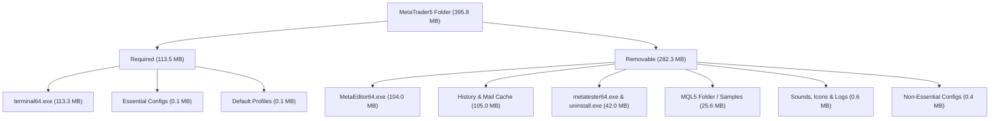

# MetaTrader 5 Optimization & Cleanup Report

This report analyzes the files in the [MetaTrader5](file://MetaTrader5) folder of the `metabridge5-node` repository. It details which files and directories can be safely removed to optimize the base Docker container while retaining full functionality for reading market data and executing trade operations via the Python `MetaTrader5` API.

---

## Executive Summary

A standard MetaTrader 5 (MT5) installation contains graphical user interface assets, compilation utilities, strategy testing agents, and sample scripts. In a headless Linux container running MT5 inside Wine for automated Python scripts, these extra components are completely redundant.

Removing them reduces disk footprint and improves build efficiency:

- **Disk footprint reduction**: Saves **282.31 MB** (a **71.3% reduction** in folder size).
- **Workspace file clutter**: Reduces the number of files from **1,220** to **32** (a **97.4% reduction**).

| Metrics         |         Original          |         Optimized         |          Saving           |
| :-------------- | :-----------------------: | :-----------------------: | :-----------------------: |
| **Folder Size** | 395.79 MB (415,012,787 B) | 113.47 MB (118,985,328 B) |  **-282.31 MB (-71.3%)**  |
| **File Count**  |        1,220 files        |         32 files          | **-1,188 files (-97.4%)** |

> [!NOTE]
> The Python `MetaTrader5` package establishes a direct inter-process communication (IPC) channel with `terminal64.exe` inside Wine. It does not require `MetaEditor64.exe` (MQL5 compiler), `.mq5`/`.mqh` files, or `metatester64.exe` (strategy tester) to query ticks, get history, or place trade orders.

---

## Developer Setup Workflow

To generate a new optimized `MetaTrader5` folder from scratch (e.g., when upgrading the MT5 terminal version or setting up a new host):

1. **Initialize Portable Mode**: Install MetaTrader 5 on a Windows desktop environment or Wine instance, then start the terminal with the `/portable` switch:
   ```cmd
   C:\MetaTrader5\terminal64.exe /portable
   ```
2. **Connect to Broker**: Log in to your broker trade account inside the GUI. This downloads the broker's server list and generates the crucial configuration settings.
3. **Purge Local Credentials**: Close the terminal and delete the host-specific credentials and license files to avoid connection conflicts or credential leakage when sharing the directory:
   ```cmd
   del C:\MetaTrader5\Config\terminal.lic
   del C:\MetaTrader5\Config\accounts.dat
   ```
4. **Import to Workspace**: Copy the trimmed `C:\MetaTrader5` folder to the root of this project as `MetaTrader5/`.
5. **Execute Pruning**: Run the cleanup instructions in the **Actionable Clean-up Procedures** section to reduce file size and file count.

---

## Required Files

These are the only files required to run the terminal in portable mode, connect to your broker, and support API connections:

- **[terminal64.exe](file://MetaTrader5/terminal64.exe)** (113.34 MB / 118,840,992 B): The core MT5 terminal executable.
- **[origin.txt](file://MetaTrader5/origin.txt)** (30 B): A system indicator file generated during installation.
- **[Config/](file://MetaTrader5/Config)**: Essential configurations:
  - `common.ini` (590 B) & `settings.ini` (5,908 B) & `terminal.ini` (16,984 B): System settings for startup and expert advisor permissions.
  - `servers.dat` (41,440 B): List of broker trade servers.
- **[Profiles/](file://MetaTrader5/Profiles)** (0.08 MB / 79,384 B): Default chart profiles (`.chr`/`.wnd` files). Although no GUI chart is displayed inside a headless display server, keeping these avoids warnings and startup lag in the logs.

---

## Removable Files and Folders

The following table summarizes the files and folders that can be safely deleted:

| Component        | Target Path              |   Size    | Description / Reason for Removal                                          |
| :--------------- | :----------------------- | :-------: | :------------------------------------------------------------------------ |
| **Executables**  | `MetaEditor64.exe`       | 104.03 MB | MQL5 editor/compiler. Not needed since all logic is in Python.            |
| **Executables**  | `metatester64.exe`       | 20.24 MB  | Strategy Tester agent. The base node is for live trading/data.            |
| **Executables**  | `uninstall.exe`          | 21.73 MB  | Uninstaller. Redundant inside a Docker container.                         |
| **Data Cache**   | `Bases/Default/History/` | 98.71 MB  | Pre-cached `.hcc` history files. MT5 downloads history dynamically.       |
| **Data Cache**   | `Bases/Default/Mail/`    |  6.25 MB  | **527 `.welcome` files** representing welcome mail in all languages.      |
| **Data Cache**   | `Bases/Default/Symbols/` |  4.66 MB  | Broker symbol list (`symbols-0.dat`). Re-downloaded on server connection. |
| **MQL5 Files**   | `MQL5/`                  | 25.56 MB  | Examples, includes (`Include/`), scripts, and default expert advisors.    |
| **GUI Assets**   | `Sounds/`                |  0.17 MB  | Audio `.wav` alerts. Useless on headless systems.                         |
| **GUI Assets**   | `Terminal.ico`           |  0.39 MB  | Shortcut icon file.                                                       |
| **Config Cache** | `Config/dnsperf.dat`     |  0.36 MB  | Connection benchmark cache. Re-generated at runtime.                      |
| **Config Cache** | `Config/agents.dat`      |  0.03 MB  | Strategy tester agents list. Not utilized.                                |
| **Config Cache** | `Config/terminal.lic`    |  0.03 MB  | License verification caches.                                              |
| **Logs**         | `logs/`                  |  0.08 MB  | Host log files.                                                           |



---

## Docker Image Layer Optimization

The current configuration in [docker/Dockerfile.base](file://docker/Dockerfile.base#L93-L105) contains an efficiency issue. It copies the entire `MetaTrader5/` directory and subsequently runs a clean-up command:

```dockerfile
# Copy portable MetaTrader 5 from host and strip unused binaries to save space
COPY --chown=wine:wine MetaTrader5/ /home/wine/.wine/drive_c/MetaTrader5/
RUN rm -f /home/wine/.wine/drive_c/MetaTrader5/MetaEditor64.exe \
           /home/wine/.wine/drive_c/MetaTrader5/metatester64.exe \
           /home/wine/.wine/drive_c/MetaTrader5/uninstall.exe && \
    rm -rf /home/wine/.wine/drive_c/MetaTrader5/Sounds
```

### The Layering Bug

In Docker, image layers are additive and immutable. When the `COPY` instruction runs, the entire 396 MB folder is committed to the image layer history. While the subsequent `RUN rm` command hides these files from the final container view, the space remains permanently occupied inside the layer history.

As a result:

1. The built Docker image remains bloated by **~146 MB of hidden files**.
2. Build times are slower because 396 MB of build context is transferred to the Docker daemon.

### Recommended Fix

To optimize both the Docker build speed and the image size:

1. **Host-Side Clean-up**: Delete redundant files directly from the repository host.
2. **Exclude Cache in `.dockerignore`**: Add the dynamic cache paths (like history and mail) to `.dockerignore` so they are never copied into the build context.

---

## Actionable Clean-up Procedures

### 1. Repository Host Cleanup

Run the following script from the project root to prune unnecessary assets from the host workspace:

```bash
#!/bin/bash
# Remove redundant executables and assets
rm -f MetaTrader5/MetaEditor64.exe \
     MetaTrader5/metatester64.exe \
     MetaTrader5/uninstall.exe \
     MetaTrader5/Terminal.ico

# Remove sound files
rm -rf MetaTrader5/Sounds

# Empty cached historical tick/bar data and logs
rm -rf MetaTrader5/Bases/*
rm -rf MetaTrader5/logs/*

# Empty MQL5 default samples (keep empty directories to avoid startup warnings)
rm -rf MetaTrader5/MQL5/*
mkdir -p MetaTrader5/MQL5/Experts \
         MetaTrader5/MQL5/Indicators \
         MetaTrader5/MQL5/Scripts \
         MetaTrader5/MQL5/Include

# Prune redundant local caches and licenses
rm -f MetaTrader5/Config/dnsperf.dat \
     MetaTrader5/Config/agents.dat \
     MetaTrader5/Config/terminal.lic
```

### 2. Configure `.dockerignore`

Create a `.dockerignore` file in the project root to block runtime cache files from entering the Docker build context:

```ini
# Git metadata
.git
.gitignore

# Compilation caches
.mypy_cache
.pytest_cache
.ruff_cache

# Local Python Environments
.venv
venv

# MetaTrader 5 Runtime Caches
MetaTrader5/Bases/Default/History
MetaTrader5/Bases/Default/Mail
MetaTrader5/Bases/Default/Symbols
MetaTrader5/logs
```
